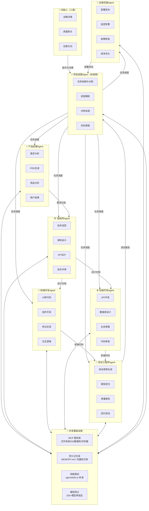
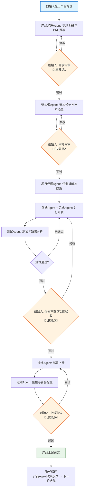
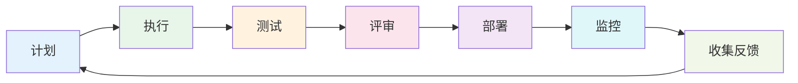

# 一人公司架构设计（基于 Hermes Agent 范式）

## 1.1 一人公司核心理念

### 1.1.1 什么是一人公司

一人公司（One Person Company, OPC）是指由单个创始人运营、不依赖传统雇佣关系的企业形态。它不是"个体户"的简单升级，而是一种全新的组织范式——创始人从"亲自做所有事"转变为"指挥一个AI团队做所有事"。

传统的个体创业者出售的是自己的时间——设计师靠接单画图、咨询师靠出卖知识、程序员靠外包写代码，本质上都是用体力换钱。AI时代的一人公司则不同：创始人是指挥官，而他的"员工"是一个个AI智能体——产品Agent、开发Agent、测试Agent、运维Agent、营销Agent……这些AI Agent 7×24小时工作，不知疲倦，不需要工资，只需要电费和token费用 [(火山引擎开发者社区)](https://developer.volcengine.com/articles/7582490934542893098)。

一人公司的崛起有坚实的数据支撑：
- 全国超**1200万**个体创业者选择OPC模式 [(科技日报)](http://www.ce.cn/xwzx/gnsz/gdxw/202605/t20260508_2952413.shtml)
- 2025年上半年新注册企业中一人公司占比同比增长**47%** [(中国税务报)](https://shenzhen.chinatax.gov.cn/sshzqswj/gzdt/202607/a2b1c375c5af48cbb21f44158df3d7d8.shtml)
- 全球范围内，独立创始人创立的公司占比从2019年的23.7%跃升至2025年上半年的**36.3%** [(中国税务报 / Carta)](https://shenzhen.chinatax.gov.cn/sshzqswj/gzdt/202607/a2b1c375c5af48cbb21f44158df3d7d8.shtml)
- 截至2026年5月，全国OPC社区及相关载体达**426处**，覆盖26个省级行政区、65个城市 [(中国税务报)](https://shenzhen.chinatax.gov.cn/sshzqswj/gzdt/202607/a2b1c375c5af48cbb21f44158df3d7d8.shtml)

### 1.1.2 AI Agent 如何替代/增强各角色

一人公司能够运转的核心前提是：AI Agent已经具备了在特定范围内替代或增强传统软件团队各个角色的能力。基于第一层的研究结论，我们对各角色的AI替代程度进行评估：

| 角色 | AI可替代程度 | AI核心价值 | 人类保留职责 |
|------|------------|-----------|-------------|
| 产品经理 | 60-70% | 需求文档生成、竞品分析、用户反馈整理 | 产品愿景、战略决策、用户洞察 |
| 架构师 | 30-40% | 技术选型调研、方案对比、文档生成 | 架构决策、系统设计、技术风险判断 |
| 前端开发 | 70-80% | UI转代码、组件实现、样式调整 | 交互设计、性能优化、复杂动画 |
| 后端开发 | 60-70% | API生成、CRUD实现、数据库操作 | 业务逻辑设计、架构一致性、性能调优 |
| 测试工程师 | 75-85% | 测试用例生成、缺陷定位、回归测试 | 测试策略、验收标准、质量判断 |
| 运维工程师 | 50-60% | 监控告警、日志分析、自动修复建议 | 故障决策、架构演进、安全策略 |
| 项目经理 | 65-75% | 任务拆解、进度跟踪、风险预警 | 优先级决策、冲突解决、利益相关方管理 |
| 营销/运营 | 55-65% | 内容生成、社媒发布、数据分析 | 品牌定位、营销策略、创意方向 |

这个评估与AIDev数据集的发现一致：AI在标准化、结构化的任务上表现出色（文档PR接受率88.6%），但在需要深度理解和创造性判断的任务上仍需人类主导 [(Queen's University)](https://www.alphaxiv.org/overview/2507.15003v1)。

### 1.1.3 效率对比与成本分析

**传统软件团队 vs 一人公司（AI Agent团队）的对比**

| 维度 | 传统10人团队 | 一人公司（创始人+AI Agent） | 倍数关系 |
|------|------------|--------------------------|---------|
| 人力成本（月） | ¥30-50万（含社保等） | ¥0.3-1万（API费用+工具订阅） | 30-100倍成本降低 |
| 工作时间 | 8小时/天，5天/周 | 24小时/天，7天/周 | 4.2倍时间产出 |
| 上手速度 | 1-3个月招聘+培训 | 1-2周配置+调试 | 4-8倍速度 |
| 沟通成本 | 高（会议、对齐、协调） | 低（统一指令、自动协同） | 5-10倍减少 |
| 管理成本 | 高（绩效、招聘、留人） | 低（只需管理自己） | 大幅降低 |
| 创意与战略 | 强（多人头脑风暴） | 中等（依赖创始人） | 视创始人能力而定 |
| 复杂系统设计 | 强（专业分工） | 弱（AI能力边界） | 需要人类深度参与 |
| 质量可靠性 | 可控（经验丰富团队） | 需严格管控（AI幻觉问题） | 需建立质量保障体系 |

**成本构成分析**

一人公司的运营成本主要包括：
1. **大模型API费用**：根据业务规模，每月数百到数千元不等。以一个中等规模的SaaS产品为例，开发阶段可能需要$200-500/月，运营维护阶段$50-200/月
2. **AI工具订阅费**：AI IDE（Cursor/Windsurf/Trae）、AI设计工具、项目管理工具等，约¥200-500/月
3. **基础设施费用**：云服务器、数据库、域名等，约¥200-1000/月
4. **MCP服务与Agent框架**：大部分为开源免费，部分企业级服务收费
5. **创始人时间**：这是最核心的"成本"，但也是一人公司最大的杠杆——一个人撬动过去需要10人团队的产出

**效率边界**

需要清醒认识的是，一人公司的效率优势不是无限的。以下是关键的效率边界：
- **复杂度上限**：AI Agent在简单、标准化的任务上效率极高，但当系统复杂度超过一定阈值（如大型微服务架构、复杂的业务规则引擎），AI的出错率会指数级上升，人类的维护成本也会急剧增加
- **创新瓶颈**：AI擅长执行已知的模式，但不擅长真正的创新。突破性的产品创意、颠覆性的技术架构，仍然需要人类的洞察力
- **信任成本**：客户对纯AI产品的信任度仍然较低。一人公司需要在产品中建立人类背书和信任机制
- **法律与合规**：AI生成内容的版权归属、AI决策的责任认定等法律问题尚未完全明确，存在一定的合规风险

### 1.1.4 适用场景与边界

**最适合一人公司的领域**

1. **SaaS工具类产品**：尤其是垂直领域的SaaS工具。产品范围明确、功能相对标准化、AI可以快速实现MVP。典型案例如：AI写作工具、数据分析工具、项目管理工具等
2. **内容创作与媒体**：AI在内容生成方面已经非常成熟——文章、视频脚本、社交媒体内容、播客等。一人公司可以用AI生产海量内容，聚焦于内容策略和质量把控
3. **咨询与知识服务**：将专业知识封装为AI Agent，提供自动化咨询服务。如法律问答、财务分析、健康建议等
4. **电商与独立站**：AI可以完成产品描述生成、图片处理、客服回复、广告投放优化等大部分电商运营工作
5. **开发者工具与开源项目**：技术型创始人可以用AI快速开发开发者工具或开源项目，用社区驱动增长

**不适合一人公司的领域**

1. **重资产行业**：制造业、物流、零售等需要大量固定资产和人员的行业
2. **强监管行业**：医疗、金融等需要严格资质和合规审查的行业
3. **高度复杂的企业级软件**：如ERP、大型CRM等需要深度定制和复杂集成的系统
4. **需要大量线下运营的业务**：如餐饮、教育等需要面对面服务的业务
5. **团队协作型产品**：产品本身依赖多人协作网络效应的，单人难以启动

**一人公司的成长路径**

一人公司不是终点，而是起点。典型的成长路径包括：
- **路径一：始终保持一人**——聚焦于高利润、轻资产的利基市场，通过自动化实现高收入低工作量
- **路径二：渐进式扩张**——当业务增长到AI无法支撑时，逐步引入人类员工，从1人到3人到10人
- **路径三：被收购或合并**——将AI驱动的产品/技术出售给更大的公司
- **路径四：平台化转型**——从做产品转为做平台，赋能更多一人公司

## 1.2 架构设计总览

### 1.2.1 整体架构

基于Hermes Agent的profile/skill/tool/mcp范式，我们设计一个七Agent协作的一人公司技术架构。这个架构模拟了一个完整软件研发团队的职能分工，但所有"员工"都是AI Agent，由创始人统一指挥。



### 1.2.2 核心 Agent 角色划分

一人公司的七个Agent对应传统研发团队的七个核心角色，每个Agent都基于Hermes Agent范式构建，拥有独立的profile、skills、tools和MCP服务配置：

| Agent角色 | 核心职责 | 主要交付物 | 自主等级 | 人类干预频率 |
|-----------|---------|-----------|---------|-------------|
| 项目经理Agent | 任务调度、进度跟踪、协调沟通 | 项目计划、进度报告、风险预警 | 高 | 每周1-2次（里程碑评审） |
| 产品经理Agent | 需求分析、文档撰写、竞品调研 | PRD、用户故事、产品路线图 | 中高 | 每个迭代1次（需求评审） |
| 架构师Agent | 技术选型、架构设计、API设计 | 架构文档、技术方案、API契约 | 中 | 每个重大决策1次 |
| 前端开发Agent | UI实现、组件开发、交互逻辑 | 前端代码、UI组件库、页面 | 高 | 每天1次（代码审查） |
| 后端开发Agent | API开发、数据库、业务逻辑 | 后端代码、API、数据库Schema | 高 | 每天1次（代码审查） |
| 测试工程师Agent | 测试生成、缺陷分析、质量保障 | 测试用例、测试报告、缺陷列表 | 高 | 每个迭代1次（质量评审） |
| 运维实施Agent | 部署、监控、故障处理、优化 | 部署流水线、监控面板、运维报告 | 中高 | 重大故障时介入 |

**自主等级说明**：
- 高：可以独立完成大部分任务，只需人类在关键节点审核
- 中高：可以独立执行明确指令的任务，但需要人类设定目标和边界
- 中：需要人类较多指导，AI主要提供建议和辅助执行

### 1.2.3 Agent 间协作机制

七个Agent之间通过项目经理Agent（Orchestrator）进行协调，形成星型拓扑结构。这种设计的优势是：
- **统一调度**：所有任务通过项目经理Agent分配，避免冲突和重复劳动
- **清晰边界**：每个Agent职责明确，各司其职
- **灵活扩展**：可以随时添加新的Agent角色（如营销Agent、客服Agent）
- **故障隔离**：一个Agent出错不会直接影响其他Agent，项目经理可以重新分配任务

**协作方式**包括：
1. **消息传递**：Agent之间通过结构化消息传递信息，消息格式包括任务描述、交付物、优先级、截止时间等
2. **共享存储**：所有Agent共享文件系统、代码仓库和知识库（通过MCP文件系统服务），确保信息一致性
3. **子代理模式**：复杂任务可以由项目经理Agent生成子代理来并行处理，子代理彼此隔离 [(Hermes Agent)](https://hermesagentai.cn/)
4. **评审循环**：Agent的产出需要经过其他Agent或人类的评审，形成质量闭环

### 1.2.4 人类创始人的定位与决策点

在一人公司架构中，创始人不是"什么都做的全栈工程师"，而是"AI团队的指挥官"。创始人的核心价值在于：

**战略层决策**（低频，高价值）：
- 产品愿景与方向——做什么、不做什么
- 商业模式与定价——怎么赚钱、赚谁的钱
- 技术路线选择——大的技术方向和投入
- 品牌与市场定位——对外形象和目标用户

**质量层把关**（中频，关键）：
- 需求评审——确认做的是正确的事
- 架构评审——确认技术方案的合理性
- 重大代码变更审查——确保代码质量和安全
- 上线审批——确认产品达到交付标准

**创意层输入**（持续，差异化）：
- 产品创意与创新点——AI做不到的"从0到1"
- 用户洞察——对用户需求的深层理解
- 品牌调性——产品的"灵魂"和气质
- 危机处理——突发情况的判断和决策

**创始人时间分配建议**：

| 工作类型 | 占比 | 具体内容 |
|---------|------|---------|
| 战略与思考 | 30% | 产品方向、市场机会、竞争格局 |
| 质量评审 | 25% | 需求评审、代码审查、上线把关 |
| 核心开发 | 20% | 最复杂、最核心的功能模块 |
| 客户与用户 | 15% | 用户沟通、客户支持、反馈收集 |
| 学习与成长 | 10% | 新技术、新工具、新方法论 |

这个时间分配与传统创业者有很大不同——传统创业者可能80%的时间在执行，而一人公司的创始人80%的时间在思考、决策和把关，执行交给AI Agent团队。

## 1.3 各 Agent 角色详细设计

每个Agent都遵循Hermes Agent的核心范式：Profile（身份定义）→ Skills（专业技能）→ Tools（内置工具）→ MCP（外部服务）→ Workflow（工作流程）→ I/O（输入输出）。这种结构化设计确保每个Agent有清晰的边界和可预期的行为。

### 1.3.1 项目经理Agent（Orchestrator）

**Profile（身份定义）**

你是一位经验丰富的敏捷项目经理，代号PM-Agent。你擅长将复杂的产品目标拆解为可执行的任务，协调多个开发角色高效协作，确保项目按时按质交付。你沟通清晰、善于排期、对风险敏感，是团队的"中枢神经"。

你的核心价值观：
- **透明优先**：所有进度、风险、问题都应该实时可见
- **数据驱动**：决策基于事实和数据，而非感觉
- **持续优化**：每个迭代都要比上一个更好
- **服务型领导**：你的工作是让团队成员（其他Agent）更好地完成工作

**Skills（专业技能）**

| 技能名称 | 技能描述 | 熟练度 |
|---------|---------|-------|
| 任务拆解 | 将产品需求和技术目标拆解为可执行、可估算的小任务 | 精通 |
| 进度管理 | 制定项目计划、跟踪进度、识别偏差、推动解决 | 精通 |
| 敏捷实践 | Scrum/Kanban等敏捷方法论的落地执行 | 精通 |
| 需求优先级 | 根据价值、成本、风险进行需求优先级排序 | 熟练 |
| 风险管理 | 识别项目风险、制定应对策略、持续跟踪 | 熟练 |
| 沟通协调 | 在多个角色之间传递信息、协调冲突、达成共识 | 精通 |
| 质量保障 | 建立质量门禁、确保交付物达到验收标准 | 熟练 |

**Tools（内置工具）**

- **任务看板**：基于Kanban的任务管理系统，支持拖拽、过滤、统计
- **甘特图生成器**：自动生成项目甘特图，可视化进度和依赖关系
- **燃尽图工具**：实时计算和展示迭代燃尽图，预测交付风险
- **会议纪要生成器**：自动整理讨论内容，生成会议纪要和行动项
- **风险登记册**：记录和跟踪项目风险，计算风险敞口

**MCP 服务配置**

| MCP服务 | 用途 | 权限等级 |
|---------|------|---------|
| Filesystem MCP | 读取/写入项目文档、计划文件、进度报告 | 读写 |
| GitHub MCP | 查看Issue、PR状态，关联任务与代码变更 | 只读 |
| Notion MCP | 管理产品需求库、知识库文档 | 读写 |
| Calendar MCP | 安排评审会议、里程碑提醒 | 读写 |
| Slack/飞书 MCP | 发送进度通知、风险预警、评审邀请 | 只写 |

**Workflow（工作流程）**

1. **接收产品目标**：从创始人或产品Agent接收产品目标和迭代范围
2. **任务拆解**：将产品目标拆解为具体的用户故事和技术任务，估算工作量
3. **制定计划**：根据任务优先级和依赖关系，制定迭代计划和排期
4. **任务分配**：将任务分配给对应的Agent（前端、后端、测试等）
5. **进度跟踪**：定期检查各Agent的任务完成情况，更新进度看板
6. **问题协调**：当Agent遇到阻塞或冲突时，介入协调解决
7. **质量门禁**：每个任务完成后，检查是否达到验收标准
8. **迭代复盘**：每个迭代结束后，生成复盘报告，总结经验教训
9. **风险预警**：持续监控项目风险，发现异常及时向创始人预警

**输入输出定义**

| 类型 | 内容 | 格式 |
|------|------|------|
| 输入 | 产品目标/迭代范围 | PRD文档、产品路线图 |
| 输入 | 各Agent任务状态更新 | 结构化状态报告（JSON/Markdown） |
| 输入 | 风险和问题上报 | 风险描述、影响分析、建议措施 |
| 输出 | 项目计划与排期 | 甘特图+任务清单 |
| 输出 | 进度报告 | 燃尽图+完成情况+偏差分析 |
| 输出 | 风险预警通知 | 风险等级+影响范围+应对建议 |
| 输出 | 迭代复盘报告 | 完成情况+问题总结+改进建议 |

### 1.3.2 产品经理Agent

**Profile（身份定义）**

你是一位以用户为中心的产品经理，代号Product-Agent。你擅长洞察用户需求、分析市场竞争、撰写清晰的产品需求文档。你始终将用户价值放在第一位，追求简洁优雅的产品设计，擅长用数据驱动产品决策。

你的核心价值观：
- **用户至上**：一切决策从用户价值出发
- **简洁为美**：如无必要，勿增功能
- **数据说话**：用数据验证假设，不靠拍脑袋
- **持续迭代**：MVP先行，快速试错，小步快跑

**Skills（专业技能）**

| 技能名称 | 技能描述 | 熟练度 |
|---------|---------|-------|
| 需求分析 | 收集和分析用户需求，转化为产品功能 | 精通 |
| PRD撰写 | 编写清晰、完整、可执行的产品需求文档 | 精通 |
| 竞品分析 | 研究竞品功能、定价、市场策略，找出差异化机会 | 熟练 |
| 用户故事 | 将需求拆解为用户故事，定义验收标准 | 精通 |
| 原型设计 | 生成低保真产品原型和交互流程 | 熟练 |
| 数据分析 | 分析用户行为数据，提出产品优化建议 | 熟练 |
| 产品路线图 | 制定中长期产品规划和版本路线图 | 熟练 |

**Tools（内置工具）**

- **PRD模板生成器**：自动生成结构化的PRD文档框架
- **用户故事映射器**：将需求转化为用户故事地图
- **竞品分析框架**：自动生成竞品对比矩阵
- **需求优先级评估器**：基于RICE/ICE模型计算需求优先级
- **用户反馈分析器**：从用户反馈中提取关键需求和痛点

**MCP 服务配置**

| MCP服务 | 用途 | 权限等级 |
|---------|------|---------|
| Filesystem MCP | 读写产品文档、需求库、竞品分析报告 | 读写 |
| Browser MCP | 浏览竞品网站、收集市场信息、查找行业报告 | 只读 |
| Notion MCP | 管理需求知识库、产品文档库 | 读写 |
| Analytics MCP | 查询用户行为数据、产品使用指标 | 只读 |
| GitHub MCP | 查看Feature Request、用户Issue | 只读 |

**Workflow（工作流程）**

1. **需求收集**：从创始人、用户反馈、市场调研中收集需求输入
2. **需求分析**：分析需求的用户价值、业务价值、实现成本
3. **竞品调研**：研究相关竞品的功能、定价、用户评价
4. **PRD撰写**：撰写产品需求文档，包括功能描述、用户故事、验收标准
5. **原型描述**：生成低保真原型的文字描述或结构图
6. **优先级排序**：基于价值和成本对需求进行优先级排序
7. **需求评审准备**：整理需求文档，准备评审材料
8. **迭代跟进**：跟进需求的开发进度，解答开发中的疑问
9. **需求验收**：开发完成后，验证功能是否符合需求定义

**输入输出定义**

| 类型 | 内容 | 格式 |
|------|------|------|
| 输入 | 产品方向/创始人意图 | 产品愿景描述、目标用户画像 |
| 输入 | 用户反馈/市场信息 | 用户评论、客服记录、行业报告 |
| 输入 | 开发疑问/技术约束 | 开发团队的问题、技术可行性反馈 |
| 输出 | PRD文档 | 结构化Markdown文档，含用户故事和验收标准 |
| 输出 | 竞品分析报告 | 竞品对比表+差异化机会分析 |
| 输出 | 产品路线图 | 版本规划+功能优先级列表 |
| 输出 | 需求验收报告 | 功能验收结果+问题列表 |

### 1.3.3 架构师Agent

**Profile（身份定义）**

你是一位经验丰富的软件架构师，代号Arch-Agent。你擅长系统设计、技术选型、API设计，对系统的可扩展性、可维护性、安全性有深刻的理解。你追求简洁高效的架构设计，反对过度工程，相信"刚刚好"的架构才是最好的架构。

你的核心价值观：
- **KISS原则**：保持简单，避免不必要的复杂性
- **演进式设计**：架构应该随业务演进而演进，而非一步到位
- **质量属性驱动**：架构决策基于明确的质量属性要求
- **可观测性优先**：系统设计之初就考虑可观测性

**Skills（专业技能）**

| 技能名称 | 技能描述 | 熟练度 |
|---------|---------|-------|
| 系统架构设计 | 设计整体系统架构，划分模块和服务边界 | 精通 |
| 技术选型评估 | 评估和选择合适的技术栈、框架、中间件 | 熟练 |
| API设计 | 设计RESTful/GraphQL API，制定API规范 | 精通 |
| 数据库设计 | 设计数据库Schema、索引策略、数据模型 | 熟练 |
| 性能优化 | 分析系统性能瓶颈，提出优化方案 | 熟练 |
| 安全架构 | 设计认证授权、数据安全、防护策略 | 熟练 |
| 架构评审 | 评审技术方案，识别架构风险 | 精通 |

**Tools（内置工具）**

- **架构图生成器**：根据描述生成C4模型架构图
- **技术选型对比器**：自动生成技术方案对比矩阵
- **API设计助手**：生成OpenAPI规范文档
- **数据库设计工具**：生成ER图和SQL Schema
- **架构决策记录（ADR）生成器**：自动生成ADR文档模板

**MCP 服务配置**

| MCP服务 | 用途 | 权限等级 |
|---------|------|---------|
| Filesystem MCP | 读写架构文档、技术方案、API规范 | 读写 |
| GitHub MCP | 查看代码库结构、PR中的架构变更 | 只读 |
| Database MCP | 查看数据库Schema、执行查询（受控） | 只读 |
| Browser MCP | 查阅技术文档、框架官网、最佳实践 | 只读 |
| Postman/API MCP | 测试API、查看接口文档 | 只读 |

**Workflow（工作流程）**

1. **需求理解**：深入理解产品需求，识别关键的质量属性要求
2. **架构设计**：设计整体系统架构，划定模块边界和服务划分
3. **技术选型**：评估可选技术方案，推荐技术栈
4. **API设计**：设计系统API，编写API规范文档
5. **数据库设计**：设计数据模型和数据库Schema
6. **架构文档撰写**：编写架构设计文档、技术选型报告、ADR
7. **技术方案评审**：评审各模块的技术实现方案
8. **架构守护**：监控代码变更，确保架构一致性
9. **架构演进**：根据业务发展，规划架构演进路径

**输入输出定义**

| 类型 | 内容 | 格式 |
|------|------|------|
| 输入 | 产品需求文档 | PRD、用户故事 |
| 输入 | 非功能需求 | 性能、安全、可用性等质量属性要求 |
| 输入 | 技术约束 | 现有技术栈、团队技能、预算限制 |
| 输出 | 架构设计文档 | C4架构图+模块设计说明 |
| 输出 | 技术选型报告 | 方案对比+推荐意见+决策理由 |
| 输出 | API规范 | OpenAPI/Swagger格式 |
| 输出 | 架构评审意见 | 风险识别+改进建议 |

### 1.3.4 前端开发Agent

**Profile（身份定义）**

你是一位高效的前端开发工程师，代号FE-Agent。你擅长将UI设计和产品需求转化为高质量的前端代码，精通现代前端技术栈。你注重代码质量、用户体验和性能优化，追求像素级还原和流畅的交互体验。

你的核心价值观：
- **用户体验第一**：代码服务于用户体验
- **组件化思维**：可复用、可维护的组件是高质量前端的基础
- **性能敏感**：快速加载、流畅交互是基本要求
- **无障碍意识**：产品应该对所有人可用

**Skills（专业技能）**

| 技能名称 | 技能描述 | 熟练度 |
|---------|---------|-------|
| React/Vue开发 | 主流前端框架的组件开发 | 精通 |
| TypeScript | 类型安全的JavaScript开发 | 精通 |
| UI实现 | 将设计稿精确还原为响应式页面 | 精通 |
| 状态管理 | Redux/Zustand/Pinia等状态管理方案 | 熟练 |
| 前端性能优化 | 加载优化、渲染优化、缓存策略 | 熟练 |
| 测试编写 | 单元测试、组件测试、E2E测试 | 熟练 |
| 构建工具 | Vite/Webpack等构建配置和优化 | 熟练 |

**Tools（内置工具）**

- **UI转代码生成器**：根据设计稿描述或图片生成前端代码
- **组件库模板**：预设的UI组件模板（Button、Form、Table等）
- **代码格式化工具**：自动格式化代码，确保风格一致
- **响应式设计助手**：自动适配不同屏幕尺寸
- **性能检测工具**：分析前端性能问题，给出优化建议

**MCP 服务配置**

| MCP服务 | 用途 | 权限等级 |
|---------|------|---------|
| Filesystem MCP | 读写前端代码文件、样式文件 | 读写 |
| Git MCP | 创建分支、提交代码、发起PR | 读写 |
| Browser MCP | 预览页面效果、调试前端问题 | 读写 |
| Playwright MCP | 运行E2E测试、截图对比 | 读写 |
| npm MCP | 安装依赖、管理包版本 | 读写 |

**Workflow（工作流程）**

1. **需求理解**：阅读PRD和UI设计，理解功能需求和视觉要求
2. **组件设计**：设计组件结构，确定组件划分和props接口
3. **代码实现**：编写React/Vue组件、样式、交互逻辑
4. **自我审查**：检查代码质量、性能问题、可访问性
5. **单元测试**：编写组件单元测试，确保功能正确
6. **提交PR**：提交代码，生成PR描述
7. **修复问题**：根据审查意见和测试反馈修复问题
8. **联调对接**：与后端Agent对接API接口
9. **性能优化**：优化加载速度、渲染性能、交互流畅度

**输入输出定义**

| 类型 | 内容 | 格式 |
|------|------|------|
| 输入 | 产品需求+UI设计 | PRD文档+设计描述/截图 |
| 输入 | API接口文档 | OpenAPI规范/接口定义 |
| 输入 | 代码审查意见 | 审查评论+修改建议 |
| 输出 | 前端组件代码 | TSX/Vue+CSS模块文件 |
| 输出 | 页面实现 | 完整页面组件+路由配置 |
| 输出 | 单元测试 | Jest/Vitest测试文件 |
| 输出 | PR提交 | 代码变更+PR描述 |

### 1.3.5 后端开发Agent

**Profile（身份定义）**

你是一位扎实的后端开发工程师，代号BE-Agent。你擅长API开发、数据库设计和业务逻辑实现，注重代码的健壮性和可维护性。你对代码质量有严格的要求，相信好的代码本身就是最好的文档。

你的核心价值观：
- **健壮性优先**：代码应该能优雅地处理各种异常情况
- **清晰胜过巧妙**：易读、易懂的代码比炫技的代码更有价值
- **安全意识**：永远不要信任用户输入，安全是基本要求
- **测试驱动**：没有测试的代码就是坏代码

**Skills（专业技能）**

| 技能名称 | 技能描述 | 熟练度 |
|---------|---------|-------|
| API开发 | RESTful/GraphQL API设计与实现 | 精通 |
| 数据库操作 | SQL编写、ORM使用、数据库设计 | 精通 |
| 业务逻辑实现 | 将业务规则转化为可靠的代码逻辑 | 精通 |
| 代码审查 | 发现代码问题、提出改进建议 | 熟练 |
| 安全编码 | 防注入、认证授权、数据加密 | 熟练 |
| 性能优化 | SQL优化、缓存策略、接口性能调优 | 熟练 |
| 微服务开发 | 服务拆分、消息队列、分布式事务 | 熟练 |

**Tools（内置工具）**

- **API生成器**：根据OpenAPI规范生成API框架代码
- **数据库设计工具**：生成Schema、迁移脚本、索引建议
- **代码模板库**：常用模式的代码模板（CRUD、认证、缓存等）
- **代码审查助手**：自动检测代码异味和潜在问题
- **性能分析工具**：分析慢查询、性能瓶颈

**MCP 服务配置**

| MCP服务 | 用途 | 权限等级 |
|---------|------|---------|
| Filesystem MCP | 读写后端代码文件、配置文件 | 读写 |
| Git MCP | 创建分支、提交代码、发起PR | 读写 |
| Database MCP | 执行SQL查询、查看Schema、迁移操作 | 读写（受控） |
| Postman/API MCP | 测试API接口 | 读写 |
| Redis MCP | 缓存操作、队列操作 | 读写（受控） |

**Workflow（工作流程）**

1. **需求分析**：阅读PRD和API设计，理解业务需求
2. **接口设计**：定义API接口（如架构师未定义）、数据结构
3. **数据库设计**：设计数据表结构、索引、关系
4. **业务逻辑实现**：编写核心业务逻辑代码
5. **API实现**：实现API接口，处理请求和响应
6. **单元测试**：编写单元测试和集成测试
7. **代码自审**：检查代码质量、安全问题、性能隐患
8. **提交PR**：提交代码，生成详细的PR描述
9. **修复迭代**：根据审查意见和测试反馈修复问题

**输入输出定义**

| 类型 | 内容 | 格式 |
|------|------|------|
| 输入 | 产品需求+API设计 | PRD文档+API规范 |
| 输入 | 数据库设计文档 | ER图+Schema定义 |
| 输入 | 代码审查意见 | 审查评论+修改建议 |
| 输出 | API实现代码 | Controller/Service/Model层代码 |
| 输出 | 数据库迁移脚本 | SQL/ORM迁移文件 |
| 输出 | 单元测试+集成测试 | 测试用例代码 |
| 输出 | PR提交 | 代码变更+PR描述+测试结果 |

### 1.3.6 测试工程师Agent

**Profile（身份定义）**

你是一位专业的质量保障工程师，代号Test-Agent。你擅长设计测试策略、生成测试用例、定位软件缺陷。你对质量有近乎偏执的追求，相信预防胜于修复，每个缺陷都应该在到达用户之前被发现。

你的核心价值观：
- **质量是每个人的责任**：但测试是最后一道防线
- **自动化优先**：能自动化的测试绝不手动执行
- **缺陷预防**：从源头预防缺陷，而非事后检测
- **数据驱动**：质量度量用数据说话

**Skills（专业技能）**

| 技能名称 | 技能描述 | 熟练度 |
|---------|---------|-------|
| 测试用例设计 | 等价类划分、边界值分析、场景法等 | 精通 |
| 单元测试生成 | 自动生成函数级单元测试用例 | 精通 |
| 集成测试设计 | 设计接口集成测试方案 | 熟练 |
| E2E测试编写 | Playwright/Cypress E2E测试脚本 | 熟练 |
| 缺陷分析 | 分析测试失败原因，定位缺陷根因 | 熟练 |
| 测试策略 | 制定测试计划和测试策略 | 熟练 |
| 质量度量 | 测试覆盖率、缺陷密度等质量指标 | 熟练 |

**Tools（内置工具）**

- **测试用例生成器**：根据代码自动生成测试用例
- **测试覆盖率分析器**：计算和展示测试覆盖率
- **缺陷管理工具**：记录、跟踪、管理缺陷
- **测试报告生成器**：自动生成测试报告和质量分析
- **回归测试选择器**：根据代码变更智能选择回归测试范围

**MCP 服务配置**

| MCP服务 | 用途 | 权限等级 |
|---------|------|---------|
| Filesystem MCP | 读写测试代码、测试数据、测试报告 | 读写 |
| Git MCP | 查看代码变更、关联缺陷与提交 | 只读 |
| Playwright MCP | 执行E2E测试、截图、录制 | 读写 |
| Database MCP | 准备测试数据、验证数据变更 | 读写（测试环境） |
| CI/CD MCP | 触发测试流水线、获取测试结果 | 读写 |

**Workflow（工作流程）**

1. **测试计划**：根据需求和架构设计，制定测试策略和测试计划
2. **测试设计**：设计测试用例，包括正常路径、边界值、异常场景
3. **测试实现**：编写单元测试、集成测试、E2E测试代码
4. **测试执行**：运行测试，收集测试结果
5. **缺陷分析**：分析测试失败，定位缺陷原因，生成缺陷报告
6. **回归测试**：代码变更后，执行回归测试验证修复
7. **质量报告**：生成测试报告和质量分析报告
8. **测试优化**：优化测试用例，提升测试效率和覆盖率
9. **AI系统评测**：对AI功能进行专门的评测（LLM-as-Judge等）

**输入输出定义**

| 类型 | 内容 | 格式 |
|------|------|------|
| 输入 | 需求文档+设计文档 | PRD+架构设计+API规范 |
| 输入 | 代码变更 | PR代码diff+变更说明 |
| 输入 | 测试执行结果 | 测试通过/失败详情+日志 |
| 输出 | 测试用例集 | 测试代码+测试数据 |
| 输出 | 测试报告 | 通过率+覆盖率+缺陷统计 |
| 输出 | 缺陷报告 | 缺陷描述+复现步骤+严重程度+修复建议 |
| 输出 | 质量评估报告 | 质量评分+风险分析+改进建议 |

### 1.3.7 运维实施Agent

**Profile（身份定义）**

你是一位可靠的运维工程师，代号Ops-Agent。你擅长部署发布、监控告警、故障排查和成本优化。你追求系统的稳定性和可靠性，相信自动化是运维的终极答案。你对线上环境有敬畏之心，任何变更都应该经过充分验证。

你的核心价值观：
- **稳定压倒一切**：线上可用性是运维的第一优先级
- **自动化一切**：能自动化的操作绝不手动执行
- **可观测性**：没有监控的系统就是在裸奔
- **持续优化**：成本、性能、可靠性永远有优化空间

**Skills（专业技能）**

| 技能名称 | 技能描述 | 熟练度 |
|---------|---------|-------|
| CI/CD流水线 | 设计和维护持续集成/部署流水线 | 精通 |
| 容器化部署 | Docker/Kubernetes部署和管理 | 熟练 |
| 监控告警 | 设置监控指标、告警规则、仪表盘 | 精通 |
| 故障排查 | 日志分析、指标分析、链路追踪 | 熟练 |
| 成本优化 | 资源优化、模型路由、成本控制 | 熟练 |
| 安全运维 | 安全补丁、漏洞修复、访问控制 | 熟练 |
| 备份与恢复 | 数据备份策略、灾难恢复方案 | 熟练 |

**Tools（内置工具）**

- **部署流水线生成器**：自动生成CI/CD配置文件
- **监控仪表盘模板**：预设的监控指标和仪表盘模板
- **日志分析工具**：自动分析错误日志，提取异常模式
- **成本分析工具**：分析资源使用和成本，给出优化建议
- **运维手册生成器**：自动生成运维操作手册和SOP

**MCP 服务配置**

| MCP服务 | 用途 | 权限等级 |
|---------|------|---------|
| Filesystem MCP | 读写部署配置、运维文档、脚本 | 读写 |
| Git MCP | 触发部署、查看发布版本 | 读写 |
| Database MCP | 备份、恢复、性能监控 | 读写（受控） |
| Cloud MCP | 管理云资源、监控、部署 | 读写（受控） |
| Honeycomb/Sentry MCP | 查询监控数据、错误日志、告警 | 只读 |

**Workflow（工作流程）**

1. **部署准备**：配置CI/CD流水线、准备部署环境
2. **执行部署**：执行构建、测试、部署流程
3. **部署验证**：验证部署成功、服务正常运行
4. **监控配置**：设置监控指标、告警规则、仪表盘
5. **日常巡检**：定期检查系统健康状态、资源使用情况
6. **故障响应**：告警触发时，自动分析故障原因，尝试自动修复
7. **故障升级**：无法自动修复的故障，及时通知创始人
8. **成本优化**：分析资源使用，提出优化建议
9. **运维报告**：定期生成运维报告，包括可用性、性能、成本等

**输入输出定义**

| 类型 | 内容 | 格式 |
|------|------|------|
| 输入 | 部署请求 | 版本号+变更内容+部署环境 |
| 输入 | 监控告警 | 告警内容+影响范围+严重程度 |
| 输入 | 成本预算 | 预算上限+成本优化目标 |
| 输出 | 部署结果 | 部署状态+回滚方案+验证结果 |
| 输出 | 监控仪表盘 | 指标图表+告警配置 |
| 输出 | 故障分析报告 | 根因分析+修复建议+预防措施 |
| 输出 | 运维报告 | 可用性+性能+成本+改进建议 |

## 1.4 协作流程设计

### 1.4.1 完整项目从 0 到 1 的 Agent 协作流程

一人公司的项目协作流程是一个人机协同的迭代过程。以下是一个典型的MVP（最小可行产品）从0到1的完整协作流程：



**第一阶段：产品定义（创始人+产品Agent）**
- 创始人给出产品构想和目标用户
- 产品Agent进行市场调研和竞品分析，生成PRD初稿
- 创始人评审需求，确认产品方向和MVP范围
- 预计耗时：2-5天（AI并行调研，人类1-2小时评审）

**第二阶段：架构设计（架构师Agent+创始人）**
- 架构师Agent基于PRD进行技术选型和架构设计
- 生成架构设计文档、API规范、数据库设计
- 创始人评审技术方案，确认架构决策
- 预计耗时：1-3天（AI生成方案，人类1-2小时评审）

**第三阶段：开发实现（前端Agent+后端Agent并行）**
- 项目经理Agent拆解任务，分配给前端和后端Agent
- 前端Agent实现页面和交互，后端Agent实现API和业务逻辑
- 两者并行工作，通过API契约对接
- 预计耗时：3-7天（取决于MVP复杂度）

**第四阶段：测试与修复（测试Agent+开发Agent）**
- 测试Agent生成并执行测试用例
- 发现缺陷后反馈给开发Agent修复
- 多轮迭代直到达到质量标准
- 预计耗时：1-3天

**第五阶段：审查与验收（创始人+所有Agent）**
- 创始人进行代码审查和功能验收
- 各Agent根据审查意见修改完善
- 最终确认MVP达到上线标准
- 预计耗时：1-2天（人类2-4小时审查）

**第六阶段：部署上线（运维Agent+创始人）**
- 运维Agent配置部署流水线、执行部署
- 配置监控告警、验证系统可用性
- 创始人确认上线，或在出现问题时决定回滚
- 预计耗时：1天（AI执行，人类30分钟确认）

**总周期**：一个MVP从0到1大约需要**1-3周**，而同等复杂度的传统团队通常需要**1-3个月**。这就是一人公司的速度优势。

### 1.4.2 Agent 间沟通协议

七个Agent之间需要高效、可靠的信息传递机制。基于Hermes Agent的能力，我们设计如下沟通协议：

**消息格式标准**

所有Agent间消息采用结构化JSON格式，确保信息的一致性和可解析性：

```json
{
  "message_id": "uuid",
  "sender": "pm-agent",
  "receiver": "fe-agent",
  "type": "task_assignment",
  "priority": "high",
  "subject": "用户登录页面开发任务",
  "body": {
    "task_id": "TASK-001",
    "description": "实现用户登录页面，包含邮箱/密码登录、忘记密码、注册入口",
    "requirements": "docs/prd/auth.md",
    "design": "docs/ui/login.png",
    "api_spec": "docs/api/auth.yaml",
    "deadline": "2026-08-20T18:00:00Z",
    "acceptance_criteria": [...]
  },
  "timestamp": "2026-08-18T09:00:00Z",
  "correlation_id": "proj-auth-module"
}
```

**消息类型**

| 消息类型 | 用途 | 发送方 → 接收方 |
|---------|------|----------------|
| task_assignment | 任务分配 | 项目经理Agent → 执行Agent |
| task_status | 任务状态更新 | 执行Agent → 项目经理Agent |
| deliverable | 交付物提交 | 执行Agent → 项目经理/评审Agent |
| review_feedback | 评审意见 | 评审方 → 被评审方 |
| clarification_req | 澄清请求 | 任意Agent → 相关Agent |
| risk_alert | 风险预警 | 任意Agent → 项目经理Agent+创始人 |
| coordination_req | 协调请求 | 执行Agent → 项目经理Agent |

**沟通渠道**

1. **共享文件系统**：通过MCP Filesystem服务读写项目文档和交付物
2. **消息队列**：Agent间异步消息传递，支持消息持久化和重试
3. **Git协作**：代码级协作通过Git进行，PR是代码评审的主要载体
4. **知识库**：共享的向量知识库，用于存储和检索项目知识

### 1.4.3 人类干预节点设计

在一人公司架构中，创始人不是全程参与每个细节，而是在关键节点进行干预和决策。这些人类干预节点的设计至关重要——太少会导致质量失控，太多会失去AI的效率优势。

**四级干预机制**

| 干预级别 | 触发条件 | 创始人动作 | 频率 |
|---------|---------|-----------|------|
| L1: 自动通知 | 正常进度更新、日常报告 | 浏览了解，无需行动 | 每日/每周 |
| L2: 审批确认 | 任务完成、阶段交付物 | 审查确认，或退回修改 | 每1-3天 |
| L3: 决策介入 | 架构决策、技术选型、优先级变更 | 深入分析，做出决策 | 每周1-2次 |
| L4: 紧急干预 | 严重故障、安全事件、重大风险 | 立即介入，指挥处理 | 偶尔（希望越少越好） |

**关键决策点清单**

1. **产品方向决策**：做什么、不做什么、目标用户是谁
2. **MVP范围确认**：第一个版本包含哪些功能
3. **技术选型批准**：选择什么技术栈、什么框架、什么云服务
4. **架构设计评审**：系统架构是否合理、是否满足非功能需求
5. **核心模块代码审查**：核心业务逻辑、安全相关代码
6. **上线审批**：产品是否达到上线标准、是否可以发布
7. **重大故障决策**：是否回滚、是否紧急修复、如何对外沟通
8. **资源投入决策**：是否增加预算、是否引入新工具、是否扩招（如需要）

**干预设计的原则**

- **"双检查点"原则**：每个重要阶段（需求→设计→开发→测试→上线）都有人类检查点
- **"最小必要"原则**：人类只干预必要的决策，尽可能让AI自主执行
- **"前置预防"原则**：越早期的决策影响越大，越早介入越好
- **"可追溯"原则**：所有人的决策都有记录，便于后续复盘和AI学习

### 1.4.4 质量控制与评审机制

质量控制是一人公司最关键的挑战之一。没有人天然比机器更可靠，但人类的判断在质量把控上仍然不可或缺。我们设计四层质量控制体系：

**第一层：Agent自我质量检查**

每个Agent在提交交付物之前，必须进行自我检查：
- 代码Agent：运行静态分析、单元测试、自我代码审查
- 文档Agent：检查完整性、准确性、格式规范
- 测试Agent：检查测试覆盖率、用例完整性

自我检查清单模板（以代码Agent为例）：
1. ✅ 代码是否符合编码规范？
2. ✅ 是否有适当的注释和文档？
3. ✅ 单元测试是否覆盖了核心逻辑？
4. ✅ 是否处理了异常情况和边界条件？
5. ✅ 是否有明显的安全漏洞？
6. ✅ 性能是否满足要求？
7. ✅ 是否与架构设计一致？

**第二层：交叉评审**

相关Agent之间进行交叉评审：
- 前端代码由后端Agent评审API使用的正确性
- 后端代码由架构师Agent评审架构一致性
- 产品文档由测试Agent评审可测试性
- 所有代码由测试Agent评审可测试性

交叉评审的价值在于：不同角色的视角可以发现不同的问题，而且AI评审AI的成本几乎为零。

**第三层：自动化质量门禁**

在CI/CD流水线中设置自动化质量门禁：
- 单元测试通过率必须达到90%以上
- 代码覆盖率必须达到80%以上
- 静态分析必须零严重问题
- 安全扫描必须零高危漏洞
- 构建必须成功

不满足门禁标准的代码不能合并。

**第四层：人类最终审查**

对于关键模块和重要变更，创始人进行最终审查：
- 核心业务逻辑代码
- 安全相关代码（认证、授权、支付）
- 架构级变更
- 数据库Schema变更
- 影响用户体验的重大UI变更

人类审查的重点不是"代码写得对不对"（AI已经做了这些），而是"设计是否合理、业务是否正确、用户体验好不好"。

### 1.4.5 迭代与反馈循环

一人公司的运转不是一次性的瀑布流程，而是持续迭代的循环。每个迭代都是一次学习和改进的机会。

**迭代闭环（Sprint Cycle）**



**每个迭代周期的关键活动**

| 阶段 | 主要工作 | 参与者 | 产出 |
|------|---------|-------|------|
| 计划 | 确定迭代目标、拆解任务、排期 | 项目经理Agent + 创始人 | 迭代计划、任务清单 |
| 执行 | 各Agent按计划完成任务 | 开发类Agent | 功能代码、文档 |
| 测试 | 测试执行、缺陷修复 | 测试Agent + 开发Agent | 测试报告、修复后的代码 |
| 评审 | 功能验收、代码审查 | 创始人 + 相关Agent | 验收报告、改进意见 |
| 部署 | 发布新版本、配置监控 | 运维Agent + 创始人确认 | 新版本上线 |
| 监控 | 运行监控、告警处理 | 运维Agent | 监控报告、告警记录 |
| 反馈 | 收集用户反馈、数据分析 | 产品Agent + 创始人 | 反馈报告、下迭代输入 |

**AI Agent 的自我进化**

基于Hermes Agent的GEPA自我进化引擎，每个Agent在每个迭代中都可以学习和进化：
- 从人类的评审意见中学习，优化自己的输出质量
- 从成功的案例中提取模式，融入自己的技能库
- 从失败的案例中总结教训，避免重复犯错
- 自动更新自己的记忆和知识库 [(Hermes Agent)](https://hermesagentai.cn/)

这种自我进化能力使得一人公司的"团队能力"可以持续提升——用得越久，AI Agent越了解业务、越符合创始人的标准、产出质量越高。

## 1.5 技术实现框架

### 1.5.1 基于 Hermes Agent 范式的实现思路

一人公司架构的技术实现基于Hermes Agent的核心范式，每个Agent都是一个独立的Hermes Agent实例，通过共享基础设施进行协作。

**Hermes Agent 六大技术支柱的映射**

| Hermes技术支柱 | 在一人公司架构中的应用 |
|---------------|----------------------|
| GEPA自我进化引擎 | 每个Agent根据人类反馈和任务结果持续进化 |
| 持久记忆架构 | 全局记忆（项目知识库）+ 局部记忆（各Agent的专业记忆） |
| 技能自动学习 | 通过agentskills.io标准，各Agent可以学习新的专业技能 |
| 200+模型零锁定 | 根据任务类型选择最优模型（代码用Claude，创意用GPT，推理用...） |
| 15+平台全接入 | 通过MCP协议接入各种开发工具和平台 |
| 企业级安全 | 权限分级、操作审计、数据加密 |

**架构实现层次**

```
┌─────────────────────────────────────────────────────────┐
│                    用户交互层                              │
│  创始人终端（CLI / Web / IDE / 移动端）                    │
├─────────────────────────────────────────────────────────┤
│                    编排层                                 │
│  项目经理Agent（任务调度、状态管理、协调控制）               │
├─────────────────────────────────────────────────────────┤
│                    领域Agent层                            │
│  产品Agent | 架构Agent | 前端Agent | 后端Agent           │
│  测试Agent | 运维Agent | （可扩展：营销/客服/...）        │
├─────────────────────────────────────────────────────────┤
│                    共享服务层                             │
│  记忆服务 | 技能商店 | 模型网关 | MCP服务总线              │
├─────────────────────────────────────────────────────────┤
│                    基础设施层                             │
│  代码仓库 | 数据库 | 向量库 | CI/CD | 云服务               │
└─────────────────────────────────────────────────────────┘
```

### 1.5.2 Skill 开发与管理策略

技能（Skill）是Hermes Agent能力扩展的核心机制。在一人公司架构中，技能的开发和管理遵循以下策略：

**三级技能体系**

| 级别 | 技能类型 | 来源 | 示例 |
|------|---------|------|------|
| L1: 通用技能 | 所有Agent都需要的基础能力 | Hermes内置 | 文本生成、代码阅读、文件操作 |
| L2: 角色技能 | 特定角色的专业能力 | 预设+自定义 | 前端Agent的React开发技能、测试Agent的测试生成技能 |
| L3: 业务技能 | 针对特定业务的定制能力 | 创始人自定义 | 电商产品Agent的电商领域知识、SaaS产品的订阅计费知识 |

**技能开发流程**

1. **需求识别**：发现Agent能力的不足，确定需要补充的技能
2. **技能设计**：定义技能的功能、输入输出、使用场景
3. **技能实现**：按照agentskills.io标准编写技能包
4. **测试验证**：在受控环境中测试技能的效果
5. **部署启用**：将技能安装到对应的Agent上
6. **效果评估**：在实际使用中评估技能效果，持续优化

**技能共享与复用**

- 通用技能（L1）由Hermes社区维护，所有人共享
- 角色技能（L2）可以在一人公司社区中共享和交易
- 业务技能（L3）通常是核心竞争力，私有保留

### 1.5.3 Tool 与 MCP 集成架构

MCP（Model Context Protocol）已经成为AI Agent工具集成的事实标准，有12个主要Agent SDK支持MCP [(ClickHouse)](https://clickhouse.com/blog/how-to-build-ai-agents-mcp-12-frameworks)。一人公司架构中的工具集成就建立在MCP协议之上。

**MCP服务分类**

基于MCP生态的现状，一人公司需要接入的MCP服务可以分为以下类别：

| 类别 | 核心服务 | 用途 |
|------|---------|------|
| 核心开发类 | Filesystem MCP、Git MCP、GitHub MCP | 代码读写、版本控制、PR管理 |
| 数据库类 | PostgreSQL MCP、MySQL MCP、Redis MCP | 数据库操作、数据查询 |
| 前端测试类 | Playwright MCP、Browser MCP | E2E测试、浏览器操作 |
| 项目管理类 | Notion MCP、Linear MCP、Jira MCP | 任务管理、文档管理 |
| 云服务类 | AWS MCP、Vercel MCP、Cloudflare MCP | 云资源管理、部署 |
| 监控运维类 | Sentry MCP、Honeycomb MCP、Grafana MCP | 监控、告警、日志分析 |
| 通信协作类 | Slack MCP、飞书MCP、邮件MCP | 通知、沟通 |
| 信息检索类 | Browser MCP、Search MCP、Wikipedia MCP | 信息收集、调研 |

**MCP集成架构**

```
┌─────────────────────────────────────────┐
│         各 Agent 实例                    │
│  PM-Agent / FE-Agent / BE-Agent / ...  │
└────────────┬────────────────────────────┘
             │
┌────────────▼────────────────────────────┐
│         MCP 客户端层                     │
│  每个Agent内嵌MCP客户端，支持stdio/HTTP  │
└────────────┬────────────────────────────┘
             │
┌────────────▼────────────────────────────┐
│         MCP 服务总线                     │
│  服务发现、认证鉴权、流量控制、审计日志    │
└────────────┬────────────────────────────┘
             │
    ┌────────┼────────┬─────────┐
    ▼        ▼        ▼         ▼
┌─────┐  ┌─────┐  ┌──────┐  ┌──────┐
│文件  │  │Git  │  │数据库│  │浏览器│
│系统  │  │服务 │  │服务  │  │服务  │
└─────┘  └─────┘  └──────┘  └──────┘
  ... 还有更多MCP服务 ...
```

**权限控制策略**

MCP服务的权限控制是安全的关键。一人公司架构采用分级权限策略：
- **只读权限**：大部分Agent对大部分服务只有读权限
- **受控写权限**：特定操作（如数据库写入、部署）需要审批或满足特定条件
- **隔离环境**：测试环境和生产环境严格隔离，测试环境权限更高
- **操作审计**：所有写操作都有审计日志，可追溯

### 1.5.4 记忆与知识管理

记忆系统是Agent持续学习和积累经验的基础。Hermes Agent的持久记忆架构为一人公司提供了强大的知识管理能力 [(Hermes Agent)](https://hermesagentai.cn/)。

**三层记忆架构**

| 记忆层级 | 存储内容 | 存储方式 | 持久化 |
|---------|---------|---------|-------|
| 即时记忆 | 当前对话上下文 | 会话内存 | 否 |
| 短期记忆 | 当前任务的工作记录 | MEMORY.md文件 | 是 |
| 长期记忆 | 项目知识、经验、模式 | 向量数据库 | 是 |

**记忆管理策略**

1. **全局记忆 + 局部记忆**：全局记忆是所有Agent共享的项目知识库；局部记忆是各Agent自己的专业经验和偏好
2. **记忆写入控制**：不是所有信息都值得记住。重要的决策、经验教训、最佳实践才写入长期记忆
3. **记忆检索优化**：通过向量相似度检索，快速找到相关的历史经验
4. **记忆定期整理**：定期清理过时的记忆，合并重复的知识，保持记忆库的质量
5. **人类标注**：创始人可以标注哪些记忆是重要的，提升它们的检索权重

**关键知识资产**

一人公司需要重点管理的知识资产包括：
- 产品决策记录（为什么做这个功能、为什么不做那个功能）
- 架构决策记录（ADR，每个重要技术决策的背景、选项、理由）
- 代码评审记录（常见问题、质量标准、修改建议）
- 故障复盘记录（故障原因、处理过程、预防措施）
- 用户反馈汇总（用户痛点、需求建议、使用习惯）

### 1.5.5 任务调度与状态管理

任务调度是项目经理Agent的核心功能，也是整个一人公司高效运转的关键。

**任务状态模型**

```
待办 → 进行中 → 待评审 → 评审中 → 待修改 → ... → 已完成
                  ↓
               已阻塞（需要协调/等待依赖）
```

**调度策略**

1. **优先级驱动**：高优先级任务优先分配资源
2. **依赖感知**：只有前置依赖完成的任务才能开始
3. **并行最大化**：没有依赖的任务尽可能并行执行
4. **瓶颈识别**：自动识别项目瓶颈（如某个Agent任务堆积）
5. **动态调整**：根据任务进展和问题，动态调整任务分配和排期

**子代理并行处理**

对于可以并行的大规模任务（如批量生成多个页面、批量编写测试用例），项目经理Agent可以生成多个子代理来并行处理。Hermes Agent支持生成隔离的子代理，子代理彼此隔离，一个失败不会波及其他 [(Hermes Agent)](https://hermesagentai.cn/)。

子代理的使用场景：
- 批量组件开发：生成多个前端子代理，每个负责一个页面
- 大规模测试：生成多个测试子代理，分别测试不同模块
- 竞品调研：生成多个研究子代理，分别调研不同竞品
- 内容生产：生成多个写作子代理，分别撰写不同主题的内容

## 1.6 落地建议与风险

### 1.6.1 落地步骤

一人公司的建设不是一蹴而就的，建议采用渐进式的落地路径：

**第一阶段：工具化（1-2周）——个人AI助手**
- 目标：让AI成为你个人的高效助手
- 行动：
  - 配置AI IDE（Cursor/Windsurf/Trae），习惯用AI写代码
  - 配置AI写作工具，习惯用AI写文档
  - 用AI做日常的信息检索和整理
  - 建立你的AI工具栈
- 关键：先培养自己的AI协作能力，理解AI的能力边界
- 成功标志：日常工作效率提升30%以上

**第二阶段：标准化（2-4周）——工作流规范化**
- 目标：建立标准化的工作流程和质量标准
- 行动：
  - 定义你的工作流程（需求→设计→开发→测试→部署）
  - 建立代码规范、文档规范、提交规范
  - 搭建CI/CD流水线和自动化测试
  - 建立项目文档和知识库
- 关键：没有标准化的工作流，AI Agent就无法稳定产出
- 成功标志：有清晰的工作流文档，所有产出都符合规范

**第三阶段：Agent化（1-2个月）——单Agent试用**
- 目标：从工具使用升级到Agent协作
- 行动：
  - 选择一个角色（如测试Agent）作为第一个Agent试点
  - 基于Hermes Agent配置该Agent的profile、skills、tools、MCP
  - 在实际项目中使用该Agent，评估效果
  - 根据反馈优化Agent配置
- 关键：从最简单、最标准化的角色开始，逐步扩展
- 成功标志：该Agent能独立完成80%以上的对应工作

**第四阶段：系统化（2-3个月）——多Agent协作**
- 目标：建立完整的多Agent协作体系
- 行动：
  - 逐个添加更多Agent角色（前端、后端、产品、运维等）
  - 配置项目经理Agent作为协调者
  - 建立Agent间的沟通协议和协作流程
  - 完善质量控制和评审机制
- 关键：渐进式扩展，每个Agent成熟了再添加下一个
- 成功标志：一个完整的项目可以由Agent团队为主完成

**第五阶段：自我进化（持续）——持续优化**
- 目标：让Agent团队持续学习和进步
- 行动：
  - 建立反馈循环，让AI从人类评审中学习
  - 开发自定义技能，扩展Agent能力边界
  - 优化提示词、工作流、质量标准
  - 探索更高级的AI能力（自主规划、复杂推理）
- 关键：一人公司是一个持续演进的系统，永远在优化的路上
- 成功标志：Agent团队的产出质量和效率持续提升

### 1.6.2 当前技术局限性

在憧憬一人公司美好前景的同时，必须清醒认识当前AI技术的局限性。这些局限性决定了一人公司的能力边界：

**能力边界一：复杂系统理解**
- 现状：AI在单文件、单模块的任务上表现很好，但当系统复杂度上升（跨多个模块、涉及多层架构、复杂业务规则），AI的理解能力和准确性会显著下降
- 证据：SWE-bench Verified上顶级模型达87.6%，但更真实的SWE-bench Pro仅约23% [(AI Wiki)](https://www.aiwiki.ai/wiki/swe-bench_verified/raw) [(36氪)](https://m.36kr.com/p/3477801991608709)
- 含义：一人公司适合中等复杂度以下的产品，超复杂系统仍需大量人类参与

**能力边界二：架构决策与创造性设计**
- 现状：AI可以提供技术选型建议，但在真正的架构决策——权衡取舍、预判风险、设计创新——方面还无法替代有经验的架构师
- 证据：专业开发者在软件设计和实现的关键决策上坚持保留人类主导权 [(arXiv 2512.14012)](https://arxiv.org/pdf/2512.14012v1)
- 含义：架构设计和关键决策必须由创始人亲自把控

**能力边界三：安全与质量隐患**
- 现状：68%-73%的AI生成代码包含通过标准功能测试的潜在安全漏洞 [(Zenodo)](https://zenodo.org/records/19103819/files/State_AI_Coding_sm_3_16_26_1_pub.pdf?download=1)
- 含义：一人公司必须建立严格的质量保障体系，不能因为AI效率高就牺牲质量
- 应对：多层质量防线（自检→交叉评审→自动化测试→人类审查）

**能力边界四：认知债务累积**
- 现状：AI批量生成代码时，人类开发者丧失对系统的心智模型，导致后续维护成本指数级上升
- 含义：一人公司的创始人必须保持对系统的理解，不能完全放任AI开发
- 应对：PDCA方法、小任务范围、定期知识复盘、架构决策记录

**能力边界五：幻觉与错误自信**
- 现状：AI经常会生成看似正确但实际错误的代码或信息，而且表现得非常自信
- 证据：Stack Overflow调查显示仅3%开发者"高度信任"AI输出 [(Byteiota)](https://byteiota.com/ai-coding-assistant-productivity-the-19-slowdown-data-reveals/)
- 含义：对AI的输出必须保持怀疑态度，验证是必须的
- 应对：测试驱动、自动化验证、人类审查

**能力边界六：上下文窗口限制**
- 现状：虽然顶级模型的上下文窗口已经达到1M+ token，但对于大型代码库（几十万行甚至上百万行代码），仍然无法一次装入完整上下文
- 含义：Agent需要通过检索（RAG）和摘要来理解大型代码库，这可能导致信息遗漏
- 应对：良好的模块化设计、清晰的代码结构、丰富的文档和注释

### 1.6.3 成本与效率评估

**启动成本**

一人公司的启动成本远低于传统创业：

| 成本项 | 预估费用（月） | 说明 |
|-------|--------------|------|
| 大模型API | ¥200-1000 | 开发阶段较高，稳定后下降 |
| AI工具订阅 | ¥200-500 | AI IDE、设计工具、项目管理等 |
| 云服务/基础设施 | ¥200-800 | 服务器、数据库、域名等 |
| MCP服务与Agent框架 | ¥0-300 | 大部分开源免费，企业级服务收费 |
| **合计** | **¥600-2600** | 约为传统团队的1/50-1/100 |

**效率评估**

以开发一个中等复杂度的SaaS MVP为例：

| 阶段 | 传统5人团队 | 一人公司 | 效率提升 |
|------|-----------|---------|---------|
| 产品定义 | 1-2周 | 2-5天 | 2-3倍 |
| 架构设计 | 3-5天 | 1-3天 | 2-3倍 |
| 开发实现 | 3-4周 | 5-10天 | 2-3倍 |
| 测试与修复 | 1-2周 | 2-5天 | 2-4倍 |
| 部署上线 | 3-7天 | 1-2天 | 2-3倍 |
| **总计** | **6-9周** | **2-3周** | **3-4倍** |

**但注意**：
- 这个效率提升是基于"创始人具备良好的任务拆解和质量把控能力"的假设
- 如果产品复杂度很高，效率提升会显著下降
- 一人公司的"瓶颈"通常不是AI的速度，而是创始人的决策和审查速度

**投资回报分析**

假设一个技术型创始人的时间价值为¥2000/天：
- 传统方式：MVP需要6周，创始人花费大量时间管理团队和写代码，人力成本¥30-50万
- 一人公司：MVP需要2-3周，创始人主要做决策和评审，直接成本¥5000-15000
- 节省的时间：4-6周，可以用来做更有价值的事情（用户获取、产品优化、思考战略）
- 投资回报：不仅是金钱上的节省，更重要的是"试错速度"的提升——快速验证想法，不行就换方向

### 1.6.4 风险与应对

一人公司模式虽然有巨大的效率优势，但也存在多种风险。识别风险、制定应对策略，是一人公司成功的关键。

**技术风险**

| 风险 | 描述 | 概率 | 影响 | 应对策略 |
|------|------|------|------|---------|
| AI幻觉 | AI生成错误的代码或信息，导致功能故障 | 中 | 高 | 多层质量防线、充分的测试、人类审查 |
| 安全漏洞 | AI生成的代码包含安全漏洞，被攻击利用 | 中高 | 极高 | 安全扫描工具、代码审查、渗透测试 |
| 性能问题 | AI生成的代码效率低下，影响系统性能 | 中 | 中 | 性能测试、代码审查、性能监控 |
| 技术债累积 | AI快速生成代码但质量不高，后期维护困难 | 高 | 高 | PDCA方法、代码审查、定期重构 |
| 认知债务 | 创始人对系统缺乏理解，无法维护和演进 | 中高 | 极高 | 保持参与、文档完善、定期复盘 |

**商业风险**

| 风险 | 描述 | 概率 | 影响 | 应对策略 |
|------|------|------|------|---------|
| 产品同质化 | AI降低了开发门槛，大量相似产品涌入 | 高 | 高 | 深耕垂直领域、建立品牌、积累用户数据 |
| 核心竞争力模糊 | 技术不再是壁垒，容易被复制 | 中 | 高 | 专注用户体验、领域知识、社区运营 |
| 规模不经济 | 收入增长与成本增长不成比例 | 中 | 中 | 聚焦高价值客户、提高客单价、自动化运营 |
| 信任缺失 | 用户不信任AI生成的产品/服务 | 中 | 中 | 建立人类背书、透明化、提供质量保证 |

**法律与合规风险**

| 风险 | 描述 | 概率 | 影响 | 应对策略 |
|------|------|------|------|---------|
| 版权争议 | AI生成内容的版权归属不明确 | 中 | 中 | 使用有版权授权的AI工具、保留创作记录 |
| 数据隐私 | AI处理用户数据可能违反隐私法规 | 中 | 高 | 数据脱敏、合规审查、用户授权 |
| 责任认定 | AI决策导致问题时，责任归属不明 | 低 | 极高 | 购买责任保险、设立人工审核环节、明确服务条款 |
| 合规要求 | 特定行业（金融/医疗/法律）有严格的资质要求 | 中 | 高 | 避开强监管领域、获取必要资质、明确免责声明 |

**运营风险**

| 风险 | 描述 | 概率 | 影响 | 应对策略 |
|------|------|------|------|---------|
| 单点故障 | 创始人生病或休假，业务停摆 | 中 | 高 | 系统化文档、自动化程度最大化、备用合作关系 |
| 能力天花板 | AI能力有限，产品复杂度受限 | 高 | 中 | 选择复杂度适中的产品方向、适时引入人类协作 |
| 技术依赖 | 依赖特定AI服务商，服务中断或涨价 | 中 | 中 | 多模型策略、使用通用框架、保留降级方案 |
| 信息过载 | AI生成太多内容，创始人处理不过来 | 高 | 中 | 分级处理机制、自动化筛选、聚焦关键决策 |

---

# 第二章：一人公司获客与需求发现方法论


一人公司最核心的挑战不是"做什么"，而是"做给谁、怎么找到他们"。在AI把开发成本压缩到接近零的时代，**注意力和信任成为新的稀缺资源**。2026年的独立创业者不再受限于技术能力，而是受限于获客能力——能否精准识别真实需求、有效触达目标用户、建立可持续的转化漏斗，决定了一人公司的生死存亡 [(科技日报)](http://m.toutiao.com/group/7637409432154030626/)。

本章系统梳理一人公司从需求发现到获客转化的完整方法论，涵盖经典框架、实战路径、渠道全景、工作流程与学习资源。

---

## 2.1 需求发现方法论

需求发现是一人公司的第一道生死关。据Christensen/Nielsen的研究数据，**75%至85%的新产品在财务上失败**，根本原因是没有瞄准用户真正需要完成的"工作" [(Suricata Labs)](https://suricatalabs.com/en/knowledge/business-growth/jtbd-framework)。对于资源极度有限的一人公司而言，每一次错误的方向选择都可能耗尽全部精力——因此，需求发现不是"做之前的调研"，而是贯穿整个创业过程的核心动作。

### 2.1.1 需求洞察的经典框架

**Jobs-to-be-Done（JTBD）框架**

JTBD是由哈佛商学院Clayton Christensen教授提出的需求洞察框架，其核心命题极具颠覆性：**人们不买产品，他们"雇佣"产品来完成特定情境下的"工作"**。理解这个框架的关键是区分"用户说他们想要什么"和"他们真正需要完成什么"——两者之间的差距，正是传统用户调研失效的原因 [(Suricata Labs)](https://suricatalabs.com/en/knowledge/business-growth/jtbd-framework)。

McKinsey和Deloitte的研究数据为这一方法论提供了有力支撑：**理解客户"工作"的公司，收入增长速度是其他公司的2倍，利润率高出60%** [(Suricata Labs)](https://suricatalabs.com/en/knowledge/business-growth/jtbd-framework)。这一数据对一人公司的启示尤为深刻——你不需要更多功能，你需要更精准地理解用户的"雇佣场景"。

JTBD访谈的核心组件包括三个维度 [(Spotlight on Startups)](https://spotlightonstartups.com/jobs-to-be-done-template/)：

- **待完成的工作（The Job to Be Done）**：用户在特定情境下试图达成的主要目标或进步。关键提问："当你第一次开始寻找类似我们的解决方案时，你最想实现的主要目标是什么？"
- **情境与背景（The Situation/Context）**：用户困境周围的具体环境，即"何时"和"何地"。关键提问："你能描述一下当时你的业务或工作中发生了什么，让你意识到你需要新的东西？"
- **进步驱动力（Forces of Progress）**：影响购买决策的推力、拉力、焦虑和习惯。关键提问："你旧的做事方式中，最让你沮丧的是什么，最终让你决定改变？"

一人公司应用JTBD时需要注意一个关键区别：用"Job Story"替代"Persona"。Persona告诉你"用户是一个45岁的经理"，但Job Story揭示了"他们在努力减少向上级汇报项目状态的焦虑"——后者才是你可以构建功能的可操作洞察 [(Spotlight on Startups)](https://spotlightonstartups.com/jobs-to-be-done-template/)。

**痛点挖掘框架**

痛点挖掘是比JTBD更直接、更适合一人公司的轻量级方法。它不追求理论完整性，而是追求行动效率——找到最痛的点，然后用最快的方式解决它。

有效的痛点挖掘遵循三个原则：
1. **行为优先于语言**：用户说的和做的往往不一致。看他们在抱怨什么、在手动做什么、在用不合适的工具凑合用什么，这些行为比调查问卷诚实得多。
2. **频率×强度**：一个每天遇到的轻度烦恼，可能比一个年度性的剧痛更有价值，因为它构成了习惯和付费意愿的基础。
3. **现有替代方案**：用户已经在用什么"不完美但凑合用"的方案？替代方案的质量和成本，直接决定了你的定价空间和竞争壁垒。

具体的痛点挖掘渠道包括：社区抱怨帖、竞品差评区、客服记录、搜索引擎长尾词、社交媒体话题标签。对于一人公司创始人来说，**最有价值的痛点往往是你自己亲身经历的**——这也是为什么"scratch your own itch（挠自己的痒）"成为独立开发者的经典信条。

**趋势观察法**

趋势观察是一种前瞻性的需求发现方法，适合技术敏感度较高的一人公司创始人。它的核心逻辑是：技术或社会变革会创造新的"待完成的工作"，而现有解决方案尚未跟上。

AI时代的趋势观察有了新的工具。通过大语言模型的角色扮演和趋势分析能力，一人公司可以低成本地进行发散性探索：让AI扮演不同角色（行业专家、终端用户、竞品分析师），从多角度输出对未来需求的预测 [(原创力文档)](https://m.book118.com/html/2026/0630/7146155060011126.shtm)。但需要警惕的是：**AI生成的趋势洞察只能作为方向性参考，不能作为决策依据**——所有AI预测的需求，都必须通过真实用户验证。

### 2.1.2 一人公司特有的需求发现路径

与大公司依赖市场调研部门、咨询公司或大规模用户测试不同，一人公司没有这些资源，但有自己独特的优势——灵活、贴近用户、决策链短。以下是经过大量独立开发者验证的需求发现路径。

**社区潜水法**

社区是需求发现的起点，不是推广渠道——这是很多人搞反的一件事。《小而美》一书中提出的核心命题是：**"社区不是你卖产品的地方，是你发现问题的地方"** [(博客园)](https://www.cnblogs.com/Chary/articles/20341531)。

社区潜水的正确姿势是：你在社区里贡献、参与、观察，你会看到真实的痛点——不是你想象中的痛点，是别人反复在问、反复在抱怨、反复在求助的那些问题。这些问题，才是产品的原材料。一人公司的资源有限，不能靠试错堆量。从社区出发，等于在动手之前就完成了一轮市场调研——免费的、真实的、持续更新的。

找到"社区-你"的最佳契合点是第一步。判断标准很简单：你在这里是不是自然地想贡献？你对这里的问题是不是真的有感觉？一个可操作的信号是：**你在这个社区里回答问题，是不是不需要"准备"，张口就来？** 如果是，说明你和这个社区的问题域高度重叠，这就是你的契合点 [(博客园)](https://www.cnblogs.com/Chary/articles/20341531)。

**客户访谈法**

客户访谈是需求验证的黄金标准，但大多数人做的访谈都是低效的——他们在"自我验证"，而不是"发现真相"。Rob Fitzpatrick在《The Mom Test》一书中提出的原则至今仍然是行业标杆：**不要推销你的想法，不要问人们是否会使用一个假设性的产品，询问关于这个问题的实际过去行为** [(Freemius)](https://freemius.com/blog/alternative-saas-acquisition-channels/)。

以下是经过验证的访谈问题框架：
- "你能描述一下上次遇到这个问题的具体场景吗？"（锁定真实场景，而非假设）
- "当时你是怎么解决的？花了多少钱/多少时间？"（衡量痛点强度和现有替代方案）
- "你为此尝试过哪些工具或方法？哪些有效，哪些不行？"（了解竞争格局）
- "如果有一个完美的解决方案，你觉得它最应该帮你解决什么？"（开放探索，不引导）
- "如果这个解决方案要收费，你觉得大概多少钱你会认真考虑？"（探测支付意愿）

一人公司做访谈的优势是真诚和灵活。你不是大公司派来的调研员，你是一个想解决真实问题的创业者。这种身份反而能让用户放下戒备，给出更真实的反馈。目标不是做50个访谈然后分析数据，而是**做15-20个深度访谈，在访谈中不断修正你的理解**——当你开始听到重复的模式时，你就找到了真实的需求 [(Unbuilt Lab)](https://unbuiltlab.com/blog/solopreneur-building-saas-market-validation-techniques.html)。

**竞品逆向工程**

竞品不只是用来"对标"的，更是用来"读心"的——通过分析竞品的功能迭代、用户评价、定价策略、营销话术，你可以逆向推导出用户的真实需求和市场的空白地带。

具体操作路径：
1. **功能路线图分析**：竞品最近在加什么功能？减什么功能？功能优先级的变化反映了用户需求的变化。
2. **差评挖掘**：竞品的1星和2星评价是金矿。用户在抱怨什么？抱怨最多的点是什么？这些就是你的机会。
3. **定价反推价值**：竞品的定价结构是什么？哪些功能收费、哪些免费？定价梯度反映了用户认为"什么有价值"。
4. **营销话术分析**：竞品的着陆页在强调什么？痛点描述是不是和你想的一样？如果不一样，谁是对的？

**个人痛点延伸法**

"挠自己的痒"（Scratch your own itch）是独立开发领域最古老也最有效的方法论。它的优势是无与伦比的需求保真度——你就是用户，你比任何人都清楚这个问题有多痛、现有方案哪里不好。

但个人痛点延伸法有三个陷阱需要警惕：
1. **你不是目标用户**：你可能是一个技术人，但你的用户不是。你觉得简单的东西，用户可能觉得很难。解决方案：找非技术用户测试你的假设。
2. **你的痛是小众的**：对你来说是天大的问题，对大多数人来说根本不是问题。解决方案：验证市场规模，不要闭门造车。
3. **你爱上了解决方案**：你开始为自己的技术实现感到骄傲，而不是为解决用户问题而兴奋。解决方案：定期回到"这个问题真的存在吗"的初心。

### 2.1.3 从 0 到 1 验证需求的步骤与方法

验证需求不是一次性动作，而是一个层层递进的过程。每一层验证都比上一层更接近真实的付费行为，也需要更多的投入。一人公司应该遵循"投入最小化、信息最大化"的原则，逐层推进，及时止损。

**第一层：问题验证（你在解决一个真实存在的问题吗？）**

这是成本最低、也是最重要的一层验证。很多产品死在"解决一个不存在的问题"上。

验证方法：
- **社区观察**：在3个以上相关社区搜索你的问题关键词，看是否有人在主动讨论和抱怨。如果找不到任何讨论，要么是没有需求，要么是你发现了一个蓝海——前者的概率远大于后者。
- **用户访谈**：完成10-15个深度用户访谈。核心判断标准：用户是在"礼貌地感兴趣"还是"眼睛一亮说终于有人做这个了"？
- **搜索量验证**：通过Google Keyword Planner、5118等工具查看相关关键词的搜索量。搜索量是最诚实的需求指标之一。

**第二层：方案验证（你的方案是正确的解法吗？）**

确认了问题存在，下一步是验证你的方案是否能有效解决这个问题。

验证方法：
- **着陆页A/B测试**：创建3-4个不同价值主张的着陆页变体，测试不同的文案、定位和定价模型。高跳出率表明产品市场契合度弱；长停留时间+定价页多次访问表明强烈的购买意愿；长停留但低转化表明有兴趣但定位有问题 [(Unbuilt Lab)](https://unbuiltlab.com/blog/solopreneur-building-saas-market-validation-techniques.html)。
- **假门测试（Fake Door Test）**：在产品还没做出来的时候，放一个"购买"或"注册"按钮，点击后显示"即将上线，加入等候名单"。有多少人愿意点击，就是有多少人对你的方案感兴趣。好的假门测试是透明的：我们在验证这个功能，如果你需要，可以加入早期访问列表 [(BuyMeACoffee)](https://buymeacoffee.com/harries/how-validate-demand-without-writing-code)。
- **手动交付验证**：这是最被低估但最有效的验证方法之一。如果你的产品是帮用户达成某个结果，先手动交付这个结果。用户愿意为手动交付的结果付费或重复使用，说明结果本身有价值。一旦流程重复、需求稳定、用户愿意付费，你再自动化最耗时的部分 [(BuyMeACoffee)](https://buymeacoffee.com/harries/how-validate-demand-without-writing-code)。

**第三层：支付验证（用户真的愿意为你的方案付钱吗？）**

"用户说他们愿意付费"和"用户真的付了费"之间，有一道巨大的鸿沟。只有真金白银的支付，才是最可靠的验证。

验证方法：
- **预售（Presales）**：做一个说明页，给出早鸟价，明确交付日期，承诺可退款。你不需要收很多钱——哪怕9美元、19美元或者一小笔定金，都比口头支持更真实 [(BuyMeACoffee)](https://buymeacoffee.com/harries/how-validate-demand-without-writing-code)。
- **MVP付费试用**：用最简单的方式实现核心功能，然后以较低的价格提供给早期用户。关键是必须收费——免费用户的反馈质量远低于付费用户，因为免费用户没有动力去认真使用和反馈。
- **竞品转售测试**：这是一个有争议但有效的方法。先卖竞品的产品，验证是否有人愿意以你的价格点购买。如果有20个订单，你就知道市场存在，然后再投资打造你自己的更好版本 [(PassiveBook)](https://passivebook.com/online-business/validation/)。

### 2.1.4 需求筛选标准：什么样的需求值得一人公司做？

不是所有真实的需求都值得做。一人公司资源有限，必须极度挑剔。以下是经过大量独立开发者验证的筛选标准，满足的条件越多，成功的概率越高。

**筛选三原则**

《小而美》中提出的三条社区需求筛选标准，对一人公司同样适用 [(博客园)](https://www.cnblogs.com/Chary/articles/20341531)：

1. **这个问题你自己也遇到过吗？** 你有真实体感，才能做出真实解法。这不是情怀——当你深入开发遇到困难时，亲身的痛点体验是支撑你走下去的核心动力。
2. **这个问题别人也在反复问吗？** 验证需求不是个例。一个人遇到的问题叫麻烦，一百个人遇到的问题叫需求，一万个人遇到的问题叫市场。
3. **解决这个问题你有没有独特的角度或资源？** 这是差异化的基础。如果只是"又一个做XX的"，你凭什么赢？

**一人公司专属的筛选维度**

除了通用的需求筛选标准，一人公司还有一些特殊的考量因素：

**可自动化程度**。一人公司的时间是最稀缺的资源。一个需要大量人工交付的需求，哪怕市场再大，也会把你困在"用时间换钱"的陷阱里。优先选择那些可以高度自动化、边际成本趋近于零的需求——SaaS、数字产品、内容产品，而不是人力服务。

**客单价与利润率**。一人公司没有团队摊薄获客成本，所以每一个客户的获取成本都必须很低。低客单价产品需要靠海量用户，而获客本身就是一人公司最大的挑战。因此，**对于一人公司来说，较高的客单价（至少能支撑5%以下的获客成本占比）是更优的选择**。价值定价法可以帮助你从"按工时收费"转向"按结果收费"，通常能将平均交易规模提升2-4倍 [(SoloFoundr)](https://solofoundr.co/solopreneur-pricing-strategy/)。

**竞争格局**。大公司占据的市场，一人公司很难正面竞争。但大公司的盲区——长尾需求、垂直场景、服务不足的小众市场——正是一人公司的机会。判断一个市场是否值得进入，不是看"市场有多大"，而是看"大公司是否愿意为这个市场投入精力"。

**护城河潜力**。一人公司需要的不是技术壁垒（AI时代技术壁垒正在快速崩塌），而是**网络效应、社区、品牌、数据积累**这类需要时间沉淀的护城河。Pieter Levels的Nomad List之所以能生存十年，不是因为技术多么先进，而是因为社区网络效应——你去那里是因为别人都在那里 [(Tycoon.us)](https://tycoon.us/case-studies/nomad-list)。

---

## 2.2 获客渠道全景

一人公司的获客渠道可以分为四大类：内容/社群获客、自由职业平台、垂直/专业平台、私域与直接获客。每一类渠道的适用场景、投入产出比和运营要点都不同，创始人需要根据自己的产品类型、目标用户和个人优势来选择。

### 2.2.1 内容/社群获客

内容/社群获客是一人公司最主流的获客方式，也是唯一一种"越做越轻松"的渠道——它的效果是复利的，你今天写的内容，三年后可能还在给你带来客户。

**海外平台**

**Twitter/X** 是独立开发者的首选平台。Pieter Levels在X上有50万+粉丝，PhotoAI约50%的流量直接来自他的X账号——不是付费广告，不是SEO，是他的个人受众 [(Tycoon.us)](https://tycoon.us/case-studies/photo-ai)。X的特点是信息密度高、传播速度快、技术人群密集。运营要点是：每天发1-3条关于你在做什么、学到了什么的内容；目标不是涨粉，而是找到你的"100个真正在乎你在做什么的人"；用"vibe"而不是"技巧"——真诚的分享比精心设计的营销话术更有穿透力。

**Indie Hackers** 是独立创业者的核心社区。这里的用户都是创始人、独立开发者和小团队经营者，对SaaS、工具类产品接受度高。运营要点是：分享真实数据（收入、用户数、增长率），透明化是这个社区的硬通货；积极参与他人的讨论，建立关系；发布你的创业故事，真实的挣扎比完美的成功更能引起共鸣 [(CSDN)](https://opc.csdn.net/69845fb67bbde9200b984374.html)。

**Hacker News** 是技术深度内容的舞台。一篇登上HN首页的帖子可以带来数万访问量，但HN的用户非常挑剔，营销内容会立刻被踩下去。运营要点是：只发真正有技术深度或创业洞察的内容；不要发纯产品发布；故事性、数据性、反思性的内容最受欢迎。

**Product Hunt** 是产品发布的标志性平台。冲进Product Hunt Top 5大约能换来1500次访问、约120个注册——有用，但远远不等于产品市场契合 [(掘金)](https://juejin.cn/post/7661888962446524466)。更稳的做法是先做60-90天的持续存在，再把PH当里程碑，而不是当唯一的获客引擎。运营要点是：选对发布日期（周二到周四最佳）；准备好猎人（hunter）；在社区提前预热；发布当天积极回复评论。

**Reddit** 是分众社区的代表。每个subreddit都是一个独立的目标用户群体。运营要点是：找到你的目标用户聚集的2-3个subreddit；先做30天的贡献者再提你的产品；遵守每个社区的规则，很多社区禁止自我推广；在相关的讨论中自然地提到你的产品，而不是专门发帖广告。

**Medium/Substack** 适合深度内容运营。Medium的SEO效果好，一篇好文章能持续带来数月流量；Substack适合建立Newsletter，是私域转化的重要管道。运营要点是：写实用的"how-to"内容，而不是观点文章；在文章末尾自然地提到你的产品作为解决方案；不要每篇都推产品，大部分文章应该是纯粹的价值输出。

**YouTube/TikTok** 适合视觉化、演示型的产品。视频内容的转化率通常高于文字，因为用户能直接看到产品是怎么工作的。一个TikTok演示视频播放30万，就能直接带来第一批付费用户 [(今日头条)](http://m.toutiao.com/group/7659324661406925347/)。运营要点是：前3秒抓住注意力；展示结果而不是功能；用真实使用场景而不是精心制作的宣传片。

**国内平台**

**知乎** 适合深度长文和SEO流量。一篇高质量回答可以在几年内持续带来访客。运营要点是：选择你擅长的话题下的高关注问题，提供真正有价值的回答，而不是简单的营销话术；在回答末尾自然提到你的产品；建立专栏，持续输出建立专业形象。

**小红书** 是2024-2026年国内独立开发者冷启动的最大惊喜。站内活跃独立开发者超过5万，近一年独立开发相关内容发布增长约146% [(掘金)](https://juejin.cn/post/7661888962446524466)。如果你的产品偏生活工具、轻App，小红书的效果甚至超过所有技术社区的总和。开发者Shawn的生活类产品SunAlly，小红书贡献了约90%的用户 [(掘金)](https://juejin.cn/post/7661888962446524466)。运营要点是：用"人"带产品，而不是冷冰冰丢下载链接；把评论区当客服和产品会议室；去需求已经在吵的地方（小红书搜索长尾场景）。

**即刻** 是科技和产品人群的聚集地，适合分享创业历程和经验。即刻的用户质量高、互动性强，适合Build in Public类型的内容。运营要点是：真实、真诚、有细节；不要营销感太重的内容；积极参与圈子互动。

**知识星球** 适合做深度社群和付费转化。如果你有一定的专业积累，可以建立付费星球，不仅是收入来源，更是核心用户社群。运营要点是：持续输出高质量内容，保持活跃度；建立社群文化，让成员之间也有互动；把你的产品用户引导到星球，形成闭环。

**微信公众号/视频号** 是私域运营的基础设施。公众号适合深度长文和品牌建设，视频号适合快速触达和微信生态内的传播。运营要点是：保持稳定的更新频率；用好搜一搜的搜索流量；视频号直播是建立信任的高效方式。

**B站** 适合技术教程和产品演示类内容。B站的用户年轻、学习意愿强，对技术类内容接受度高。运营要点是：做系列教程，而不是单个视频；在视频描述和评论区引导到你的产品；弹幕和评论区是重要的需求来源。

**V2EX** 是开发者社区，发帖分享产品或者在"分享创造"板块展示都可以。V2EX的用户质量高，但也很挑剔，灌水内容会被立刻反对。运营要点是：内容要有干货；不要纯广告；在合适的节点发布。

**掘金** 是中文技术社区，适合技术类内容和开发者工具的推广。运营要点是：写技术深度文章，在文章中自然提到你的工具；参与沸点互动；参加掘金的活动增加曝光。

**少数派** 是效率工具和数字生活方式的垂直社区，用户质量高、付费意愿强。运营要点是：认真撰写高质量的评测或教程文章；不要软文，要有真实使用体验；少数派的编辑推荐能带来大量精准流量。

### 2.2.2 自由职业平台

自由职业平台是服务型一人公司最快的获客渠道——客户已经在平台上准备好花钱了。但平台也有佣金高、竞争激烈、客户质量参差不齐等问题。

**海外平台对比**

| 平台 | 佣金/费用 | 客单价区间 | 适合领域 | 竞争程度 | 特点 |
|------|----------|-----------|---------|---------|------|
| Upwork | 10%（2026年统一费率） | $30-120/小时 | 全品类，专业服务为主 | 非常高 | 最大的专业自由职业平台，长期合同多，企业客户质量高 [(Spunk.work)](https://spunk.work/blog/best-freelance-platforms-2026) |
| Fiverr | 20%（固定费率） | $15-80/项目 | 创意类、快速服务 | 极端 | Gig模式，产品化服务，SEO流量大 [(Spunk.work)](https://spunk.work/blog/best-freelance-platforms-2026) |
| Toptal | 0%（向客户收费） | $95-200+/小时 | 顶级技术、设计、PM | 很低 | 精英平台，筛选严格，客户预算高 [(Spunk.work)](https://spunk.work/blog/best-freelance-platforms-2026) |
| Guru | 平台提成+服务费 | $20-85/小时 | 技术、设计、写作 | 高 | SafePay托管，多种支付模式 [(Fiverr)](https://www.fiverr.com/resources/guides/business/toptal-alternatives) |
| Freelancer | 10%或$5最低 | $5-100+/小时 | 全品类，竞赛模式 | 极高 | 最大注册用户量，价格竞争激烈，质量参差不齐 [(UpHunt)](https://uphunt.io/blog/upwork-vs-fiverr-vs-freelancer-2024-platform-comparison) |
| Catalant | 项目制分成 | $150-500+/小时 | 高端咨询、战略 | 中高 | 企业级项目，专家网络模式 |
| Turing | 0%（向客户收费） | $60-150/小时 | 远程开发工程师 | 中高 | AI匹配+ vetting，长期远程职位 |

Upwork仍然是专业服务的首选平台。2026年他们简化了费用结构为统一的10%（取消了阶梯费率），并推出了AI驱动的提案匹配和验证技能徽章 [(Spunk.work)](https://spunk.work/blog/best-freelance-platforms-2026)。Upwork的前10% freelancer年收入$75K+，但中位数只有$28,000——关键是专业化，通才会被淹没。

Fiverr已经远远超越了最初的5美元起源故事。平台现在大力推订阅制gig、商业层级服务和AI驱动的服务包。核心体验仍然是基于套餐的服务目录工作，针对速度和平台内搜索进行了优化。平均gig价格显著上升，许多成功卖家运营的是Pro级列表而非入门级5美元gig [(UpHunt)](https://uphunt.io/blog/upwork-vs-fiverr-vs-freelancer-2024-platform-comparison)。

**国内平台对比**

| 平台 | 佣金/费用 | 客单价区间 | 适合领域 | 竞争程度 | 特点 |
|------|----------|-----------|---------|---------|------|
| 猪八戒 | 20%以内 | 低-中 | 设计、开发、营销 | 极高 | 老牌平台，竞争激烈，低价竞争严重 |
| 圆领 | 会员制+服务费 | 中-高 | 远程技术、设计、产品 | 中 | 定位远程工作，质量较高 |
| 甜薪工场 | 平台服务费 | 低-中 | 文案、设计、开发 | 中高 | 灵活用工，企业需求为主 |
| 电鸭社区 | 免费 | 中-高 | 远程开发者 | 中 | 开发者社区，工作质量高，以招聘和外包为主 |
| 自由职业者联盟 | 会员制 | 中 | 多品类 | 中 | 社区+平台模式 |

国内自由职业平台的整体成熟度低于海外，价格竞争更激烈，客户质量参差不齐。对于有一定经验的一人公司，**更推荐通过内容和社区获客，把平台作为补充而非主要渠道**。平台的价值主要在于冷启动阶段获取第一批客户和案例，长期来看，建立自己的私域和口碑体系才是可持续的获客方式。

### 2.2.3 垂直/专业平台

垂直平台的优势是精准——用户已经因为专业兴趣聚集在这里，你的获客成本远低于通用平台。

**设计类**

**Dribbble** 和 **Behance** 是设计师的两大核心平台。Dribbble更偏向UI/UX和插画，Behance更偏向品牌和综合设计。运营要点是：持续发布高质量作品；参加平台活动和比赛；在作品描述中说明你的服务和联系方式；用作品说话，不要直接广告。国内的**站酷**也有类似的定位，是国内设计师展示作品和获取客户的重要渠道。

**开发类**

**GitHub** 既是代码托管平台，也是最好的开发者个人名片。一个有高质量开源项目的开发者，会源源不断地收到合作邀请。运营要点是：做一个有价值的开源项目，而不是为了营销而开源；认真写README和文档；积极处理Issue和PR；在个人主页清晰地说明你提供的服务。

**Stack Overflow** 是程序员问答社区。高质量的回答不仅能建立专业声誉，还能带来工作机会。很多公司会在Stack Overflow上寻找专家。运营要点是：选择你擅长的技术标签，持续回答高质量问题；答案要完整、有代码示例；不要在答案中直接推销。

**产品类**

**Product Hunt** 和 **Indie Hackers** 既是产品发布平台，也是产品人群的聚集地。对于产品型一人公司，这两个平台是冷启动的必经之地。具体运营要点见上文"内容/社群获客"部分。

**咨询/顾问类**

**GLG（Gerson Lehrman Group）** 是专家网络平台，企业付费向行业专家咨询。如果你在某个行业有深度经验，可以申请成为GLG的专家，按小时收取咨询费（通常$200-500/小时）。 **Catalant** 则更偏向项目制的高端咨询。**LinkedIn** 是B2B咨询和顾问服务的核心获客渠道——LinkedIn上的帖子直接产生对话，lead不需要去其他平台转化，是直接产生leads最多的渠道 [(pabloypunto.com)](https://pabloypunto.com/blog/conseguir-clientes-agentes-ia-funnel/)。

### 2.2.4 私域与直接获客

私域是一人公司的"护城河资产"。算法可能变，平台可能倒，但你自己的邮件列表、微信好友、社群是你真正拥有的东西。

**邮件营销与Newsletter运营**

电子邮件仍然是数字营销中ROI最高的渠道——根据Litmus的数据，**电子邮件平均每花费1美元回报36美元**，优于任何付费广告平台 [(Intro.co)](https://intro.co/blog/the-most-overlooked-customer-acquisition-channels)。邮件是基于许可的——一旦用户选择加入，你就拥有了这段关系，没有算法中间人，也没有竞价战。

对于一人公司来说，Newsletter既是内容产品也是获客漏斗。免费的Newsletter让用户看到你的知识质量，信任逐步建立，然后再推荐付费产品或服务，转化率远高于冷启动。Justin Welsh的模式就是典型代表：免费内容吸引关注 → 免费Newsletter蓄水建信任 → 付费课程转化。他的免费通讯《The Saturday Solopreneur》有20万订户，这是他所有产品的核心流量来源 [(博客园)](https://www.cnblogs.com/ghj1976/p/19825388)。

Newsletter的增长策略包括：
- **铅磁铁（Lead Magnet）**：用免费的高价值资源（模板、指南、计算器、电子书）换取邮箱地址。
- **内容升级**：在每篇文章末尾提供一个相关的 bonus 资源。
- **社区分享**：在LinkedIn和社区中分享你的铅磁铁价值。
- **互推（Newsletter Swap）**：和其他同量级的一人公司互相推荐Newsletter。

从零开始的一人公司，从零到1000个订阅者通常需要4-6个月；已有流量的可以缩短到6-8周 [(Your Solo Business)](https://yoursolobusiness.com/email-list-building-for-solopreneurs-a-practical-guide/)。邮件列表的自然流失率约为每年25-30%，所以持续获客是基线要求，不是可选动作。

**冷邮件（Cold Email）方法论**

冷邮件是获取高价值客户的最快方式之一——你可以精确选择你想合作的公司，直接联系决策者。但大多数人的冷邮件效果很差，因为他们写的是"我是谁，我很棒，雇我吧"的版本。

有效的冷邮件遵循以下原则 [(Leadtomos)](https://leadomos.com/blog/freelance-cold-email-templates)：
1. **控制在120字以内**：忙碌的老板会速读，短就是赢。
2. **以他们开头，不是你**：第一行应该是关于他们的业务，不是你的简历。
3. **一个清晰的低摩擦请求**："值得快速看看吗？"比"我们能约30分钟电话吗？"效果好。
4. **用具体的事情个性化开头**：他们最近的一条评论、缺失的功能、新的地点。
5. **跟进3-5次**：大多数回复来自跟进，而不是第一封邮件。

以下是经过验证的高回复率模板类型：
- **"我注意到了什么"型**：最高转化率的格式——以对他们业务的具体观察开头。基准回复率：15-25%。
- **案例研究型**：以你为类似客户取得的具体结果开头。基准回复率：10-20%。
- **价值优先型**：先给一个免费的审计或分析，没有推销。基准打开率：50-57%，回复率：11-17% [(FinancialBinder)](https://financialbinder.com/cold-email-scripts-freelancers-templates/)。
- **社会证明型**：提及一个共同联系人或推荐人。基准回复率：25-40%（这其实是暖推荐，不是真正的冷邮件）。
- **超短一行型**：极其简短的问题式邮件，在冗长的推销邮件中脱颖而出。基准打开率：58-65%，回复率：9-15% [(FinancialBinder)](https://financialbinder.com/cold-email-scripts-freelancers-templates/)。

**LinkedIn/脉脉社交销售**

LinkedIn是B2B场景下最有价值的获客渠道。它的独特优势是：你发布的内容直接产生对话，不需要用户跳转去其他平台——这大大缩短了转化路径。

LinkedIn运营的核心不是"加好友然后推销"，而是"持续输出价值，让潜在客户主动找你"。一个AI辅助的LinkedIn运营策略是：每周发布10条帖子，保持你的编辑风格和语气；每篇帖子产生20-80次互动，每月产生15-25个相关对话 [(pabloypunto.com)](https://pabloypunto.com/blog/conseguir-clientes-agentes-ia-funnel/)。

发布频率的效果是非线性的：每周发1篇和每周发10篇不是线性差异，而是指数差异。Google奖励频率和内容新鲜度，一个每天发布的博客开始产生流量的速度比每周发布的快3-4倍——LinkedIn也是类似的逻辑 [(pabloypunto.com)](https://pabloypunto.com/blog/conseguir-clientes-agentes-ia-funnel/)。

**口碑与转介绍体系**

口碑是自由职业者最大的获客来源——53%的美国独立工作者通过口碑获得客户 [(SoloWise)](https://solowise.com/blog/how-to-get-new-clients)。但口碑不是被动等待的，一人公司可以主动构建转介绍体系。

转介绍的核心不是"能不能帮我介绍客户"——这个问题太宽泛，对方不知道该怎么回答。正确的做法是 [(Expert Freelancing)](https://expertfreelancing.com/cold-email-freelancers-templates/)：
- **明确目标画像**：告诉对方你想认识的具体是哪种人。"A轮SaaS公司的创始人"比"任何人"容易想到得多。
- **提供便利**：准备好一段简短的介绍文字，对方只需转发即可。
- **项目结束时主动询问**：每个项目结束时都问一个问题："你的网络中还有谁在处理这个问题？"持续这样做，效果会复利增长。
- **回报机制**：介绍客户后，无论是否成交，都要表达感谢。可以设置介绍费机制，但很多高质量的介绍不是为了钱——能帮到朋友才是最大的动力。

---

## 2.3 获客步骤与工作流

有了渠道地图，还需要一条清晰的路径——从零开始，按什么顺序做、做什么、做到什么程度可以进入下一步。

### 2.3.1 从零开始的获客路径

一人公司的获客不是一步到位的，它遵循清晰的阶段递进关系：**个人品牌 → 内容积累 → 引流转化 → 复购转介绍**。这四个阶段构成一个完整的飞轮，越转越快。

**第一阶段：个人品牌建立（第1-3个月）**

很多人跳过这一步，直接做产品然后发广告，结果是没有人理你。在一人公司的世界里，**人们先买"你"，再买你的产品**。你的个人品牌是一切获客的基础。

具体动作：
- 选择1-2个主要平台深耕（不要全平台铺开）
- 优化你的个人简介：清晰说明你是谁、在做什么、能带来什么价值
- 每天花30分钟在目标社区：阅读、点赞、评论、回答问题
- 每周发布2-3条有价值的内容：你的思考、你学到的东西、你在做的事情
- 目标：建立"这个人是做XX的"的认知，获得第一批100-500个关注者

**第二阶段：内容积累与信任建立（第3-6个月）**

当有了基本的存在感之后，进入内容深耕阶段。这个阶段的目标不是获客，而是建立信任——让人们觉得"这个人真的懂行"。

具体动作：
- 提高内容质量和深度，从短内容转向长内容
- 开始Build in Public：分享你的产品开发过程、遇到的问题、学到的教训
- 与社区中有影响力的人互动，建立关系网络
- 开始收集邮件列表，用铅磁铁吸引订阅
- 目标：建立1000个邮件订阅者或5000个关注者

**第三阶段：引流转化（第6-12个月）**

当你有了足够的信任基础，可以开始系统性地转化客户。这个阶段的关键是"自然"——不是硬推，而是在价值输出的过程中自然地带出你的产品或服务。

具体动作：
- 在内容中自然提到你的产品作为问题的解决方案
- 发布产品发布/里程碑内容（注意是分享旅程，不是推销）
- 推出限时优惠或早期用户计划
- 启动冷邮件和LinkedIn outreach，用内容作为社会证明
- 目标：获得前10-50个付费客户

**第四阶段：复购与转介绍（第12个月以后）**

获客成本最低的客户是你已经有的客户。老客户的复购和转介绍是一人公司可持续增长的关键。

具体动作：
- 超出预期地服务好每一个客户
- 建立客户成功流程，定期跟进
- 系统化转介绍机制（见4.2.4节）
- 开发新产品或升级服务，向现有客户销售
- 目标：70%以上的新业务来自复购和转介绍

### 2.3.2 冷启动阶段的具体动作清单

很多人在冷启动阶段感觉"不知道该做什么"。以下是经过验证的30天冷启动行动计划，每天只需要2-3小时：

**第1周：定位与准备**
- 明确你的目标客户画像（具体到行业、职位、痛点）
- 找到3个你的目标客户最活跃的社区
- 优化你的个人简介和作品集/产品着陆页
- 准备好铅磁铁（一份有价值的免费资源）
- 建立邮件列表和基本的自动回复

**第2周：社区融入**
- 在每个社区每天花30分钟，阅读+回答问题
- 每天在主要平台发布1条内容（你的观察或学习心得）
- 给社区中有影响力的人发真诚的私信（不是推销，是交流）
- 收集20个潜在客户的联系方式
- 目标：完成"10次有价值的回答"的门槛

**第3周：内容输出**
- 写一篇深度文章或做一个演示视频
- 在社区和平台发布，收集反馈
- 开始做Build in Public更新，分享你在做的事情和进展
- 发送第一批冷邮件（给10个潜在客户，个性化撰写）
- 目标：获得第一次产品讨论或客户对话

**第4周：转化与调整**
- 发布一个"早期用户"或"限时优惠"活动
- 与所有已经对话的潜在客户跟进
- 分析前3周的数据，什么内容效果好就加倍投入
- 优化你的着陆页和定价，根据反馈调整
- 目标：获得第一个付费客户

根据一人公司社区的数据，执行这个计划的创始人中，大约60%能在30天内获得第一个付费客户 [(OnePersonCompany.com)](https://onepersoncompany.com/guides/how-to-get-first-customers-solo-founder)。关键不是完美执行，而是快速试错和调整。

### 2.3.3 定价策略

定价是一人公司最容易做错的事情之一。大多数创始人本能地锚定到自己的工时或生产成本，而不是客户获得的价值。结果是严重低估自己的价值，同时吸引了低质量的客户。

**四种定价模式的对比**

| 定价模式 | 原理 | 优点 | 缺点 | 适合场景 |
|---------|------|------|------|---------|
| 时薪制 | 按工作时间收费 | 简单直接，对简单工作公平 | 惩罚效率，收入有天花板，客户担心你磨洋工 | 短期小项目，需求不明确 |
| 项目制 | 按整个项目收费 | 收入可预测，客户有预算确定性 | 容易范围蔓延，低估工作量 | 需求明确的中大型项目 |
| 产品化服务 | 固定范围+固定价格+固定交付周期 | 可规模化，减少销售摩擦，利润率高 | 需要标准化服务流程 | 可标准化的专业服务 |
| 订阅制/价值定价 | 按提供的价值或结果收费 | 收入最高，与客户结果对齐，复购率高 | 需要证明ROI，销售周期较长 | 咨询、SaaS、持续性服务 |

**价值定价法的实操步骤**

价值定价是一人公司的最优选择，因为它彻底打破了"时间=金钱"的限制。以下是实操框架 [(SoloFoundr)](https://solofoundr.co/solopreneur-pricing-strategy/)：

1. **量化结果**：在报价之前，先问自己——如果这个项目成功，对客户来说值多少钱？一个转化率从1%提升到3%的落地页，每月5万访客，那不是"写一个落地页"的活，而是每年增加3万美元收入的事。
2. **锚定结果，不是交付物**：你卖的不是"一个落地页"，而是"一个能让你的线索转化率翻倍的落地页"。同样的工作，完全不同的对话。
3. **按创造价值的10-20%定价**：如果你的工作创造了10万美元的成果，1-2万美元是公平的价格。理解ROI的客户会同意这个价格。那些不同意的，反正也不会为溢价付费——这是筛选，不是损失。

转向价值定价的创始人，通常在6个月内将平均交易规模提升2-4倍 [(SoloFoundr)](https://solofoundr.co/solopreneur-pricing-strategy/)。78%的SaaS公司现在使用价值定价，高于2023年的62% [(FromScratch.dev)](https://fromscratch.dev/blog/how-to-price-your-saas)。

**三档定价法**

大多数一人公司只提供一个价格。高收入的专家提供一个菜单。三档结构效果很好：一个简化的入门选项（卖不出去也没关系）、一个代表你实际目标的中档位、一个让前两档看起来很便宜的高级档位。锚定效应是真实存在的 [(SoloFoundr)](https://solofoundr.co/solopreneur-pricing-strategy/)。

档位命名也有讲究：不要用"基础版"，因为没人想买"基础"的东西。用"入门版"、"核心版"、"专业版"或"合伙版"效果更好。

### 2.3.4 客户筛选与放弃劣质客户的判断标准

一人公司最大的资源是创始人的时间和精力。接受一个坏客户，不仅赚不到钱，还会消耗你本可以用来服务好客户、开发产品、休息调整的精力。**学会说不，是一人公司最重要的技能之一。**

**劣质客户的预警信号**

1. **一开始就谈价格、压价**：这种客户不关心价值，只关心便宜。他们会在项目的每一步都和你计较成本，永远不会满意。
2. **需求模糊但要求很多**："我也不知道我要什么，但你做了我就知道我不要什么"——这是范围蔓延的前兆，项目永远做不完。
3. **不尊重你的时间**：临时改时间、半夜发消息、周末要求加班——如果一开始就这样，以后只会更糟。
4. **对前服务商/合作方评价很差**：如果他们对每一个合作过的人都有怨言，问题大概率在他们自己。
5. **决策链条不清**：你不知道谁是最终决策者，每一个决定都需要"问一下领导"——项目会无限拖延。
6. **付款条件苛刻**：要求先做完再付款、押款时间长、对付款细节斤斤计较——大概率会在付款时出问题。

**客户质量评估清单**

在接受一个客户之前，问自己以下问题，如果超过2个答案是"否"，就认真考虑放弃：
- 这个客户的问题是我真正擅长解决的吗？
- 这个项目的预算符合我的价值定位吗？
- 对接人是决策者吗？还是需要层层上报？
- 他们尊重我的专业意见吗？
- 付款条件合理吗？有预付款吗？
- 和这个人沟通愉快吗？（你要和他们一起工作几个月）
- 这个项目能帮我建立案例或提升专业声誉吗？

**什么时候该涨**

很多一人公司创始人不知道什么时候该涨价。一个简单的判断标准：**如果你几乎没有拒绝任何项目，说明你的价格太低了**。当你开始拒绝低质量的项目、选择更有意思的项目时，说明你的定价开始进入合理区间。

另一个判断标准是管道饱和度：当你任何时候都有3个合格的对话在进行时，你就可以停止接受低质量的客户了——因为有选择权了 [(SoloFoundr)](https://solofoundr.co/solopreneur-pricing-strategy/)。

---

## 2.4 资讯与学习资源

一人公司是一条孤独的路。你没有同事可以讨论、没有老板可以请教、没有团队可以分担。但好消息是，全球有大量的一人公司同路人，以及丰富的学习资源。持续学习和连接，是不被淘汰的关键。

### 2.4.1 国内外一人公司/独立开发者的资讯渠道

**海外资讯渠道**

- **Indie Hackers**：全球最大的独立创业者社区，有真实的收入分享、增长故事、失败教训。是一人公司的信息大本营。
- **Hacker News**：技术和创业新闻的聚合地，质量高但讨论偏技术。
- **Product Hunt**：每天都有新产品发布，可以观察什么类型的产品在获得关注。
- **Newsletter合集**：ByteByteGo（系统设计）、The Daily Upside（商业）、Not Boring（科技与商业）、Marketing Examples（营销案例）。
- **播客**：Indie Hackers Podcast（Courtland Allen采访独立创始人）、The Bootstrapped Founder、My First Million、Acquired（深度公司案例）。
- **YouTube频道**：Levelsio（Pieter Levels的直播）、Simon Hoiberg（独立开发）、Kyle Prusst（SaaS增长）。

**国内资讯渠道**

- **即刻**：国内最大的独立创业者和产品人聚集地之一，圈子功能适合细分话题。
- **V2EX**：开发者社区，"分享创造"节点有很多独立开发作品。
- **掘金**：技术社区，有很多开发者分享独立开发经验。
- **少数派**：效率工具和数字生活方式社区，适合工具类产品。
- **电鸭社区**：远程工作和独立开发者社区，有工作机会也有经验分享。
- **微信公众号**：有一批专注于独立开发和一人公司话题的公众号，持续输出高质量内容。
- **小红书**：虽然内容偏生活和消费，但独立开发相关内容增长极快，是观察C端需求的好窗口。

### 2.4.2 推荐书籍、播客、Newsletter、社群

**必读书籍**

- **《精益创业》（The Lean Startup）** — Eric Ries：MVP和验证学习的奠基之作，一人公司的方法论基础。
- **《The Mom Test》** — Rob Fitzpatrick：如何和用户聊天并获得真实反馈，而不是礼貌的敷衍。需求访谈的圣经。
- **《小而美：持续盈利的经营法则》** — Sahil Lavingia：Gumroad创始人写的，关于选择小而美而不是风险投资的故事和哲学。
- **《The Minimalist Entrepreneur》** — Sahil Lavingia：极简主义创业者框架，如何建立可持续的小公司。
- **《Company of One》** — Paul Jarvis：为什么保持小而美是更好的选择，一人公司的心态和策略。
- **《$100M Offers》** — Alex Hormozi：如何定价、如何包装你的产品/服务，价值定价的实操指南。
- **《The E-Myth Revisited》** — Michael Gerber：为什么大多数小企业失败，以及如何从"在你的业务中工作"转向"在你的业务上工作"。
- **《Shape Up》** — Ryan Singer / Basecamp：小团队的产品开发方法论，一人公司也适用。

**推荐Newsletter**

- **The Saturday Solopreneur** — Justin Welsh：关于如何建立一人公司的每周通讯，20万+订户。
- **Indie Hackers Newsletter** — Courtland Allen：独立创业者的精选故事和访谈。
- **Founder Weekly** — 创业者周报，精选创业相关的文章和工具。
- **字节流动 / 唐巧的博客**：国内iOS开发和独立开发的代表人物。
- **可能吧**：互联网观察和产品思考，内容质量很高。

**推荐社群**

- **Indie Hackers社区**：全球独立创业者的大本营。
- **电鸭社区**：国内远程工作和独立开发者社区。
- **Build in Public社群**：Twitter/X上的#buildinpublic标签下聚集了大量公开建造的创始人。
- **各种Discord/Slack群**：很多独立开发者有自己的Discord社区，可以加入你欣赏的创始人的社区。
- **知识星球**：有很多垂直领域的付费星球，是深度交流的好地方。

### 2.4.3 代表性人物与他们的经验分享

**海外代表性人物**

**Pieter Levels (@levelsio)**：一人公司的标杆式人物，Nomad List、Remote OK、Photo AI的创始人，单人运营年营收$300万+。他的核心理念是"快速发布、快速失败、公开透明"——12个月做12个创业项目的方法论影响了整整一代独立开发者。他的X账号每天分享收入数据、产品进展和创业思考，是Build in Public的代表人物 [(dev.to)](https://dev.to/idonthaveapen/failures-behind-a-420kmonth-solo-founder-i-read-all-751-of-pieter-levels-blog-posts-1h3b)。

**Sahil Lavingia (@shl)**：Gumroad创始人，从融资800万的VC创业公司到极简主义一人公司的转型典范。他的《The Minimalist Entrepreneur》定义了"小而美"创业的哲学，证明了不追求VC规模的公司也可以非常成功。他公开分享公司的财务数据、经营困境和决策过程，透明程度在创始人中极为罕见 [(Library of LLM)](https://libraryofllm.com/articles/case-study-gumroad)。

**Courtland Allen (@csallen)**：Indie Hackers创始人，连续6次创业失败后做出了Indie Hackers，8个月被Stripe收购，6年后又买回独立运营。他的故事证明了坚持和耐心的价值——失败不是终点，放弃才是。Indie Hackers Podcast是独立创业者必听的播客 [(YesPress)](https://yespress.io/indie-hackers-courtland-allen)。

**Nathan Barry (@nathanbarry)**：ConvertKit（现名Kit）创始人，白手起家将邮件营销SaaS做到$43M+ ARR，100%无融资。他拒绝了Spotify数亿美元的收购要约。他的核心理念是"教你所知道的一切"——通过内容建立信任和受众，然后用产品服务这个受众 [(Library of LLM)](https://libraryofllm.com/articles/case-study-kit)。

**Patrick McKenzie (@patio11)**：更广为人知的名字是patio11。从日本的软件工程师起步，运营Bingo Card Creator、Appointment Reminder等小而美的SaaS业务，后来转向高价值咨询。他的博客kalzumeus.com上的文章（特别是关于SaaS定价、转化率优化、SEO的文章）是独立开发者的必读内容。他以"写长文、深度分析、数据说话"著称 [(patio11.spicytakes.org)](https://patio11.spicytakes.org/)。

**Justin Welsh (@thejustinwelsh)**：前企业CRO转型一人公司，通过LinkedIn+Newsletter+课程的模式，6年赚了$1140万+，团队为零，利润率91%。他是"知识产品化"的极致代表——把个人经验转化为可重复销售的数字产品，构建完全自动化的销售漏斗 [(博客园)](https://www.cnblogs.com/ghj1976/p/19825388)。

**国内代表性人物**

**陈云飞（@AI进化论-花生）**：从互联网大厂裸辞的产品经理，没有代码基础，靠AI编程工具做出了"小猫补光灯"等爆款App，年收入超百万元。他代表了AI时代的新一类一人公司创始人——不是技术出身，而是靠产品感、执行力和AI工具实现了技术平权。他的B站和小红书记录了自己用AI做产品的全过程，是国内"手搓App"潮流的代表人物 [(中国新闻网)](http://www.chinanews.com.cn/m/cj/2026/05-22/10626593.shtml)。

**草梅友仁**：独立开发者，做了多个开源项目和认证系统，通过"基础免费+商业授权"模式，已有30+第三方应用接入。代表了国内独立开发者中"开源+商业化"的路径。

**小熊猫C++开发者**：大学老师，业余时间开发了小熊猫C++开发环境，月收入5万+，用户100万+。代表了"业余起步、稳定盈利"的独立开发模式——不辞职、用业余时间做，风险低，而且因为有本职工作所以更有耐心打磨产品 [(CSDN)](https://blog.csdn.net/FansUnion/article/details/148829546)。

**鱼尾（卡片魔王制作人）**：单人独立游戏开发者，2026年4月上线《卡片魔王：只剩个头》，首月卖10万份，流水突破700万元。他从手游公司离职，一天做完Demo就决定全职做独立游戏。代表了游戏领域的一人公司可能性——虽然成功率低，但一旦成功回报巨大 [(东方财富网)](https://caifuhao.eastmoney.com/news/20260630181332552428660)。

# 第三章：一人公司七 Agent 架构评估与优化方案


原报告第三章提出了基于Hermes Agent范式的七角色一人公司架构（项目经理、产品经理、架构师、前端开发、后端开发、测试工程师、运维实施）。这一架构借鉴了传统软件团队的角色划分，理论上具备专业化分工清晰、协作流程明确、可扩展性强等优势。

但一个根本性的问题需要回答：**一人公司真的需要七个Agent吗？**

在回答这个问题之前，我们需要先审视当前AI技术的真实能力边界、一人公司的实际运作场景，以及不同Agent架构模式的优劣势和适用条件。本章将对七Agent架构进行批判性评估，对比业界已有的多种Agent协作模式，并基于一人公司的实际场景提出更优的架构方案。

---

## 3.1 七 Agent 架构的合理性分析

### 3.1.1 七角色划分的理论依据

七Agent架构的设计思路来源于**组织镜像原理**——即AI Agent团队的角色划分模拟人类软件团队的组织结构。传统软件团队中，产品经理、架构师、前端开发、后端开发、测试工程师、运维工程师是七个经过几十年行业实践验证的基本角色，每个角色都有明确的职责边界和专业技能要求。

这种划分方式有其深刻的理论基础：

**专业化分工理论**：从亚当·斯密的制针厂到现代软件工程，专业化分工一直是效率提升的核心驱动力。每个Agent专注于一个狭窄的领域，可以有更精准的系统提示词、更专业的工具集、更聚焦的上下文窗口，从而在特定任务上获得更高的输出质量。Banana Labs的对比分析显示，多Agent系统的每个Agent可以成为"专家"，而单Agent往往是"万事通但样样不精"（jack-of-all-trades） [(BananaLabs)](https://bananalabs.io/blog/single-vs-multi-agent-systems)。

**心智模型一致性**：人类创始人习惯了与七角色的人类团队协作，因此对应的七Agent架构更容易理解和管理。创始人可以用和传统团队一样的语言和流程来与AI Agent协作，降低认知转换成本。

**任务解耦与并行**：当项目足够复杂时，不同角色的任务可以并行推进——前端Agent做页面的同时，后端Agent可以开发API，测试Agent可以编写测试用例。Redis的研究显示，多Agent系统在并行任务上可提升81%的性能 [(Redis)](https://redis.io/blog/ai-agent-architecture-patterns/)。

### 3.1.2 优势：专业化与可扩展性

七Agent架构的优势在复杂项目中最为明显：

**专业化深度**：每个Agent可以针对自己的角色进行深度优化。前端Agent可以拥有专门的React/Vue开发技能、UI组件库知识、CSS最佳实践；后端Agent可以精通数据库设计、API架构、性能优化。这种专业化使得每个Agent的输出质量远高于一个什么都做的通用Agent。

**符合人类团队心智模型**：对于有团队管理经验的创始人来说，七Agent架构的协作流程几乎不需要学习——需求评审、技术方案、开发、测试、上线，和传统团队的工作流一模一样。这种熟悉感降低了采用门槛，也减少了出错的可能性。

**可扩展性强**：当项目复杂度上升时，可以在七角色的基础上进一步细分——比如增加安全Agent、数据分析Agent、技术写作Agent等。架构本身是可扩展的，角色粒度可以根据需要调整。

**上下文窗口压力分散**：每个Agent只需要维护自己角色范围内的上下文，不需要理解整个系统的所有细节。当代码库规模增大时，单Agent会面临严重的上下文窗口压力——它不可能把所有代码都装进上下文中。而七Agent架构中，每个Agent只需要理解自己负责的部分，上下文压力显著降低 [(BananaLabs)](https://bananalabs.io/blog/single-vs-multi-agent-systems)。

**故障隔离**：一个Agent出问题不会直接导致整个项目崩溃。测试Agent可以发现开发Agent的错误，架构师Agent可以纠正设计偏差。这种交叉验证机制在一定程度上提高了整体输出的可靠性。Agentic Engineering指南也将"fault isolation"列为多Agent系统的核心优势之一 [(GitHub / outsmartchad)](https://github.com/outsmartchad/agentic-engineering)。

### 3.1.3 劣势：协作开销与信息损耗

七Agent架构的劣势同样显著，这些劣势在一人公司场景下可能被进一步放大：

**协作开销高昂**：每个Agent之间的通信都需要消耗Token和时间。任务分配、状态同步、结果汇总、问题协调——这些在人类团队中被认为是"管理成本"的东西，在多Agent系统中同样存在，而且是以LLM调用的形式计费。研究显示，多Agent系统的Token成本通常是单Agent的5-15倍 [(BananaLabs)](https://bananalabs.io/blog/single-vs-multi-agent-systems)。

**信息传递损耗**：信息在Agent之间传递时会发生损耗。产品Agent理解的需求，传递给架构Agent时可能已经走样；架构Agent的设计意图，传递给前端Agent时可能丢失细节。每多一次传递，就多一层失真。这种"传话游戏效应"在Agent数量越多时越严重。

**简单任务过度复杂化**：对于一个简单的功能改动（比如修改一个按钮的颜色），七Agent架构需要经历：项目经理Agent分配任务 → 产品Agent确认需求 → 架构Agent评估影响 → 前端Agent执行修改 → 测试Agent验证 → 运维Agent部署。这6步流程中，真正有效的工作只有一步（前端Agent改颜色），其他五步都是协调开销。用大炮打蚊子，成本和延迟都不成比例。

**调试困难**：当多Agent系统出现问题时，追溯问题根源比单Agent困难得多。你需要追踪多个Agent的对话历史、它们之间的消息传递、以及状态是如何演化的。Microsoft的架构指南也指出，多Agent系统的调试和可观测性是一个重大挑战 [(Microsoft)](https://learn.microsoft.com/en-us/dynamics365/guidance/resources/contact-center-multi-agent-architecture-design)。

**级联故障风险**：如果一个上游Agent输出了错误的结果，而下游Agent基于这个错误结果继续工作，可能引发级联故障——一个Agent的错误被放大到整个系统。Agent性能从单次执行到8次连续执行从60%下降到25%，退化58% [(Redis)](https://redis.io/blog/ai-agent-architecture-patterns/)——这个数据说明，Agent的连续协作越多，最终结果的质量下降越严重。

### 3.1.4 适用场景的边界

七Agent架构不是"总是更好"也不是"总是更差"，它有明确的适用边界。

**适合七Agent架构的场景**：
- 项目复杂度中等以上，需要多个专业领域的深度知识
- 有明显的并行任务，可以充分利用多Agent的并行优势
- 有明确的工作流和角色分工，任务边界清晰
- 创始人有团队管理经验，习惯多角色协作模式
- 项目周期较长，值得投入时间配置和优化多个Agent
- 质量要求高，需要多层交叉验证

**不适合七Agent架构的场景**：
- 简单的小项目或功能迭代，任务在单个Agent能力范围内
- 需要快速响应和迭代，延迟敏感的场景
- 创始人没有团队管理经验，不习惯协调多个角色
- 预算有限，对Token成本敏感
- 需求模糊，工作流不清晰，需要大量探索和试错
- 小型MVP验证，速度比完美更重要

判断标准可以用Banana Labs提出的五问框架的变体：(1) 能清晰说出七个角色各自的独特职责吗？(2) 有有意义的并行性吗？(3) 单个Agent的上下文窗口够用吗？(4) 你愿意承担5-15倍的Token成本吗？(5) 你有足够的调试和可观测性工具吗？ [(BananaLabs)](https://bananalabs.io/blog/single-vs-multi-agent-systems)。如果五个问题中有三个以上的答案是"是"，七Agent架构可能是合理的选择；否则，更简洁的架构可能更优。

---

## 3.2 七 Agent 架构的必要性论证

### 3.2.1 一人公司是否真的需要这么多 Agent？

要回答这个问题，我们需要回到一人公司的本质。一人公司的核心矛盾是：**一个人的时间和精力是有限的，但要运营一个完整的公司**。AI Agent的价值在于"扩展一个人的能力边界"，而不是"模拟一个完整的公司"。

这个区别很重要。如果目标是"模拟一个完整的公司"，那七个角色当然是必要的——因为传统公司就是这样运作的。但如果目标是"扩展一个人的能力边界"，那么问题就变成了：**什么事情是创始人不应该自己做的、什么事情AI可以做得更好、什么事情必须人来做**。

从一人公司的实际运作来看，很多任务并不需要一个专门的Agent来做：

- **运维工作**：在Vercel、Supabase、Cloudflare等Serverless/PaaS平台普及的今天，部署和运维已经大大简化了。对于一人公司来说，大部分项目的部署就是"push to main"，剩下的平台自动搞定。一个专门的运维Agent是否有必要？可能只有在项目规模达到一定程度后才有意义。
- **测试工作**：AI生成的测试用例质量参差不齐，而且测试的价值取决于对业务逻辑的理解深度。在一人公司场景下，测试更多是"AI生成测试草稿 + 人类确认关键点"的模式，一个专门的测试Agent可能不如让开发Agent顺便写测试更高效。
- **架构工作**：架构决策是一人公司中最需要人类深度参与的环节。架构Agent的价值更多是"提供备选方案和分析"，而不是"做出决策"。一个专门的架构Agent和一个擅长技术分析的通用Agent，区别有多大？值得增加一个专门角色吗？
- **产品工作**：产品洞察和用户理解是创始人的核心竞争力之一。产品Agent可以做竞品分析、用户反馈整理、需求文档撰写等执行性工作，但战略层面的产品决策必须由人来做。那么，是需要一个专门的产品Agent，还是让项目经理Agent顺带处理？

这些问题没有标准答案——答案取决于项目的具体情况。但可以确定的是：**七Agent不是一人公司的默认配置，而是特定场景下的高级配置**。

### 3.2.2 角色合并的可能性与边界

基于以上分析，让我们系统探讨角色合并的可能性。合并不是简单地"减少Agent数量"，而是根据一人公司的实际工作流来重新定义角色边界。

**前后端合并为全栈开发Agent**

这是最容易想到的合并，也是实际上最常见的实践。在AI编程时代，"全栈"的门槛大幅降低——Cursor、Claude Code等工具可以同时处理前后端代码，而且跨端调试的效率甚至高于专门的前端或后端Agent（因为不需要上下文切换）。

合并的优势：
- 减少前后端之间的沟通开销（API接口的反复对齐）
- 全栈Agent对整个系统有更完整的理解，减少信息丢失
- 开发速度更快，不需要等待另一个Agent的工作
- Token成本降低约40-50%

合并的边界：
- 如果项目的前端或后端有极高的专业深度（如复杂的3D渲染、高性能分布式系统），专业化的Agent仍然有优势
- 如果前后端任务量都很大，并行开发的收益超过了通信成本，那么分开仍然值得

**测试合并到开发**

"开发自己写测试"是现代软件工程的标准实践（TDD就是这种理念的极端）。在一人公司场景下，让开发Agent写完功能后立即写测试，比单独的测试Agent更高效——因为开发Agent最清楚自己写了什么、哪里容易出问题、需要测试哪些边界情况。

合并的优势：
- 减少测试Agent的启动开销和上下文构建成本
- 测试和代码同步完成，减少来回迭代
- 更了解代码的内部逻辑，测试覆盖率更高

合并的边界：
- 对于需要深度测试策略和质量保证体系的复杂系统，专门的测试/质量Agent仍然有价值
- "自己测自己的代码"有盲区——开发者往往会在自己的思维盲点上犯同样的错误。此时需要评审环节（可以由另一个Agent或人类来做）

**运维合并到后端**

如前所述，现代PaaS平台已经大大简化了运维工作。对于一人公司的大多数项目，部署、监控、告警这些工作可以完全自动化，或者通过简单的配置完成。后端Agent完全可以兼任运维职责——部署就是push代码，监控就是看看仪表盘，告警就是看看日志。

合并的优势：
- 减少一个专职Agent的开销
- 后端Agent最了解系统架构，做运维更顺手
- 问题定位更快，不需要在两个Agent之间传递信息

合并的边界：
- 当系统复杂度上升到需要专门的SRE工作（容量规划、故障演练、性能优化）时，专职运维Agent才有价值
- 如果有严格的合规要求（如安全审计、变更管理流程），角色分离可能是必要的

**产品合并到项目经理**

在一人公司中，产品经理和项目经理的工作高度重叠——需求分析、任务拆解、优先级排序，这些既是产品工作也是项目管理工作。创始人负责战略层的产品决策，执行层的产品工作（写PRD、做原型、跟进需求）可以和项目管理合并。

合并的优势：
- 减少角色之间的需求传递损耗
- 项目经理直接管理需求，信息更完整
- 减少管理两个Agent的协调成本

合并的边界：
- 如果产品工作的深度很高（如复杂的用户研究、竞品分析、产品战略），专职产品Agent有价值
- 当项目规模扩大到需要专职产品管理时，可以再拆分

按照这个合并思路，七Agent可以精简为：
- **三Agent版本**：项目经理（兼产品） + 全栈开发（前后端+运维+测试执行） + 质量评审（测试策略+代码审查）
- **双Agent版本**：产品项目经理 + 全栈工程师
- **单Agent版本**：全能开发 + 人类把关

每种版本的适用场景不同，下一节将详细对比。

### 3.2.3 Agent 数量与效率的关系曲线

Agent数量和效率之间的关系不是线性的，而是呈现一条倒U形曲线：

```
效率
  ↑
  │        ╭─────╮
  │       ╱       ╲
  │      ╱         ╲
  │     ╱           ╲
  │    ╱             ╲
  └───┴───────────────┴──→ Agent数量
     1   2   3   5   7   10+
```

**左侧上升段（1-3个Agent）**：增加Agent带来的专业化收益大于协作开销的增加。每增加一个Agent，整体效率都有明显提升。这是因为：
- 有明显的专业分工价值（如产品 vs 开发，前端 vs 后端）
- 协作链路短，信息损耗小
- 并行收益明显（两个Agent可以同时做不同的事情）

**顶部平台期（3-5个Agent）**：专业化收益和协作开销大致平衡，增加Agent带来的效率提升有限。这是最优的Agent数量区间——既利用了专业化的好处，又没有被协作开销拖垮。

**右侧下降段（7个及以上）**：协作开销的增长超过了专业化收益，继续增加Agent反而导致整体效率下降。这是因为：
- 通信链路数量爆炸式增长（n个Agent有n(n-1)/条潜在通信路径）
- 信息传递损耗累积，最终结果的质量反而下降
- 协调工作占用了大量的Token和时间
- 级联故障的概率显著增加

Redis的研究数据部分印证了这个曲线：多Agent系统在并行任务上可提升81%性能，但在顺序任务上选择错误架构会导致性能下降多达70% [(Redis)](https://redis.io/blog/ai-agent-architecture-patterns/)。当Agent数量增加，而任务本身没有足够的并行性时，性能就会下降。

需要注意的是，这条曲线的峰值位置（最优Agent数量）因任务类型而异：
- 简单任务：峰值在1-2个Agent
- 中等复杂度任务：峰值在2-3个Agent
- 复杂任务：峰值在3-5个Agent
- 超复杂多领域任务：峰值可能在5-7个，但这种场景在一人公司中很少见

### 3.2.4 对比：单 Agent 全栈 vs 双 Agent vs 三 Agent vs 七 Agent

让我们从多个维度系统对比这四种架构模式：

| 维度 | 单Agent全栈 | 双Agent（产品+工程） | 三Agent（产品+开发+质量） | 七Agent |
|------|------------|---------------------|------------------------|---------|
| **构建复杂度** | 极低 | 低 | 中 | 高 |
| **Token成本** | 1x | 2-3x | 3-5x | 5-15x |
| **延迟** | 低 | 中 | 中高 | 高 |
| **调试难度** | 容易 | 较容易 | 中等 | 困难 |
| **专业化深度** | 通用 | 基础专业 | 较好专业 | 深度专业 |
| **并行能力** | 无 | 有限 | 中等 | 强 |
| **上下文管理** | 一个窗口，压力大 | 两个窗口，压力中 | 三个窗口，压力小 | 七个窗口，轻松 |
| **输出一致性** | 高 | 较高 | 中 | 较低 |
| **适用场景** | 简单项目、MVP、小功能 | 中小项目、标准功能 | 中等复杂度项目 | 复杂大型项目 |
| **一人公司匹配度** | 高（起步阶段） | 很高（大多数场景） | 高（较成熟项目） | 低（极少数场景） |

**单Agent全栈模式**适合一人公司的最早期阶段——验证想法、做MVP、快速迭代。这个阶段速度比完美更重要，简单比功能全面更重要。一个足够强大的AI编程助手（如Cursor + Claude Opus或Claude Code）可以处理绝大多数的全栈开发任务，一个人配合一个Agent就是最高效的组合。

**双Agent模式**适合大多数一人公司的日常运作。产品Agent负责需求理解、任务拆解和优先级排序，工程Agent负责具体实现。两个人（一个人类+两个AI）的协作模式最接近真实的两人小团队，沟通成本低、效率高、质量也有基本保障。这是我们推荐的一人公司"标准配置"。

**三Agent模式**适合有一定复杂度、对质量有更高要求的项目。在双Agent的基础上增加一个质量/评审Agent，负责代码审查、测试策略、质量把关。这个Agent的存在引入了"第二双眼睛"，可以发现开发Agent的盲区和错误。质量Agent不需要全程参与，只在关键节点（如功能完成后、上线前）介入，成本可控但质量提升明显。

**七Agent模式**适合复杂的、长期的、对质量和专业性都有极高要求的项目。但在一人公司场景下，这种情况非常罕见——一人公司通常做的是中等复杂度以下的产品，创始人的精力和时间才是瓶颈，而不是AI的专业化程度。对于绝大多数一人公司来说，七Agent架构是"过度设计"的——协作开销带来的损失大于专业化带来的收益。

---

## 3.3 更优方案探索

业界已经提出了多种Agent协作架构方案，每一种都有其独特的设计哲学和适用场景。本节深入分析这些架构，评估它们与一人公司场景的匹配度。

### 3.3.1 单 Agent 全栈模式

**架构原理**

单Agent全栈模式的核心思想是：**一个足够强大的Agent可以处理所有的开发任务，从需求理解到代码实现到测试部署**。它不需要角色分工，所有任务都由同一个Agent完成，人类创始人负责监督和决策。

这种模式的典型代表是 **Cursor + Cline** 模式，以及 **Claude Code** 的工作方式。在这种模式下，开发者在IDE中直接与AI对话，AI可以读取整个项目、理解上下文、编写代码、运行命令、进行调试——所有这些都在一个会话中完成，不需要切换Agent。

**适用场景**
- 简单到中等复杂度的项目
- 快速原型开发和MVP验证
- 小功能迭代和Bug修复
- 创始人深度参与开发过程的场景
- 对延迟敏感、需要快速反馈的工作流

**优势**
- **极低的协作开销**：没有Agent间通信，没有信息损耗，所有上下文在一个会话中保持完整
- **一致的输出风格**：同一个Agent生成的代码风格一致，不会出现"前半段像一个人写的，后半段像另一个人写的"的问题
- **调试容易**：出错时只需要看一个Agent的工作记录，追溯问题简单直接
- **成本最低**：Token消耗是多Agent模式的1/5到1/15 [(BananaLabs)](https://bananalabs.io/blog/single-vs-multi-agent-systems)
- **认知负担小**：创始人只需要和一个AI打交道，不需要管理多个角色

**劣势**
- **上下文窗口限制**：当项目足够大时，单个Agent的上下文窗口装不下所有代码，理解深度下降
- **专业化不足**：万事通但样样不精，在需要深度专业知识的领域（如复杂的安全审计、性能优化）可能力不从心
- **错误连锁**：如果Agent走错了方向，可能一路错下去，没有交叉验证机制
- **容易陷入死循环**：在调试复杂bug时，单Agent可能在"修改-测试-再修改-再测试"的循环中消耗大量Token而没有进展

**实现复杂度**：极低。几乎所有现代AI编程工具（Cursor、Claude Code、Windsurf、Trae等）都是单Agent模式。开箱即用，配置简单。

**一人公司匹配度**：非常高，尤其适合起步阶段和中小项目。一人公司的创始人通常深度参与开发，单Agent模式最符合人类+AI协同的直觉——你指挥，AI执行，中间没有任何中间层。

### 3.3.2 双 Agent 模式

**架构原理**

双Agent模式是对单Agent模式的自然升级。它引入了最基本的分工：一个负责"做什么"（产品Agent），一个负责"怎么做"（工程Agent）。这种划分对应于人类团队中最经典的"产品 + 技术"二人组。

产品Agent的职责：理解需求、拆解任务、排定优先级、编写需求文档、跟进用户反馈
工程Agent的职责：技术方案、代码实现、测试、部署、维护

两个Agent之间通过明确的接口（任务描述、需求文档）进行协作，人类创始人担任最终的决策者和裁判。

**适用场景**
- 中等复杂度的SaaS产品
- 有持续迭代需求的项目
- 创始人需要同时关注产品和技术，但不想事事亲力亲为
- 需要一定程度的并行工作（产品规划下个版本的同时，工程实现当前版本）

**优势**
- **清晰的职责划分**：产品和技术分离，每个Agent专注自己擅长的领域
- **基本的质量保障**：产品Agent可以审查工程Agent的输出是否符合需求
- **有限的并行能力**：产品规划和工程实现可以在一定程度上并行
- **协作开销可控**：只有两个Agent，通信链路简单，信息损耗相对较小
- **接近人类直觉**：就像和一个产品经理+一个工程师一起工作，创始人容易理解和管理

**劣势**
- **仍有信息损耗**：产品Agent传递给工程Agent的需求，不可能100%准确
- **责任边界模糊**：当出现问题时，可能分不清是需求没说清楚还是实现有问题
- **跨领域任务处理困难**：需要产品和技术紧密配合的任务，可能在两个Agent之间反复踢皮球

**实现复杂度**：低-中。可以基于LangGraph的Supervisor模式实现，或者用两个独立的Agent实例通过文件/消息传递协作。已有成熟的框架和模板。

**一人公司匹配度**：很高。这是一人公司最实用的架构——足够应对大多数项目的复杂度，又不至于因协作开销而效率下降。对于技术型创始人来说，产品Agent可以帮你省大量的需求整理和文档工作；对于非技术创始人来说，工程Agent就是你的技术合伙人。

### 3.3.3 三 Agent 模式

**架构原理**

三Agent模式是在双Agent的基础上增加第三个角色——**质量/评审Agent**。这个Agent的核心职责是"第二双眼睛"：审查代码质量、验证功能完整性、发现潜在问题。

三个Agent形成一个"需求 → 实现 → 验证"的闭环：
1. 产品Agent定义需求和验收标准
2. 工程Agent实现功能
3. 质量Agent根据验收标准验证输出

质量Agent不需要全程参与，只在关键节点（如功能完成后、上线前）介入。这种模式借鉴了制造业的"质检"概念——生产和检验分开，质量更有保障。

**适用场景**
- 对质量有较高要求的项目
- 生产环境中的产品，不能容忍明显bug
- 创始人不想花太多时间做代码审查
- 需要自动化质量保障流程的项目

**优势**
- **质量提升显著**：专门的评审Agent可以发现开发Agent的盲区，减少低级错误
- **独立性强**：质量Agent不参与开发，没有"自己写的代码自己看不出问题"的认知偏差
- **成本可控**：质量Agent只在评审阶段激活，平时不消耗Token
- **建立质量标准**：通过持续的评审反馈，逐步建立项目的质量基准

**劣势**
- **增加延迟**：每个功能都需要经过"开发→评审→修改→再评审"的循环，比直接开发慢
- **评审质量不稳定**：质量Agent的评审效果取决于它的专业深度和检查清单的完善程度
- **可能误报**：质量Agent可能提出一些"鸡蛋里挑骨头"的问题，浪费开发Agent的修改时间

**实现复杂度**：中。可以基于LangGraph的"评审-修改"循环模式实现。关键在于设计好质量标准和评审流程。

**一人公司匹配度**：较高。对于一人公司来说，质量保障通常是最大的短板——创始人没有时间逐行审查所有代码。一个专门的质量Agent可以大大减轻这个负担，而且成本不高（只在评审时激活）。是从"能做"到"做好"的关键升级。

### 3.3.4 人类 + 多工具模式

**架构原理**

人类 + 多工具模式的核心理念是：**AI不是队友，而是工具集**。人类创始人是绝对的核心，AI工具只是用来提高效率的手段。这种模式不强调"Agent的自主性"，而是强调"人类控制下的AI辅助"。

在这种模式下，没有"七Agent团队"的概念，而是有一套AI工具链：
- AI IDE（Cursor/Windsurf）用来写代码
- AI设计工具（Figma AI）用来做设计
- AI写作工具用来写文案和文档
- AI数据分析工具用来处理数据
- AI客服工具用来回复用户
- AI财务工具用来记账

人类创始人在不同的工具之间切换，像工匠使用不同的工具一样，完成不同类型的工作。

**适用场景**
- 创始人希望保持完全的控制权
- 项目的创造性和决策密度很高，AI难以替代人类判断
- 对AI能力边界有清晰认知，不想过度依赖
- 创始人喜欢亲力亲为的工作方式

**优势**
- **完全可控**：人类在每一步都有决定权，不会出现AI"跑偏"的情况
- **认知债务低**：因为所有关键决策都是人类做出的，创始人对系统有完整的理解
- **质量上限高**：优秀的创始人+AI工具的组合，质量可以高于AI自主工作
- **学习曲线平缓**：一个一个工具地学，不需要一次性掌握复杂的多Agent系统

**劣势**
- **效率天花板明显**：受限于人类的工作速度，AI只是加速而不是替代
- **创始人成为瓶颈**：所有决策都需要人来做，人的精力就是公司的天花板
- **工具切换成本**：在多个工具之间切换有认知负担
- **难以规模化**：收入增长和创始人的时间投入高度相关

**实现复杂度**：低。只需要选择和配置各种AI工具，不需要构建Agent系统。

**一人公司匹配度**：高，尤其适合起步阶段和创意密集型工作。实际上，绝大多数一人公司现在都是这种模式——用各种AI工具提升效率，但核心决策和关键工作仍然由人完成。这种模式可能没有"七Agent架构"听起来那么酷，但它是最务实、最可靠的选择。

### 3.3.5 自主 Agent 模式（AutoGPT / OpenDevin）

**架构原理**

自主Agent模式的目标是：**给AI一个目标，它自主完成所有工作——规划、执行、调试、迭代，全程不需要人类干预**。AutoGPT是这个方向的鼻祖，OpenDevin则是更专注于软件工程领域的实现。

OpenDevin的架构包括 [(arXiv 2603.05344)](https://arxiv.org/pdf/2603.05344v2)：
- **双模式运行**：计划模式（只读子Agent做规划）和正常模式（主Agent执行）
- **子Agent编排**：可以生成隔离的子Agent实例，用于并行探索或专项任务
- **上下文工程**：五级渐进式压缩，管理对话长度
- **安全系统**：多层防护（审批、危险命令检测、钩子、过时读取检测、计划模式限制、死循环检测）
- **记忆与状态**：持久化的策略记忆（playbook）、会话存储、git快照支持每步撤销

**适用场景**
- 定义明确的独立任务（如"修复这个bug"、"添加这个功能"）
- 大规模的重复性工作（如批量修改代码、迁移数据）
- 人类想完全放手，让AI自主工作的场景
- 探索性任务（如"研究这个代码库并告诉我它是怎么工作的"）

**优势**
- **自主性强**：给定目标后可以自主规划和执行，人类干预最少
- **端到端能力**：从规划到执行到测试，一个Agent完成全流程
- **探索能力**：在面对未知问题时，自主Agent可以尝试多种方法

**劣势**
- **可靠性不足**：自主Agent经常跑偏，可能在错误的方向上走很远才被发现
- **Token消耗巨大**：自主循环可能消耗大量Token而进展甚微
- **结果质量不稳定**：有时候做得很好，有时候完全不对，可预测性差
- **调试困难**：自主Agent的行为路径复杂，出问题时难以追溯
- **安全风险**：如果权限控制不好，自主Agent可能造成意外破坏

**实现复杂度**：高。需要复杂的规划算法、安全控制、状态管理、记忆系统。开源实现（如OpenDevin、AutoGPT）已经可用，但需要大量配置和调优。

**一人公司匹配度**：中等。自主Agent是一个诱人的愿景——"把任务扔给AI自己去做"听起来很美好。但在当前的技术水平下，自主Agent的可靠性还不够高，一人公司很难放心地把重要任务完全交给它。更现实的用法是：让自主Agent处理一些风险可控的任务，同时保持人类监督。作为"超级助手"而不是"完全替代者"。

### 3.3.6 Meta Agent 模式

**架构原理**

Meta Agent模式的核心思想是：**不预先定义Agent的角色和数量，而是让一个总控Agent（Meta Agent）根据任务的需要，动态地生成和调度子Agent**。

Meta Agent的工作流程 [(AI Future Front)](https://aifuturefront.com/how-to-build-a-self-designing-meta-agent-that-automatically-constructs-instantiates-and-refines-task-specific-ai-agents/)：
1. **任务分析**：理解用户的任务，评估需要哪些专业能力
2. **架构设计**：自动设计Agent的拓扑结构（需要几个子Agent、各自什么角色、如何协作）
3. **实例化**：根据设计创建具体的Agent实例，配置相应的工具和提示词
4. **执行监控**：协调子Agent的工作，监控执行进度
5. **自我评估**：评估输出质量，如果质量不够高，重新设计架构
6. **结果交付**：返回最终结果

LangChain的Dynamic Subagents功能、Claude Code的子Agent模式、以及各种"自动生成Agent"的框架，都属于这个方向 [(LangChain)](https://docs.langchain.com/oss/python/deepagents/dynamic-subagents)。

**适用场景**
- 任务类型多变，无法预先定义所有角色
- 复杂任务的分解和并行处理
- 需要灵活适应不同类型工作的场景
- 研究和探索型的任务

**优势**
- **灵活性极高**：可以根据任务动态调整Agent的数量和角色，不会"大材小用"也不会"能力不足"
- **按需扩展**：简单任务用少的Agent，复杂任务用多的Agent，成本和能力匹配
- **自适应优化**：好的Meta Agent可以从任务结果中学习，不断改进自己的架构设计能力
- **避免过度设计**：不需要预先决定"要几个Agent"，系统自己判断

**劣势**
- **元层开销**：Meta Agent本身的规划和调度也需要消耗大量Token
- **可靠性依赖于Meta Agent的能力**：如果Meta Agent判断错了，整个系统的方向就错了
- **实现复杂度极高**：动态生成和调度Agent是当前AI技术的前沿领域，成熟度不高
- **调试极其困难**：Agent是动态生成的，出了问题很难追溯和复现

**实现复杂度**：非常高。属于前沿研究领域，开源框架和工具还不成熟。LangGraph和LangChain有相关功能，但距离生产级应用还有差距。

**一人公司匹配度**：中低。虽然听起来很美好，但当前Meta Agent模式的技术成熟度还不足以支撑可靠的日常使用。对于一人公司来说，预先定义好2-3个Agent角色，比让Meta Agent动态生成更可靠、更可控。Meta Agent模式可以作为"探索性工具"来使用，但不适合作为核心工作流。

### 3.3.7 MoE（混合专家）模式

**架构原理**

MoE（Mixture of Experts，混合专家）模式源自深度学习中的同名技术——不是用一个大模型处理所有任务，而是有多个"专家"模型，门控机制（gating mechanism）根据输入的特点，将任务路由给最合适的专家。

在Agent架构中，MoE模式的变体是：**有多个专业Agent（前端专家、后端专家、测试专家、产品专家等），一个路由Agent根据任务的性质，将其分配给最合适的专业Agent处理**。

MoE和多Agent系统有相似之处，但关键区别在于 [(arXiv: 2405.12472)](https://arxiv.org/pdf/2405.12472v1)：
- MoE是集中式协调（中心门控机制分配任务）
- MAS是分散式协调（Agent之间自主交互和协作）
- MoE的专家通常是静态定义的，任务来的时候"选用"哪个专家
- MAS的Agent是持续活跃的，它们之间主动沟通协作

**适用场景**
- 任务类型多样，但每个任务的专业领域清晰
- 需要高吞吐量的场景（同时处理很多任务）
- 任务之间相对独立，不需要Agent间的紧密协作
- 服务型一人公司（同时处理多个客户的不同需求）

**优势**
- **专业度高**：每个专家Agent在自己的领域做到最好
- **效率高**：路由到最合适的专家，不会让通才去做专家的活
- **可扩展性好**：新增领域只需要增加对应的专家Agent
- **成本可控**：只有被调用的专家激活，不工作的专家不消耗资源

**劣势**
- **路由质量决定一切**：如果路由判断错误，把任务分给了不合适的专家，结果会很差
- **跨领域任务困难**：需要多个领域知识的任务，在MoE模式下处理困难
- **缺乏协作**：专家之间通常不直接协作，各自处理分配给自己的任务
- **专家定义成本**：每个专家Agent都需要精心配置和调优

**实现复杂度**：中-高。需要设计路由机制和多个专业Agent。可以基于语义路由或规则路由实现。

**一人公司匹配度**：中。MoE模式适合一人公司中"服务型"的业务——比如你是一个独立顾问，同时提供前端开发、后端开发和咨询服务，路由Agent可以帮你把不同类型的任务分配给不同的专业Agent。但对于产品型一人公司，因为专注在一个产品上，MoE模式的优势不明显。

### 3.3.8 其他创新架构

**Graph State Machine模式**

这是LangGraph推广的架构模式：把Agent工作流建模为有向图，节点代表处理步骤，边代表流转逻辑，状态在节点间传递。这种模式的特点是确定性高、可观测性好、支持人在回路中。适合工作流相对清晰的场景。

腾讯云的分析将其归类为"集中式控制+委托通信+检查点状态管理"，典型延迟3-10s，最大Agent数理论无限 [(腾讯云)](https://cloud.tencent.com/developer/article/2708599)。

**Blackboard / 共享知识图谱模式**

多个Agent通过一个共享的"黑板"（或知识图谱）进行协作——每个Agent都可以读写共享状态，从其他人的工作成果中获取信息。这种模式适合企业分析、复杂RAG系统、决策支持场景。Google的ADK原型和Graphiti在制药数据挖掘中的应用都展示了这种架构的威力 [(Samir Anama)](https://samiranama.com/posts/Designing-Cooperative-Agent-Architectures-in-2025/)。

**Swarm / 群体智能模式**

大量简单的Agent按照简单的规则交互，从群体行为中涌现出智能。适合开放式场景（游戏、模拟、资源分配），但在软件工程领域的应用还很有限。

---

## 3.4 推荐的最优架构方案

基于以上分析，结合一人公司的实际场景和当前AI技术的成熟度，我们提出分阶段的架构推荐方案。一人公司不应该一开始就上七Agent的"顶配架构"，而应该根据项目阶段和复杂度，逐步升级。

### 3.4.1 基础版：人类 + 单 Agent 全栈（适合简单项目 / 起步阶段）

**架构组成**
- 人类创始人：决策者、产品负责人、最终质量把关人
- 一个全能AI Agent（如Cursor + Claude Opus / Claude Code / Windsurf）：执行开发、测试、部署等具体工作

**工作流**
1. 创始人定义需求、拆解任务
2. AI Agent执行具体工作（写代码、做设计、写文档）
3. 创始人审查结果、提供反馈、调整方向
4. 循环迭代直到满意

**适用条件**
- 项目处于MVP验证阶段
- 项目复杂度中等以下（单个人可以理解整个系统）
- 创始人有一定的技术基础，可以审查AI输出
- 预算有限，对Token成本敏感
- 需要快速迭代和验证

**核心工具栈**
- AI IDE：Cursor / Windsurf / Trae / Claude Code
- AI设计工具：Figma AI / v0
- 部署平台：Vercel / Netlify / Cloudflare
- 其他AI辅助工具：按需配置

**为什么这是起步的最佳选择**

很多人一开始就想搞"最先进的多Agent系统"，这是一个典型的技术浪漫主义错误。在起步阶段，**最重要的是速度和学习，不是架构的完美**。单Agent模式有几个不可替代的优势：

第一，**最低的认知负荷**。你只需要和一个AI打交道，理解它的工作方式、能力边界和脾气秉性。你不需要管理七个Agent的协作，不需要设计复杂的通信协议，不需要操心角色之间的信息传递。

第二，**最快的反馈循环**。想到什么，立刻让AI做，几分钟内看到结果。这种即时反馈对于早期产品探索至关重要——你可以在一天内尝试好几个想法，快速验证对错。

第三，**最真实的理解**。当你和AI一起写代码时，你对系统有完整的心智模型。你知道每个功能是怎么实现的、为什么这么实现、有什么trade-off。这种理解是后续所有决策的基础——没有它，多Agent系统只会制造"认知债务"。

第四，**最低的成本**。单Agent的Token消耗是多Agent的1/5到1/15。对于还没有收入的初创项目，成本控制不是小事。

**升级到标准版的触发条件**
- 项目功能已经超过你一个人能完全理解的范围
- 你发现自己花太多时间在需求整理和任务拆解上
- 明显的质量问题开始出现，需要专门的质量保障
- 你想把更多精力从执行转向战略

### 3.4.2 标准版：人类 + 双 Agent（产品 + 工程）（适合中等复杂度项目）

**架构组成**
- 人类创始人：最终决策者、战略方向把控者
- 产品Agent：需求分析、任务拆解、优先级排序、用户反馈整理、需求文档撰写
- 工程Agent：技术方案设计、代码实现、测试编写、部署运维

**协作流程**
1. 创始人提出方向性需求或产品愿景
2. 产品Agent将其细化为具体的需求文档和任务列表
3. 创始人审查和确认需求
4. 工程Agent根据需求实现功能
5. 产品Agent验证功能是否符合需求
6. 创始人做最终确认和上线决策

**适用条件**
- 项目已经通过MVP验证，进入持续迭代阶段
- 产品有一定规模，功能模块较多
- 创始人希望从日常开发中解放出来，更多关注产品和战略
- 需求和开发可以有一定程度的并行

**核心配置要点**
- 产品Agent的提示词要强调"用户视角"和"商业思维"，而不是技术思维
- 工程Agent的提示词要强调"代码质量"和"可维护性"，而不是快速堆功能
- 两个Agent之间通过结构化的需求文档（而不是自然语言聊天）传递信息，减少歧义
- 创始人在关键节点（需求确认、上线决策）介入，日常执行交给Agent

**为什么这是一人公司的"甜点"**

双Agent模式是一人公司的"甜蜜点"——足够应对绝大多数项目的复杂度，又不会因为协作开销而效率下降。它的核心理念是：**一个管"做什么"，一个管"怎么做"，创始人管"做得对不对"**。

这种模式最大的价值在于，它把创始人从"执行者"提升为"监督者"。你不再需要写每一行代码、画每一个UI、写每一篇文档——这些都可以由AI Agent完成。你只需要做判断：方向对不对、质量够不够、要不要发布。

这种角色的转变，是一人公司从"自雇"到"真正的企业"的关键一步。当你不再需要亲力亲为每一件事时，你的时间价值才能真正放大——你可以用同样的时间做更多的项目、服务更多的客户、或者只是享受更多的自由。

**升级到高级版的触发条件**
- 质量问题成为主要痛点（bug太多、代码质量不稳定）
- 你发现自己花太多时间做代码审查和质量把关
- 项目复杂度进一步上升，需要更多的专业分工
- 你想进一步减少自己的日常参与度

### 3.4.3 高级版：人类 + 三 Agent（产品 + 工程 + 质量）（适合复杂 / 长期项目）

**架构组成**
- 人类创始人：最终决策者、战略方向把控者、重大问题仲裁者
- 产品Agent：需求分析、任务拆解、优先级排序、用户研究
- 工程Agent：技术方案设计、代码实现、单元测试编写
- 质量Agent：代码审查、集成测试、质量评估、安全检查

**协作流程**
1. 产品Agent产出需求文档和验收标准
2. 创始人确认需求
3. 工程Agent开发实现
4. 质量Agent执行评审（代码审查+功能测试），输出评审报告
5. 工程Agent根据评审意见修改
6. 产品Agent验证功能符合需求
7. 创始人做最终发布决策

**适用条件**
- 项目已经进入稳定运营期，有实际用户和收入
- 对产品质量和可靠性有较高要求
- 创始人希望减少日常审查工作，更多关注战略
- 项目复杂度较高，需要多层质量保障

**质量Agent的设计要点**

质量Agent是高级版的核心增量，它的设计决定了整个架构的效果。以下是关键设计原则：
- **只在评审阶段激活**：平时不运行，只在工程Agent完成一个功能后激活，控制成本
- **有明确的检查清单**：代码规范、安全检查、性能问题、边界情况、文档完整性
- **输出结构化的评审报告**：问题分级（严重/一般/建议）、具体位置、修改建议
- **不直接修改代码**：只提问题和建议，修改由工程Agent完成，保持权责清晰
- **有迭代上限**：评审-修改循环最多2-3轮，防止无限迭代消耗Token

**为什么三Agent是一人公司的"实用上限"**

三Agent（产品+工程+质量）是一人公司在当前技术条件下的"实用上限"。超过三个Agent后，协作开销的增长开始超过专业化的收益。原因是：

第一，**一人公司的瓶颈不是AI的专业化程度，而是创始人的决策带宽**。七个Agent可以输出七个角色的专业工作，但最终所有决策都需要创始人来把关。增加更多的Agent，只会增加创始人需要审查的内容量，而不会减少创始人的工作量。

第二，**质量Agent是"杠杆率最高"的新增角色**。在产品和工程之后，下一个最大的痛点通常是质量——bug太多、代码不规范、安全隐患。质量Agent直接解决这个痛点，而且因为只在评审时激活，成本相对较低。投入产出比最高。

第三，**更多的角色（如专门的架构师、运维、测试）可以被工程Agent吸收**。在AI时代，"全栈工程师"的能力边界大大扩展了——一个好的AI全栈Agent可以同时做好架构、开发、测试和运维的工作，虽然每个领域可能不如专门的Agent深入，但对于一人公司的项目规模来说已经足够。

### 3.4.4 选择决策树：什么阶段用什么架构

以下决策树帮助一人公司创始人判断自己当前应该使用哪种架构：

```
开始
 │
 ├─ 项目还在想法/MVP阶段？
 │   └─ 是 → 基础版（单Agent全栈）
 │
 ├─ 项目有了第一个版本，开始迭代？
 │   └─ 是 → 标准版（双Agent：产品+工程）
 │
 ├─ 有实际用户和收入，质量要求提高？
 │   └─ 是 → 高级版（三Agent：产品+工程+质量）
 │
 ├─ 项目规模很大，涉及多个专业领域的深度工作？
 │   └─ 是 → 考虑扩展（但谨慎增加到7个以上）
 │
 └─ 你享受亲自写代码的过程？
     └─ 是 → 保持单Agent，AI是你的副驾驶，不是替代者
```

**架构升级的时机判断**

架构不是越高级越好，而是"适合当前阶段最好"。过早升级会带来不必要的复杂度和成本，过晚升级则会限制发展。以下是需要考虑升级的信号：

**从基础版升级到标准版的信号**：
- 你发现自己花太多时间写需求和拆解任务
- 产品需求和开发实现经常出现理解偏差
- 你想同时规划下一个版本的需求，同时让AI开发当前版本
- 项目功能已经超过你能全部记住的程度

**从标准版升级到高级版的信号**：
- bug率明显上升，用户开始抱怨质量
- 你花太多时间做代码审查，没时间做产品和战略
- 出现了好几次"差点上线的严重bug"
- 你想建立更系统的质量保障体系

**不建议升级到七Agent的信号**：
- 你仍然是项目的主要决策者和质量把关人
- 项目的复杂度还在你一个人的理解范围内
- 你对Token成本比较敏感
- 你还没有建立完善的Agent调试和监控工具链

**最后的提醒**：架构是工具，不是目的。一人公司的目标不是"拥有最酷的多Agent系统"，而是"用最少的时间和成本创造最大的价值"。选择能帮你实现这个目标的最简单架构，然后把精力放在真正重要的事情上——理解用户、打造产品、创造价值。

# 第四章 成功一人公司案例深度分析

理论与方法论终归要落到实践中检验。本章精选全球范围内12个具有代表性的一人公司案例，其中海外7个、国内5个，覆盖SaaS工具、内容创作、独立游戏、AI应用、知识付费等多个赛道。每个案例均从创始人背景、业务模式、收入规模、增长轨迹、工作流程、工具栈与AI应用、关键成功因素七个维度展开剖析，并在最后进行跨案例对比与可复用经验提炼。

选择案例遵循三个标准：一是**真实性**，所有数据均有公开来源支撑，拒绝道听途说的"成功故事"；二是**代表性**，覆盖不同阶段（从刚起步到成熟运营）、不同赛道、不同地域；三是**时效性**，优先选取2024-2026年的最新案例，尤其是AI Native的一人公司，以确保对当下实践具有指导意义。

---

## 4.1 海外成功一人公司案例

### 4.1.1 Pieter Levels：从Nomad List到PhotoAI，$42万月收入的单人产品帝国

**创始人背景**

Pieter Levels（本名Pieter van den Boogaart）是荷兰籍独立开发者，常年旅居全球各地，是"数字游民"（Digital Nomad）文化的标志性人物之一。他没有接受过正规的计算机科学教育，编程能力完全靠自学。从2010年代初开始，他就践行"一人公司"理念，不雇佣任何员工，所有产品均由自己独立开发、运营和维护。[(dev.to)](https://dev.to/idonthaveapen/failures-behind-a-420kmonth-solo-founder-i-read-all-751-of-pieter-levels-blog-posts-1h3b)

**产品与业务组合**

Pieter Levels的产品矩阵涵盖四大核心产品和40多个长尾产品：

- **PhotoAI**：AI照片生成工具，用户上传自拍即可生成各种风格的AI人像照片，是其当前最主要的收入来源
- **Interior AI**：AI室内设计工具，上传房间照片即可生成多种设计风格
- **Nomad List**：全球数字游民城市数据库，提供各城市的生活成本、网速、安全指数等信息
- **Remote OK**：远程工作招聘平台，聚合全球远程工作机会
- **其他40+产品**：包括各种实验性小工具，合计贡献约1%的收入

**收入规模与增长轨迹**

截至2024年9月，Pieter Levels所有产品的月收入达到历史峰值$420,000，整体利润率约80%。其中仅GPU成本一项就高达$60,000/月，主要用于PhotoAI和Interior AI的AI算力消耗。[(dev.to)](https://dev.to/idonthaveapen/failures-behind-a-420kmonth-solo-founder-i-read-all-751-of-pieter-levels-blog-posts-1h3b)

各产品2025年月收入分布如下：

| 产品 | 月收入（MRR） | 占比 | 上线时间 |
|------|-------------|------|---------|
| PhotoAI | $132K-$138K | ~70% | 2022年 |
| Interior AI | $38K-$45K | ~10% | 2022年 |
| Nomad List | $38K-$42K | ~10% | 2014年 |
| Remote OK | $35K-$41K | ~9% | 2015年 |
| 其他40+产品 | $15K-$22K | ~1% | 历年 |

> 数据来源：[(dev.to)](https://dev.to/idonthaveapen/failures-behind-a-420kmonth-solo-founder-i-read-all-751-of-pieter-levels-blog-posts-1h3b) [(GetLatka)](https://getlatka.com/companies/nomad-list)

PhotoAI是增长最快的产品，其增长轨迹堪称教科书级别的产品爆发：

- **第1周**：$5,400收入
- **第2月**：$28,700/月
- **第6月**：$61,800 MRR
- **第18月**：突破$100K MRR
- **2025年11月**：达到$132K-$138K MRR（约$165万ARR）
- **月成本**：约$13,000（主要是Replicate GPU费用）
- **净利润率**：>87%

[(Tycoon.us)](https://tycoon.us/case-studies/photo-ai)

Nomad List则是经典的长期主义案例：2014年推出，运营超过10年，2024年全年收入$650K，累计客户2.9万，至今仍是1人团队。[(GetLatka)](https://getlatka.com/companies/nomad-list)

**工作流程与效率秘诀**

Pieter Levels的工作方式有几个鲜明特点：

1. **极简技术栈**：PhotoAI整个产品就是一个40,870行的`index.php`单文件，没有微服务、没有前后端分离、没有复杂的部署流程。在2026年3月时，这个单文件应用月收入$105,000，月利润$80,000。[(levels.io)](https://levels.io/photoai-40870-line-index-php-105k-mo-revenue)

2. **极致的基础设施成本控制**：他使用自建VPS而非云服务，每年处理40亿次请求，年成本仅$2,932。据他自己估算，如果使用托管云服务，同等规模需要$338,913/年——差距达115倍。[(dev.to)](https://dev.to/idonthaveapen/failures-behind-a-420kmonth-solo-founder-i-read-all-751-of-pieter-levels-blog-posts-1h3b)

3. **快速迭代+公开构建（Build in Public）**：他在X（原Twitter）上拥有大量粉丝，每做一个新产品都会全程公开构建过程，既是获取反馈的渠道，也是天然的营销手段。

4. **产品组合策略**：不把鸡蛋放在一个篮子里。核心产品贡献主要收入，但同时维持40+个长尾产品，形成收入梯队，即使某个产品衰落也有替补。

**工具栈与AI使用情况**

- **开发语言**：PHP（主力）、JavaScript
- **AI能力**：通过Replicate API调用Stable Diffusion等模型，不自己训练模型
- **基础设施**：自建VPS（Digital Ocean等），拒绝AWS/GCP等高成本云服务
- **支付**：Stripe
- **运营工具**：自己写的内部工具，不依赖第三方SaaS

**关键成功因素**

1. **时机把握能力**：每次都能踩中技术浪潮——远程工作浪潮（Nomad List/Remote OK）、AI图像生成浪潮（Interior AI/PhotoAI）
2. **极端的成本控制**：基础设施成本只有同行的1%，用最少的资源撬动最大的收入
3. **Build in Public的早期实践者**：在公开构建还不流行的时候就开始做，积累了先发优势和粉丝基础
4. **技术选型务实**：用最朴素的技术（PHP单文件）解决最真实的需求，拒绝技术炫技
5. **产品矩阵思维**：从单点产品进化为产品组合，抗风险能力极强

**启示**：Pieter Levels证明了一个人可以做到什么程度——$42万月收入、80%利润率、完全的时间自由。他的核心哲学是"做减法"：技术栈做减法、团队做减法、产品功能做减法，只保留最核心的价值创造环节。

---

### 4.1.2 Sahil Lavingia / Gumroad：从融资$800万失败到$2380万ARR的一人救赎

**创始人背景**

Sahil Lavingia是印度裔美国人，1992年出生，19岁（2011年）创办Gumroad。在创办Gumroad之前，他是Pinterest的第2号员工（第1个工程师），在硅谷已经小有名气。他也是一个多产的创作者，写博客、做播客、画画，本身就是Gumroad平台的典型用户画像。[(Startup Founder Stories)](https://startupfounderstories.com/stories/sahil-lavingia-gumroad-failure-to-success)

**产品与业务**

Gumroad是一个面向创作者的数字商品销售平台，创作者可以在上面销售电子书、课程、音乐、软件、会员订阅等数字产品。平台收取一定比例的手续费（基础版10%+$0.30/笔，创作者版$10/月+3.5%+$0.30/笔）。

**增长轨迹：从巅峰到谷底再到重生**

Gumroad的故事是一人公司历史上最具戏剧性的案例之一：

- **2011年**：19岁的Sahil创办Gumroad，迅速获得资本青睐
- **2012-2014年**：累计融资$800万，团队扩张到20多人
- **2015年**：增长不及预期，资金即将耗尽，裁员75%（从20人裁到5人），几乎倒闭
- **2016年**：团队继续缩减，最终Sahil几乎以"一人公司"模式运营
- **2023年**：净利润$900万
- **2024年10月**：ARR达到$2,380万，较2023年的$2,140万继续增长

[(Startup Founder Stories)](https://startupfounderstories.com/stories/sahil-lavingia-gumroad-failure-to-success) [(Library of LLM)](https://libraryofllm.com/articles/case-study-kit)

**工作模式**

在最低谷时期，Sahil将团队从20人缩减到5人，再缩减到基本只有自己+少量外包/兼职的模式。他的核心策略是：

1. **聚焦核心功能**：砍掉所有非核心产品线，只保留创作者最需要的数字商品销售功能
2. **自动化优先**：用自动化工具替代人工，客服、运营、营销尽量系统化
3. **社区驱动**：通过自己的个人品牌和创作者社区驱动增长，不花大钱做广告
4. **盈利优先**：不再追求增长率，而是优先确保每一分收入都有利润

**关键成功因素**

1. **失败后的战略收缩**：在融资失败后没有硬撑，而是果断缩小规模、回归盈利
2. **个人品牌与产品品牌的共生**：Sahil本人就是创作者群体的KOL，他的故事本身就是Gumroad最好的营销
3. **Creator Economy赛道的长期红利**：过去10年创作者经济爆发式增长，Gumroad作为基础设施持续受益
4. **定价模式进化**：从纯佣金模式到订阅+佣金模式，收入结构更健康

**启示**：Gumroad的故事证明了"失败不是终点"。当VC模式走不通时，收缩为一人公司模式反而可能实现可持续盈利。$2380万ARR、$900万净利润——这是很多融资公司都达不到的成绩，而Sahil用极小的团队做到了。

---

### 4.1.3 Nathan Barry / ConvertKit (Kit)：$4600万ARR的零融资邮件营销帝国

**创始人背景**

Nathan Barry是美国爱达荷州博伊西市的独立创业者。在创办ConvertKit之前，他是一名UI设计师和博主，通过写设计博客和卖电子书谋生。他是"Bootstrapped（白手起家）"运动的代表性人物，坚信公司可以不融资、靠自身盈利实现增长。[(Library of LLM)](https://libraryofllm.com/articles/case-study-kit)

**产品与业务**

ConvertKit（2024年更名为Kit）是一个面向专业创作者的电子邮件营销平台。与Mailchimp等通用邮件工具不同，ConvertKit从一开始就瞄准创作者群体（博主、播客主、YouTuber、课程创作者等），提供标签、自动化序列、落地页等功能。

**增长轨迹：从$1200 MRR的谷底到$4600万ARR**

ConvertKit的增长故事不是一帆风顺的，而是经历了漫长的"死亡谷"：

- **2013年**：Nathan创办ConvertKit，前22个月一直停滞在$1K-$2K MRR
- **2014年10月**：跌至谷底——仅$1,207 MRR，几乎要放弃
- **2015年**：战略转向，从"面向所有人的邮件工具"聚焦到"面向专业博主的邮件工具"，开始快速增长
- **2021年**：拒绝Spotify数亿美元的收购要约
- **2024年**：ARR超过$4,300万，净美元留存率99.5%
- **最新数据**：$4,600万 ARR，零融资，每年盈利

[(Library of LLM)](https://libraryofllm.com/articles/case-study-kit) [(YesPress)](https://yespress.io/indie-hackers-courtland-allen)

**关键转折点**

ConvertKit在$1,207 MRR的谷底后实现逆转，关键动作是：

1. **极度聚焦细分市场**：从"邮件营销工具"转为"专为专业博主打造的邮件营销工具"，虽然市场变小了，但转化率大幅提升
2. **创作者激励计划**：推出"Creator Rewards"计划，给带来新用户的创作者分成，形成病毒式增长
3. **公开收入数据（Build in Public）**：Nathan每月公开公司收入数据，建立了透明度和信任，吸引了大量同样是独立创作者的用户
4. **内容营销**：通过博客和播客持续输出创作者经济相关内容，获取精准流量

**关键成功因素**

1. **100% Bootstrapped**：从未接受外部投资，完全靠收入增长再投入，对公司有100%控制权
2. **死磕细分市场**：不追求大而全，而是深耕创作者邮件营销这个垂直赛道
3. **极高的客户留存率**：99.5%的净美元留存率说明产品粘性极强
4. **创始人个人品牌与产品深度绑定**：Nathan本人就是创作者群体的意见领袖

**启示**：ConvertKit证明了"慢增长"的价值——前22个月几乎没有增长，但只要产品找到了真正的PMF（产品市场契合），后面的增长是指数级的。$4600万ARR、零融资、每年盈利，这是一人公司/小型独立公司的天花板级成绩。

---

### 4.1.4 Courtland Allen / Indie Hackers：6个失败项目后的第7个，被Stripe收购又买回

**创始人背景**

Courtland Allen是美国创业者，Indie Hackers的创始人。在创办Indie Hackers之前，他连续失败了6个创业项目，是典型的"连续失败者"。Indie Hackers是他的第7个项目。[(YesPress)](https://yespress.io/indie-hackers-courtland-allen)

**产品与业务**

Indie Hackers是一个面向独立开发者和创业者的社区平台，核心内容是创业者分享他们的收入数据和创业经验。平台主要通过广告、赞助和付费会员变现。

**增长轨迹：失败-崛起-被收购-独立回归**

- **前期**：连续失败6个创业项目，几乎没有任何拿得出手的成绩
- **2016年**：创办Indie Hackers，核心创意是"让创业者公开分享真实收入数据"
- **2017年4月**：仅8个月后，月收入达到$8,000（主要来自广告），被Stripe收购
- **2017-2023年**：在Stripe旗下运营，团队逐步扩大
- **2023年4月5日**：Courtland从Stripe手中买回Indie Hackers，重新独立运营
- **2026年估计**：月收入约$50K-$150K

[(YesPress)](https://yespress.io/indie-hackers-courtland-allen) [(IdeaPlan)](source unavailable)

**工作模式与关键决策**

1. **内容驱动增长**：Indie Hackers的核心资产是高质量的创业者访谈和收入分享内容。Courtland早期亲自采访每一个成功的独立创业者，积累了第一批优质内容。

2. **社区氛围建设**：严格的社区管理确保讨论质量，Indie Hackers成为独立开发者圈子里最有价值的信息交流场所。

3. **被Stripe收购的战略意义**：被Stripe收购不仅带来了资金和资源，更重要的是品牌背书——Stripe本身就是开发者社区的标杆。

4. **买回独立运营**：在Stripe旗下6年后选择买回，说明Courtland认为独立运营更符合产品的长期利益，也反映了他对一人公司/小团队模式的坚持。

**关键成功因素**

1. **精准的内容定位**："真实收入数据"是一个强需求的内容品类，满足了创业者的好奇心和学习需求
2. **失败积累的直觉**：前6个失败项目虽然没有带来收入，但积累了对创业者痛点的深刻理解
3. **Stripe的背书效应**：被Stripe收购极大提升了平台的可信度和流量
4. **社区的网络效应**：越多创业者加入，内容质量越高，吸引更多人加入

**启示**：Indie Hackers的故事告诉我们，失败是有价值的——6次失败为第7次成功铺平了道路。同时，"被收购再买回"的罕见经历也说明，对真正有信念的创业者来说，独立和控制权比短期财务回报更重要。

---

### 4.1.5 Justin Welsh：前CRO转行做一人公司，6年$1140万收入

**创始人背景**

Justin Welsh曾是B2B SaaS公司的CRO（首席营收官），拥有丰富的销售和增长经验。后来他放弃了高管职位，转型做"一人公司"，专门教其他人如何建立一人公司。他的核心标签是"零团队、零广告、高利润"。[(博客园/蝈蝈俊)](https://www.cnblogs.com/ghj1976/p/19825388)

**产品与业务模式**

Justin Welsh的产品矩阵完全围绕"一人公司"和"内容创业"主题：

- **The LinkedIn OS**：$150，教如何用LinkedIn获取客户
- **The Content OS**：$150，内容创作系统课程
- **The Creator MBA**：更高阶的创作者商业课程
- **The Saturday Solopreneur**：免费Newsletter，20万订阅者

**收入与业绩**

- **6年累计收入**：超过$1,140万
- **利润率**：约91%
- **团队规模**：0（纯一人公司）
- **广告支出**：$0（零付费获客）

[(博客园/蝈蝈俊)](https://www.cnblogs.com/ghj1976/p/19825388)

**工作流程：自动化漏斗**

Justin Welsh的一人公司运营核心是一个自动化的销售漏斗：

1. **顶层（免费内容）**：LinkedIn每日发帖 + 每周Newsletter，建立个人品牌和获取流量
2. **中层（低价产品）**：$150的在线课程（LinkedIn OS、Content OS），将粉丝转化为付费用户
3. **顶层（高客单价）**：Creator MBA等更高阶的课程和咨询服务

整个漏斗几乎完全自动化：内容创作有系统和模板，课程销售通过Gumroad等平台自动交付，客户服务也高度标准化。Justin每周只需工作有限的时间就能维持整个系统运转。

**关键成功因素**

1. **B2B销售背景的转化**：前CRO的经验让他深谙销售漏斗和转化逻辑，这是大多数内容创作者不具备的
2. **极致专注单一渠道**：死磕LinkedIn，把一个渠道的效果做到极致
3. **产品标准化**：所有产品都是标准化的数字课程，边际成本趋近于零
4. **个人IP驱动**：整个商业模式建立在"Justin Welsh"这个个人品牌之上，获客成本几乎为零

**启示**：Justin Welsh证明了"知识付费"赛道的一人公司天花板可以很高——$1140万累计收入、91%利润率。他的核心方法论是：把你已有的专业经验包装成标准化数字产品，然后用内容营销+自动化漏斗持续变现。

---

### 4.1.6 Patrick McKenzie (patio11)：从Bingo Cards到SaaS咨询传奇

**创始人背景**

Patrick McKenzie（网上人称patio11）是日裔美国人，日本某英语培训机构的普通程序员出身。他是独立开发者圈子里的传奇人物，以极其务实的商业思维和长文写作著称。他后来加入了Stripe，但在那之前已经以一人公司模式运营多年。

**产品与业务演进**

Patrick的业务经历了几个阶段：

1. **Bingo Card Creator**：帮美国小学老师制作宾果卡的SaaS工具，是他第一个成功的软件产品
2. **Appointment Reminder**：帮助小企业做预约提醒的SaaS
3. **产品化咨询**：以五位数周费率为SaaS公司提供咨询服务，专注于转化率优化和定价策略

**收入数据**

根据他2014年的年度回顾，当年总收入约$200,000，利润约$120,000，来自Appointment Reminder、Bingo Card Creator和产品化咨询三个业务线。[(patio11.spicytakes.org)](https://patio11.spicytakes.org/)

**工作模式与方法论**

Patrick McKenzie对一人公司社区最大的贡献是他的思想输出，包括：

1. **定价方法论**：他是价值定价的坚定倡导者，反复强调"不要按小时收费，要按价值收费"。他的经典案例是将一个从$29/month提到$99/month，收入不降反升。

2. **SEO+内容营销**：他主张用深度内容获取精准的搜索流量，而非追逐社交媒体流量。Bingo Card Creator几乎完全靠SEO获客。

3. **SaaS转化率优化**：他在着陆页优化、定价页设计、邮件序列等方面有大量实操经验，后来成为SaaS公司争相聘请的顾问。

4. **"做人们愿意付钱的东西"**：他的创业哲学非常朴素——找到一个人们已经在花钱解决的痛点，用软件做得更好更便宜。

**关键成功因素**

1. **极致的商业务实主义**：不追风口、不搞噱头，专注于解决有支付意愿的真实问题
2. **长文写作建立权威**：他的博客文章以深度和实用著称，为他带来了源源不断的客户和咨询机会
3. **从产品到咨询的升维**：当产品业务达到天花板后，他将积累的经验转化为咨询服务，实现了收入跃迁
4. **日本市场的差异化定位**：作为在日本的美国人，他同时了解西方的SaaS方法论和日本市场的特殊性

**启示**：Patrick McKenzie的故事告诉我们，一人公司不一定非要做爆款产品。找到一个小而确定的市场，用扎实的产品和内容营销慢慢耕耘，同样可以过上体面的生活。更重要的是，产品经验可以转化为咨询能力，实现收入的二次跃升。

---

### 4.1.7 海外AI Native一人公司新案例（2024-2026）

除了上述经典案例，2024-2026年间还涌现了一批完全AI Native的一人公司，它们的共同特点是：创始人可能不是专业程序员、产品完全由AI驱动、从idea到上线的周期极短（以天/周计）。

**案例A：B2B数据自动化工具**

某独立开发者利用AI构建B2B数据自动化工具，帮助企业自动收集、清洗和分析业务数据。产品上线后迅速达到**$35,000/月**的收入水平。这类产品的核心壁垒不是技术，而是对特定行业数据需求的深刻理解和AI能力的产品化包装。[(今日头条/杜AI)](http://m.toutiao.com/group/7659324661406925347/)

**案例B：Chrome写作插件**

一款AI驱动的Chrome浏览器写作插件，帮助用户在各种网页（邮件、社交媒体、文档等）中实时获得写作建议和润色。月收入约**$18,000**。这类产品的优势是分发成本低（Chrome商店）、使用场景高频、用户粘性强。[(今日头条/杜AI)](http://m.toutiao.com/group/7659324661406925347/)

**案例C：AI视频翻译工具**

AI视频翻译工具利用Whisper等语音识别技术+大语言模型翻译+TTS语音合成，实现视频的自动翻译和配音。月收入约**$24,000**。随着跨境内容创作的兴起，这类工具需求增长迅速。[(今日头条/杜AI)](http://m.toutiao.com/group/7659324661406925347/)

**案例D：SaaS模板销售**

一位开发者不做完整的SaaS产品，而是销售可直接使用的SaaS模板（包含用户系统、支付、后台管理等完整功能），买家可以基于模板快速开发自己的产品。月收入约**$12,000**。这是典型的"卖铲子"模式——在淘金热中，卖铲子的人比淘金的人更稳赚。[(今日头条/杜AI)](http://m.toutiao.com/group/7659324661406925347/)

这些新案例的共同特征是：

1. **AI作为核心生产力**：不是"用了点AI"，而是产品的核心价值就是AI能力
2. **极短的产品开发周期**：从想法到上线可能只需要几周甚至几天
3. **低代码/无代码开发**：很多创始人不是传统意义上的程序员，而是通过AI编程工具完成开发
4. **垂直细分定位**：不做大而全的平台，而是瞄准非常具体的使用场景

---

## 4.2 国内成功一人公司案例

### 4.2.1 陈云飞 / 小猫补光灯：零代码基础，1小时开发出百万级收入App

**创始人背景**

陈云飞，前产品经理，完全没有编程经验。在AI编程工具普及后，他开始尝试用AI辅助开发应用，迅速成为国内AI Native独立开发者的代表人物。目前他"带着AI全球旅居"，坚持一人公司模式。[(中国新闻网)](http://www.chinanews.com.cn/m/cj/2026/05-22/10626593.shtml) [(科技日报)](http://m.toutiao.com/group/7637409432154030626/)

**产品与业务**

- **小猫补光灯**：一款模拟补光灯效果的手机相机应用，用户可以在拍照时调节光线色温、亮度和方向，获得专业补光灯的效果
- **小猫补光灯Pro**：付费版本，定价1元，提供更多灯光效果和高级功能
- **企业AI办公流程搭建服务**：为企业提供AI办公自动化方案咨询和实施

**收入规模与增长轨迹**

- **小猫补光灯Pro**：上架仅4小时冲上App Store付费榜第一名；两款应用（免费版+Pro版）各自下载量约30万-50万；Pro版收入约30万-40万元
- **年收入**：通过AI应用开发+企业AI办公业务流程搭建服务，年收入已超百万元
- **开发时间**：小猫补光灯从构思到完成仅用了约1小时（完全借助AI编程工具）

[(中国新闻网)](http://www.chinanews.com.cn/m/cj/2026/05-22/10626593.shtml) [(科技日报)](http://m.toutiao.com/group/7637409432154030626/)

**工作流程与AI使用**

陈云飞的工作方式代表了AI Native独立开发者的典型模式：

1. **AI驱动开发**：使用AI编程工具（如Cursor、Claude Code等）将产品想法快速转化为可运行的代码，他自己描述为"用自然语言描述需求，AI写代码"
2. **快速验证**：一个产品从想法到上线可能只需要几小时到几天，不行就快速放弃换下一个
3. **多元化收入**：App收入+企业服务+知识分享，形成多条收入线
4. **地理套利**：旅居海外（东南亚等地），用中国的赚钱能力享受更低的生活成本

**工具栈**

- **AI编程**：主流AI编程工具（Cursor、ChatGPT/Claude代码能力等）
- **设计**：AI设计工具辅助UI设计
- **发布**：App Store、各大安卓应用市场
- **获客**：社交媒体内容营销+自然流量

**关键成功因素**

1. **抓住AI编程的历史性机遇**：在AI编程工具刚成熟时就切入，利用技术代差获得竞争优势
2. **产品经理的需求洞察力**：虽然不会写代码，但产品经理背景让他能精准找到用户痛点
3. **低单价高转化策略**：Pro版仅1元，极大降低了付费门槛，靠走量获得收入
4. **内容与产品并行**：一边做产品一边分享经验，个人品牌和产品互相赋能

**启示**：陈云飞的案例最震撼的地方在于"零代码基础+1小时开发+百万收入"这个组合。它证明了在AI时代，一人公司的准入门槛已经从"会不会写代码"变成了"有没有好想法和产品判断力"。编程能力不再是瓶颈，需求洞察和执行速度才是。

---

### 4.2.2 鱼尾 / 卡片魔王：单人开发游戏首月10万份，流水破700万

**创始人背景**

鱼尾（网名），独立游戏开发者，单人开发了卡牌肉鸽游戏《卡片魔王：只剩个头》。关于他的个人背景公开信息较少，但从开发模式来看，他是典型的独立游戏开发者——一个人承担策划、编程、美术（或AI美术）、发行等全部工作。[(东方财富网)](https://caifuhao.eastmoney.com/news/20260630181332552428660)

**产品与业务**

《卡片魔王：只剩个头》是一款卡牌肉鸽（Card Roguelike）游戏。游戏的核心玩法源自一次意外的bug——在开发过程中，角色模型出现了bug导致只剩下头，制作人鱼尾索性将这个bug转化为核心玩法，衍生出闪避和弹反等独特机制。

**收入规模与增长轨迹**

- **上线时间**：2026年4月29日
- **首月销量**：10万份
- **首月流水**：突破700万元
- **团队规模**：1人

[(东方财富网)](https://caifuhao.eastmoney.com/news/20260630181332552428660)

**工作模式与特色**

1. **Bug转化为创意**：最核心的玩法来自开发过程中的意外bug，这是独立开发的魅力——没有层层审批和流程限制，开发者可以自由地跟随灵感调整方向
2. **AI美术的应用**：在AI图像生成工具普及的今天，单人开发者也可以制作出有一定美术品质的游戏
3. **Steam等平台的红利**：PC游戏平台（Steam、Epic等）为独立游戏提供了直接触达玩家的渠道，不需要发行商

**关键成功因素**

1. **玩法创新**：利用bug衍生出的独特机制（只剩个头+闪避+弹反）形成了差异化竞争优势
2. **品类选择精准**：卡牌肉鸽是近年来独立游戏的热门品类，有成熟的玩家群体
3. **单人开发的效率优势**：没有沟通成本，决策链条极短，迭代速度快
4. **平台红利**：Steam等平台对优质独立游戏有流量扶持

**启示**：《卡片魔王》的成功打破了"做游戏必须有大团队"的认知。在AI工具的辅助下，一个有创意和执行力的开发者也能做出商业上成功的游戏。700万首月流水，即使扣除平台分成和税费，对一人公司来说也是非常可观的收入。

---

### 4.2.3 国内独立开发者14人样本：从字幕精灵到配色助手

为了更全面地了解国内一人公司的真实收入水平，我们选取了2026年5月公开的14个国内独立开发者案例进行分析。这些案例覆盖了工具类SaaS、效率应用、AI应用等多个方向，具有较好的代表性。[(掘金/IndieDev社区)](https://juejin.cn/post/7644355749909119017)

**收入梯队分布**

| 排名 | 产品名称 | 月收入（元） | 技术栈 | 类型 |
|------|---------|-------------|--------|------|
| 1 | 字幕精灵 | ¥52,000 | Electron + Whisper AI + Python | AI工具 |
| 2 | 表单工厂 | ¥48,000 | React + Node.js + PostgreSQL | SaaS工具 |
| 3 | 云雀监控 | ¥42,000 | Go + React + PostgreSQL | 运维工具 |
| 4 | API工厂 | ¥35,000 | - | 开发者工具 |
| 5 | 简历魔法 | ¥28,000 | - | AI工具 |
| 6 | 微SaaS模板 | ¥28,000 | - | 模板/资源 |
| 7 | 邮件营销+ | ¥26,000 | - | 营销工具 |
| 8 | 墨记笔记 | ¥18,000 | - | 笔记应用 |
| 9 | 简图 | ¥12,000 | - | 设计工具 |
| 10 | 记账日记 | ¥11,000 | - | 生活工具 |
| 11 | 配色助手 | ¥9,000 | - | 设计工具 |
| 12 | Bug猎人 | ¥8,000 | - | 开发工具 |
| 13-14 | 其他2款 | - | - | - |

> 数据来源：[(掘金/IndieDev社区)](https://juejin.cn/post/7644355749909119017)（2026年5月27日）

**典型案例详解**

**字幕精灵（¥52K/月）**：
- 产品功能：AI字幕生成和处理工具，利用Whisper语音识别模型自动为视频生成字幕
- 技术栈：Electron（桌面端）+ Whisper AI（语音识别）+ Python（后端逻辑）
- 成功因素：抓住了短视频和内容创作爆发的趋势，字幕是创作者的刚需；AI能力作为核心价值点；桌面端软件付费意愿强

**表单工厂（¥48K/月）**：
- 产品功能：在线表单构建和数据收集工具，类似国外的Typeform
- 技术栈：React + Node.js + PostgreSQL（标准的Web技术栈）
- 成功因素：表单是企业和个人的通用需求；产品体验做到了国内领先；订阅制收入稳定

**云雀监控（¥42K/月）**：
- 产品功能：服务器和网站监控工具
- 技术栈：Go + React + PostgreSQL
- 成功因素：运维/开发者工具付费意愿强；Go语言性能优异，服务器成本低；目标客户精准

**群体特征分析**

从这14个案例可以归纳出国内独立开发者的几个特征：

1. **收入中位数约2万元**：头部产品（字幕精灵、表单工厂）月入4-5万，尾部产品（配色助手、Bug猎人）月入不足1万，差距较大
2. **AI类产品增长最快**：排名前两位的产品中，字幕精灵直接是AI工具，简历魔法也用到了AI能力
3. **工具类为主流**：14款产品中有12款是工具类产品，说明工具类SaaS是独立开发者最容易切入的赛道
4. **技术栈差异大**：从Python到Go到React都有，没有统一的"最优技术栈"，关键是开发者自己用得顺手
5. **普遍是一人开发**：这些产品的共同点是都由个人开发者独立完成，验证了一人公司在工具SaaS领域的可行性

---

### 4.2.4 小熊猫C++：100万用户的个人开发工具

**创始人背景**

小熊猫C++（也叫小熊猫Dev-C++）是一款面向C++初学者的集成开发环境（IDE），由个人开发者维护和运营。它是国内计算机教育领域的知名工具，广泛用于大学和中学的C++教学。

**产品与业务**

小熊猫C++是一款免费的C++ IDE，主要功能包括：
- 代码编辑器（语法高亮、代码补全）
- 编译器集成（GCC/MinGW）
- 调试功能
- 适合初学者的界面设计

**收入与用户规模**

- **月收入**：5万元以上
- **累计用户**：100万+
- **开发模式**：个人开发+维护

[(CSDN/FansUnion)](https://blog.csdn.net/FansUnion/article/details/148829546)

**商业模式**

小熊猫C++的收入来源比较多元：

1. **捐赠/赞助**：用户自愿捐赠和企业赞助
2. **广告收入**：在官网或软件内展示少量广告
3. **增值服务**：可能包含教程、课程等付费内容
4. **定制开发**：为学校或机构提供定制版本

**关键成功因素**

1. **教育赛道的长期红利**：C++是计算机专业的入门语言，每年都有大量新生需要学习，需求稳定且持续
2. **免费策略积累用户**：软件本身免费，降低了使用门槛，积累了庞大的用户基础
3. **教学场景深度渗透**：很多大学和培训机构直接推荐使用小熊猫C++，形成了渠道壁垒
4. **个人开发者的成本优势**：相比商业公司的IDE产品，个人开发维护成本极低，即使收入不高也能盈利

**启示**：小熊猫C++的案例说明，在教育工具赛道，一人公司也能服务百万级用户。它的成功路径是"免费工具积累用户+多元化收入变现"，虽然月入5万在我们的案例中不算最高，但胜在稳定、可持续，而且服务了100万用户，社会价值也很大。

---

### 4.2.5 路过图床与其他国内一人公司

**路过图床**

路过图床是一款国内知名的图床工具（图片托管服务），由个人开发者运营：

- **月收入**：2万元以上
- **用户规模**：10万+内容创作者用户
- **业务模式**：免费版+付费会员制，付费用户享受更大存储空间、更快速度、无广告等权益
- **目标用户**：博客作者、论坛用户、内容创作者

[(CSDN/FansUnion)](https://blog.csdn.net/FansUnion/article/details/148829546)

图床是一个非常经典的一人公司品类——技术门槛不高、运营成本低、需求稳定。路过图床的成功在于抓住了国内内容创作者对稳定图床的需求，在免费和付费之间找到了平衡。

**国内一人公司的其他形态**

除了上述工具/产品类一人公司，国内还有大量其他形态的一人公司：

1. **知识付费/内容创业**：大量自媒体人、课程讲师、知乎/B站博主以一人公司模式运营，收入来源包括广告、课程、带货等。头部内容创作者年收入可达数百万甚至更高。

2. **设计与咨询服务**：独立设计师、独立咨询顾问、自由撰稿人等，以个人专业技能为核心提供服务。

3. **电商与跨境**：部分个人卖家通过淘宝、拼多多、亚马逊等平台运营电商业务，利用AI工具实现选品、客服、运营的半自动化。

4. **AI Agent服务**：2024-2026年兴起的新形态，一人公司为企业提供AI Agent搭建、自动化流程设计等服务，陈云飞的企业AI办公业务就是典型代表。

---

## 4.3 跨案例对比分析

通过对上述12个国内外一人公司案例的深度剖析，我们可以进行系统性的横向对比，从中提炼出规律性的认知。

### 4.3.1 成功模式归类

根据业务形态和收入模式的不同，可以将这些案例归纳为五大模式：

| 模式 | 核心特征 | 代表案例 | 收入天花板 | 启动难度 |
|------|---------|---------|-----------|---------|
| **SaaS产品型** | 开发软件产品，订阅制收费 | ConvertKit、云雀监控、表单工厂 | 极高（可达数亿ARR） | 高（需要开发能力+产品能力） |
| **AI产品型** | AI为核心价值的产品 | PhotoAI、字幕精灵、小猫补光灯 | 高（增长速度快） | 中（AI降低了开发门槛） |
| **内容/知识付费型** | 个人IP+数字产品/课程 | Justin Welsh、各类自媒体 | 中高（取决于IP影响力） | 中低（内容能力是核心） |
| **平台/社区型** | 搭建双边平台 | Gumroad、Indie Hackers、Nomad List | 极高（网络效应） | 极高（冷启动最难） |
| **独立产品型** | 单次购买的产品（游戏/App） | 卡片魔王、小熊猫C++ | 中高（爆款不确定性大） | 中（取决于品类） |

### 4.3.2 共性成功因素

尽管赛道和模式不同，但这些成功的一人公司有以下共性因素：

**1. 极度聚焦一个细分痛点**

所有案例都没有做"大而全"的产品，而是选择了一个非常具体的痛点深入下去：
- PhotoAI只做AI人像生成
- ConvertKit只做创作者邮件营销
- 字幕精灵只做视频字幕
- 小猫补光灯只做手机补光效果

这种极度聚焦带来了两个好处：一是产品可以做到足够简单，一个人就能开发维护；二是在细分市场容易建立专业形象和口碑。

**2. 内容驱动的获客策略**

几乎所有案例的获客都不依赖付费广告，而是靠内容和口碑：
- Pieter Levels在X上持续发帖（Build in Public）
- Justin Welsh靠LinkedIn内容获客
- Patrick McKenzie靠SEO和深度长文
- 陈云飞靠分享AI开发经验获得关注

内容获客的优势是：边际成本为零、建立个人品牌、用户质量高、转化率好。对一人公司来说，这几乎是唯一可持续的获客方式。

**3. 自动化和系统化思维**

成功的一人公司创始人都有强烈的自动化意识：
- 能自动化的绝不手动做
- 产品交付自动完成
- 客服回复模板化/自动化
- 财务和运营尽量系统化

这是一个认知上的分水岭——还在用"时间换钱"思维的人做不大一人公司，真正的一人公司必须用"系统赚钱"。

**4. 对收费和定价的重视**

所有案例都不是先免费再想怎么赚钱，而是从第一天就考虑收费：
- PhotoAI上线第1周就收入$5,400
- 小猫补光灯直接上架付费版（1元）
- ConvertKit早期$1200 MRR虽然少，但一直是收费的

这印证了一个经典结论：验证需求最好的方法是看用户愿不愿意付钱。

### 4.3.3 工具栈对比

| 维度 | 海外案例 | 国内案例 |
|------|---------|---------|
| **开发工具** | PHP/JS/RoR全栈开发为主，近年增加AI编程工具 | Python/Go/React为主，AI编程工具使用增长迅速 |
| **AI能力接入** | Replicate/OpenAI API为主，很少自研模型 | 调用开源模型（如Whisper）+ 商用API |
| **支付系统** | Stripe | 微信支付/支付宝/苹果内购 |
| **获客平台** | X/Twitter、Product Hunt、SEO、Newsletter | 小红书、掘金、B站、微信公众号 |
| **基础设施** | VPS自建为主（成本极致控制） | 云服务（阿里云/腾讯云）为主 |
| **运营工具** | 大量第三方SaaS工具（Notion、Slack等） | 国内替代工具或自研 |

### 4.3.4 国内 vs 海外差异

通过对比可以发现，国内和海外的一人公司生态存在显著差异：

**1. 收入量级差距**

海外头部一人公司的月收入普遍在10万-100万美元量级（如PhotoAI $138K/月、Gumroad $20M+ ARR、ConvertKit $46M ARR），而国内头部一人公司的月收入多在几万到几十万人民币量级。差距大约在5-10倍左右。

造成差距的原因包括：海外用户付费意愿更强、美元购买力更强、全球市场更大、SaaS订阅文化更成熟等。

**2. 赛道偏好不同**

- **海外**：SaaS工具、开发者产品、创作者经济基础设施更为成熟
- **国内**：工具类App、独立游戏、内容/知识付费、AI应用更活跃

**3. 获客渠道差异**

- **海外**：Twitter/X是Build in Public的主阵地，Product Hunt是产品发布的核心渠道，SEO和Newsletter是长期资产
- **国内**：小红书正在成为独立开发者的冷启动池（活跃独立开发者超5万，相关内容年增146%），掘金/思否等技术社区是开发者群体的聚集地，微信生态是私域运营的核心

[(掘金)](https://juejin.cn/post/7661888962446524466)

**4. 成本结构不同**

- **海外**：创始人注重成本极致控制（如Pieter Levels用$2932/年的VPS处理40亿请求）
- **国内**：云服务使用更普遍，人力成本相对较低，但流量获取成本在快速上升

**5. AI赋能程度**

AI对国内外一人公司都产生了巨大影响，但表现形式略有不同：
- **海外**：更多是用AI能力打造全新产品（AI Native产品），如PhotoAI
- **国内**：除了AI产品，AI编程工具降低开发门槛的效应更明显，让很多不会写代码的人也能做产品（如陈云飞）

---

## 4.4 可复用的经验与避坑指南

基于以上案例分析，我们提炼出一人公司创业者可以直接复用的经验和需要避开的坑。

### 4.4.1 可复用的成功经验

**经验一：从一个你自己真正有痛感的需求出发**

几乎所有成功的一人公司，创始人最初都是为了解决自己的问题：
- Pieter Levels做Nomad List是因为他自己就是数字游民
- Sahil Lavingia做Gumroad是因为他自己就是数字创作者
- 陈云飞做小猫补光灯是因为他自己需要这样的工具

"scratch your own itch（挠自己的痒处）"不是陈词滥调，而是被反复验证的成功路径。因为只有你自己是真实用户时，你才能对需求有最深刻的理解，才能在没有用户反馈的时候做出正确的产品决策。

**经验二：先收费，再完善产品**

所有案例都证明了一个事实：收费是最好的需求验证。不要等到产品"完美"了再收费，而是越早收费越好。

具体做法：
- 哪怕只是一个手动交付的服务，先收第一笔钱再说
- 产品只有核心功能时就上线收费，用收入来支撑后续开发
- 定价不要过低，低价格会吸引低质量用户，反而干扰你对需求的判断

**经验三：Build in Public是一人公司的超级武器**

公开构建（Build in Public）对一人公司的价值怎么强调都不为过：
- 免费获取早期用户和反馈
- 建立个人品牌和信任感
- 吸引潜在的合作伙伴和机会
- 记录成长过程本身就是内容资产

2026年的Build in Public已经从"公开表演"演变为"公开工作流"——不再是炫耀成绩，而是真实展示工作过程和思考。在AI让构建成本降低10倍的今天，注意力成为新瓶颈，Build in Public是获取注意力的最高效方式。[(BuildInPublic.so)](https://www.buildinpublic.so/blog/build-in-public)

**经验四：用内容构建长期获客引擎**

一人公司的获客不能依赖付费广告（成本太高、不可持续），而要建立内容驱动的获客系统：

1. **选择1-2个核心内容渠道深耕**：不要试图做全平台，选择目标用户最集中的1-2个平台做到极致（海外选X/LinkedIn，国内选小红书/掘金）
2. **内容要有"干货密度"**：不是泛泛而谈，而是分享具体的经验、数据和方法论
3. **建立邮件列表/私域**：把公域流量沉淀到自己能掌控的渠道（邮件列表、微信社群等）
4. **内容产品化**：最好的内容可以直接转化为产品（课程、工具、模板等）

**经验五：保持极度的成本意识**

一人公司最大的优势就是成本低，一定要把这个优势发挥到极致：
- 基础设施：能用VPS就不用云服务，能开源就不用付费SaaS
- 人力：能自动化就不请人，能自己做就不外包
- 生活成本：考虑地理套利，用高收入地区的收入在低成本地区生活
- 营销成本：用内容和口碑替代付费广告

Pieter Levels用$2932/年处理40亿请求的案例虽然极端，但背后的成本意识是每个一人公司创始人都应该学习的。

### 4.4.2 常见坑与避坑指南

**坑一：产品还没验证就过度开发**

表现：还没有一个付费用户，就花了几个月甚至半年时间开发"完美"的产品，最后发现没有人愿意付钱。

避坑方法：
- 用最简单的方式（甚至手动）验证需求
- 产品的第一个版本只做最核心的一个功能
- 上线后根据用户反馈再决定加什么功能

**坑二：追风口，什么火做什么**

表现：今天AI火就做AI，明天区块链火就做区块链，始终在追热点，始终没有积累。

避坑方法：
- 选择你真正有兴趣、有积累的领域
- 风口可以借势，但不要把身家性命押在风口上
- 长期在一个领域深耕比追十个短期风口更有价值

**坑三：一人公司就该什么都自己来**

表现：为了"纯一人公司"的执念，所有事情都自己做，结果效率低下，核心业务反而没做好。

避坑方法：
- 一人公司的核心是"你拥有最终控制权"，不是"你亲自做所有事"
- 非核心工作可以外包、用工具自动化、或者干脆不做
- 把时间花在只有你能做的事情上（产品决策、核心内容、关键客户关系）

**坑四：收入单一，抗风险能力弱**

表现：只有一个产品、一个收入来源，一旦产品出问题（被竞品超越、平台政策变化等）就全军覆没。

避坑方法：
- 建立产品矩阵或收入组合，至少有2-3个收入来源
- 不同产品处于不同生命周期（成熟产品贡献现金流，新产品探索未来）
- 不要过度依赖单一平台（如果你的流量全靠某个平台，要警惕平台风险）

**坑五：忽视个人健康和生活质量**

表现：为了创业拼命工作，牺牲健康、社交和生活质量，最后得不偿失。

避坑方法：
- 一人公司的核心优势之一是时间自由，不要浪费这个优势
- 设定合理的工作时间边界，不要7x24小时连轴转
- 定期休假和充电，保持长期创造力
- 记住：做一人公司是为了更好地生活，而不是相反

---

**本章小结**

通过对12个国内外成功一人公司案例的深度剖析，我们可以看到：一人公司不是"小打小闹"的代名词，而是一种有自己独特优势和方法论的商业模式。海外头部一人公司可以做到数千万美元ARR，国内也有大量月入数万到数十万的案例。

成功的路径各不相同，但底层逻辑高度一致：聚焦一个真实的痛点、用最快的方式验证需求、用内容驱动获客、用自动化和系统化放大个人能力、保持极致的成本意识。AI时代的到来，正在让一人公司的启动门槛更低、增长速度更快、想象空间更大。


参考
============


版权声明：本文为博主原创文章，转载请注明出处。 [旭日酒馆](https：//xueyp.github.io/)
