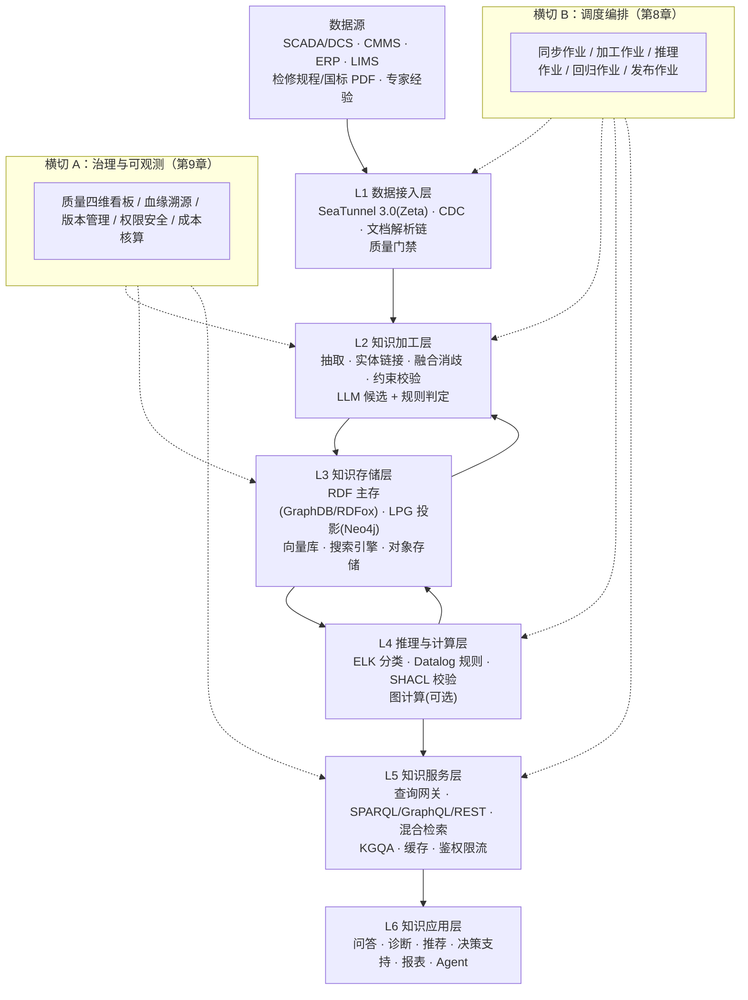
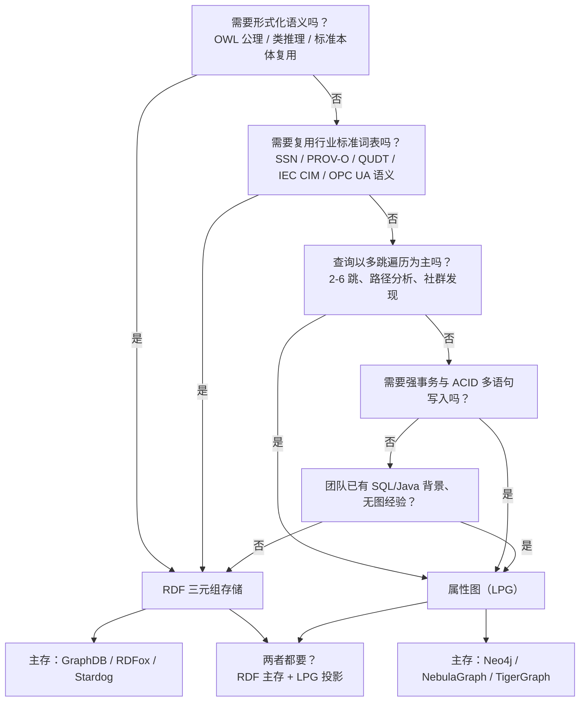
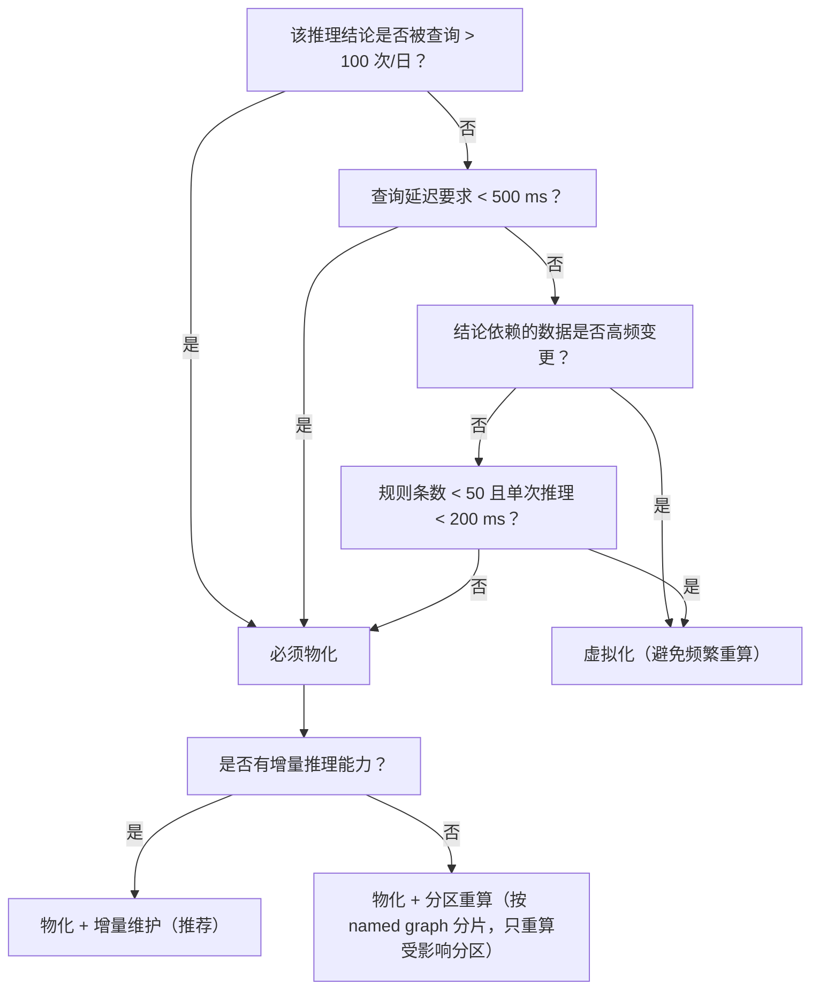
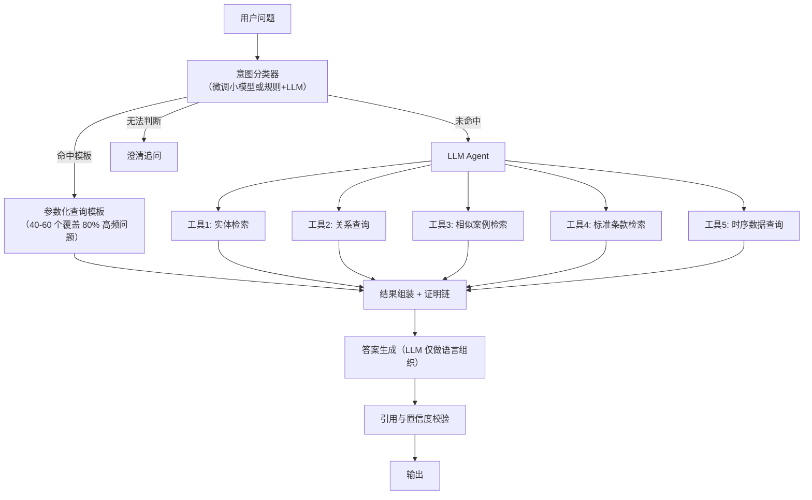
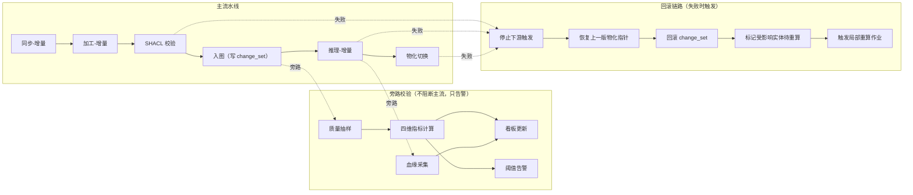
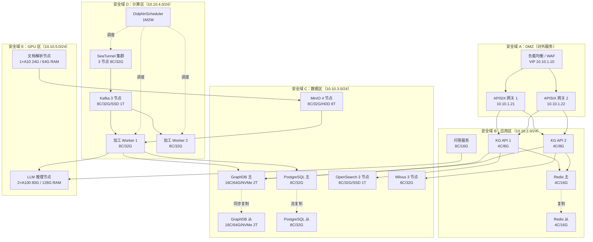
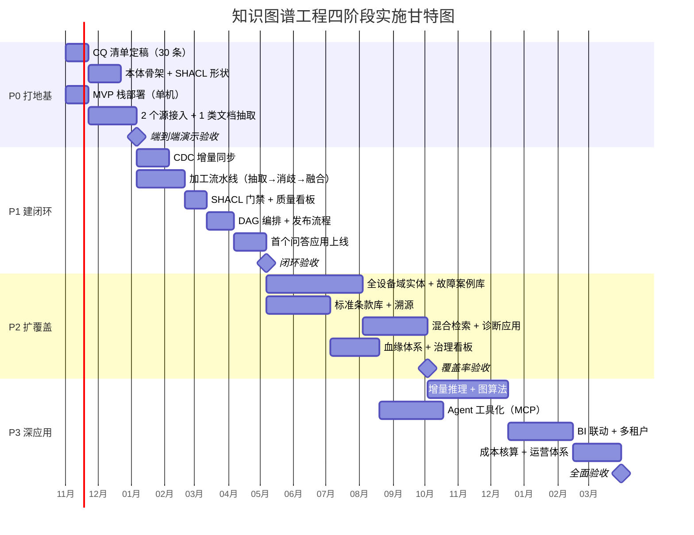

# 知识图谱全链路工程实践：从数据接入到知识应用

## 0 导读与核心结论

### 0.1 这份报告解决什么问题

知识图谱项目在技术上"建成"和在业务上"用起来"之间存在一条很宽的鸿沟。跨越这条鸿沟需要回答的不是"用什么本体语言"，而是五个工程问题：

1. 数据从哪来、怎么持续来、上游改字段了怎么办；
2. 三元组存在哪、存多少、怎么备份、查询延迟是多少；
3. 推理规则怎么跑、规则改了能不能不停服、推理崩了怎么降级；
4. 业务系统怎么调、一次问答要几跳、P99 能不能压到 2 秒内；
5. 上线三个月后，怎么知道图谱质量在变好还是变坏。

这两份前置报告分别覆盖了"知识建模与约束"和"数据集成与调度"，但都停在图谱内部。本报告的定位是一份施工图：每一层给出候选产品、明确判据、配置片段与验收指标，使一个 5–8 人的团队能够在 6 个月内交出可运行的最小闭环，并在 18 个月内扩展为生产系统。

判断读者是否用得上这份报告的方法很简单：如果读完仍无法回答"下周该采购/部署哪三个组件、先写哪两个 DAG"，说明报告没写好。

### 0.2 核心判断

| # | 判断 | 一句话依据 |
|---|---|---|
| 1 | 知识图谱项目的成败不取决于本体建模质量，而取决于 L1 接入、L3 存储、L5 服务三层的工程完整度 | 建模再精确，接不进数据、查不出延迟、供不上服务，业务侧感知为零 |
| 2 | 存储选型是唯一"选错就要重做"的决策：需要形式化推理与标准本体复用就用 RDF 三元组，只需要关系遍历与图分析就用属性图；两者都要时的正确解法是"RDF 主存 + LPG 投影"，不是找一个两栖数据库 | 表达能力（OWL/SHACL/SWRL）与遍历性能（毫秒级多跳、亿级边）在架构上互斥 |
| 3 | LLM 在知识工程中的正确位置是"语言层"（抽取、翻译、解释、生成候选），不是"判定层"；判定必须交给推理机与 SHACL 校验器 | LLM 输出无形式化保证，同一模型仅因上下文供给方式不同，公理提取 F1 可在 0.323–0.717 间波动 |
| 4 | GraphRAG 不是知识图谱的替代品，而是知识服务层的一种检索编排模式；纯向量 RAG 在工业设备运维场景的失效是结构性的 | 工业问答的核心需求是多跳因果、时序先后、否定条件与精确标识符（位号/批次/标准条款号），这四类恰好是向量检索最弱的 |
| 5 | 调度与治理不是配套设施而是产品的一部分；没有 DAG 化的五类作业和四维质量看板，图谱会在 6 个月内退化为一次性交付的静态数据集 | 知识的老化速度由上游业务系统的变更频率决定，不由建模团队的工作节奏决定 |

### 0.3 与两份前置报告的关系

| 主题 | 前置报告 A（LLM 参与本体与约束建设） | 前置报告 B（SeaTunnel/DS/Airflow 工程实践） | 本报告的处理 |
|---|---|---|---|
| 本体生命周期与方法论 | 完整（九阶段生命周期、LLM 四角色矩阵、CQ 驱动） | 无 | 压缩为 3.3 节的可执行部分，删除 TRL、论文数据与勘误清单 |
| OWL/SHACL/SWRL/SPARQL 能力边界 | 完整 | 无 | 保留为 3.3、5.2 的判断依据，不复述语法 |
| 本体对齐与评估体系 | 完整（GenOM/OAEI/六层验证） | 无 | 并入 3.5 质量度量与第 9 章治理 |
| 推理服务（推理机/服务化/增量/物化） | 完整（第 12 章 12.1–12.12） | 无 | 压缩为第 5 章选型表 + 判断，服务化工程并入第 6 章 |
| 数据集成（CDC、Schema Evolution） | 无 | 完整 | 重写为 2.2–2.3 的"知识工程视角"，部署细节一句话引用原报告 |
| 调度编排选型 | 无 | 完整 | 第 8 章重新评估，聚焦"本体构建与 CQ 回归该不该进调度器" |
| 知识存储（图库对比、容量规划、容灾） | 缺失 | 缺失 | 新增第 4 章（本报告最大增量） |
| 知识服务（接口形态、混合检索、KGQA、缓存网关） | 仅推理服务 | 缺失 | 新增第 6 章 |
| 知识应用（问答、诊断、Agent、BI） | 仅案例嵌入点 | 缺失 | 新增第 7 章 |
| 非结构化文档接入 | 缺失 | 缺失 | 新增 2.4 |
| 治理可观测（血缘、版本、成本、权限） | 偏学术 | 缺失 | 重写为第 9 章，全部落到可配置项 |
| 组件清单与部署架构 | 工具清单（偏本体工具） | 部署细节（偏数据平台） | 合并为第 10、11 章 |

---

## 1 全景架构：知识工程六层模型

### 1.1 为什么必须分层：三个典型失败

不分层的知识图谱项目通常以同样的方式失败。以下三个案例来自工业知识图谱项目的常见复盘，症状、根因与对策一一对应。

| 失败模式 | 典型症状 | 根因 | 分层对策 |
|---|---|---|---|
| 模型孤岛 | 上线 3 个月后，图谱里的设备实例数与 CMMS 系统对不上，运维人员不再信任查询结果 | 只有一次性 ETL 导入，没有 L1 的持续同步与 L2 的增量加工；图谱是快照而非镜像 | L1 建立 CDC 增量通道 + L2 建立增量加工流水线 + 第 9 章的数据新鲜度指标 |
| 查询即服务 | 把 SPARQL Endpoint 直接暴露给业务前端，P99 从 200 ms 劣化到 8 s，前端大面积超时 | 缺少 L5 的物化/缓存/网关/限流，把"能查"当成"能服务" | L5 独立成层：查询网关 + 结果缓存 + 物化视图 + 限流降级 |
| 推理当装饰 | 规则写在文档里没物化；或每次规则变更都要停服全量重算半天；或推理结论无法解释，操作员不采信 | 推理被当成建模附属品，没有独立成层，没有规则版本化与增量维护 | L4 独立成层：规则版本化、增量推理、证明链、灰度发布 |
| 二次开发地狱（补充） | 每个应用各自写 Cypher/SPARQL、各自做实体消歧、各自拼 prompt，同一个"设备"在三个系统里有三种 ID | 缺少 L5 的统一知识 API 与 L6 的接入规范 | L5 提供统一 SDK 与语义化接口；L6 规定接入契约 |
| 质量不可观测（补充） | 无法回答"当前图谱的完整率是多少""上周新增的三元组有多少没通过校验" | 缺少横切的治理与可观测能力 | 第 9 章四维质量看板 + 血缘 + 版本管理 |

三个核心失败模式的共同根因是同一个认知错误：**把知识图谱当作一个数据集交付，而不是当作一个系统运营**。数据集可以一次交付，系统必须持续运行——而"持续运行"这件事，只能靠分层来承载。

### 1.2 六层 + 两横切架构



架构图的关键点不是六个框，而是三条回流箭头：

1. **L4 → L3**：推理结果必须写回存储（物化），否则每次查询都要重算；
2. **L3 → L2**：存储中的存量知识是加工的输入（实体链接要靠已有实体库做候选召回，冲突消解要靠存量做基准）；
3. **L5 → L4 → L2 的反馈环**：服务层的"查询失败/未命中/低置信"日志应回流为加工层的抽取目标与 CQ 扩展来源。这条反馈环是知识图谱从"静态资产"变成"持续进化系统"的唯一机制，也是绝大多数项目缺失的一环。

### 1.3 各层职责与组件映射

| 层 | 核心职责 | 推荐组件（自建 IDC） | 关键接口/协议 | 验收指标（量化） |
|---|---|---|---|---|
| L1 数据接入 | 多源抽取、CDC 增量、文档解析、到达即校验 | SeaTunnel 3.0.0（Zeta 引擎）；MinerU 2.5+/Docling 做文档解析；Debezium 作为备选 CDC | JDBC、binlog/WAL、REST、文件监听、Kafka | 端到端延迟 P95 < 60 s（CDC）；文档解析成功率 > 95%；门禁拦截率可解释 |
| L2 知识加工 | 实体/关系抽取、实体链接、融合消歧、约束校验 | Python 服务（FastAPI）+ LLM（本地 Qwen 或 API）；pySHACL；rapidfuzz/Splink 做相似度与聚类 | 内部 gRPC/REST；批处理走 Spark（可选） | 抽取准确率、实体链接 Top-1 命中率、冲突消解覆盖率 |
| L3 知识存储 | 三元组/属性图持久化、向量索引、全文索引、对象存储 | GraphDB 11.x（RDF 主存）+ RDFox（高性能增量推理，可选）；Neo4j 2025.x（LPG 投影）；Milvus 2.6 或 pgvector 0.8；OpenSearch/Elasticsearch；MinIO | SPARQL 1.1/1.2、Cypher、gRPC | 查询 P99、导入吞吐、存储放大倍数、备份 RPO/RTO |
| L4 推理与计算 | 本体分类、规则推导、约束校验、图算法 | ELK（OWL EL 分类）；GraphDB 规则引擎或 RDFox（Datalog）；pySHACL；GDS/GraphScope（图计算，可选） | 内部 API；批量作业 | 全量推理耗时、增量延迟 P95、规则覆盖率 |
| L5 知识服务 | 统一查询、混合检索、问答、缓存、鉴权限流 | Spring Cloud Gateway 或 Kong/APISIX；Redis；自研 KG API（FastAPI）；向量检索服务 | REST/GraphQL/SPARQL Endpoint/MCP | P99 延迟、可用性、限流命中率、缓存命中率 |
| L6 知识应用 | 业务侧产品化 | 自研前端 + 统一 SDK；BI 工具（Superset/Metabase） | 统一 SDK、MCP、JDBC/ODBC | 业务采用率、任务完成率、用户满意度 |
| 横切 A 治理 | 质量、血缘、版本、权限、成本 | DataHub 1.x 或 OpenMetadata 1.9.x；Git（本体/规则版本）；OpenLineage 事件 | OpenLineage、Git webhook | 四维指标周环比、血缘覆盖率、回滚耗时 |
| 横切 B 调度 | 五类作业编排 | DolphinScheduler 3.4.3（主）；GitLab CI（CQ 回归）；Airflow 3.1+（可选，ML/LLM 批处理） | DAG 定义、事件触发、回调 | 作业成功率、重跑耗时、SLA 达成率 |

### 1.4 端到端数据流：一条设备故障知识的完整链路

以水泥厂"3# 回转窑主减速机高速轴轴承外圈剥落"这一条知识为例，走完全链路：

| 步骤 | 层 | 输入 | 处理 | 输出产物 | 组件 |
|---|---|---|---|---|---|
| ① | L1 | CMMS 检修工单（结构化）、振动传感器时序（流式）、检修规程 PDF（非结构化） | 工单走 CDC 增量同步；传感器走 30 s 微批；PDF 走解析链 | 原始表 `ods.cmms_workorder`、时序表 `dwd.sensor_vib`、文档块 `doc_chunk` + 页码坐标 | SeaTunnel Zeta、MinerU |
| ② | L1 门禁 | 上述三类原始数据 | 到达即校验：必填字段、位号编码规范、时间戳时区、单位量纲 | 通过/隔离两路；隔离数据进 `quarantine` 表并告警 | SeaTunnel Transform + 自定义 UDF |
| ③ | L2 | 工单文本"更换高速轴轴承，外圈剥落，型号 32230" | LLM 抽取实体与关系（设备/部件/故障模式/维修动作） | 候选三元组 `<3#窑主减, 故障模式, 轴承外圈剥落>` | LLM（Qwen2.5-72B 本地）+ 抽取模板 |
| ④ | L2 | 候选三元组 + 存量图谱 | 实体链接：把"3#窑主减"对齐到 `kg:Equipment_3#Kiln_MainReducer`；消歧"外圈剥落" vs "滚道剥落" | 带置信度与来源的规范化三元组 | Splink/向量召回 + 规则裁决 |
| ⑤ | L2 校验 | 规范化三元组 | SHACL 校验：`hasFaultMode` 值域是否在故障模式类内、`occurredAt` 是否 xsd:dateTime、基数约束 | 通过则入图；违规则进审核队列 | pySHACL |
| ⑥ | L3 | 校验通过的三元组 + 来源元数据 | 写入 RDF 主存，同时在 named graph 写入 PROV 溯源三元组；同步写向量索引（故障描述文本） | 图数据库中的 4–6 条三元组 + 1 条 provenance 记录 | GraphDB / RDFox |
| ⑦ | L4 | 新写入的三元组 | 触发增量推理：若该故障模式属于"轴承类故障"且该设备 `hasComponent` 轴承，则推出 `<设备, 存在隐患部件, 轴承>` | 物化推理结果，附证明链 | RDFox B/F 增量 或 GraphDB 规则引擎 |
| ⑧ | L5/L6 | 物化结果 + 文档块 + 向量索引 | 服务层提供三类接口：诊断查询（"这台设备历史上同类故障的平均修复时长"）、语义检索（"轴承外圈剥落的典型征兆"）、KGQA（"3# 窑主减现在有什么隐患"） | 前端诊断卡片、问答答案、BI 指标 | 网关 + 缓存 + 混合检索 |
| ⑨ | 横切 A | 全流程埋点 | 记录血缘：这条三元组的来源是工单号 + 文档页码 + 抽取模型版本 + 人工确认人 | 可追溯至原始凭证 | DataHub/OpenMetadata + 自研 provenance 表 |
| ⑩ | 横切 B | 上述作业 | DAG 编排：同步 DAG（5 min）→ 加工 DAG（CDC 事件触发）→ 推理 DAG（加工完成后触发）→ CQ 回归 DAG（每日）→ 发布 DAG（人工审批） | 全链路自动化，失败可重跑、可回滚 | DolphinScheduler + GitLab CI |

这条链路的工程量分布值得注意：真正花时间的不是第 ③ 步的 LLM 抽取（约占 15% 工作量），而是第 ②、④、⑤、⑨ 步（校验、链接、门禁、血缘，合计约 60%）。这也解释了为什么"用大模型一键建图谱"的 demo 能跑通，但生产系统建不起来。

### 1.5 分层的关键取舍

| 层 | 能否合并/省略 | 判据 | 说明 |
|---|---|---|---|
| L1 接入 | 不能省，可与 L2 合并部署 | 数据源 < 3 个且无增量需求时，可用脚本替代 SeaTunnel | 但一旦出现第二套业务系统或需要增量，脚本方案的重写成本远高于迁移成本 |
| L2 加工 | 不能省 | — | 加工是知识质量的唯一来源 |
| L3 存储 | 不能省，不能与 L2 混 | — | 存储选型错误会导致 L2 与 L5 全部重写 |
| L4 推理 | 首年可"降级"为 L3 的规则引擎 | 规则 < 50 条、无增量需求、无证明链要求时 | 不要一开始就上独立推理服务；但要预留规则外置与版本化的接口 |
| L5 服务 | 不能省 | — | 但首年可以用"网关 + 缓存"的极简形态，不必做完整多租户 |
| L6 应用 | 不能省，但只需 1 个 | 首个应用必须是高频、可量化的 | 不要同时开三个应用场景 |
| 治理 | 首年可手工（Git + Excel） | 三元组 < 100 万、团队 < 8 人 | 第二年必须引入元数据平台，否则血缘断链 |
| 调度 | 不能省 | 作业数 > 20 或存在跨系统依赖时 | 作业 < 10 个且线性依赖时可用 crontab |

一条实操判断：**L4 是唯一可以在首年"降级"的层，L3 是唯一"选错就要重做"的层，L5 是唯一"最容易被低估"的层**。三者对应的风险分别是"多花钱"、"推倒重来"、"上线即崩"。
---

### 1.6 五条架构决策记录（ADR）

架构决策一旦定下，后续所有技术选择都会被它约束。把决策显式记录下来（含"什么情况下该推翻"），比事后争论"当初为什么这么选"成本低得多。

| 编号 | 决策 | 背景与理由 | 后果（正面） | 后果（负面/代价） | 推翻条件 |
|---|---|---|---|---|---|
| **ADR-001** | 知识主存用 RDF 三元组，LPG 仅做分析投影 | 需要 OWL 分类推理、SHACL 校验、复用 SOSA/QUDT/OPC UA 标准本体；水泥场景的 69 类事件需要形式化语义 | 标准本体可直接复用；约束可机器校验；推理结果可解释 | 高并发遍历性能弱于 LPG；团队需学 SPARQL | 若应用侧 P99 需求 < 50 ms 且查询以深链遍历为主，改为 LPG 主存 |
| **ADR-002** | LLM 只做语言层，不做判定层 | LLM 不可解释、输出不稳定、无法给出确定性证明；工业场景的错判代价高 | 结论可追溯、可复现；模型升级不改变业务结论 | 需要额外投入规则/约束工程；抽取仍依赖 LLM | 若某类判定的人工标注准确率长期低于 LLM 且可接受不可解释，局部放开 |
| **ADR-003** | 时序原始点不入图，只入"观测事件" | 量级差四个数量级（亿级/天 vs 百万级总量）；图库不适合高写入时序 | 图库规模可控；查询稳定 | 需要时序库 + 图库双写与关联字段 | 若采样频率降至分钟级且设备数 < 200，可考虑全量入图 |
| **ADR-004** | 推理以物化为主、增量为辅，禁止查询时推理 | 查询时推理导致 P99 不可控（报告 A 实测差距可达两个数量级） | 查询延迟稳定；结果可审计 | 规则变更需重算窗口；存储有冗余 | 若规则极少变更（< 1 次/季）且查询量极低，可全虚拟化 |
| **ADR-005** | 调度器管数据作业，CI 管本体与 CQ 回归 | 本体构建与回归测试本质是"代码变更 + 测试"，属 CI 语义；调度器擅长数据依赖与时序 | 本体变更可评审、可回滚、有测试门禁 | 需要维护两套流水线；需要打通制品仓库 | 若团队无 CI 基础设施，可临时用调度器承载，但需补齐审批节点 |

**判断**：这五条里最容易被推翻又最不该推翻的是 ADR-002。当 LLM 能力持续提升时，"让模型直接判定"的诱惑很大，但工业场景的审计要求不会因模型变强而放松。正确做法是把 LLM 判定包在"候选生成 + 规则/约束过滤 + 人工确认"三层里，而不是取消这三层。

---

## 2 L1 数据接入层

### 2.1 知识工程要接入的四类数据

知识图谱的"知识"来自四类差异极大的数据源，接入方式、频率、质量风险完全不同。把它们当成一类处理是接入层最常见的错误。

| 类别 | 水泥行业实例 | 典型数据源 | 接入方式 | 频率 | 主要质量风险 |
|---|---|---|---|---|---|
| 结构化业务库 | 设备台账、检修工单、备件库存、点检记录、化验单 | CMMS/EAM、ERP、LIMS（Oracle/MySQL/SQL Server） | JDBC 全量 + binlog CDC 增量 | 全量每日、增量秒级 | 主键不稳定、位号编码不统一、软删除未标记 |
| 半结构化日志与报文 | DCS 报警日志、PLC 报文、OPC UA 节点快照、邮件工单 | Kafka、Syslog、OPC UA Server、文件目录 | 流式消费 + 微批 | 秒级~分钟级 | 字段漂移、单位量纲不一致、时区混用 |
| 非结构化文档 | 设备说明书、检修规程、国标/行标、故障分析报告、图纸 | 文件服务器、OA、共享盘、扫描件 | 解析链（OCR+版面分析+分块） | 按文件变更事件 | 扫描质量差、表格跨页、公式与符号、页码定位 |
| 流式信号 | 回转窑主电机电流、减速机振动、窑筒体温度、篦冷机压力 | 时序库（InfluxDB/TDengine）、Historian | 微批聚合后接入 | 1 s 采样 → 30 s 微批 | 缺失值、尖峰噪声、传感器漂移 |

判断：四类数据中，**结构化库决定图谱的"骨架正确性"**（设备、部件、位置、工序的实体是否齐全），**非结构化文档决定图谱的"知识密度"**（故障机理、处置经验、标准限值），**流式信号决定图谱的"时效价值"**（当前状态）。骨架错则全盘错，密度低则无人用，时效差则只值一次交付。

### 2.2 SeaTunnel 在知识工程视角下的用法

前置报告 B 已给出 SeaTunnel 的完整部署与调优细节（Zeta 引擎、Checkpoint、并行度、连接器），此处只写知识工程特有的用法约束，部署细节引用原报告即可。

**定位**：SeaTunnel 在知识工程中承担"把异构源变成结构一致的规范化表"这一件事，输出的是**加工层的输入表**，不是图谱本身。不要试图在 SeaTunnel 里做实体抽取或图谱写入——那是 L2 的职责。

**四条用法约束（判断）**：

1. **只做"到表"的搬运，不做"到图"的建模**。SeaTunnel 的输出 sink 统一落 Parquet/ORC 或 Kafka topic，由 L2 消费。理由是抽取逻辑（尤其是 LLM 调用）需要重试、限流、缓存与人工复核，这些能力在流处理引擎里实现代价极高。
2. **CDC 只开需要的表，不做整库同步**。知识工程需要的表通常只占业务库的 10%–20%（设备主数据、工单、故障代码、点检项）。整库 CDC 会让 Schema Evolution 的风险面扩大 5 倍以上。
3. **在 Source 侧完成"知识友好的字段补齐"**。例如给每条工单补 `source_system`、`extract_ts`、`record_version` 三个字段，这三个字段是后续血缘与冲突消解的基础。用 SeaTunnel 的 `Transform` + `Sql` 插件即可完成，不需要额外的加工层。
4. **用 `zstd` 压缩 + 分区落盘**。文档与日志类数据量大但冷，压缩比通常在 4–8 倍，直接影响 L3 对象存储成本。

最小可用的 CDC 同步配置（MySQL → Kafka，仅设备与工单两类表）：

```hocon
env {
  parallelism = 4
  job.mode = "STREAMING"
  checkpoint.interval = 30000
}

source {
  MySQL-CDC {
    base-url = "jdbc:mysql://10.20.3.11:3306/cmms"
    username = "${CMMS_USER}"
    password = "${CMMS_PASS}"
    table-names = [
      "cmms.eq_equipment",
      "cmms.eq_component",
      "cmms.mt_workorder",
      "cmms.mt_fault_code"
    ]
    startup.mode = "initial"          # 首次全量，之后自动切增量
    server-id = 5410-5413
    exactly-once = true
  }
}

transform {
  Sql {
    query = """
      SELECT
        id                AS src_id,
        equip_code        AS equip_code,
        equip_name        AS equip_name,
        parent_code       AS parent_code,
        'CMMS'            AS source_system,
        NOW()             AS extract_ts,
        UNIX_TIMESTAMP()  AS record_version
      FROM cmms.eq_equipment
      WHERE deleted = 0
    """
  }
}

sink {
  Kafka {
    bootstrap.servers = "10.20.5.21:9092,10.20.5.22:9092"
    topic = "kg.ods.equipment"
    format = canal_json
    semantic = "EXACTLY_ONCE"
  }
}
```

### 2.3 CDC 增量同步设计与 Schema Evolution 冲击

**全量 + 增量的切换**是接入层第一个必须设计的动作。三种模式对比：

| 模式 | 实现 | 优点 | 缺点 | 适用 |
|---|---|---|---|---|
| 全量覆盖 | 每日全量抽到新分区，下游整体重算 | 简单、天然纠错 | 大表不可行；下游重算成本高 | 小维表（设备台账、故障代码字典） |
| 全量初始化 + 增量追平 | 一次全量快照 + 后续 binlog 持续消费 | 数据一致、延迟低 | 需要位点管理、需要处理乱序 | 事实表（工单、点检记录）——**推荐** |
| 纯增量（无全量） | 只消费 binlog | 成本最低 | 历史数据缺失，图谱无法冷启动 | 仅用于增量价值极高的信号类数据 |

判断：知识工程一律采用"全量初始化 + 增量追平"，且**全量快照必须落到不可变分区**（如 `snapshot_date=2026-10-31`），而不是覆盖。原因在于图谱需要回溯"某条知识在某个时间点的状态"，覆盖式全量会摧毁这个能力。

**Schema Evolution 对本体与约束的冲击**，是接入层最容易被忽略、后果最严重的问题。上游加一个字段、改一个枚举值、放宽一个非空约束，都会在下游引发连锁反应：

| 上游变更 | 对 L1 | 对 L2 | 对 L3/本体与约束 | 处置策略 |
|---|---|---|---|---|
| 新增字段 | 无影响（CDC 自动带出） | 抽取模板需决定是否使用 | 通常无需改本体；若新字段是业务关键属性，需新增 `owl:DatatypeProperty` | 先落 ODS 宽表，本体变更走"观察期"（见下） |
| 字段重命名 | 同步任务报错或字段丢失 | 抽取失败 | 属性名不变但映射断裂 | 强制上游保留旧字段 3 个月别名；L1 做字段映射层 |
| 枚举值新增（如故障代码新增一类） | 无影响 | 抽取可能落到 `未分类` | **必须扩本体**：新增个体或子类，且 SHACL 的 `sh:in` 约束会直接拒绝 | 建立"枚举值自动发现"作业：每日对比源端 distinct 值与本体值域，差异告警 |
| 枚举值删除 | 无影响 | 历史数据仍在 | 存量个体变成"孤儿"，一致性校验失败 | 本体侧做 deprecate 而非 delete（`owl:deprecated true`） |
| 字段类型变更（varchar→int） | 可能截断 | 抽取类型错 | 违反 `sh:datatype` 约束 | L1 强制类型收敛 + 类型变更白名单 |
| 表拆分/合并 | 同步任务需改 | 实体来源变化 | 实体 ID 可能变，导致**实体链接全部失效** | 实体 ID 生成规则必须与源表结构解耦（用业务编码，不用自增主键） |

这里有一条硬性工程规则（判断）：**图谱中的实体 ID 必须由业务编码派生，绝不能使用源系统的自增主键**。水泥厂的设备位号（如 `K3-MR-001`）比 `id=10237` 稳定得多。用自增主键做主键，任何一次库迁移都会让整张图谱的实体链接失效。

**Schema Evolution 的三道防线**：

1. **观察期**：源端变更先只进 ODS，L2 在"影子模式"下加工但不入图，观察 7 天；
2. **契约测试**：为每个源表维护一份 YAML 契约（字段名、类型、值域、基数），CI 中每日校验，不符则阻断；
3. **本体变更闸门**：任何触及本体或 SHACL 的变更必须走 L4 的 CQ 回归（见 8.4），不允许"顺手加个属性"。

```yaml
# contracts/cmms.eq_equipment.yaml —— 源表契约示例
table: cmms.eq_equipment
owner: 设备管理部
refresh: cdc
columns:
  equip_code:   {type: string,  pattern: "^[A-Z0-9]{1,4}-[A-Z]{2}-[0-9]{3}$", required: true, unique: true}
  equip_name:   {type: string,  max_len: 120, required: true}
  parent_code:  {type: string,  nullable: true}
  equip_class:  {type: enum,    values_from: kg:EquipmentClass, required: true}
  install_date: {type: date,    nullable: true}
  deleted:      {type: int,     values: [0,1], required: true}
evolution:
  forbid: [rename, drop]
  require_alias_months: 3
```

### 2.4 非结构化文档接入：解析 → 版面分析 → 分块 → 元数据标注

工业场景中 70% 以上的高价值知识（故障机理、检修工艺、标准限值、图纸参数）藏在 PDF 与扫描件里。这条链路的工程质量直接决定图谱的"知识密度"。

**工具链现状（2025–2026）**：

| 工具 | 许可 | 能力 | 适用 | 局限 |
|---|---|---|---|---|
| MinerU 2.5 / 3.x | 2.x：AGPL-3.0（含 AGPL 权重依赖，联网服务需开源义务核查）；3.1.0+：Apache 2.0 基 | 版面分析、阅读顺序重建、公式转 LaTeX、表格转 HTML、109 语种 OCR；1.2B 模型可跑在 24 GB GPU 上（来源：arXiv 2509.22186、PyPI） | **首选**：中英混排的规程、说明书、标准 | 复杂跨页表仍需后处理；附加条款需法务确认 |
| Docling（IBM） | MIT | 20+ 格式（PDF/DOCX/PPTX/XLSX/HTML/图片）、Granite-Docling 258M VLM、版面与表格结构输出（来源：ibm.com/products/docling） | 需要多格式统一、希望与 LangChain/LlamaIndex 直连时 | 中文扫描件 OCR 质量略弱于 MinerU |
| PaddleOCR 3.3（含 PaddleOCR-VL 0.9B） | Apache 2.0 | PP-DocLayout 系列 mAP@0.5 达 90.4%，端到端百页/秒；公式、表格、印章识别（来源：paddleocr.ai 更新日志） | 中文为主、需要印章识别、需要自训练 | 需要自行组装流水线，工程量大 |
| Unstructured | Apache 2.0（部分功能商业） | 通用元素切分 | 快速原型 | 表格与公式能力弱 |
| 商业 API（Azure Document Intelligence、阿里文档智能） | 商业 | 开箱即用、准确率高 | 预算充足、文档量不大 | 数据出境/保密限制，工业图纸常不可外发 |

判断：**自建 IDC 场景一律选 MinerU 为主解析器、Docling 为补充（处理 Office 与 HTML）、PaddleOCR 作为扫描件兜底**。理由是三者均可在内网离线部署、均支持 GPU 批处理，且 MinerU 在中文版面与公式上明显优于通用方案。

**解析链的四个工程要点**：

1. **必须保留页码与坐标（bbox）**。这是后续所有溯源能力的地基——没有 bbox，用户看到一条知识无法跳转到原文第 37 页第 2 段，信任就建立不起来。MinerU 与 Docling 均输出 middle.json 含 bbox，务必入库而非丢弃。
2. **版面元素要分类入图，不要全部当文本**。表格、公式、图片、图题应分别处理：表格转结构化（或至少保留 HTML 供 LLM 阅读），公式保留 LaTeX，图题作为图片的 `dc:description`。
3. **分块策略由知识结构决定，不由 token 数决定**。工业规程的自然单元是"条款"（如"5.3.2 减速机高速轴轴承温度不得超过 75 ℃"），按条款切分比按 512 token 切分的信息完整性高一个量级。实操规则：先按标题层级切"章—节—条"，再对超长条款按句切分并保留条款号前缀。
4. **元数据标注是分块的一部分，不是后处理**。每个块必须携带：`doc_id`、`doc_title`、`doc_type`（国标/行标/企标/说明书/报告）、`clause_no`、`page_no`、`bbox`、`effective_date`、`supersedes`、`confidentiality`。其中 `effective_date` 与 `supersedes` 决定了知识的时间有效性，`confidentiality` 决定了权限过滤。

分块后的规范化 JSON（写入对象存储，供 L2 消费）：

```json
{
  "doc_id": "QJ-JX-2023-017",
  "doc_title": "回转窑主减速机检修规程",
  "doc_type": "enterprise_standard",
  "effective_date": "2023-07-01",
  "supersedes": "QJ-JX-2018-009",
  "confidentiality": "internal",
  "clause_no": "5.3.2",
  "page_no": 37,
  "bbox": [72.5, 214.0, 523.8, 268.4],
  "text": "减速机高速轴轴承温度正常运行时应不高于 75 ℃，超过 85 ℃ 应立即停机检查。",
  "parser": {"tool": "mineru", "version": "2.5", "model": "MinerU2.5-2509-1.2B"}
}
```

### 2.5 时序信号与观测事件的接入取舍

流式信号（振动、温度、电流、压力）是工业知识图谱最容易接错的一类数据。核心问题只有一个：**时序点要不要进图**。

答案（判断）：**不进**。时序点的量级（5000 台设备 × 20 测点 × 1 s 采样 = 每天 86 亿点）与图谱的量级（百万级三元组）差四个数量级，把时序点入图会让图库在两周内不可用。正确做法是"两级建模"：

| 层级 | 存什么 | 存哪 | 粒度 |
|---|---|---|---|
| 原始时序 | 每秒/每分钟的测点值 | 时序库（TDengine / InfluxDB / TimescaleDB） | 原始采样 |
| 观测事件（Observation） | "2026-10-28 14:00–15:00 振动烈度均值 6.2 mm/s，超阈值" | 图谱（复用 SOSA 本体） | 事件级（每小时或每次越限） |
| 观测定义（Sensor） | 测点编号、量纲、安装位置、所属部件 | 图谱 | 静态元数据 |

这样图谱中每台设备每天只增加 24 条左右的观测事件，五年也只有 4 万余条，完全可控；而原始时序仍可在需要时通过 `series_id` + 时间窗回查。

**观测事件入图的三条规则**：

1. **只在"有意义"时入图**：越限、突变、趋势反转、人工标注。不要把所有窗口都入图。
2. **必须带量纲与统计口径**（QUDT）：`kg:value 6.2 ; kg:unit unit:MilliMetrePerSecond ; kg:aggregation "mean" ; kg:window "PT1H"`。没有量纲的数值在跨源融合时必然出错。
3. **阈值必须来自标准条款而非硬编码**：`kg:thresholdSource kg:doc_QJ-JX-2023-017_clause_5.3.2`。这样标准更新时，阈值可自动追溯并批量复核。

```sparql
# 找出所有"阈值仍引用已废止标准"的观测定义（知识老化检测）
SELECT ?sensor ?threshold ?doc ?supersededBy WHERE {
  ?sensor kg:hasThreshold ?threshold ;
          kg:thresholdSource ?clause .
  ?clause kg:docId ?doc .
  ?doc kg:supersedes ?old ; kg:effectiveDate ?eff .
  FILTER(?eff > "2026-01-01"^^xsd:date)
  OPTIONAL { ?doc kg:supersededBy ?supersededBy }
}
```

### 2.6 接入层的质量门禁

原则：**数据到达即校验，不要等到入库才发现脏数据**。门禁放在 L1 的最后一个环节（sink 之前），失败数据进隔离区，不进 L2。

| 门禁类型 | 检查内容 | 失败处置 | 阈值（示例） |
|---|---|---|---|
| 结构门禁 | 字段存在性、类型、非空 | 整条记录隔离 | 字段缺失率 > 0 即告警 |
| 编码门禁 | 位号正则、单位量纲、时区 | 记录隔离 + 修正建议 | 位号不合规率 > 2% 阻断批次 |
| 值域门禁 | 枚举值是否在本体值域内 | 打标 `unmapped` 放行（供 3.4 枚举发现） | 未映射率 > 10% 阻断 |
| 引用完整性 | `parent_code` 是否存在于设备表 | 隔离并生成待补录清单 | 悬挂引用率 > 1% 告警 |
| 时效门禁 | 时间戳是否在合理区间（不早于 2000 年、不晚于当前+1 天） | 记录隔离 | 异常率 > 0.5% 告警 |
| 体量门禁 | 单批次行数与历史均值偏差 | 阻断并人工确认（防上游误删全表） | 偏差 > 50% 阻断 |

体量门禁常被忽略但极其重要：上游一次误操作清空表，CDC 会把 20 万条删除事件推下来，如果没有体量门禁，图谱会在一夜间被清空，而且回滚需要重放全量。

### 2.7 自建 IDC 部署要点

SeaTunnel 集群的部署形态、Zeta 引擎参数、Checkpoint 与并行度调优、连接器选型详见前置报告 B，此处只补充知识工程特有的三点：

1. **为文档解析单独划一台 GPU 节点**（建议 1×A10 24 GB 或 2×RTX 4090），不要与 CDC 任务混部——文档解析是突发性 CPU/GPU 密集任务，与 CDC 的长连接低延迟特性冲突。
2. **Kafka 作为接入层与加工层的唯一解耦点**，topic 命名规范 `kg.{layer}.{domain}.{entity}`，保留 7 天，压缩 `lz4`。所有下游消费必须幂等（用 `(src_id, record_version)` 做去重键）。
3. **隔离区必须有独立生命周期策略**：隔离数据保留 30 天供人工修复重放，超期归档到对象存储冷层，不要直接删除——很多"脏数据"其实是上游系统的问题，需要作为证据保留。

---

## 3 L2 知识加工层

### 3.1 加工流水线四阶段

```
抽取 → 消歧链接 → 融合 → 入图
```

四个阶段的输入输出与失败影响：

| 阶段 | 输入 | 输出 | 主要技术 | 失败后果 | 人工介入点 |
|---|---|---|---|---|---|
| 抽取 | 规范化表、文档块 | 候选三元组（含置信度、来源 span） | LLM 抽取 + 规则模板 + 词典 | 知识缺失或错误，下游全污染 | 低置信批量复核 |
| 消歧链接 | 候选三元组 + 存量实体库 | 规范化三元组（主语宾语指向唯一 IRI） | 向量召回 + 字符相似 + 规则裁决 | 实体重复或错链，图谱"碎片化" | 歧义对裁决 |
| 融合 | 多源规范化三元组 | 单一事实视图（含来源集合与置信度） | 优先级规则 + 时间戳 + 投票 | 事实矛盾，用户不信任 | 冲突裁决 |
| 入图 | 融合结果 | 图数据库中的三元组 + 溯源 | 事务批量写 + SHACL 校验 | 约束违反或写入失败 | 约束违反审核 |

判断：这四个阶段的工作量比例约为 **抽取 25%、消歧链接 35%、融合 25%、入图 15%**。绝大多数团队把 70% 精力放在抽取上，结果得到一个"能抽但连不上"的图谱。

### 3.2 实体抽取与实体链接

**抽取的两条路线**：

| 路线 | 做法 | 准确率（工业文本经验值） | 成本 | 适用 |
|---|---|---|---|---|
| 规则/词典优先 | 位号正则 + 故障模式词典 + 依存句法 | 精确率高（> 0.9）但召回低（0.4–0.6） | 极低 | 实体形态高度规范的场景（设备位号、标准条款号、故障代码） |
| LLM 抽取 | Few-shot prompt + JSON Schema 约束输出 | 精确率 0.7–0.85，召回 0.75–0.9 | 中（每千字约 1.5k token） | 关系抽取、隐含语义（"因……导致……"） |
| 混合（推荐） | 规则打底 + LLM 补充 + 词典兜底 | 精确率 0.85–0.92 | 中低 | 生产环境唯一可行路线 |

混合路线的具体做法：先用规则与词典把高确定性的实体（位号、日期、数值+单位、标准号）抽出来并**从文本中遮蔽**，再把剩余文本交给 LLM 抽取关系与隐含实体。这样 LLM 的输入更短、错误面更小，成本下降 40%–60%。

**LLM 抽取提示词的工程要点**（判断，基于工业文本实践）：

- 输出必须绑定 JSON Schema（用结构化输出/函数调用），禁止自由文本解析；
- 每条抽取结果必须带 `evidence`（原文片段）与 `confidence`，无 evidence 的结果直接丢弃；
- 显式给出"不知道就返回空数组"的指令，否则模型会为凑数而编造；
- 三元组谓词必须来自**封闭词表**（由本体提供，注入 prompt），不允许模型自创谓词——这是控制"谓词爆炸"的唯一有效手段。

**实体链接（Entity Linking）的三个失败模式**：

| 失败模式 | 症状 | 根因 | 对策 |
|---|---|---|---|
| 同名异实体 | "1# 磨"在生料系统和水泥系统都存在，全部链到同一个 IRI | 候选召回只用名称，未用上下文（工序/位置） | 链接时把实体的上位路径（`属于工序`）纳入相似度；同一名称多候选时强制人工或降级为"待定实体" |
| 异名同实体 | "窑主减""回转窑主减速机""K3-MR-001" 建成三个实体 | 缺少别名表与同义关系 | 维护 `skos:altLabel` 别名库；链接前先查别名；别名由人工确认后回写 |
| 过度链接 | 把"轴承"这类通用词链接到某台具体设备的部件 | 阈值过低，缺少类型约束 | 链接前用本体类型做前置过滤：候选实体类型必须与抽取类型兼容（`rdfs:subClassOf` 可达） |

实体链接的工程实现建议（判断）：

1. **候选召回三路并行**：别名精确匹配 → 字符相似（rapidfuzz，阈值 85）→ 向量相似（bge-m3 或 bge-large-zh，top-10）；
2. **排序用规则而非模型**：类型兼容性 + 上下文路径相似度 + 别名命中，三项加权，权重由人工标注 200 条样本调出；
3. **阈值分段处置**：> 0.92 自动链接；0.75–0.92 自动链接但打 `needs_review` 标；< 0.75 建为新实体并进待审队列。**不要设置 0.6 以下的自动链接**——错链的修复成本是漏链的 10 倍。

### 3.3 本体构建与约束生成（可执行结论）

前置报告 A 已完整论证九阶段生命周期与 LLM 四角色矩阵（生成者/校验者/解释者/维护者）。此处只保留可直接施工的结论：

| 结论 | 具体做法 |
|---|---|
| CQ 先行，本体后建 | 先写 30–50 条能力问题（CQ），每条 CQ 对应一个 SPARQL 查询骨架；本体元素必须有至少一条 CQ 用到它，否则删除 |
| 本体分三层维护 | 上层复用标准词表（SSN/SOSA 表示传感观测、PROV-O 表示溯源、时间本体表示时态、QUDT 表示量纲），中层行业本体自建（设备-部件-故障-处置），下层实例不入本体文件 |
| LLM 只生成候选 | LLM 输出 OWL 片段作为"候选"，必须经 ELK 一致性检查 + SHACL 校验 + 人工确认三道闸门才能进入主干 |
| 约束与本体分离 | OWL 管"必然成立"的公理（分类、域值、不相交），SHACL 管"业务上必须成立"的规则（基数、值域、格式、条件必填）。不要用 OWL 表达业务约束——OWL 的开放世界假设会让校验失效 |
| 本体版本语义化 | `owl:versionIRI` + 语义化版本；破坏性变更（删类、改域值、收紧基数）升主版本号，必须走 CQ 全量回归 |
| 最小充分原则 | 类数量与 CQ 数量保持 1:1.5 左右的比例。367 个类对应约 500 条 CQ 是合理密度；如果类有 800 个而 CQ 只有 60 条，说明本体在"为建模而建模" |

水泥行业设备运维本体的骨架（判断，可直接落地）：

```
设备域：Equipment → RotaryKiln / RawMill / CementMill / Preheater / Cooler / Fan / Conveyor
部件域：Component → Gearbox / Bearing / Motor / Shell / Refractory / Roller / Seal
故障域：FaultMode → Wear / Fatigue / Overheat / Looseness / Blockage / Leakage / Electrical
       （FaultMode 与 Component 通过 hasApplicableComponent 关联，形成"故障-部件"矩阵）
处置域：Action → Replace / Adjust / Clean / Weld / Lubricate / Monitor
证据域：Observation（复用 SOSA）→ VibrationReading / TemperatureReading / OilAnalysis
溯源域：Provenance（复用 PROV-O）→ WorkOrder / InspectionRecord / StandardClause / ExpertStatement
时序域：TimeInterval（复用 OWL-Time），用于"故障发生期""有效期""检修周期"
```

关键设计决策（判断）：**故障模式必须建成独立类而不是字符串属性**。因为"轴承外圈剥落"要参与推理（属于疲劳类故障 → 与振动高频能量上升相关）、要参与统计（同类故障平均修复时长）、要参与推荐（对应的处置动作）。建成字符串属性，这三件事全部做不了。

### 3.4 多源知识融合与冲突消解

同一实体或同一事实被多个源描述且不一致，是知识工程的常态。典型冲突：设备台账说轴承型号是 32230，检修工单写 32230E，说明书标 32230E-T，标准推荐 32230。

**三级裁决机制（判断，推荐）**：

| 优先级 | 裁决依据 | 规则 | 适用 |
|---|---|---|---|
| P1 | 权威性 | 源权威等级：设计文件 > 国标/行标 > 厂家说明书 > 企业规程 > 工单记录 > 专家口述 | 所有冲突先按此排序 |
| P2 | 时效性 | 同权威等级时，取 `effective_date` 最新者；若旧值仍在有效期内，保留为 `historical` 而非删除 | 标准更新、设备改造后 |
| P3 | 置信度/投票 | 权威与时序均无法区分时，按来源数量投票；票数相同取抽取置信度高者 | 长尾事实 |

**实现方式**：在图中为每个事实保留多值 + 元数据，查询时按策略取"当前有效值"，而不是在写入时就物理覆盖。这是知识图谱相对关系库的核心优势，用覆盖式写入等于放弃了这个优势。

```turtle
# 同一属性三个来源，共存于图中，由视图裁决
kg:Equipment_3Kiln_MainReducer kg:bearingModel "32230" ;
    prov:wasGeneratedBy kg:src_ledger_2020 .
kg:Equipment_3Kiln_MainReducer kg:bearingModel "32230E" ;
    prov:wasGeneratedBy kg:src_workorder_20250812 ;
    kg:confidence 0.95 .
kg:Equipment_3Kiln_MainReducer kg:bearingModel "32230E-T" ;
    prov:wasGeneratedBy kg:src_manual_v3 ;
    kg:authorityLevel 4 ;
    kg:effectiveFrom "2024-03-01"^^xsd:date .
```

裁决通过一个 SPARQL 视图（或应用层的 `currentValue` 函数）实现：

```sparql
# 按权威性→时效性取当前有效值
SELECT ?value WHERE {
  kg:Equipment_3Kiln_MainReducer kg:bearingModel ?value .
  ?stmt prov:wasGeneratedBy ?src .
  ?src kg:authorityLevel ?auth ; kg:effectiveFrom ?eff .
}
ORDER BY DESC(?auth) DESC(?eff)
LIMIT 1
```

**冲突的四种类型与处置**（不是所有冲突都要"解决"）：

| 冲突类型 | 例 | 处置 |
|---|---|---|
| 数值精度差异 | 32230 / 32230E | 视为同一实体，保留完整型号为主值，短型号作 `skos:altLabel` |
| 事实矛盾 | 台账"在用"，工单"已更换" | 按时间戳裁决，旧值标 `historical`，触发一致性告警 |
| 分类归属冲突 | 某故障既标"机械"又标"电气" | 允许双重分类（多继承），但需在 SHACL 中声明该类允许的父类集合 |
| 单位量纲冲突 | 温度 75 ℃ vs 348 K | **不裁决，改为规范化**：入库统一 SI 单位，原始值保留在 `kg:rawValue` |

### 3.5 知识质量度量

四个维度必须可量化、可自动计算、可按周环比。

| 维度 | 指标定义 | 计算方式 | 目标值（水泥设备域经验） |
|---|---|---|---|
| 完整性 | 关键属性的填充率 | 对每类实体，统计必填属性的非空比例，按实体数加权 | 设备类 > 95%，部件类 > 85%，故障案例 > 70% |
| 一致性 | 约束通过率 + 逻辑矛盾率 | SHACL 校验通过的三元组数 / 总数；矛盾对（同一属性多值且不可共存）数量 | 约束通过率 > 99%；矛盾对周新增 < 10 |
| 准确性 | 抽样准确率 | 每周随机抽 100 条三元组人工判定（正确/错误/存疑） | > 95%（错误率 < 3%，存疑 < 2%） |
| 时效性 | 数据新鲜度 + 知识老化率 | 各源最新同步时间距当前的小时数；引用已废止标准的条款占比 | 结构化源 < 1 h；老化率 < 5% |

补充两个复合指标（判断，比单项更有决策价值）：

- **可回答率**：CQ 集合中能被图谱正确回答的比例。这是"图谱对业务到底有没有用"的最直接度量，建议每月跑一次全量 CQ 回归。目标：首年 60%，第二年 85%。
- **知识覆盖率**：业务系统实际使用的实体/属性占图谱总量的比例。若图谱有 367 类但业务只用了 40 类，说明建模严重超配。

### 3.6 人工介入点设计：人在回路的三种模式

| 模式 | 机制 | 适用 | 成本 | 建议占比 |
|---|---|---|---|---|
| 事后审核（Human-on-the-loop） | 自动入图，人工抽检与纠错 | 高置信（> 0.92）且低风险的知识 | 低 | 70% 的知识量 |
| 事前审批（Human-in-the-loop） | 阻断等待人工确认后才入图 | 中置信（0.75–0.92）、影响业务决策的知识 | 中 | 25% 的知识量 |
| 专家共建（Human-as-author） | 专家主动录入/修订，系统只做校验与建议 | 隐性经验（"听声音就知道轴承坏了"）、高价值判据 | 高 | 5% 的知识量 |

**关键设计**：审核队列不能是"一堆待办"，必须是"按影响面排序的工作清单"。排序依据 = 该条知识被下游引用的次数 × 置信度缺口 × 权威等级。这样审核员每天打开界面，看到的第一条就是最该看的那条。

审核界面必须提供三件东西：原文高亮（定位到页码与 bbox）、相似存量知识（避免重复录入）、一键纠错（纠错结果直接回写并作为下一次抽取的 few-shot 样本）。第三项是把人工投入转化为模型改进的唯一闭环，缺了它，人工审核就是纯成本。
### 3.7 加工层的实现细节

**抽取提示词骨架**（工业文本，封闭词表注入）：

```
你是水泥设备运维领域的信息抽取器。从给定文本中抽取三元组。

可用谓词（只能从这里选择，不得自创）：
  hasComponent | hasFaultMode | hasSymptom | hasCause | hasAction
  occursOn | detectedBy | measuredBy | governedBy | precedes

实体类型：Equipment | Component | FaultMode | Symptom | Cause | Action | Document

规则：
1. 每条三元组必须给出 evidence（原文连续片段，不得改写）。
2. 无法确定时返回空数组，禁止推测。
3. 数值必须带单位；时间必须为 ISO 8601。
4. 不确定的置信度给 0.5–0.7；有明确表述给 0.85–0.95。

输出 JSON：{"triples":[{"subject":"","subject_type":"","predicate":"","object":"","object_type":"","evidence":"","confidence":0.0}]}

文本：
"""
{chunk_text}
"""
```

**实体链接的打分公式**（可直接实现，权重由 200 条人工标注样本调出）：

```python
def link_score(cand, mention, ctx):
    s_type  = 1.0 if type_compatible(mention.type, cand.type) else 0.0
    s_alias = 1.0 if mention.text in cand.alt_labels else 0.0
    s_str   = fuzz.token_set_ratio(mention.text, cand.label) / 100.0
    s_vec   = cosine(mention.embedding, cand.embedding)          # 0..1
    s_path  = jaccard(ctx.ancestor_path, cand.ancestor_path)     # 上下文路径相似度
    if s_type == 0.0:
        return 0.0                     # 类型不兼容直接否决
    return 0.20*s_alias + 0.20*s_str + 0.25*s_vec + 0.25*s_path + 0.10*s_type
```

三个阈值：`>= 0.92` 自动链接；`0.75–0.92` 自动链接并打 `needs_review`；`< 0.75` 建新实体进待审队列。类型否决（`s_type == 0 → 0`）这一行是最重要的——它把"把通用词链接到具体实例"这类错误从源头挡掉。

**融合阶段的优先级裁决 SQL 实现**（在图库导出的事实表上做，结果回写图库）：

```sql
WITH ranked AS (
  SELECT
    entity_iri, predicate, object_value, source_system,
    authority_level, effective_from, confidence,
    ROW_NUMBER() OVER (
      PARTITION BY entity_iri, predicate
      ORDER BY authority_level DESC, effective_from DESC, confidence DESC
    ) AS rn
  FROM kg_fact_staging
  WHERE valid_to IS NULL
)
SELECT entity_iri, predicate, object_value AS current_value, source_system
FROM ranked WHERE rn = 1;
```

**入图的事务边界**：一批三元组 + 对应的 PROV 溯源记录 + change_set 记录必须在一个事务内提交。GraphDB 的 SPARQL Update 支持多操作事务，用 `INSERT DATA` 分块提交时注意每块不超过 5 万条（超过会触发内存问题）。

---

## 4 L3 知识存储层

存储选型是整份报告中唯一"选错就要重做"的决策。它决定了本体表达能力、查询性能上限、运维复杂度与总成本，且迁移成本极高——不仅是数据搬迁，还包括所有查询、所有约束、所有应用代码的重写。

### 4.1 第一个决策：属性图（LPG）还是 RDF 三元组



**六个决定性判据**（不是"各有优劣"，而是按顺序问）：

| # | 判据 | 选 RDF | 选 LPG |
|---|---|---|---|
| 1 | 是否需要类推理与公理约束 | 需要（`rdfs:subClassOf` 传递、`owl:disjointWith` 检测矛盾、属性链、传递闭包） | 不需要，或可用应用代码实现 |
| 2 | 是否要复用外部标准本体 | 要（SSN/SOSA、PROV-O、QUDT、OWL-Time、IEC CIM、Brick Schema） | 不要，全自建 |
| 3 | 约束的表达与校验 | SHACL 是 RDF 生态的原生标准，工具成熟（pySHACL、TopBraid、GraphDB 内置） | 靠应用层校验或图库自有约束（Neo4j 的 property existence/type 约束能力有限） |
| 4 | 主要负载形态 | 复杂模式匹配、多约束联合查询、联邦查询 | 深链遍历、路径最短/最长、邻居扩展、图算法 |
| 5 | 数据模型的稳定性 | 模型演进频繁、需要版本化与推理 | 模型相对固定、以应用需求驱动 |
| 6 | 团队技能 | 有语义网/本体工程经验，或愿意投入学习 SPARQL | 熟悉 Cypher/Gremlin/SQL，图经验来自应用开发 |

**水泥设备运维场景的结论（判断）**：选 RDF 为主存。理由是判据 1、2、3 全部指向 RDF——故障模式的分类推理（轴承外圈剥落 → 疲劳类故障 → 振动特征）、标准条款的时间有效性（OWL-Time）、量纲统一（QUDT）、溯源（PROV-O）、SHACL 的业务约束校验，这五件事在 LPG 上都需要大量自研。而判据 4 的深链遍历需求在本场景中并不突出（典型查询 3–4 跳），且可通过 LPG 投影解决。

### 4.2 图数据库横向对比（2025–2026 现状）

以下版本与能力信息来自各厂商官方发布记录与公开文档（2025–2026），链接见附录 C。凡标注"厂商宣称"的性能数字，均需自行 POC 验证。

| 产品 | 模型 | 许可证 / 成本 | 分布式能力 | 推理 / 约束 | 适用规模 | 典型场景 | 自建 IDC 适配 |
|---|---|---|---|---|---|---|---|
| **Neo4j**（2025.x / 2026.x） | LPG + Cypher | Community GPLv3（无热备、无细粒度 RBAC、无在线备份）；Enterprise 商业 | 因果集群；2025 年起推出属性分片（Infinigraph）预览，宣称支持 100 TB+ 图 | 无 OWL；有向量索引、全文索引、Cypher 内 VECTOR 类型（2025.10 起） | 单集群十亿–百亿边 | 应用侧图服务、GraphRAG、推荐、反欺诈 | 高（可完全离线；社区版功能受限需注意） |
| **NebulaGraph**（社区 3.8.0 / 企业 5.2.0） | LPG + nGQL（兼容 openCypher 子集） | 社区 Apache 2.0；企业版商业 | 原生 shared-nothing 存算分离，水平扩展最彻底 | 无 OWL；企业 5.2.0 支持图+向量+全文单条查询、库内计算、GQL 存储过程 | 千亿–万亿边 | 超大规模关系网络、风控、图谱检索 | 很高（国产、中文文档、私有化部署成熟） |
| **JanusGraph**（1.x） | LPG + Gremlin | Apache 2.0（零许可成本） | 依赖外部后端：Cassandra/HBase/BerkeleyDB；索引依赖 ES/Lucene/Solr | 无 | 十亿–百亿边（受后端限制） | 已有 HBase/Cassandra 资产的场景 | 中（组件多、一致性需自行保证、运维复杂） |
| **TigerGraph**（4.x / Savanna） | LPG + GSQL | 商业；Community 免费单机上限约 300 GB；Savanna 云版约 $45/GB/月起 | MPP 并行，原生分布式 | 无 OWL | 百亿边以上 | 深链分析、反欺诈、供应链 | 中（商业授权成本高；国内支持有限） |
| **Amazon Neptune** | LPG + RDF 双模 | 托管服务（无自建选项） | 托管集群，单集群最大 128 TiB | RDF 侧支持部分 OWL 推理 | 十亿–百亿 | AWS 生态内的图应用 | 低（云服务，自建 IDC 不可用；数据出境合规风险） |
| **华为云 GES** | LPG 为主 + 部分 RDF | 云托管服务 | 自研 EYWA 内核，查询分析一体，秒级多跳 | 有限 | 十亿级 | 国内政企、关系分析 | 低（纯云服务，无私有化版本） |
| **阿里云 GraphCompute** | LPG，偏 OLAP | 云托管服务 | 自研图引擎，宣称支持万亿级 | 无 | 万亿级 | 全图统计、推荐、风控 | 低（纯云服务） |
| **Ontotext GraphDB**（11.x，现属 Graphwise） | RDF + SPARQL 1.1 | Free 版自 11.0 起需申请许可，限制为 2 并发查询 / 5 仓库；Standard / Enterprise 商业 | Enterprise 支持集群 | **内置 RDFS/OWL-Horst 推理 + SHACL 校验**，开箱即用 | 亿–十亿三元组 | RDF 主存首选、语义检索、标准合规 | **高**（离线许可、Docker/裸机均可、文档完善） |
| **Stardog**（12.x） | RDF + SPARQL | 商业；免费许可为非开源、一年期可续 | 集群（企业版） | OWL 推理 + SHACL + 规则；**虚拟图**可直接映射关系库 | 亿–十亿三元组 | 需要联邦/虚拟化访问既有关系库 | 中高（许可成本；虚拟图能力独特） |
| **Virtuoso**（08.03.x） | RDF + SPARQL | 商业版 08.03.x；GPLv2 开源线截至 7.2.x | 集群能力弱，以单机高性能为主 | 有限（部分推理靠规则集） | 十亿三元组单机 | 公开数据发布、Linked Data | 高（开源可离线，运维简单） |
| **AllegroGraph**（8.5 / 9.0） | RDF + SPARQL 1.2 | 商业（Franz Inc.） | 联邦式（多实例联合） | OWL 推理 + SHACL + **Prolog 规则引擎** | 十亿三元组 | 政府/国防、需要复杂规则的场景 | 中（许可成本；国内技术支持弱） |
| **RDFox**（Oxford Semantic，2024-07 被 Samsung 收购） | RDF + Datalog | 商业 | 单机为主（内存型），可多实例分片 | **Datalog 增量推理（B/F 规则），性能业界领先** | 千万–亿级（受内存限制） | 高并发推理查询、需要证明链 | 中高（内存成本高；厂商被并购，需评估长期支持风险） |
| **Apache Jena Fuseki**（5.x / 6.x） | RDF + SPARQL | Apache 2.0（零成本） | 无原生集群（可做只读副本） | 规则推理（Jena Rules），能力弱于 GraphDB | 千万–亿级 | 预算零的原型、只读发布 | **很高**（零成本、纯 Java、易嵌入） |

三条横向观察（判断）：

1. **LPG 阵营在 2025–2026 集体向"图 + 向量"融合演进**（Neo4j 的 Cypher VECTOR 类型与向量索引、NebulaGraph 企业版 5.2.0 的图+向量+全文单查询、Qdrant 与图引擎组合的混合检索方案），本质是在抢占 GraphRAG 场景。RDF 阵营（GraphDB、Stardog）则强化"推理 + 虚拟化 + 自然语言接口"（Stardog Voicebox），走的是"语义层"路线。
2. **许可证风险是自建 IDC 的第一道筛选**。Neo4j Community 的 GPLv3 且缺失热备/细粒度权限/在线备份，生产环境几乎必然要买企业版；GraphDB Free 自 11.0 起限制为 2 并发查询，只够做评估；Stardog 免费许可非开源且需年度续期。采购前必须把"三年 TCO"算清，而不是只看"能否免费下载"。
3. **纯云托管产品（Neptune、GES、GraphCompute）在自建 IDC 约束下直接出局**，但其架构设计（存算分离、查询分析一体、内置算法库）值得在自建选型时作为能力对照清单。

### 4.3 分场景选型建议

| 场景 | 数据规模 | 推荐方案 | 备选 | 判据 |
|---|---|---|---|---|
| 中小规模单机（首年 MVP） | < 5000 万三元组，< 20 QPS | **GraphDB Standard 单机**（16C/64G/NVMe） | Apache Jena Fuseki（零成本）/ RDFox（若推理重） | 一套系统同时解决存储、推理、SHACL、SPARQL，运维面最小 |
| 大规模分布式 | > 5 亿三元组 或 > 100 QPS | **NebulaGraph 企业版 5.2.0**（LPG）或 **GraphDB Enterprise 集群**（RDF） | Neo4j Enterprise + 分片 | 需要线性扩展；注意 RDF 集群的扩展性普遍弱于 LPG |
| 强推理需求 | 规则 > 500 条、要求增量与证明链 | **RDFox**（Datalog 增量）或 **GraphDB + 规则集** | AllegroGraph（Prolog） | 增量推理延迟是核心指标；RDFox 在 B/F 规则上优势明显 |
| 强事务需求 | 需要多语句 ACID、并发写 | **Neo4j Enterprise** | NebulaGraph（最终一致，需应用层补偿） | RDF 库的写入事务粒度通常较大，高并发写不是其强项 |
| 超大规模图分析 | > 百亿边，需全图算法 | **NebulaGraph** 或 **阿里 GraphCompute**（云） | TigerGraph | 全图算法需要专用图计算引擎，不要指望 OLTP 图库 |
| 预算受限原型 | < 1000 万三元组 | **Jena Fuseki + pySHACL + ELK** | GraphDB Free（注意 2 并发限制） | 全开源，能力够用，后续可平滑迁移到 GraphDB |

**默认推荐（判断）**：**GraphDB 11.x 作为 RDF 主存 + Neo4j 2025.x 作为 LPG 投影（按需）**。理由：GraphDB 把推理、SHACL、SPARQL、可视化、备份做到了同一套产品里，是自建 IDC 下"运维面最小"的 RDF 选择；Neo4j 的生态（驱动、可视化、GraphRAG 库、Bloom）在应用侧最成熟，投影层用它可以让应用团队快速上手。

### 4.4 混合存储架构

单一存储无法同时满足四种访问模式：语义查询、向量相似、关键词精确、大文件原文。混合架构的职责划分：

| 存储 | 存什么 | 不存什么 | 一致性策略 | 规模占比 |
|---|---|---|---|---|
| RDF 图库（GraphDB） | 实体、关系、分类、约束、推理结论、溯源 | 原始文档全文、时序原始点、大字段 | **权威源（System of Record）**，其余为派生 | 5% |
| LPG 投影（Neo4j） | 应用高频访问的子图（如"设备-部件-故障"三层） | 完整本体、推理中间结果 | 单向异步同步（图库 → LPG），容忍秒级延迟 | 15% |
| 向量库（Milvus 2.6 / pgvector 0.8） | 实体描述、文档块、故障案例的 embedding | 结构化属性（只在 payload 中放 ID 与过滤字段） | 与图库异步双写，以 `entity_id` 为关联键；每日对账 | 10% |
| 搜索引擎（OpenSearch/ES） | 文档块全文、实体名与别名、条款文本 | 关系结构 | 与向量库同源双写 | 10% |
| 对象存储（MinIO） | 原始 PDF、图片、解析中间产物（middle.json）、备份 | 任何需要实时查询的结构化数据 | 弱一致（写入即不可变） | 60%（容量） |

**一致性设计的三条规则**（判断）：

1. **只有一个权威源**。图库是权威，向量库与搜索索引都是派生。任何"在图库和向量库各改一次"的设计都会在半年内产生无法对账的数据分裂。
2. **异步双写 + 每日对账 + 可重建**。向量索引必须能从图库 + 对象存储完整重建（保留原文与分块），这是唯一可靠的一致性兜底。
3. **用 outbox 模式而非双写事务**。图库写入成功后落一条 outbox 记录，由独立的同步作业消费并更新向量/搜索/LPG，失败可重试。这样即使向量库宕机 2 小时，恢复后也能追平。

```sql
-- outbox 表（与图库写入在同一业务事务的边界内）
CREATE TABLE kg_outbox (
  id           BIGSERIAL PRIMARY KEY,
  entity_iri   TEXT        NOT NULL,
  op           TEXT        NOT NULL,      -- upsert / delete
  payload      JSONB       NOT NULL,      -- 需要同步到派生存储的字段
  target       TEXT[]      NOT NULL,      -- {vector, search, lpg}
  created_at   TIMESTAMPTZ NOT NULL DEFAULT now(),
  processed_at TIMESTAMPTZ,
  retry        INT         NOT NULL DEFAULT 0
);
CREATE INDEX idx_outbox_pending ON kg_outbox (created_at) WHERE processed_at IS NULL;
```

### 4.5 容量规划与分片

**三元组数量估算方法**（以水泥厂 5000 台设备为基数）：

| 实体类 | 数量 | 平均属性/关系数 | 三元组数 | 说明 |
|---|---|---|---|---|
| 设备（Equipment） | 5,000 | 22 | 110,000 | 含位号、型号、厂家、投运日期、所属工序等 |
| 部件（Component） | 30,000 | 14 | 420,000 | 每台设备平均 6 个关键部件 |
| 故障模式（FaultMode） | 300 | 12 | 3,600 | 类与类之间的关系 |
| 故障案例（FaultCase） | 20,000 | 28 | 560,000 | 含故障现象、原因、处置、耗时 |
| 处置动作（Action） | 150 | 8 | 1,200 | — |
| 标准条款（StandardClause） | 200,000 | 9 | 1,800,000 | 含条款号、来源文档、有效期 |
| 专家判据（ExpertRule） | 2,000 | 10 | 20,000 | 口述经验的形式化 |
| 溯源记录（Provenance） | 每条事实 1 条 | 4 | ~1,200,000 | PROV-O 的四元组开销，**不可省略** |
| **合计** | — | — | **约 410 万** | 未含推理物化结果 |
| 推理物化（增量 30%） | — | — | **约 530 万** | 分类、传递闭包、规则推导 |

关键结论：**溯源三元组的开销与业务三元组同量级**，这是绝大多数容量估算漏掉的部分。若省略溯源，容量减半但失去可解释性与冲突消解能力，是典型的"省小钱坏大事"。

**资源配比经验值（判断）**：

| 指标 | 经验值 | 说明 |
|---|---|---|
| 磁盘占用 | 1 百万三元组 ≈ 250–400 MB（含索引） | GraphDB 实测区间；RDFox 为内存型不适用 |
| 内存占用 | 热数据 1 百万三元组 ≈ 1.2–2 GB | 建议内存 ≥ 磁盘数据量的 30% |
| 单机承载 | 32C / 128 GB / NVMe 1 TB 可承载约 5,000 万三元组、20 QPS 复杂查询 | 复杂查询指 4–6 跳 + 聚合 |
| 写入吞吐 | 批量导入 5–15 万三元组/秒（GraphDB 批量加载器） | 在线写入约 500–2,000/秒 |
| 索引开销 | 全文索引额外占 20%–40% 空间 | 只对需要全文检索的属性建 |

**分片策略**（RDF 库横向扩展弱，必须靠逻辑分区）：

| 策略 | 做法 | 优点 | 缺点 | 适用 |
|---|---|---|---|---|
| Named Graph 分区 | 按域（设备/工艺/标准/案例）或按时间（年度）划分 named graph | 查询可限定图，缩小扫描范围；便于按图备份与权限控制 | 跨图查询需显式 UNION | **推荐默认** |
| 按租户拆实例 | 每个工厂/基地一个实例 | 隔离彻底、故障域小 | 运维成本随实例数线性增长 | 多基地集团，实例 ≤ 10 |
| 按冷热分层 | 历史案例与废止标准迁到只读实例 | 主库保持小 | 跨库联邦查询复杂 | 数据 > 1 亿三元组 |
| 联邦查询 | 多实例 + 联邦查询引擎 | 无需迁数据 | 延迟不可控、调优困难 | 仅用于跨组织共享 |

### 4.6 备份、容灾与版本快照

| 对象 | 方式 | 频率 | RPO | RTO | 说明 |
|---|---|---|---|---|---|
| 图数据库 | 全量备份（GraphDB backup API / Neo4j dump）+ 增量事务日志 | 全量每日，日志 15 min | 15 min | 2–4 h | 备份必须**异地**存放，且每月做一次恢复演练 |
| 本体与规则文件 | Git 仓库 | 每次变更 | 0 | 5 min | 本体/规则必须代码化，禁止只在图形界面里改 |
| 原始数据（ODS） | 对象存储 + 生命周期策略 | 持续 | 0 | 视规模 | 是图谱的最终重建依据 |
| 向量索引 | 不备份，可重建 | — | — | 4–8 h | 前提是原文与分块已持久化 |
| 配置（映射/模板/契约） | Git | 每次变更 | 0 | 5 min | 与本体同仓库管理 |

**版本快照**是实现"知识可回溯"的关键能力。三种粒度：

1. **本体版本**：`owl:versionIRI` + 语义化版本，通过 named graph 命名（`kg:ontology:v2.3.0`）保留历史版本；
2. **数据版本**：每日导出"变更集"（新增/删除的三元组清单）而非全量快照，保留 90 天。全量快照成本太高，变更集足以回答"上周改了什么"；
3. **推理结果版本**：每次全量推理生成一个结果 named graph（`kg:inferred:20261031`），切换时原子替换，失败可秒级回滚。

### 4.7 存储层反模式

| 反模式 | 症状 | 为什么错 | 正确做法 |
|---|---|---|---|
| 把图库当关系库用 | 实体只有 1–2 个关系，查询几乎不遍历；表结构直接照搬 | 放弃了图的唯一优势，却承担了图库的运维成本 | 若确实无关系需求，用关系库 + 邻接表更合适 |
| 把时序数据塞进图 | 图中 10 亿个观测点，写入与查询双慢 | 图库不是时序库，索引结构不匹配 | 时序进 TDengine/InfluxDB，图中只存"观测事件"节点并引用时序库的 `series_id` + 时间窗 |
| 推理全压在查询时 | 简单查询 P99 从 200 ms 劣化到 8 s | 每次查询都重跑规则，复杂度不可控 | 规则结论物化（见 5.4），查询时只做必要校验 |
| 无约束的自由建模 | 同一概念出现 `hasFault`、`hasFaultMode`、`faultMode` 三种谓词 | 查询必须穷举，图谱碎片化 | 谓词来自封闭词表，SHACL 约束谓词取值 |
| 忽略超级节点 | 某台关键设备有 5 万条入边，查询该设备时内存溢出 | 遍历 fan-out 爆炸 | 限制 fan-out（`LIMIT` + 权重排序）；对超级节点做预聚合摘要节点 |
| 一个实例装所有环境 | dev 的测试数据污染 prod；一次误操作全挂 | 无隔离 | 至少 prod / non-prod 两套实例 |
| 用图库当主数据源 | 业务系统直接写图库，图库变成第二套业务库 | 图库失去"派生视图"定位，一致性无从保证 | 图库只读于业务库；写入必须经 L2 加工 |
| 忽视许可条款做容量规划 | 上线后因并发限制（如 GraphDB Free 的 2 并发）被迫紧急采购 | 把评估版当生产版 | 选型阶段核对许可条款与并发/容量上限 |

---

### 4.8 图模型设计规范

存储选型定了之后，下一个决定成败的是建模规范。没有规范的图谱在 6 个月后会变成"属性名各异、同义关系并存、类与实例混用"的泥潭，而清理成本远高于一开始就规范。

**命名与 IRI 规则**

| 对象 | 规则 | 示例 |
|---|---|---|
| 命名空间 | `https://kg.<企业域>/<域>/` | `https://kg.cement.example/equip/` |
| 类 | UpperCamelCase，单数 | `kg:RotaryKiln`、`kg:FaultMode` |
| 对象属性 | lowerCamelCase，动词语义 | `kg:hasComponent`、`kg:locatedIn` |
| 数据属性 | lowerCamelCase，名词语义 | `kg:ratedPower`、`kg:commissionDate` |
| 实例 IRI | `kg:<类简称>_<业务编码>` | `kg:Equipment_3Kiln_MainReducer` |
| 事件实例 | `kg:evt_<业务单号>` | `kg:evt_WO-2025-0812-014` |
| 词表文件 | `kg-ontology-<版本>.ttl` | `kg-ontology-1.4.2.ttl` |

**类与实例的判定**（判断，最常出错的地方）：如果一个概念需要"有属性值"或"参与关系"，它才是实例；如果它只是"描述另一类东西的共同特征"，它是类。典型误用：把"轴承型号 32230E"建成类（应建成实例，属于 `kg:BearingModel`），把"回转窑"建成实例（应建成类 `kg:RotaryKiln`，具体某台窑才是实例 `kg:Equipment_3Kiln`）。

**外部词表复用优先级**（自上而下，能不建就不建）：

| 优先级 | 词表 | 覆盖内容 | 复用理由 |
|---|---|---|---|
| 1 | **SOSA/SSN** | 传感器、观测、执行 | 观测事件建模的标准答案，避免自造 |
| 2 | **QUDT** | 量纲、单位、数值 | 跨源融合时单位换算的唯一可靠基础 |
| 3 | **OPC UA / IEC 62541** | 工业设备信息模型、位号 | 与现场 PLC/SCADA 对接时天然对齐 |
| 4 | **ISO 15926 / IEC 81346** | 流程工业设备分类、参考代号 | 与设计院、EPC 交付物对齐 |
| 5 | **PROV-O** | 来源、活动、责任者 | 溯源与血缘的标准答案 |
| 6 | **SKOS** | 同义词、别名、分类体系 | 实体链接的别名来源 |
| 7 | 自建 `kg:` | 领域特有概念（故障模式、处置动作） | 前面都覆盖不到时才建 |

**属性还是关系**：一个判断规则——**需要独立查询、需要带属性、需要参与推理**的，建成关系或独立节点；否则用数据属性。例如"设备有额定功率"用数据属性 `kg:ratedPower`；"设备由某班组维护"若需要记录"维护起始日期、责任比例"，就必须建成 `kg:MaintenanceAssignment` 节点（n 元关系具体化）。

**事件的建模**（水泥场景 69 类事件）：事件必须建成独立节点而非关系，因为事件需要挂时间、地点、参与者、结果、证据。用 `kg:Event` 作为顶层类，下分 `FaultEvent`、`MaintenanceEvent`、`InspectionEvent`、`AlarmEvent`，每个事件通过 `kg:occursOn` 指向设备、通过 `kg:hasCause`/`kg:hasSymptom` 关联故障模式、通过 `kg:evidencedBy` 指向文档或观测。

**六条禁止事项**：

1. 禁止在数据属性里塞 JSON 字符串（应展开为结构化三元组，否则无法查询）；
2. 禁止同一个语义用两个谓词（`hasPart` 与 `contains` 只能留一个，另一个用 `owl:equivalentProperty` 对齐）；
3. 禁止无单位的数值属性（必须配 `qudt:unit`）；
4. 禁止把时间写成字符串（用 `xsd:dateTime`，否则区间查询失效）；
5. 禁止在类上直接写实例级属性（`kg:RotaryKiln kg:ratedPower 5000` 是错的）；
6. 禁止删除三元组而不留痕（必须走"失效标记 + change_set"，保留历史版本）。

---

## 5 L4 推理与计算层

### 5.1 推理机选型

前置报告 A 第 12 章对推理机的完整论证不再复述，此处给压缩后的选型表与判断。

| 推理机 | 表达能力 | 增量能力 | 性能量级 | 证明/解释 | 部署 | 定位 |
|---|---|---|---|---|---|---|
| **ELK** | OWL 2 EL（TBox 分类） | 无（全量重分类） | 万级类 < 10 s | 有限（可导出分类路径） | Java 独立服务 | **TBox 分类主力**：类层级一致性检查 |
| **GraphDB 规则引擎** | RDFS-Plus / OWL-Horst / 自定义规则集 | 有（按语句增量触发，但能力有限） | 百万级三元组分钟级 | 支持（可查规则链） | 内置，零额外部署 | **ABox 前向链主力**：起步首选 |
| **RDFox** | Datalog（含聚合、否定分层）+ OWL 2 RL 子集 | **原生增量（B/F 规则）** | 千万级三元组亚秒级增量 | 强（可导出推导树） | 单机内存服务 | 规模与增量要求高时替换 GraphDB 规则引擎 |
| **HermiT** | OWL 2 DL（完整） | 无 | 千级类即分钟级 | 有 | Java 库 | 仅用于本体开发期的严格一致性验证，**不进生产** |
| **Openllet** | OWL 2 DL 子集 | 无 | 中等 | 有 | Java 库 | 同上，作为 HermiT 的备选 |
| **AllegroGraph Prolog** | Prolog 规则 | 有限 | 快 | 强 | 商业产品内置 | 规则极复杂且团队有 Prolog 背景时 |
| **Jena Rules** | 前向链规则 | 无 | 中等 | 弱 | 内置 Fuseki | 零成本原型的规则推导 |
| **pySHACL** | SHACL Core + SPARQL 约束 | 不适用（校验而非推理） | 万级三元组秒级 | 详细违规报告 | Python 库 | **约束校验主力**，进 CI |
| **Drools** | 业务规则（非本体） | 有 | 高 | 有 | Java 服务 | 告警与工单流转等业务规则，**不用于语义推理** |

**推荐组合（判断）**：

```
TBox 分类：ELK（本体变更时触发，结果物化）
ABox 前向链：GraphDB 规则引擎（首年）→ RDFox（数据量 > 2000 万或增量延迟要求 < 5 s 时）
约束校验：pySHACL（入图前 + 每日全量 + CI）
业务规则：Drools 或应用代码（不进本体层）
```

一条明确的反面建议：**不要用 HermiT/Openllet 做生产推理**。它们的表达能力强，但复杂度是 2-EXPTIME 量级，在工业本体（数百类、数万个体）上单次推理可达数十分钟，且不支持增量。它们的位置是"本体提交前的 CI 检查"，不是"线上服务"。

### 5.2 规则引擎与 SWRL/Datalog 的工程边界

| 维度 | SWRL | Datalog（RDFox/GraphDB 规则） |
|---|---|---|
| 可判定性 | 无限制 SWRL 不可判定，可能不终止 | 可判定（无函数符号），保证终止 |
| 否定与聚合 | 不支持（需 SWRL-FOL 扩展） | 支持分层否定与聚合（RDFox） |
| 工具成熟度 | Protégé 可编辑，生产引擎支持零散 | GraphDB/RDFox 原生，工具链完整 |
| 调试难度 | 高（错误信息晦涩） | 中（可逐条追踪） |
| 建议 | 只用于原型与文档表达 | **生产环境统一使用** |

**规则的五类分类与归属**（判断，这条分类决定"什么该进推理机"）：

| 规则类型 | 示例（水泥设备域） | 归属 | 理由 |
|---|---|---|---|
| 分类规则 | 若故障涉及滚动体表面材料脱落且伴疲劳裂纹 → 归类为"疲劳剥落" | 推理机（TBox） | 属于本体公理，需全局一致 |
| 一致性规则 | 若某设备同时标记"在用"与"已报废" → 冲突 | 推理机（SHACL 或规则） | 需要全局检测 |
| 派生属性规则 | 若设备 `hasComponent` 轴承 且 轴承 `hasFaultMode` 疲劳剥落 → 设备 `存在隐患部件` 轴承 | 推理机（ABox 前向链） | 高频查询，需物化 |
| 告警规则 | 若振动烈度 > 4.5 mm/s 且持续 30 min → 生成"轴承劣化预警" | 业务规则引擎（Drools） | 涉及时窗与外部数据，非纯语义 |
| 统计规则 | 同类故障平均修复时长 = AVG(修复时长) GROUP BY 故障模式 | OLAP / SQL | 聚合统计不适合图推理 |

**规则工程的四条硬性要求**：

1. **规则必须代码化并进 Git**，与本体同仓库，版本号对齐；
2. **每条规则必须有唯一 ID、自然语言描述、责任人和单元测试用例**（正例 + 反例）；
3. **规则集必须可独立启停**，用于灰度与故障隔离；
4. **规则变更必须跑 CQ 回归**（见 8.4），回归不通过不允许发布。

RDFox 规则片段示例（派生属性 + 分类）：

```
@prefix kg: <http://example.com/cement/kg#> .
@prefix rdf: <http://www.w3.org/1999/02/22-rdf-syntax-ns#> .

# R01 设备隐患派生：部件存在疲劳类故障 → 设备存在隐患部件
[?eq, kg:hasHiddenRiskComponent, ?comp] :-
    [?eq, kg:hasComponent, ?comp],
    [?comp, kg:hasFaultMode, ?fm],
    [?fm, rdf:type, kg:FatigueFault] .

# R02 故障等级派生：轴承类故障且振动超限 → 高风险
[?fc, kg:riskLevel, kg:High] :-
    [?fc, rdf:type, kg:FaultCase],
    [?fc, kg:involvesComponent, ?c],
    [?c, rdf:type, kg:Bearing],
    [?fc, kg:vibrationSeverity, ?v],
    FILTER(?v > 4.5) .

# R03 传递闭包：部件层级
[?a, kg:partOf, ?c] :- [?a, kg:partOf, ?b], [?b, kg:partOf, ?c] .
```

### 5.3 什么时候需要图计算引擎

| 需求 | 是否需要图计算引擎 | 说明 |
|---|---|---|
| 单点 2–6 跳邻域查询 | 不需要 | 图库的 OLTP 能力足够（NebulaGraph 宣称千亿边 3 跳毫秒级） |
| 规则推导与约束校验 | 不需要 | 推理机负责 |
| 设备重要性排序（PageRank/度中心性） | **需要** | 全图迭代计算，OLTP 图库做不了 |
| 故障传播路径与影响面分析 | **需要** | 需要最短路径/可达集，数据量大时需专用引擎 |
| 故障聚类与社群发现（Louvain） | **需要** | 全图算法 |
| 全图统计（连通分量、直径） | **需要** | 同上 |

**产品选择**：Neo4j GDS（与 Neo4j 同栈，最省事）、GraphScope（阿里开源，支持 Gremlin/GAIA，适合超大规模）、Spark GraphX（已有 Spark 集群时）、NebulaGraph Algorithm（Nebula 生态内）。**判断：水泥设备运维场景首年不需要图计算引擎**。设备规模（5000 台、3 万部件）的 PageRank 用单机 Python（networkx）即可在秒级完成，引入分布式图计算引擎是纯浪费。第二年当故障案例超过 5 万条、需要做"故障传播链"分析时再引入。

### 5.4 物化 vs 虚拟化：成本模型与决策树

这是推理层最重要的工程决策，直接决定查询延迟与运维复杂度。

**成本模型**：

```
物化总成本  = (全量推理耗时 × 规则/数据变更次数) + 存储增量成本 + 一致性维护成本
虚拟化总成本 = (查询 QPS × 单次推理耗时 × 查询时长) + 延迟劣化的业务损失
```

以水泥厂实际参数代入（判断，基于典型值）：

| 参数 | 物化 | 虚拟化 |
|---|---|---|
| 单次全量推理耗时 | 8 min（530 万三元组，ELK + 规则） | — |
| 单次查询推理耗时 | — | 0.8–3 s（取决于规则数） |
| 变更频率 | 每日 24 次（CDC 增量） | — |
| 日推理总耗时 | 若每次全量：192 min（不可接受）→ 必须增量：约 6 min/日 | — |
| 查询量 | — | 3,000 次/日 |
| 日计算总量 | 6 min | 3,000 × 1.5 s ≈ 75 min |
| 存储增量 | +30%（约 120 万三元组，约 400 MB） | 0 |
| 查询延迟 | 50–200 ms | 0.8–3 s（不可接受） |

结论：**核心结论必须物化**，但物化的前提是**增量推理**。没有增量能力的物化在 CDC 场景下会退化为"每小时全量重算"，成本反而高于虚拟化。

**决策树**：



**混合策略（推荐）**：三层结论分层处置——

| 结论类型 | 处置 | 例 |
|---|---|---|
| 高频、稳定、影响业务判断 | 物化 + 增量维护 | 设备隐患部件、故障风险等级 |
| 中频、依赖上下文 | 查询时计算（缓存 5 min） | 同类故障平均修复时长 |
| 低频、探索性 | 完全虚拟化 | "如果这条标准废止会影响哪些设备" |

### 5.5 增量推理的工程实现要点

**四个必须解决的问题**：

| 问题 | 说明 | 工程方案 |
|---|---|---|
| 变更集捕获 | 需要知道"这一批新增/删除了哪些三元组" | L2 入图时同步写 `change_set` 表（含 `graph_iri`、`op`、`triple`）；或按 named graph 做 diff |
| 删除的传播 | 删除一条事实可能导致大量推导结论失效，逐个追溯成本高 | 优先用原生支持删除传播的引擎（RDFox 的 DRed 类算法）；否则按"受影响实体"重算其邻域，而非全图重算 |
| 事务边界 | 推理结果写入与事实写入必须原子，否则出现"有事实无结论" | 推理结果写独立 named graph（`kg:inferred`），写完原子切换指针 |
| 与全量结果的一致性 | 增量推理可能因删除传播不完整而偏离全量结果 | 每周一次全量重算，抽样 1,000 条比对增量结果；偏差 > 0.1% 触发告警并强制切换 |

**分区重算的实用做法**（在没有原生增量能力时的兜底）：按"设备"作为推理分区键，把 5,000 台设备分成 50 个 named graph（每图 100 台）。变更只影响所属分区，重算该分区（约 10 s），50 个分区轮转可在 8 min 内完成全量刷新，且单次故障只影响 1/50 的数据。这是用工程手段弥补引擎能力缺口的典型方案。

---

### 5.6 推理性能基准与调优参数

推理是"看起来简单、跑起来爆炸"的典型环节。以下是可复用的量级参考（判断，基于公开基准与同类项目经验的保守估计，实际需自测）：

| 场景 | 规模 | 推理机 | 全量推理耗时 | 说明 |
|---|---|---|---|---|
| TBox 分类（EL） | 400 类 / 60 属性 | ELK | 2–8 s | 每次本体变更后跑一次，可接受 |
| TBox 分类（DL） | 400 类 / 60 属性 | HermiT | 40 s–5 min | 类数量到 2000 时可能不可判定或超时 |
| ABox 前向链（RDFS-Plus 规则集） | 500 万三元组 | GraphDB 规则引擎 | 3–8 min | 规则 50 条以内；规则数翻倍耗时约翻 1.8 倍 |
| ABox 前向链（OWL-Horst） | 500 万三元组 | GraphDB | 10–25 min | 全量；建议夜间跑 |
| Datalog 增量 | 500 万三元组，日变更 2 万 | RDFox | 秒级 | 增量优势最明显，但内存成本高 |
| SHACL 校验（120 条形状） | 500 万三元组 | pySHACL | 5–15 min | `advanced=True` 会慢 2–3 倍，但表达力必要 |
| SHACL 校验（同上） | 同上 | 原生 SHACL（GraphDB/Stardog） | 40 s–2 min | 快 5–10 倍，值得为此选商业版 |

**关键调优参数**：

```properties
# GraphDB 推理与内存（graphdb.properties 节选）
# 堆内存：约为热数据三元组规模的 1.5 倍（500 万三元组约 4–6 GB）
-Xmx8g
# 实体索引与谓词索引的缓存比例
graphdb.entity-index.size=8000000
# 规则集：起步用 rdfs-plus，需要 OWL 语义时换 owl-horst
# 不要一开始就用 owl-max（耗时可能高一个数量级）
# 查询超时（防止单条查询拖垮服务）
graphdb.query.timeout=120
```

```python
# pySHACL 并行化（按形状文件拆分，多进程跑）
from concurrent.futures import ProcessPoolExecutor
shapes_files = ["shapes/equipment.ttl", "shapes/fault.ttl", "shapes/document.ttl"]
with ProcessPoolExecutor(max_workers=3) as ex:
    results = list(ex.map(validate_one_shapes_file, shapes_files))
# 注意：data_graph 每个进程独立加载，内存需按进程数预乘
```

**三个性能陷阱**：

1. **规则数量增长快于预期**。每加一条 SWRL 规则，前向链的中间结果可能翻倍。控制规则数在 60 条以内，超出时考虑把部分规则下推到查询层（用 SPARQL 属性路径替代）。
2. **`owl:sameAs` 的传递闭包爆炸**。实体消歧产生的 `sameAs` 链会引发推理膨胀，且难以撤销。**判断**：不要用 `owl:sameAs` 做实体合并，改用"主实体 + `skos:exactMatch` + 视图层归一"的方式。
3. **SHACL 的 `sh:sparql` 约束全表扫描**。带 `sh:sparql` 的形状在大图上会退化为全量扫描，必须配合 `sh:targetClass` 限定范围。

---

## 6 L5 知识服务层

这一层是知识图谱与业务系统之间的唯一通道，也是最容易被低估的一层。前置报告 A 已覆盖推理服务化，本章补齐查询服务、检索服务、问答服务与网关治理。

### 6.1 服务分层

| 服务 | 职责 | 典型接口 | 延迟目标 | 依赖 |
|---|---|---|---|---|
| 查询服务 | 结构化精确查询（按位号查设备、按故障模式查案例） | REST / GraphQL | P99 < 200 ms | 图库 + 缓存 |
| 推理服务 | 返回推理结论与证明链 | REST | P99 < 500 ms | 物化结果 + 推理机 |
| 检索服务 | 语义 + 关键词 + 图扩展的混合检索 | REST | P99 < 800 ms | 向量库 + 搜索 + 图库 |
| 问答服务 | 自然语言问答（KGQA / KG-grounded RAG） | REST / SSE 流式 | 首 token < 2 s，完整 < 8 s | 检索服务 + LLM |
| 管理服务 | 实体维护、审核队列、质量看板 | REST | 不敏感 | 全栈 |

### 6.2 接口形态选型

| 形态 | 适用 | 性能特征 | 风险 |
|---|---|---|---|
| **SPARQL Endpoint** | 内部数据探查、分析人员自助查询、CQ 回归 | 复杂查询延迟不可控（百 ms 到数十 s）；易被重查询打挂 | **禁止直接暴露给业务前端与外部系统**；必须加查询超时、结果行数上限、只读账号 |
| **REST（资源化）** | 业务系统集成、移动端、第三方 | 延迟可控（预定义查询），易缓存 | 接口数量随需求膨胀，需版本管理 |
| **GraphQL** | 前端需要灵活组合字段（设备详情页要 20 个字段） | 单请求减少往返，但 N+1 风险高 | 需 DataLoader 批处理，否则图库被打爆 |
| **MCP（Model Context Protocol）** | 作为 Agent 的可调用工具 | 与 LLM 生态直连 | 规范演进快（2025-03-26、2025-11-25、2026-07-28 无状态化），需锁定版本 |

**推荐组合（判断）**：

```
对外业务系统 → REST（预定义、强类型、可缓存、带版本号 /v1）
前端详情页 → GraphQL（配 DataLoader + 字段级权限）
分析人员 → SPARQL Endpoint（只读账号 + 查询超时 30 s + 行数上限 10 万）
Agent → MCP Server（封装 6–10 个原子工具，不给原始 SPARQL）
```

一条明确的反面建议：**不要把 SPARQL 直接给 LLM 生成**。让 LLM 自由生成 SPARQL 的失败率在工业本体上极高（属性名长、前缀多、约束复杂），且错误查询可能拖垮数据库。正确做法是 LLM 只在"预定义的参数化查询模板"中选择并填参（见 6.4）。

### 6.3 向量检索与混合检索：三路召回

纯向量检索在工业场景的召回质量不足以支撑生产，必须三路并行。

| 召回路径 | 实现 | 强项 | 弱项 |
|---|---|---|---|
| BM25 关键词 | OpenSearch/ES 的 `match` + `multi_match`，对 `位号`、`标准号`、`故障代码` 做 `keyword` 精确字段 | 精确标识符、罕见术语（"32230E-T"、"GB 175"） | 同义改写、口语化表达 |
| 向量语义 | bge-m3 / bge-large-zh，Milvus 2.6 或 pgvector 0.8（HNSW） | 同义改写、跨表述（"外圈剥落" vs "滚道掉块"） | 精确编号、长尾实体 |
| 图扩展 | 从召回结果出发，在图库做 1–2 跳邻域扩展（`hasComponent`、`hasFaultMode`、`appliesTo`） | 补全上下文与因果链 | 依赖种子质量，扩展过深会引入噪声 |

**融合排序的三段式**：

```
1) 三路各取 Top-K（K=30/30/20）→ RRF 融合（k=60）
2) Cross-encoder 重排（bge-reranker-v2-m3）取 Top-10
3) 规则加权：实体类型匹配 + 时间有效性（未废止的标准 +0.15）+ 权威等级
```

RRF（Reciprocal Rank Fusion）优于加权分数的原因很实际：三路分数量纲不同（BM25 分数无上界、余弦相似度 0–1、图扩展是离散跳数），归一化后的加权和极不稳定，而 RRF 只用排名，鲁棒性高得多。

OpenSearch 侧的混合检索查询骨架：

```json
{
  "size": 30,
  "query": {
    "bool": {
      "should": [
        { "multi_match": { "query": "轴承外圈剥落 征兆", "fields": ["text^2", "title^1.5"], "type": "best_fields" } },
        { "knn": { "embedding": { "vector": [0.013, -0.221, "..."], "k": 30 } } }
      ],
      "filter": [
        { "term": { "confidentiality": "internal" } },
        { "range": { "effective_date": { "lte": "2026-10-31" } } }
      ]
    }
  },
  "collapse": { "field": "doc_id" }
}
```

注意 `filter` 里的两个条件：**保密级别过滤**与**生效日期过滤**必须在检索阶段完成，而不是在结果后处理。否则会把废止的标准、越权的文档送进 LLM 上下文，形成"合规事故 + 幻觉"的双重风险。

### 6.4 KGQA：三条技术路线的成熟度与选型

| 路线 | 机制 | 成熟度 | 准确率（工业域经验） | 适用问题类型 | 工程成本 |
|---|---|---|---|---|---|
| 模板匹配 | 意图分类 → 槽位填充 → 参数化 SPARQL 模板 | **高（生产可用）** | 85%–95%（在覆盖范围内） | 高频、结构固定的问题（"X 设备的历史故障""Y 故障的标准处置"） | 低（每模板约 0.5 人日） |
| 语义解析（Text2SPARQL） | LLM 将自然语言转为 SPARQL | 中（需强约束） | 50%–70%（开放生成）；加约束后 75%–85% | 中等复杂度、组合条件查询 | 中（需 schema 注入 + 执行反馈 + 校验） |
| LLM Agent | LLM 规划 → 调用多个原子工具 → 汇总 | 中（依赖工具质量） | 70%–85%（多步任务） | 多跳、需要推理与外部数据的问题 | 高（工具设计 + 编排 + 评测） |

**推荐架构（判断）：模板优先 + Agent 兜底，语义解析作为中间层但不作为唯一路径**。



关键工程细节：

- **模板库是资产**，必须像代码一样维护（版本、测试用例、覆盖率统计）。40–60 个模板可覆盖 80% 的高频问题，投入产出比远高于 Text2SPARQL。
- **答案生成阶段 LLM 只做语言组织**，不允许新增事实。实现方式：把检索结果转成结构化事实列表，prompt 中明确"只能使用以下事实，缺失则回答不知道"。
- **必须输出引用**（文档页码 / 图数据库实体 IRI / 工单号），无引用的答案降级为"建议人工确认"。
- **置信度门槛**：检索最高分 < 阈值或图查询返回空时，直接回答"未找到相关知识"，不要硬答。工业场景中"不知道"远比"编一个"可接受。

### 6.5 KG-grounded RAG：为什么纯向量 RAG 在工业场景失效

**四个结构性失效点**（判断，来自工业问答的实际失败案例）：

| 失效类型 | 用户问题 | 纯向量 RAG 的失败方式 | 图增强的补救 |
|---|---|---|---|
| 多跳因果 | "3# 窑主减振动上升，可能导致哪些下游设备停机" | 检索到"振动上升"和"停机"的文档，但无法沿"设备→部件→影响工序"的链条推理 | 实体链接到 `3#窑主减` → 图扩展 `affectsProcess` 2 跳 → 得到受影响设备清单 |
| 时序先后 | "先换轴承还是先做动平衡" | 两篇文档都提到，但无法判断工艺顺序 | 图中有 `precedes` 关系与 `ActionStep` 序号，可直接排序 |
| 否定与例外 | "哪些情况下不允许立即停机" | 检索到"应立即停机"，遗漏例外条款 | 例外条款在图中建模为 `hasException`，与主条款关联，一次取全 |
| 精确标识符 | "32230E-T 的替代型号有哪些" | 向量检索把型号当普通 token，召回一堆无关轴承 | BM25 精确字段 + 图查询 `hasSubstitute` 关系 |

**KG-grounded RAG 的三种落地形态**：

| 形态 | 做法 | 适用 | 成本 |
|---|---|---|---|
| 图作为检索增强（Graph-as-Retriever） | 实体链接 → 图邻域扩展 → 邻域内的实体描述 + 关联文档块作为上下文 | 多跳、需因果链 | 低（复用现有图谱） |
| 图作为约束校验（Graph-as-Verifier） | 生成后校验：答案中的实体与关系是否存在于图中、是否违反约束 | 幻觉治理 | 低 |
| 图作为推理通道（Graph-as-Reasoner） | 复杂问题先在图上演算（路径、规则），结果作为事实喂给 LLM | 诊断根因、影响面分析 | 中（需推理服务） |

**关于微软 GraphRAG 与 LightRAG 的适用边界**（2025–2026 现状，事实部分标注来源）：

- 微软 GraphRAG 走"索引期用 LLM 抽实体+关系+社区摘要"的路线，效果好在全局性问题（"这批文档的主要风险主题是什么"），但索引成本极高。其 LazyGraphRAG 变体（2024-11-25 发布）把 LLM 调用推迟到查询期，官方称索引成本与向量 RAG 持平、仅为完整 GraphRAG 的 0.1%，并在 96 项基准对比中全部胜出（厂商宣称，来源：Microsoft Research / aiwiki.ai 汇总）。
- LightRAG（港大数据智能实验室，论文被 EMNLP 2025 接收）用双层检索（实体级 + 主题级）替代社区发现，索引成本低、增量更新友好，2025 年 11 月版本已集成 RAGAS 评测与 Langfuse 追踪（来源：PyPI 发布说明）。
- **判断**：这两者解决的是"从零文档自动构图"的问题，适合**没有既有图谱**的场景。工业设备运维通常已有精心建模的本体与高质量实例，此时引入 GraphRAG 的自动抽取反而是倒退——它的实体类型不受控、关系谓词自由、无法做约束校验。正确做法是**用自己的图谱做 grounding，用 LightRAG 式的双层检索做文档侧的补充召回**。

### 6.6 缓存策略

| 缓存对象 | 缓存位置 | TTL | 失效策略 | 命中率目标 |
|---|---|---|---|---|
| 实体详情（设备/部件卡片） | Redis | 30 min | 写穿透：L2 写入时主动失效对应 key | > 85% |
| 查询模板结果（参数化） | Redis | 5 min | 版本号 key（`v{graph_version}`），图谱发布时整体失效 | > 60% |
| 推理结论 | 图库物化（非缓存） | — | 推理作业完成后原子切换 | — |
| 向量检索结果 | Redis | 10 min | 按 query hash；索引重建时全清 | > 40% |
| 文档块原文 | 本地 LRU（服务内存） | 1 h | LRU 淘汰 | > 70% |
| LLM 回答 | Redis（仅高频同问） | 1 h | 答案引用的事实变更即失效 | > 30% |

**失效设计的核心原则**（判断）：**用版本号而非逐条失效**。维护一个全局 `graph_version`（每次图谱发布递增），所有缓存 key 前缀带版本号。发布后旧 key 自然过期，无需遍历删除。逐条失效在分布式环境下几乎不可能做对，且一旦漏删就是"用户看到旧数据"的隐性 bug。

### 6.7 网关、限流、鉴权、多租户

| 能力 | 实现 | 关键配置 |
|---|---|---|
| 统一入口 | APISIX 或 Kong | 路由前缀 `/kg/v1/*`；上游服务注册；健康检查 3 s |
| 限流 | 网关层（按调用方 API Key）+ 服务层（按接口） | 普通业务 100 QPS；问答接口 5 QPS；单用户 1 QPS |
| 鉴权 | JWT + 网关校验 + 服务层透传 | JWT 中携带 `tenant_id`、`roles`、`data_level`（数据分级） |
| 多租户 | 逻辑隔离（按 `tenant_id` 过滤 named graph）+ 物理隔离（大客户独立实例） | 租户 → named graph 映射表；禁止跨租户联合查询 |
| 数据分级 | 三档：`public` / `internal` / `restricted` | 检索与查询阶段强制注入过滤条件；`restricted` 需二次授权 |
| 审计 | 网关记录全部请求（调用方、参数摘要、返回行数、耗时） | 保留 180 天；敏感字段脱敏后入库 |

**行级权限在图上的实现**（难点）：水泥集团多基地场景下，A 基地用户不应看到 B 基地的设备知识。三种方案：

| 方案 | 实现 | 优点 | 缺点 |
|---|---|---|---|
| Named Graph 隔离 | 每基地一个 named graph，查询时按用户所属基地拼 `FROM` 子句 | 性能好、隔离彻底 | 跨基地共享知识（如标准条款）需复制或单独授权 |
| 属性过滤 | 每条三元组带 `kg:tenant` 属性，查询时注入 FILTER | 灵活 | 每个查询都要带过滤条件，容易漏 |
| 视图层 | 为每个租户建 SPARQL 视图（GraphDB 支持） | 对应用透明 | 视图数量随租户增长 |

判断：**用 Named Graph 隔离 + 共享图单独授权**。共享知识（标准、通用故障模式）放 `kg:shared` 图，所有租户可读；基地私有知识放 `kg:tenant_{id}` 图，仅本租户可读。查询时 `FROM kg:shared FROM kg:tenant_007`，既隔离又共享，且性能可控。

### 6.8 SLA 与容量规划

| 接口 | P99 延迟 | 可用性 | 峰值 QPS | 单次资源消耗 |
|---|---|---|---|---|
| 实体查询 | 200 ms | 99.9% | 200 | 图库 1 次查询 |
| 关系查询（3 跳内） | 400 ms | 99.9% | 100 | 图库 1 次查询 |
| 推理结论查询 | 300 ms | 99.9% | 150 | 读物化结果 |
| 混合检索 | 800 ms | 99.5% | 50 | 向量 + 搜索 + 图扩展（并行） |
| 问答（含 LLM） | 首 token 2 s / 完整 8 s | 99.0% | 10 | 检索 + LLM 推理（GPU） |
| 批量导出 | 不承诺 | — | — | 限流 + 异步任务 |

**容量反推**：问答接口 10 QPS 峰值意味着 LLM 需要支撑 10 并发生成。以 Qwen2.5-32B + vLLM 在单张 A100 80G 上估算，约可支撑 8–15 并发（取决于上下文长度），因此**至少需要 1 张 A100 或 2 张 A10 做问答服务**，且必须配置排队与超时（> 15 s 直接返回"系统繁忙，请缩小问题范围"）。

**降级预案**（必须提前设计）：

| 故障 | 降级动作 | 用户感知 |
|---|---|---|
| 向量库不可用 | 只走 BM25 + 图扩展 | 检索质量下降，功能可用 |
| 推理机不可用 | 返回上次物化结果 + 标注"结论可能过期" | 可用 |
| LLM 不可用 | 问答降级为"检索结果列表 + 原文片段" | 可用（体验下降） |
| 图库主节点故障 | 切只读副本（数据可能滞后 1 min） | 可用 |
| 缓存全失效 | 限流阈值降到 30% | 变慢 |
### 6.9 检索与问答的评测体系

没有评测集的知识服务无法迭代——每次调整分块、权重、提示词，都只能靠"感觉好像好了点"。评测集是这一层唯一的客观标尺。

**评测集构建**（判断：300 条起步，成本约 3 人周）：

| 题型 | 占比 | 示例 | 考察点 |
|---|---|---|---|
| 单点事实 | 30% | "3# 窑主减的轴承型号是什么" | 实体链接 + 属性查询 |
| 多跳关系 | 25% | "3# 窑主减属于哪道工序，该工序还有哪些关键设备" | 图遍历 |
| 条件组合 | 20% | "近一年振动超 4.5 mm/s 且未更换轴承的设备有哪些" | 图 + 时序 + 条件过滤 |
| 规程查询 | 15% | "减速机轴承温度上限是多少，出自哪份文件" | 文档检索 + 引用准确性 |
| 拒答题 | 10% | "4# 窑的产能是多少"（图谱中无 4# 窑） | 拒答能力（最重要） |

**五个核心指标**：

| 指标 | 定义 | 计算方式 | 目标值 |
|---|---|---|---|
| Recall@10 | 正确答案所需证据出现在前 10 条召回中的比例 | 人工标注每条题目的"必需证据集合" | ≥ 0.90 |
| nDCG@10 | 排序质量 | 按相关性分级（3/2/1/0）计算 | ≥ 0.75 |
| 答案准确率 | 答案与标准答案语义一致的比例 | 人工判定 + LLM 辅助初筛 | ≥ 0.80 |
| 引用正确率 | 引用来源确实支撑答案的比例 | 人工判定（抽样 100 条） | ≥ 0.95 |
| 拒答正确率 | 该拒答时拒答、不该拒答时不拒答的比例 | 混淆矩阵 | ≥ 0.90 |

**评测执行**：

- **每次发布前**跑全量 300 条（约 40 min，可并行）；
- **每次改动分块/权重/提示词**跑子集 100 条（约 15 min）；
- **每周**跑一次并记录趋势，指标下降超过 3 个百分点触发告警。

**关于 LLM-as-judge 的边界**（判断）：可以用 LLM 做初筛（把明显正确的过滤掉，人工只看有争议的），但不能用 LLM 做最终判定。原因是工业场景的答案正确性依赖领域常识，通用 LLM 判官会把"数值正确但单位错"判为正确。折中做法：LLM 判定 + 20% 人工复核，复核不一致率超过 15% 时提高人工比例。

**一个常被忽略的指标**：**答案的可操作性**。"3# 窑主减可能存在问题"与"3# 窑主减振动烈度 6.2 mm/s 超过规程 4.5 mm/s 限值，建议 48 小时内做频谱分析"——前者准确率可能也是"正确"，但对用户毫无价值。建议在评测表中加一列"是否给出下一步动作"，作为定性参考。

---

### 6.10 服务降级与故障处置

知识服务挂掉时，业务不能跟着挂。降级方案必须在设计阶段定好，而不是故障时临时决定。

| 故障 | 影响面 | 降级策略 | 用户可见变化 |
|---|---|---|---|
| 图库主节点不可用 | 所有图谱查询 | 切只读副本；写操作排队 | 查询正常，数据可能滞后 < 5 min |
| 图库整体不可用 | 图谱查询全失效 | 降级到 ES 关键词检索（仅文档类问题） | 关系类问题返回"暂时不可用" |
| 向量库不可用 | 混合检索退化为单路 | 只用 BM25 + 图扩展 | 语义召回率下降，事实类问题不受影响 |
| LLM API 超时/限流 | 生成环节失效 | 直接返回结构化结果（不生成自然语言） | 用户看到结构化卡片而非摘要 |
| 推理服务异常 | 派生结论缺失 | 返回显式存储的事实，标注"未含推理结论" | 结论变少，但不给错结论 |
| 全链路不可用 | 全部 | 静态兜底页 + 应急电话 + 手册 PDF 链接 | 明确告知不可用，引导人工 |

**三条处置原则**：

1. **宁可少答，不可错答**。任何一个依赖不可用时，返回"部分结果 + 明确的缺失说明"，绝不返回未经验证的内容。
2. **降级要可观测**。每次降级触发都要打点（`kg_degrade_total{reason=...}`），否则会长期在降级状态下运行而无人知晓。
3. **降级要能自动恢复**。恢复必须基于健康检查而非人工操作，且恢复后要跑一次小规模自检（10 条冒烟查询）再全量放量。

**健康检查设计**（判断：不要只做端口探活）：

```yaml
# 图谱服务健康检查三层次
liveness:                       # 进程活着
  http: /healthz
  period: 10s
readiness:                      # 能对外服务（依赖就绪）
  http: /readyz                 # 内部检查图库连接 + 索引加载状态
  period: 15s
  failureThreshold: 3
business_probe:                 # 业务语义可用（每 60s 跑 5 条基准查询）
  script: probes/bench_queries.py
  threshold: 4/5 通过且 P99 < 800ms
```

---

## 7 L6 知识应用层

### 7.1 应用形态全景

| 形态 | 用户 | 核心价值 | 关键接口 | 首年优先级 |
|---|---|---|---|---|
| 智能问答 / 知识助手 | 一线操作员、点检员、新员工 | 把"找规程、问老师傅"的时间从 20 min 降到 30 s | 问答服务 | **P0** |
| 故障诊断辅助 | 设备工程师、值班长 | 从"凭经验判断"到"有依据的根因候选排序" | 推理服务 + 检索服务 | **P0** |
| 知识推荐 | 检修计划员 | 检修前自动推送同类案例、备件清单、风险提示 | 查询 + 检索 | P1 |
| 决策支持 | 设备管理部门 | 技改优先级、备件储备策略、检修周期优化 | 图计算 + OLAP | P1 |
| 报表与 BI 联动 | 管理层 | 故障归因从"设备"下钻到"部件-故障模式" | JDBC/ODBC + 指标映射 | P1 |
| Agent 工具化 | 平台团队、其他系统 | 让其他系统与 Agent 复用知识能力 | MCP / Function Calling | P2 |

判断：**首年只做前两个**。同时开三个以上应用场景是知识图谱项目最常见的失败原因——每个场景都需要不同的知识覆盖度、不同的接口形态、不同的评测标准，摊薄后没有一个能用。

### 7.2 智能问答与知识助手

**三个能力层级**：

| 层级 | 实现 | 能回答什么 | 不能回答什么 | 建设成本 |
|---|---|---|---|---|
| L1 文档检索式 | 混合检索 + LLM 摘要 | "减速机轴承温度上限是多少"（答案在单一文档中） | 需要跨文档整合、需要计算的问题 | 2 人月 |
| L2 图谱增强式 | 实体链接 + 图查询 + 文档召回 + 融合生成 | "3# 窑主减有哪些历史故障，分别怎么处理的"（需跨工单与规程） | 需要推理链、需要外部实时数据的问题 | 4 人月 |
| L3 Agent 式 | 多工具编排 + 多步规划 | "这周振动报警的三台设备，哪台最可能本月停机，依据是什么"（需组合图谱、时序、统计） | 超出工具能力范围的问题 | 8 人月 |

**落地路径（判断）**：L1 先上（2 个月出可用版本，验证检索质量），L2 在知识覆盖度达标后接入（设备类实体完整率 > 95%），L3 视需求而定。跳过 L1 直接做 L3 的项目，通常因检索质量不达标而无法定位问题出在"检索"还是"编排"。

**界面设计的三条硬要求**：

1. **答案必须带来源**：文档页码可点击跳转原文、图查询结果可展开查看三元组、工单可跳转 CMMS。没有来源的答案在工业场景不被采信。
2. **必须显示"知识边界"**：明确告知"该结论基于 2023 版规程，该规程已于 2026-01 被替代"或"图谱中无此类故障记录"。用户知道边界才敢用。
3. **必须能一键纠错**：每个答案下方有"反馈"入口，纠错内容直接进 L2 的审核队列。这是知识持续进化的主要来源。

### 7.3 故障诊断辅助：三级能力

这是知识图谱在工业场景中价值最高的应用，也是最容易做成"花架子"的地方。三级能力的差异必须讲清。

| 级别 | 能力 | 技术实现 | 输出 | 准确率（经验值） | 人机分工 |
|---|---|---|---|---|---|
| **L1 检索相似案例** | 找到历史上相似的故障及处置 | 向量检索（故障现象文本）+ 图过滤（同类型设备/同部件） | Top-5 相似案例（含处置动作与耗时） | 70%–80%（"相似"判定主观） | 人判断哪个真正相似 |
| **L2 推理根因候选** | 基于征兆推理可能的根因，并给出排序 | 规则 + 图路径 + 概率（历史频次先验） | 根因候选列表 + 支撑证据 + 排除项 | 60%–75%（候选命中率） | 人做最终判断，机器做排序与举证 |
| **L3 预测与决策建议** | 预测劣化趋势，给出处置时机与方案 | L2 + 时序预测模型 + 成本模型 | 剩余寿命估计、建议检修窗口、方案对比 | 50%–65%（预测类普遍偏低） | 人决策，机器提供量化依据 |

**L2 的具体实现（推荐，判断）**：

```
输入：设备位号 + 征兆集合（振动烈度、温度、电流、油液分析、异响描述）
步骤1  实体链接：位号 → 设备 IRI；征兆描述 → 征兆实体（映射到本体中的 Symptom 类）
步骤2  图路径搜索：从设备出发，沿 hasComponent → hasFaultMode → hasSymptom 反向匹配
       找出"能解释这些征兆"的故障模式集合（覆盖率 = 命中征兆数 / 故障模式应有征兆数）
步骤3  规则过滤：排除不满足条件的候选（如"该设备未配备油液监测，油液类故障不可判"）
步骤4  排序：按 (征兆覆盖率 × 历史频次先验 × 设备年龄修正) 排序
步骤5  举证：为每个候选返回支撑证据（命中的征兆、历史案例、标准条款、规则链）
输出：候选列表 + 证据 + 建议的验证动作（"建议做振动频谱分析确认是否为轴承外圈频率"）
```

关键设计（判断）：**必须输出"建议的验证动作"**。诊断的价值不在于"猜对了"，而在于"指明了下一步该测什么"。这一步把系统从"猜谜机"变成"诊断助手"，也是工程师愿意使用它的真实原因。

### 7.4 Agent 与工具调用

知识图谱作为 Agent 的可调用工具时，工具粒度设计决定成败。

| 工具粒度 | 示例 | 优点 | 缺点 |
|---|---|---|---|
| 过粗（1 个万能工具） | `query_graph(sparql)` | 灵活 | LLM 生成的 SPARQL 错误率高，且可被用于越权查询 |
| 过细（20+ 个工具） | `get_equipment_name`、`get_equipment_model`... | 语义清晰 | 工具选择成本高，编排复杂 |
| **合适（6–10 个原子工具）** | 见下表 | 语义边界清晰、可独立鉴权与限流 | 需要精心设计 |

推荐的 8 个原子工具（水泥设备运维域）：

| 工具名 | 输入 | 输出 | 权限 |
|---|---|---|---|
| `search_entity` | `query: str, type: str?, top_k: int` | 实体列表（IRI + 名称 + 类型 + 匹配分） | 只读 |
| `get_entity_detail` | `iri: str, fields: [str]?` | 实体属性 + 1 跳关系 | 只读 |
| `get_relations` | `iri: str, predicate: str?, depth: int(≤2)` | 关系三元组列表 | 只读 |
| `find_fault_cases` | `equipment_iri: str, symptoms: [str], limit: int` | 相似故障案例 + 处置动作 | 只读 |
| `get_standard_clause` | `query: str, doc_type: str?` | 标准条款 + 文档页码 + 有效期 | 只读（受保密级别约束） |
| `query_sensor_trend` | `equipment_iri: str, metric: str, window: str` | 时序聚合值（均值/最大/趋势斜率） | 只读 |
| `infer_root_cause` | `equipment_iri: str, symptoms: [str]` | 根因候选 + 证据 + 验证建议 | 只读 |
| `submit_feedback` | `answer_id: str, verdict: str, note: str?` | 反馈受理确认 | 写（进审核队列，不影响主图） |

**MCP 工具定义示例**：

```json
{
  "name": "infer_root_cause",
  "description": "根据设备位号与征兆列表，返回根因候选排序及支撑证据。适用于用户询问'为什么''可能是什么原因'类问题。不适用于查询设备基本属性。",
  "inputSchema": {
    "type": "object",
    "properties": {
      "equipment_code": {
        "type": "string",
        "description": "设备位号，如 K3-MR-001。必须是 CMMS 中的标准位号。",
        "pattern": "^[A-Z0-9]{1,4}-[A-Z]{2}-[0-9]{3}$"
      },
      "symptoms": {
        "type": "array",
        "items": {"type": "string"},
        "maxItems": 10,
        "description": "征兆描述列表，如 ['振动烈度上升至 6.2mm/s', '轴承温度 82℃']"
      }
    },
    "required": ["equipment_code", "symptoms"]
  },
  "annotations": {"readOnlyHint": true, "idempotentHint": true}
}
```

**三条安全边界**（判断，必须写进工具规范）：

1. **默认全部只读**。任何写操作（修改实体、写入知识）都不通过 Agent 工具暴露，只能走人工审核界面。Agent 的幻觉会直接污染图谱，且污染难以追溯。
2. **工具描述必须写清"不适用于什么"**。LLM 选错工具的主要原因不是描述不清"能做什么"，而是不知道"不该做什么"。
3. **MCP 规范版本锁定**。MCP 在 2025 年发布了 2025-03-26、2025-11-25 等版本，2026-07-28 版本转向无状态协议核心（来源：blog.modelcontextprotocol.io）。生产环境必须锁定一个版本并做兼容性测试，不要跟随最新。

### 7.5 BI 与报表联动

知识图谱对 BI 的价值不是"多一个数据源"，而是**补齐维度**。

| BI 常见困境 | 图谱的补法 | 效果 |
|---|---|---|
| 故障统计只能按"设备"聚合，无法按"部件-故障模式"聚合 | 图谱中有 `设备→部件→故障模式` 的路径，可生成完整维度表 | 从"3# 窑故障 12 次"变成"3# 窑减速机轴承疲劳剥落 5 次、密封泄漏 4 次" |
| 同一指标在不同系统口径不一致（"故障停机时间"在 CMMS 与 MES 中定义不同） | 图谱中用 `skos:definition` + `prov:wasDerivedFrom` 固化口径与来源 | 口径统一，争议可追溯 |
| 归因只能下钻到设备，无法到"为什么" | 图谱提供根因链路（征兆→故障模式→处置动作→耗时） | 支持"按根因类型看停机损失" |
| 新维度需求要改 ETL | 图谱中的关系即维度，BI 直接 JOIN 维度表 | 新维度 = 一条 SPARQL 查询 |

**落地方案**：每日由 L4 作业生成 4 张宽表（星型模型的维度表 + 事实表），落到 PostgreSQL 或 ClickHouse，BI 工具（Superset/Metabase）直连。不要让 BI 工具直连图库——BI 的查询模式（大范围扫描 + 聚合）会拖垮 OLTP 图库。

```sql
-- 维度表：设备-部件-故障模式（由图谱生成）
CREATE TABLE dim_equip_fault AS
SELECT
  e.equip_code,
  e.equip_name,
  c.component_name,
  f.fault_mode_name,
  f.fault_category,
  p.process_name
FROM kg_export.equipment e
JOIN kg_export.has_component hc   ON hc.equip_iri = e.iri
JOIN kg_export.component c        ON c.iri = hc.component_iri
JOIN kg_export.has_fault_mode hf  ON hf.component_iri = c.iri
JOIN kg_export.fault_mode f       ON f.iri = hf.fault_iri
JOIN kg_export.in_process p       ON p.equip_iri = e.iri;
```

### 7.6 应用接入规范

| 规范项 | 要求 | 理由 |
|---|---|---|
| 统一 SDK | 提供 Python 与 Java 两套 SDK，封装鉴权、重试、分页、错误码 | 避免每个应用各自实现（必然各自出 bug） |
| 版本化 | URL 带版本 `/kg/v1/`；响应体含 `schema_version` 与 `graph_version` | 图谱发布与接口演进解耦 |
| 权限透传 | 应用传用户 JWT，服务端据此过滤数据级别与租户 | 禁止应用用超级账号代理所有用户 |
| 结果可解释 | 每个返回结果必须含 `evidence`（来源）、`confidence`、`graph_version` | 业务侧需要判断可信度 |
| 超时与降级 | 客户端超时 3 s（问答 15 s）；服务端提供降级响应 | 避免级联故障 |
| 幂等 | 所有 GET 幂等；写接口用 `Idempotency-Key` | 重试安全 |
| 埋点 | 应用侧上报"结果是否被采纳"（点击/采纳/纠错） | 这是知识质量与价值的唯一真实反馈 |

统一响应体的字段约定：

```json
{
  "code": 0,
  "data": {
    "answer": "3# 窑主减存在轴承疲劳剥落隐患，建议本周安排振动频谱复测。",
    "evidence": [
      {"type": "graph", "iri": "kg:Equipment_3Kiln_MainReducer", "relation": "hasHiddenRiskComponent"},
      {"type": "document", "doc_id": "QJ-JX-2023-017", "clause": "5.3.2", "page": 37, "bbox": [72.5, 214.0, 523.8, 268.4]},
      {"type": "case", "workorder": "WO-2025-0812-014", "similarity": 0.87}
    ],
    "confidence": 0.82,
    "graph_version": "2026.10.31-1",
    "schema_version": "v1",
    "degraded": false
  }
}
```

### 7.7 一个诊断案例的完整走查

以"3# 回转窑主减速机高速轴轴承温度 82 ℃、振动烈度 6.2 mm/s"这一现场报警为例，走一遍 L6 应用的完整链路，看清每一层各自贡献了什么。

**用户输入**（值班长在诊断界面）：选择设备 `K3-MR-001`，勾选当前报警"轴承温度高""振动烈度超限"，补充描述"伴随间断性金属敲击声"。

| 步骤 | 层 | 动作 | 返回 | 耗时 |
|---|---|---|---|---|
| 1 | L5 | 位号 `K3-MR-001` → 实体链接（别名精确匹配命中） | `kg:Equipment_3Kiln_MainReducer` | 8 ms |
| 2 | L5 | 征兆描述 → 征兆实体（"金属敲击声" → `kg:Symptom_ImpactNoise`） | 3 个征兆实体 | 120 ms |
| 3 | L5 | 拉取设备详情（型号、投运日期、上次检修、部件清单） | 22 个属性 + 6 个部件 | 45 ms |
| 4 | L5 | 时序聚合查询（近 30 天振动与温度趋势） | 均值 4.1→6.2 mm/s（上升 51%）；温度 68→82 ℃ | 210 ms |
| 5 | L4 | 根因推理（规则 R01/R02 + 图路径匹配） | 3 个候选：轴承外圈剥落（覆盖率 0.86）、齿轮点蚀（0.52）、润滑不良（0.44） | 380 ms |
| 6 | L4 | 规则过滤（该设备无油液监测点，排除"润滑不良需油液确认"分支，但保留为待验证项） | 2 个主候选 + 1 个待验证项 | 20 ms |
| 7 | L5 | 相似案例检索（向量 + 图过滤同类型设备同部件） | Top-5 案例，最相似 0.87（WO-2025-0812-014，处置：更换轴承，停机 16 h） | 340 ms |
| 8 | L5 | 标准条款检索（"轴承温度上限""振动烈度限值""异响处置"） | 3 条条款，含页码与有效期 | 260 ms |
| 9 | L6 | 组装诊断卡片（候选 + 证据 + 验证建议 + 相似案例 + 条款） | 结构化结果 | 60 ms |
| 10 | L6 | LLM 生成自然语言摘要（仅组织语言，事实来自上述结构化结果） | 3 段文字 + 引用列表 | 1.8 s |

**最终呈现给值班长的内容**：

```
结论：3# 窑主减速机（K3-MR-001）存在轴承疲劳剥落的较高可能性（置信度 0.82）。

依据：
· 振动烈度 30 天内由 4.1 升至 6.2 mm/s（+51%），已超规程限值 4.5 mm/s
  （QJ-JX-2023-017 第 5.3.2 条，第 37 页）
· 轴承温度 82 ℃，接近停机阈值 85 ℃（同上条款）
· 伴随间断性金属敲击声，与"滚动体剥落"征兆特征一致
· 历史上同型号减速机出现同类征兆 5 次，其中 4 次最终确认为轴承外圈剥落
  （最近一次 WO-2025-0812-014，更换轴承，停机 16 h）

排除项：齿轮点蚀（征兆覆盖率仅 0.52，且缺少齿面磨损的铁谱数据支撑）

建议下一步动作：
1. 48 小时内安排振动频谱分析，重点看 BPFO（外圈故障频率）及其谐波
2. 备件核查：32230E-T 轴承库存 2 套，满足更换需求
3. 若频谱确认，建议在下次计划检修窗口（11-05 至 11-07）内更换
4. 更换前将温度报警阈值临时下调至 80 ℃，加强监控频次至 2 小时/次

[查看原文]  [采纳]  [不准确，我来纠正]
```

这个案例说明了三件事：

1. **每一层都不可替代**。L3 提供关系（部件-故障-征兆），L4 提供推理与排序，L5 提供检索与组装，L6 提供语言组织与交互。任何一层的缺失都会让结果降级为"一堆文档"。
2. **端到端 3.2 秒**（不含 LLM 生成的 1.8 s），其中 LLM 只占一半，其余是可优化的确定性查询。这解释了为什么"纯 LLM 方案"在这个场景不可行——它无法给出引用、无法排序、无法给出可验证的下一步。
3. **建议的下一步动作是价值核心**。用户不是因为"系统猜对了"而采纳，而是因为"系统告诉了我该测什么、备件够不够、什么时候停机"。这也是知识图谱相对文档检索的真正差异点。

---

### 7.8 应用接入的三个反模式

**反模式一：把图谱当"更快的数据库"**

症状：应用直接拼 SPARQL 字符串查单个属性，或用图谱替代原本的关系库查询。
后果：延迟反而更高（图谱对单表点查没有优势），且应用与图谱 schema 强耦合。
对策：应用只调用封装好的语义 API（`getEquipmentProfile`、`findSimilarCases`），不拼 SPARQL。schema 变更由 API 层吸收。

**反模式二：把 LLM 输出直接当答案**

症状：检索到内容后交给 LLM 自由生成，不校验、不引用、不带置信度。
后果：早期演示效果好，生产后偶发严重错误，一次错误就摧毁信任。
对策：强制"结构化优先"——先由图谱给出结构化结论与证据链，LLM 只做语言组织；输出必须带 `evidence[]` 与 `confidence`，无证据的内容直接截断。

**反模式三：一次接入十个应用**

症状：图谱刚上线就被要求同时支撑问答、诊断、报表、大屏、移动端、Agent。
后果：每处都做浅，没有一处达到可用标准，最终全部被弃用。
对策：**判断**——首年只做 1 个"高频、高价值、可量化"的场景（水泥场景建议选"设备故障诊断辅助"而非"综合问答"），做到日活用户 ≥ 30、周采纳率 ≥ 40% 后再横向复制。

---

## 8 调度编排：贯穿全链路的作业体系

### 8.1 知识工程的五类作业

| 类型 | 作业内容 | 频率 | 典型耗时 | 失败影响 | 可重跑性 |
|---|---|---|---|---|---|
| **同步作业** | CDC 全量初始化、增量追平、文档解析入库 | 全量每日 / 增量分钟级 / 文档按事件 | 全量 20–90 min；增量秒级 | 图谱不新鲜 | 高（幂等） |
| **加工作业** | 抽取、实体链接、融合、SHACL 校验、入图 | CDC 事件触发 + 每日批 | 增量 1–5 min；全量 2–6 h | 知识缺失或错误 | 中（需幂等键） |
| **推理作业** | TBox 分类、ABox 前向链、物化切换 | 加工完成后触发 + 每日全量校验 | 增量 10 s–5 min；全量 8–40 min | 结论过期 | 高 |
| **回归作业** | CQ 全量回归、SHACL 全量校验、抽取准确率抽样 | 每日 + 本体/规则变更时 | 10–30 min | 质量问题流入生产 | 高 |
| **发布作业** | 图谱版本发布、LPG 投影刷新、缓存版本号切换、BI 宽表重建 | 每周 + 紧急 | 15–60 min | 用户看到旧数据或半新半旧 | 需回滚能力 |

### 8.2 触发方式与依赖关系

| 作业 | 触发方式 | 上游依赖 | 下游触发 | SLA |
|---|---|---|---|---|
| 同步-全量 | 定时（每日 02:00） | 无 | 加工-全量 | 05:00 前完成 |
| 同步-增量 | 常驻（CDC） | 无 | 加工-增量（事件） | 端到端 < 60 s |
| 文档解析 | 文件事件（inotify/S3 事件） | 无 | 加工-文档 | 单文档 < 3 min |
| 加工-增量 | 事件（Kafka topic 达阈值或每 5 min 微批） | 同步-增量 | 推理-增量 | < 3 min |
| 加工-全量 | 定时（同步-全量成功后） | 同步-全量 | 推理-全量 | < 4 h |
| 推理-增量 | 加工-增量成功后 | 加工-增量 | 发布-灰度 | < 2 min |
| 推理-全量 | 定时（每周日 03:00） | 加工-全量 | 回归-全量 | < 1 h |
| 回归-CQ | 定时（每日 06:00）+ 本体变更（CI） | 推理-全量 | 发布 | < 30 min |
| 发布 | 人工审批（回归通过后） | 回归-CQ | 缓存刷新、BI 重建 | < 1 h |

### 8.3 DAG 设计模式：主流水线 + 旁路校验 + 回滚链路



三个设计要点：

1. **旁路校验不阻断主流**。质量指标计算与血缘采集失败不应导致知识无法入库——它们是观测能力，不是门禁能力。真正的门禁（SHACL、结构校验）在主流里。
2. **回滚必须精确到"受影响实体"**。全量回滚代价太大（一次回滚等于丢失一天的增量），正确做法是回滚 change_set 并标记受影响实体，触发局部重算。
3. **每个作业必须有幂等键**。增量加工的幂等键是 `(src_id, record_version)`；推理作业是 `(graph_version, rule_set_version)`；发布作业是 `(graph_version)`。没有幂等键的重跑会造成重复写入与统计翻倍。

### 8.4 DolphinScheduler vs Airflow：聚焦知识工程场景的再评估

前置报告 B 已给出两者的完整对比与部署建议。此处只回答一个具体问题：**本体构建与 CQ 回归该放进哪个系统？**

先给结论（判断）：**都不放**。本体构建与 CQ 回归属于"代码变更的验证"，应该放在 CI（GitLab CI / Jenkins）里，而不是调度器里。理由是：本体与规则的变更由 Git 提交触发，验证结果的"通过/失败"要作为合并请求的门禁，而调度器的产物是"作业实例状态"，两者语义不匹配。把 CQ 回归塞进调度器，会导致"回归失败但合并已发生"的漏洞。

三者的职责边界：

| 系统 | 负责 | 不负责 | 判据 |
|---|---|---|---|
| **GitLab CI** | 本体语法校验、ELK 一致性检查、pySHACL 校验、CQ 回归、单元测试、镜像构建 | 数据同步、批量加工、生产发布 | 触发源是**代码提交**，产物是**门禁结果** |
| **DolphinScheduler** | 同步、加工、推理、发布、BI 重建、数据质量作业 | 代码门禁、模型训练 | 触发源是**时间/数据事件**，产物是**数据状态** |
| **Airflow** | LLM 批处理（大规模文档抽取）、模型微调、离线评测、复杂 Python 依赖的任务 | 高频 CDC 同步（延迟不如 DS 稳定） | 触发源是**时间/实验**，产物是**模型与数据集** |

**如果必须二选一（单调度器）**：选 DolphinScheduler。四条判据：

| 判据 | DolphinScheduler | Airflow | 对知识工程的影响 |
|---|---|---|---|
| 内置 SeaTunnel 任务类型 | 有（原生插件） | 无（需自定义 Operator 或走 Shell） | DS 可直接编排同步作业，Airflow 需额外封装 |
| 可视化 DAG 与补数 | 强（可视化拖拽、补数向导） | 中（代码定义，补数需 CLI 或插件） | 数据侧运维人员上手成本低 |
| 多租户与权限 | 内置项目/租户/Worker 组隔离 | 需 RBAC 插件或自建 | 多基地场景 DS 更省事 |
| 代码化与测试友好 | 中（DAG 可代码定义但生态弱） | **强**（纯 Python、可单测、可 Git 管理） | 复杂逻辑与回归类作业 Airflow 更合适 |
| 事件驱动 | 支持（依赖/回调/外部触发） | 支持（Dataset/Asset 触发，3.x 起增强） | 相当 |
| 部署复杂度 | 中（Master/Worker/API/Alert 四组件 + ZooKeeper） | 中高（Scheduler/Webserver/Worker/DAG Processor + 元数据库） | 相当 |

结论：**数据侧（同步/加工/推理/发布）用 DolphinScheduler，代码门禁（本体与 CQ 回归）用 GitLab CI，LLM 批处理用 Airflow（可选）**。三者通过"发布事件"串联：CI 通过 → 打 tag → DS 的发布作业监听 tag → 执行发布。

### 8.5 端到端 DAG 示例

从 MySQL CDC 到推理物化到 CQ 回归到发布的完整链路（DolphinScheduler 工作流定义的核心片段）：

```yaml
# workflow: kg_full_pipeline
name: kg_full_pipeline
schedule: "0 0 2 * * ?"          # 每日 02:00
timeout: 21600                    # 6 h
params:
  graph_version: ${system.datetime(yyyyMMdd)}-1

tasks:
  - name: seatunnel_full_sync
    type: SEATUNNEL
    config:
      deploy_mode: cluster
      job_file: /opt/kg/jobs/full_sync.conf
    timeout: 5400

  - name: parse_documents
    type: SHELL
    command: python /opt/kg/bin/parse_docs.py --since ${last_success_time}
    timeout: 3600
    retry: {times: 2, interval: 600}

  - name: extract_and_link
    type: PYTHON
    command: python /opt/kg/bin/pipeline.py --stage extract,link --batch-date ${batch_date}
    timeout: 10800
    retry: {times: 1, interval: 900}

  - name: shacl_validate
    type: PYTHON
    command: python /opt/kg/bin/validate.py --shapes /opt/kg/ontology/shapes.ttl --fail-on-error
    timeout: 1800

  - name: write_graph
    type: SHELL
    command: python /opt/kg/bin/write_graph.py --graph kg:data:${graph_version} --write-changeset
    timeout: 3600

  - name: reason_materialize
    type: SHELL
    command: >
      curl -X POST ${REASONER_API}/jobs
      -d '{"graph":"kg:data:${graph_version}","ruleset":"kg-rules-v2.3","target":"kg:inferred:${graph_version}"}'
    timeout: 3600
    retry: {times: 2, interval: 300}

  - name: switch_pointer
    type: SHELL
    command: python /opt/kg/bin/switch_inferred.py --to ${graph_version}
    timeout: 300

  - name: refresh_projection
    type: SHELL
    command: python /opt/kg/bin/project_lpg.py --version ${graph_version}
    timeout: 1800

  - name: rebuild_bi_tables
    type: SQL
    datasource: pg_bi
    sql: "SELECT kg_refresh_dims('${graph_version}')"
    timeout: 1800

  - name: cq_regression
    type: SHELL
    command: python /opt/kg/bin/cq_regression.py --suite cq_full --report /data/reports/cq_${graph_version}.json
    timeout: 1800

  - name: quality_metrics
    type: PYTHON
    command: python /opt/kg/bin/quality.py --emit-metrics
    timeout: 900

relations:
  - [seatunnel_full_sync, extract_and_link]
  - [parse_documents, extract_and_link]
  - [extract_and_link, shacl_validate]
  - [shacl_validate, write_graph]
  - [write_graph, reason_materialize]
  - [reason_materialize, switch_pointer]
  - [switch_pointer, refresh_projection]
  - [switch_pointer, rebuild_bi_tables]
  - [refresh_projection, cq_regression]
  - [cq_regression, quality_metrics]
```

CI 侧的本体与 CQ 回归（GitLab CI）：

```yaml
# .gitlab-ci.yml
stages: [lint, reason, validate, regression, publish]

ontology_lint:
  stage: lint
  script:
    - rapper -i turtle -c ontology/kg-core.ttl > /dev/null
    - robot report --input ontology/kg-core.ttl --output reports/robot.html

consistency_check:
  stage: reason
  script:
    # 用 HermiT 做开发期的严格一致性检查（不进生产）
    - robot reason --reasoner hermit --input ontology/kg-core.ttl --output reports/reasoned.owl
    - robot verify --input reports/reasoned.owl --queries queries/inconsistency.sparql

shacl_validate:
  stage: validate
  script:
    - pyshacl -s ontology/shapes.ttl -e ontology/kg-core.ttl -f human data/sample-instances.ttl

cq_regression:
  stage: regression
  script:
    - python ci/cq_runner.py --suite cq_full --expected ci/expected/cq_expected.json --threshold 0.95
  artifacts:
    reports:
      junit: reports/cq-junit.xml

publish_ontology:
  stage: publish
  rules:
    - if: $CI_COMMIT_TAG =~ /^ont-v/
  script:
    - python ci/publish.py --version $CI_COMMIT_TAG
```

注意 `cq_regression` 的 `--threshold 0.95`：CQ 回归不是"全过或全不过"，而是"通过率不低于阈值"。因为部分 CQ 依赖的数据尚未入库是正常状态，硬性 100% 通过会导致门禁长期红着，团队就会开始忽略它。

### 8.6 事件驱动 vs 定时触发

| 场景 | 推荐触发 | 理由 |
|---|---|---|
| CDC 增量 → 加工 | **事件驱动**（Kafka topic 达到批阈值或 5 min 微批） | 时效性要求高；纯定时会造成延迟堆积 |
| 加工 → 推理 | **事件驱动**（加工完成回调） | 链式依赖明确 |
| 全量同步/加工 | 定时（低峰期） | 资源占用大，需避开业务高峰 |
| CQ 回归 | 定时（每日）+ CI（代码变更） | 双触发：日常监控 + 变更门禁 |
| 发布 | 人工审批 + 事件（CI tag） | 发布必须有人的判断 |
| 文档解析 | 事件（文件变更） | 文档到达时间不可预测 |
| 质量指标 | 定时（每小时） | 指标本身不需要秒级 |

**事件驱动的一个工程陷阱**：CDC 事件在高峰期会瞬时涌入（如月底批量工单录入），若直接触发加工会造成下游雪崩。正确做法是**事件 → 缓冲 → 批处理**：事件写入 Kafka 后由消费者按"每 5 分钟或累计 5,000 条"两个条件之一触发批次，并在批次级别做背压（下游处理慢时暂停消费）。这条设计能把突发流量平滑成稳定负载，是知识工程流水线稳定性的关键。
---

### 8.7 作业失败处置手册

知识工程的作业失败往往不报错，而是"跑完了但结果不对"。因此失败处置要覆盖两类：显式失败与静默失败。

| 作业 | 显式失败表现 | 静默失败表现 | 检测手段 | 处置 |
|---|---|---|---|---|
| CDC 同步 | 连接失败、任务 exit≠0 | 延迟持续增大、增量数为 0 | 监控 `binlog_lag`、增量行数基线对比 | 重置位点需人工确认；不要自动跳过 |
| 文档解析 | 文件读取异常 | 解析出 0 字符、表格错行 | 字符数下限、表格列数校验 | 进隔离区人工处理，不阻塞主流水线 |
| LLM 抽取 | API 报错、超时 | 输出 JSON 合法但三元组为空/重复 | 抽取产出率基线（每千字三元组数） | 低于基线 30% 时告警并重试（换模型/降温度） |
| 实体链接 | 服务不可用 | 链接率骤降（如从 92% 降到 60%） | 链接率日报 | 回退到上一版本匹配模型 |
| 融合入图 | 事务冲突、写入失败 | 同一实体多值并存 | 唯一性约束校验 | 阻断发布，回滚 change_set |
| SHACL 校验 | 校验器崩溃 | 校验通过但违规数异常低 | 违规数周环比 | 校验器自检（预置 5 条必违规数据） |
| 推理物化 | 内存溢出 | 推理结论数骤减 | 结论数基线对比 | 回退到上一物化版本，暂停发布 |
| 发布 | 索引切换失败 | 发布成功但查询命中旧版本 | 版本探针（查询返回的 graph_version） | 立即回滚到上一版本 |

**静默失败的通用防线**：为每类作业定义 2–3 个"业务基线指标"（增量行数、抽取产出率、链接率、违规数、结论数），每日与 7 日均值比对，偏离超过 40% 即告警。这条防线的价值高于任何单点监控——它能在无人察觉时发现"作业在跑但没干活"。

**回滚的三层设计**：

```
第 1 层：作业级重跑（幂等保证）—— 所有加工作业必须幂等，重跑不产生重复数据
第 2 层：批次级回滚 —— 每个 change_set 可逆，按 batch_id 撤销
第 3 层：版本级回滚 —— 图谱整体回到上一个发布版本（快照恢复，RTO < 30 min）
```

三层必须都具备。只有第 1 层时，遇到"错误数据已流入下游"就无法处理；只有第 3 层时，回滚代价过大导致没人敢回滚。

---

## 9 治理与可观测

### 9.1 知识质量监控：四维实时看板

| 维度 | 指标 | 计算频率 | 采集方式 | 告警阈值 | 看板呈现 |
|---|---|---|---|---|---|
| 完整性 | 各类实体关键属性填充率 | 每小时 | SPARQL 聚合查询 | 设备类 < 95% | 按实体类的横向条形图 + 周趋势 |
| 完整性 | 关系基数达标率（每设备至少 1 个 `hasComponent`） | 每日 | SPARQL | < 90% | 热力矩阵（工序 × 设备类型） |
| 一致性 | SHACL 校验通过率 | 每批次 | pySHACL 报告 | < 99% | 单值 + 违规类型 Top-10 |
| 一致性 | 逻辑矛盾对数量（同属性互斥多值） | 每日 | 规则查询 | 周新增 > 10 | 趋势线 + 矛盾清单链接 |
| 准确性 | 抽样准确率 | 每周 | 人工标注 100 条 | < 95% | 单值 + 按来源系统的分层准确率 |
| 准确性 | 抽取置信度分布 | 每小时 | 加工日志 | 低置信占比 > 15% | 直方图 |
| 时效性 | 各源同步延迟 | 每分钟 | 同步作业埋点 | CDC > 5 min | 多源仪表盘 |
| 时效性 | 知识老化率（引用已废止标准的条款占比） | 每日 | SPARQL + 有效期比对 | > 5% | 单值 + 受影响实体数 |
| 业务价值 | CQ 可回答率 | 每日 | CQ 回归 | < 60%（首年） | 单值 + 失败 CQ 清单 |
| 业务价值 | 知识覆盖率（被查询过的实体/属性占比） | 每周 | 服务层埋点 | < 30% | 桑基图（实体类 → 查询量） |

**看板设计的核心原则**（判断）：**每个指标必须能下钻到具体记录**。看板显示"一致性 97.2%"没有行动价值，能点进去看到"这 2.8% 是 137 条三元组，其中 89 条是故障模式值域违规"才有。不能下钻的指标一律不上看板，只会变成装饰。

### 9.2 血缘与溯源

**一条三元组的来源必须能追到原始凭证**。三级溯源模型：

| 级别 | 记录内容 | 存储 | 用途 |
|---|---|---|---|
| L1 系统级 | 来源系统、表、主键、批次 ID | 三元组的 `prov:wasGeneratedBy` | 追到"哪张表的哪条记录" |
| L2 处理级 | 抽取模型版本、prompt 版本、链接算法版本、加工作业 ID | `prov:used` + 作业元数据 | 追到"哪个版本的哪个处理步骤" |
| L3 凭证级 | 文档 ID、页码、bbox、条款号、人工确认人、确认时间 | `prov:wasAttributedTo` + 文档块索引 | 追到"原文哪一页哪一段、谁确认的" |

```turtle
# 完整的溯源链示例
kg:stmt_bearing_32230E a kg:Statement ;
    rdf:subject   kg:Equipment_3Kiln_MainReducer ;
    rdf:predicate kg:bearingModel ;
    rdf:object    "32230E" ;
    prov:wasGeneratedBy  kg:job_extract_20261031_0412 ;
    prov:wasAttributedTo kg:doc_QJ-JX-2023-017_clause_5.3.2 ;
    kg:extractModel      "qwen2.5-72b-instruct@v2026-09" ;
    kg:promptVersion     "extract-v7" ;
    kg:confidence        0.93 ;
    kg:reviewedBy        "expert:zhangwei" ;
    kg:reviewedAt        "2026-10-31T14:22:00+08:00" .

kg:doc_QJ-JX-2023-017_clause_5.3.2
    kg:docId     "QJ-JX-2023-017" ;
    kg:clauseNo  "5.3.2" ;
    kg:pageNo    37 ;
    kg:bbox      "[72.5,214.0,523.8,268.4]" ;
    kg:docHash   "sha256:9f2c..." .
```

**血缘的三条工程要求**：

1. **溯源三元组与业务三元组同事务写入**，不允许异步补写（补写必然漏）。
2. **文档哈希必须记录**。文档被替换后，旧知识的溯源会指向新版本内容，哈希可以检出这种"错位引用"。
3. **血缘要能反向查询**："这份文档影响了哪些知识"与"这条知识来自哪里"同样重要——标准更新时，需要知道哪些知识需要复核。

**与元数据平台的集成**：DataHub 1.x 与 OpenMetadata 1.9.x 都支持 OpenLineage 事件（OpenLineage 1.x 协议已是事实标准，dbt 自 1.9+ 支持列级血缘）。集成方式：加工作业向 OpenLineage 端点发 `RunEvent`，把"源表 → 加工作业 → 图库数据集"的链路注册进去，实现"从业务库到图谱"的跨系统血缘。

判断：**元数据平台是第二年的事**。首年用自建 `provenance` 表 + 简单可视化即可满足；但要在首年就把 `source_system`、`job_id`、`doc_hash` 三个字段埋好，否则第二年补血缘要重跑全量加工。

### 9.3 版本管理：本体、规则、数据三者协同

| 对象 | 版本载体 | 版本号规则 | 变更影响 | 协同要求 |
|---|---|---|---|---|
| 本体 | Git + `owl:versionIRI` | 语义化：主版本=破坏性变更（删类/改域值/收紧基数）；次版本=新增；修订=文档修正 | 影响所有实例与查询 | 主版本变更必须全量 CQ 回归 |
| 规则 | Git + `ruleset_version` | `kg-rules-v{major}.{minor}` | 影响推理结论 | 规则变更必须与本体版本兼容（规则引用的类/属性必须存在） |
| 数据 | `graph_version`（日期-序号） | `2026.10.31-1` | 影响查询结果 | 每个 graph_version 必须绑定当时的本体与规则版本 |
| 文档 | `doc_hash` + `effective_date` | — | 影响溯源与时效性 | 文档替换必须触发受影响知识的复核 |

**三者绑定的实现**：每个 `graph_version` 在元数据表中记录 `(ontology_version, ruleset_version, doc_snapshot_date)` 三元组。查询时返回 `graph_version`，用户可据此判断结论基于哪版本体与规则。

```sql
CREATE TABLE kg_release (
  graph_version     TEXT PRIMARY KEY,
  ontology_version  TEXT NOT NULL,
  ruleset_version   TEXT NOT NULL,
  doc_snapshot_date DATE NOT NULL,
  triple_count      BIGINT NOT NULL,
  cq_pass_rate      NUMERIC(4,3) NOT NULL,
  released_at       TIMESTAMPTZ NOT NULL DEFAULT now(),
  released_by       TEXT NOT NULL,
  status            TEXT NOT NULL DEFAULT 'active'   -- active / superseded / rolled_back
);
```

**回滚能力**：三个版本必须能独立回滚，但组合必须合法。回滚本体版本时，必须同时回滚到与该本体兼容的规则版本与数据版本——这一点在变更前就要做兼容性矩阵，而不是回滚时才发现不兼容。

### 9.4 权限与安全

| 层面 | 机制 | 实现要点 |
|---|---|---|
| 数据分级 | 三档：`public` / `internal` / `restricted` | 分级标注在实体与文档块上，检索与查询阶段强制注入过滤 |
| 字段级脱敏 | 敏感属性（价格、供应商联系方式、人员信息）返回时脱敏 | 在 API 层实现，不在图库层（图库层的脱敏策略难维护） |
| 行级权限 | 按租户/基地过滤（named graph 隔离，见 6.7） | 共享图 + 私有图分离 |
| 操作权限 | RBAC：`viewer` / `editor` / `reviewer` / `admin` | 写操作（改实体、改本体）必须 `reviewer` 以上 |
| 审计 | 全部查询与写入记录（调用方、参数摘要、返回行数） | 保留 180 天；查询参数中的敏感词脱敏 |
| 传输与存储加密 | TLS 1.3 + 静态加密 | 图库备份文件必须加密（备份泄露是最常见的事故） |

**一条常被忽略的安全风险**：**LLM 提示词中的越权数据泄露**。检索阶段如果没有做权限过滤，把 `restricted` 文档块塞进 LLM 上下文，模型会在答案中复述出来。这不是理论风险——多租户场景下这是最高频的数据泄露路径。防线只有一条：**权限过滤必须在检索阶段完成，且由服务端强制注入，不能依赖应用层传参**。

### 9.5 监控告警体系：指标、日志、链路追踪

| 层次 | 工具 | 采集内容 | 关键指标 | 告警策略 |
|---|---|---|---|---|
| 指标 | Prometheus + Grafana | 服务 QPS/延迟/错误率、图库连接数与查询耗时、推理作业耗时、队列积压 | P99 延迟、错误率、作业成功率、Kafka lag | 分级：P1（服务不可用）电话；P2（延迟劣化）IM；P3（质量指标下滑）日报 |
| 日志 | Loki 或 ELK | 应用日志、作业日志、审计日志 | 错误日志量、异常堆栈聚类 | 错误率突增 3 倍告警 |
| 链路追踪 | OpenTelemetry + Jaeger/Tempo | 一次问答请求的完整链路（网关→检索→图查询→LLM） | 各段耗时占比、慢查询定位 | 单请求 > 5 s 采样记录 |
| 业务指标 | 自建看板 | 四维质量指标、CQ 可回答率、知识覆盖率 | 见 9.1 | 见 9.1 |

**链路追踪的落地要点**：一次 KGQA 请求跨 5–7 个组件（网关、实体链接、图查询、向量检索、LLM、结果组装），没有追踪就无法定位"为什么这次回答慢"。必须在网关生成 `trace_id` 并透传到所有下游，且在图查询的 span 中记录实际执行的 SPARQL/Cypher（截断到 2,000 字符）。这条信息在排查"某个查询突然变慢"时是唯一线索。

**告警的降噪原则**（判断）：知识工程的告警最容易失效的方式是"告警太多"。三条规则：

1. **只对"需要人立刻行动"的事告警**。质量指标下滑用日报，不用告警。
2. **同一根因只发一条**。用告警分组（按 `service` + `error_type`）而非逐条发送。
3. **每条告警必须附"建议动作"**。没有建议动作的告警等于把排查工作推给值班人员。

### 9.6 成本核算

| 成本项 | 构成 | 水泥厂 5000 设备规模估算（年） | 优化手段 |
|---|---|---|---|
| 存储成本 | 图库（含索引与备份）、对象存储（原文+中间产物）、向量库 | 图库 300 GB → 约 0.3 万元（按自建 NVMe 折旧）；对象存储 2 TB → 约 0.2 万元 | 冷热分层、原文压缩（zstd，4–8 倍）、变更集代替全量快照 |
| 算力成本 | 文档解析 GPU、推理 CPU、服务 CPU | 1 台 GPU 节点（A10）+ 4 台应用节点 ≈ 8–12 万元（含折旧与电费） | 解析批处理错峰、推理物化减少实时计算 |
| LLM 成本 | 抽取与问答的 token 消耗 | 本地部署：已含在 GPU 折旧；若用 API：抽取 2 万文档 × 8k token ≈ 1.6 亿 token，约 3–8 万元 | 规则优先 + LLM 补充（省 40%–60%）；答案缓存；小模型做意图分类 |
| 人力成本 | 本体工程师、数据工程师、后端、前端、领域专家（兼职） | 5.5 FTE ≈ 150–220 万元 | 模板化、自动化回归、减少人工审核比例 |

**成本结构的两个反直觉结论**（判断）：

1. **人力成本占总成本的 80% 以上**，硬件与软件许可合计不到 20%。因此"买贵的工具省人力"通常是正确决策，"省许可费多雇人"通常错误。选型时把"运维一个人能否搞定"作为重要判据，而不是只看许可价格。
2. **LLM 成本不是主要成本，但会突然失控**。失控场景是"全量重跑抽取"——一次本体大改导致全部文档重抽，2 万文档 × 8k token 在 API 模式下就是数万元。防线：抽取结果必须缓存（按 `doc_hash + prompt_version` 做键），重跑只处理变更部分。

### 9.7 质量指标的可执行实现

四个维度的指标必须能跑出数，否则看板就是装饰。以下 SPARQL 可直接挂到定时作业里，结果写入监控库。

**完整性：必填属性缺失率**

```sparql
SELECT ?class (COUNT(?s) AS ?total) (SUM(?missing) AS ?miss) 
       ((1.0*SUM(?missing)/COUNT(?s)) AS ?ratio) WHERE {
  VALUES ?class { kg:Equipment kg:Component kg:FaultMode }
  ?s a ?class .
  OPTIONAL { ?s kg:hasCode ?c1 }  BIND(IF(BOUND(?c1),0,1) AS ?m1)
  OPTIONAL { ?s kg:locatedIn ?c2 } BIND(IF(BOUND(?c2),0,1) AS ?m2)
  OPTIONAL { ?s kg:hasResponsibleDept ?c3 } BIND(IF(BOUND(?c3),0,1) AS ?m3)
  BIND(?m1 + ?m2 + ?m3 AS ?missing)
} GROUP BY ?class
```

**一致性：违反 SHACL 约束的实体数**（用 pySHACL 输出报告，解析 `sh:focusNode` 计数）

```python
from pyshacl import validate
conforms, report_graph, report_text = validate(
    data_graph=load_graph("kg_data.ttl"),
    shacl_graph=load_graph("kg_shapes.ttl"),
    ont_graph=load_graph("kg_ontology.ttl"),
    inference="rdfs", advanced=True, js=False,
)
violations = report_graph.query("""
  SELECT ?focus ?shape (COUNT(?r) AS ?n) WHERE {
    ?r a sh:ValidationResult ; sh:focusNode ?focus ; sh:sourceShape ?shape .
  } GROUP BY ?focus ?shape ORDER BY DESC(?n)
""")
```

**准确性：抽样人工校验通过率**

```sql
-- 从质量抽样表统计，按来源系统分组，找出最不可靠的来源
SELECT source_system,
       COUNT(*)                                        AS sampled,
       SUM(CASE WHEN verdict='correct' THEN 1 ELSE 0 END) AS correct,
       ROUND(1.0*SUM(CASE WHEN verdict='correct' THEN 1 ELSE 0 END)/COUNT(*), 3) AS accuracy
FROM kg_quality_sample
WHERE sample_date >= CURRENT_DATE - INTERVAL '30 days'
GROUP BY source_system ORDER BY accuracy ASC;
```

**时效性：知识老化分布**

```sparql
SELECT ?bucket (COUNT(?s) AS ?n) WHERE {
  ?s kg:lastVerifiedAt ?t .
  BIND(IF(?t > NOW() - "P90D"^^xsd:duration, "fresh",
      IF(?t > NOW() - "P365D"^^xsd:duration, "aging", "stale")) AS ?bucket)
} GROUP BY ?bucket
```

四个指标统一写入 `kg_metrics_daily` 表，看板按"实体类型 × 来源系统"两个维度切片。**判断**：完整性低于 0.85 或一致性违规数周环比增长超过 30% 时，应暂停新数据接入，先修质量问题——带着坏数据往下游跑，只会让修复成本指数上升。

---

### 9.8 知识运营的组织机制

知识图谱不是交付物，是资产；资产需要运营。技术做得再好，没有运营机制，图谱会在 12 个月内变成"没人维护的旧系统"。

**三个必须存在的角色**（可以是兼职，但必须有明确责任人）：

| 角色 | 职责 | 投入 | 归属 |
|---|---|---|---|
| **知识 Owner** | 对某领域知识的正确性负责，审批本体变更与实体合并 | 0.2 FTE/域 | 业务部门（设备部/工艺部） |
| **知识工程师** | 维护流水线、处理质量告警、执行消歧审核 | 1–2 FTE | 数据/IT 部门 |
| **知识运营专员** | 每日巡查看板、分派纠错工单、统计采纳率 | 0.5–1 FTE | 数据部门 |

**四个固定节奏**：

| 节奏 | 活动 | 产出 | 参与人 |
|---|---|---|---|
| 每日 | 巡质量看板、处理纠错工单 | 工单闭环记录 | 运营专员 |
| 每周 | 质量周会（15 min）：看四维指标、看采纳率、看 Top3 纠错 | 改进项清单 | 工程师 + 运营 |
| 每月 | 本体变更评审会 | 变更决议 + 版本号 | Owner + 工程师 |
| 每季 | 知识审计：抽样 100 条，逐条核对来源与时效 | 审计报告 + 清理清单 | 全部角色 |

**纠错闭环设计**（这是运营的核心机制）：

```
用户在应用里点"不准确，我来纠正"
  → 生成纠错工单（含问题三元组、用户描述、截图）
  → 自动分类：实体错误 / 关系错误 / 缺失 / 过时
  → 实体与关系错误：进入消歧/融合审核队列（工程师 24h 内处理）
  → 缺失：进入抽取任务池（下一批文档处理时补）
  → 过时：触发源系统重新同步 + 人工确认
  → 闭环后回告用户："您反馈的问题已修正，感谢"
```

这个闭环有两个作用：一是持续改进质量；二是让用户感知到"我的反馈有用"，这是采纳率能长期维持的前提。**判断**：没有纠错入口的知识系统，用户第一次遇到错误后就会永久降低使用频率。

**采纳率的度量**（唯一值得长期跟踪的业务指标）：

```
采纳率 = 被采纳的建议数 / 被展示的建议数
```

水泥设备诊断场景的健康值：上线 3 个月 ≥ 25%，6 个月 ≥ 40%，12 个月 ≥ 55%。低于 25% 说明知识或服务有问题，需要停下扩展、回头修质量。

---

## 10 技术组件全景清单

### 10.1 必需组件 vs 可选组件

| 层 | 必需 | 可选（按需引入） |
|---|---|---|
| L1 接入 | SeaTunnel 3.0.0（Zeta）；Kafka；MinIO；文档解析器（MinerU 2.5+） | Debezium（异构 CDC 补充）；Docling（Office/HTML）；PaddleOCR（扫描件兜底） |
| L2 加工 | Python 服务框架（FastAPI）；LLM 服务（vLLM + Qwen2.5）；pySHACL；相似度库（rapidfuzz / Splink） | Spark（超大规模批处理）；Label Studio（标注）；Langfuse（LLM 调用追踪） |
| L3 存储 | GraphDB 11.x（RDF 主存）；PostgreSQL 16（元数据/outbox/release）；Redis 7 | Neo4j 2025.x（LPG 投影）；Milvus 2.6 或 pgvector 0.8；OpenSearch 2.x；RDFox（高性能推理） |
| L4 推理 | GraphDB 规则引擎（首年）；ELK（TBox 分类）；pySHACL（校验） | RDFox（增量）；Neo4j GDS / GraphScope（图计算）；Drools（业务规则） |
| L5 服务 | APISIX 或 Kong；自研 KG API；Redis 缓存 | 向量检索服务；MCP Server；GraphQL（前端详情页） |
| L6 应用 | 1 个问答应用 + 1 个诊断应用 | BI（Superset/Metabase）；Agent 平台 |
| 治理 | Git（本体/规则/契约）；自建质量看板（Grafana） | DataHub 1.x / OpenMetadata 1.9.x；OpenLineage |
| 调度 | DolphinScheduler 3.4.3 | Airflow 3.1+；GitLab CI（必需，但通常已有） |
| 可观测 | Prometheus + Grafana + Loki；OpenTelemetry | Jaeger/Tempo |

### 10.2 分阶段引入顺序

| 阶段 | 引入组件 | 不引入（明确推迟） | 判据 |
|---|---|---|---|
| 第 1 年（MVP） | SeaTunnel、Kafka、MinIO、MinerU、GraphDB Standard、PostgreSQL、Redis、FastAPI、pySHACL、ELK、Grafana、DolphinScheduler、GitLab CI | Neo4j、Milvus、RDFox、DataHub、Airflow、图计算引擎、多租户 | 单基地、< 1000 万三元组、< 30 QPS、无多租户需求 |
| 第 2 年（规模化） | Milvus 或 pgvector、OpenSearch、Neo4j（投影）、DataHub 或 OpenMetadata、Airflow（LLM 批处理）、多租户 | RDFox、图计算引擎 | 实体 > 20 万、三元组 > 3000 万、需要混合检索与血缘 |
| 第 3 年（深化） | RDFox（增量推理）、图计算引擎（GDS/GraphScope）、MCP Server、Agent 平台、成本核算体系 | — | 增量延迟要求 < 5 s、需要故障传播分析、需要 Agent 复用 |

**推迟引入的判断依据必须写清**。最常见的过度建设是"第一天就上 DataHub + Milvus + Neo4j + RDFox"，结果是四个系统各配了 20%，没有一个能用，团队 80% 的时间在做集成。

### 10.3 自建 vs 开源 vs 商业的取舍原则

| 原则 | 内容 | 应用示例 |
|---|---|---|
| 存储层倾向商业/成熟开源 | 存储是"选错就重做"的层，优先选有长期支持、有商业兜底的方案 | GraphDB Standard（商业）优于自研或小众开源 |
| 计算层倾向开源 | 加工与推理逻辑是核心竞争力，用开源框架自建更可控 | 抽取/链接用 Python 自建，不用商业 ETL 的抽取功能 |
| 集成层倾向成熟开源 | 集成是"标准化问题"，开源方案已足够成熟 | SeaTunnel / Kafka 无需商业版 |
| 应用层倾向自研 | 应用是业务差异化所在，且需求变化快 | 问答与诊断界面自研 |
| 避免"全家桶"锁定 | 任何单一厂商覆盖 4 层以上时，议价能力与迁移能力同时丧失 | 不要同时用同一厂商的图库 + 推理 + 服务 + 应用 |
| 许可条款必须法务过一遍 | 并发限制、数据规模限制、云环境限制、审计条款常被忽略 | GraphDB Free 的 2 并发限制；Neo4j Community 的 GPLv3 传染性 |

### 10.4 最小可行栈（MVP）

能跑通端到端的最小组合，全部可离线部署在自建 IDC：

| 层 | 产品 | 版本 | 部署 | 备注 |
|---|---|---|---|---|
| 集成 | Apache SeaTunnel | 3.0.0（2026-09 发布） | Zeta 集群，3 节点 | 若存量仅 2 个数据源，可先用 2.3.10 |
| 消息 | Apache Kafka | 3.9.x（KRaft 模式） | 3 节点 | 免 ZooKeeper |
| 对象存储 | MinIO | RELEASE.2025-xx | 4 节点纠删码 | 存原文与解析产物 |
| 文档解析 | MinerU | 2.5 或 3.x | 1 台 GPU 节点（A10 24G） | 1.2B 模型可跑在 24 GB 显存 |
| 图数据库 | Ontotext GraphDB | 11.x Standard | 单机 16C/64G/NVMe 1T | 内置推理 + SHACL + 可视化 |
| 元数据库 | PostgreSQL | 16.x | 主备 | outbox、release、审核队列 |
| 缓存 | Redis | 7.4 | 主从 | 缓存与限流 |
| LLM 服务 | vLLM + Qwen2.5-32B-Instruct（或同级开源模型） | vLLM 0.6+ | 1 台 GPU 节点（A100 80G 或 2×A10） | 抽取与问答共用，配排队 |
| 加工服务 | Python 3.11 + FastAPI + pySHACL | — | 2 节点 | 自研流水线 |
| 网关 | Apache APISIX | 3.x | 2 节点 | 限流鉴权 |
| 调度 | Apache DolphinScheduler | 3.4.3 | 3 节点（1M2W） | 含 SeaTunnel 任务类型 |
| CI | GitLab CE + Runner | 17.x | 1 节点 | 本体与 CQ 回归门禁 |
| 可观测 | Prometheus + Grafana + Loki | 最新稳定 | 1 节点 | 指标与日志 |
| 本体工具 | Protégé + ROBOT + ELK | 最新稳定 | 开发机 | 仅开发期使用 |

**MVP 的验收标准**：一条工单从 CDC 到可被问答检索，端到端延迟 < 5 min；CQ 可回答率 ≥ 60%；问答答案带来源引用；SHACL 校验通过率 ≥ 99%。

### 10.5 完整栈（生产级）

在 MVP 基础上增加：

| 层 | 新增组件 | 版本 | 作用 |
|---|---|---|---|
| 存储 | Neo4j Enterprise | 2025.x | LPG 投影，供应用侧低延迟遍历与图算法 |
| 存储 | Milvus | 2.6.x | 大规模向量检索（> 1000 万向量） |
| 存储 | OpenSearch | 2.x | 全文检索 + 混合检索 |
| 推理 | RDFox | 最新商业版 | 增量推理（B/F 规则），亚秒级增量 |
| 推理 | Neo4j GDS 或 GraphScope | 最新 | 图算法（PageRank、社群发现、路径分析） |
| 服务 | MCP Server | 锁定规范版本 | Agent 工具化 |
| 治理 | DataHub 1.x 或 OpenMetadata 1.9.x | 最新稳定 | 元数据、跨系统血缘、资产目录 |
| 调度 | Airflow | 3.1+ | LLM 批处理、离线评测（HITL 能力自 3.1 起提供） |
| 可观测 | OpenTelemetry + Tempo | 最新 | 分布式链路追踪 |
| 安全 | Vault | 最新 | 密钥与凭据管理 |

### 10.6 组件选型速查表

| 层 | 组件类型 | 推荐方案 | 备选 | 关键判据 |
|---|---|---|---|---|
| L1 | 数据集成 | SeaTunnel 3.0.0 | DataX、Flink CDC、Debezium | 是否需要多源统一配置 + 原生调度集成 |
| L1 | 文档解析 | MinerU 2.5+ | Docling、PaddleOCR 3.3、商业 API | 中文版面与公式质量；能否离线 |
| L2 | LLM 推理服务 | vLLM + Qwen2.5 | SGLang、TGI、商业 API | 并发与成本；数据是否可外发 |
| L2 | 约束校验 | pySHACL | GraphDB 内置 SHACL、TopBraid | 是否需要进 CI |
| L3 | RDF 存储 | GraphDB 11.x | RDFox、Stardog、Jena Fuseki | 推理+SHACL+运维面的综合平衡 |
| L3 | LPG 存储 | Neo4j 2025.x | NebulaGraph、TigerGraph、JanusGraph | 生态成熟度 vs 规模上限 vs 许可成本 |
| L3 | 向量库 | Milvus 2.6 / pgvector 0.8 | Qdrant、Weaviate、ES kNN | 向量规模；是否已有 PG |
| L3 | 搜索 | OpenSearch 2.x | Elasticsearch 8.x | 许可（OpenSearch 为 Apache 2.0） |
| L4 | TBox 推理 | ELK | HermiT（仅开发期） | 性能与增量需求 |
| L4 | ABox 推理 | GraphDB 规则 → RDFox | AllegroGraph Prolog | 增量延迟要求 |
| L4 | 图计算 | Neo4j GDS / GraphScope | Spark GraphX | 是否需要全图算法 |
| L5 | 网关 | APISIX | Kong、Nginx+Lua | 限流与插件生态 |
| L5 | API 框架 | FastAPI | Spring Boot | 团队技术栈 |
| 治理 | 元数据 | DataHub 1.x | OpenMetadata 1.9.x、Atlas 2.4 | 血缘能力与连接器覆盖 |
| 调度 | 数据作业 | DolphinScheduler 3.4.3 | Airflow 3.1+ | 是否需要可视化与补数 |
| 调度 | 代码门禁 | GitLab CI | Jenkins | 已有 CI 平台 |

---

### 10.7 国产化替代路径

自建 IDC 的工业客户常有信创要求，需要提前规划替代路径。**判断**：不要在项目初期就为了国产化而牺牲技术选型的合理性；正确的做法是"架构上保留可替换性，替换时按层推进"。

| 层 | 首选（功能优先） | 国产替代 | 替代难度 | 关键差异 |
|---|---|---|---|---|
| 数据集成 | SeaTunnel | **SeaTunnel（本身即国产主导的 Apache 项目）** | 无 | 无差异 |
| 调度 | DolphinScheduler | **DolphinScheduler（国产主导）** | 无 | 无差异 |
| 图存储（RDF） | GraphDB / RDFox | 暂无成熟对等品；可用 **Jena Fuseki + TDB2** 替代 | 高 | 缺集群、缺原生 SHACL、推理能力弱 |
| 图存储（LPG） | Neo4j | **NebulaGraph**（社区版 Apache 2.0）、华为 GES、阿里 GraphCompute | 中 | nGQL 语法差异；需重写查询 |
| 向量库 | Milvus | **Milvus（国产主导）** | 无 | 无差异 |
| 文档解析 | MinerU / Docling | **MinerU（国产主导）**、PaddleOCR | 低 | 中文版面识别更强 |
| LLM | GPT/Claude 类 | **Qwen 系列、DeepSeek、GLM**（本地部署） | 中 | 抽取任务上 Qwen 系列表现已接近；需重跑评测 |
| 元数据治理 | DataHub | **OpenMetadata（可自建）**、Apache Atlas | 低 | 均为 Apache 2.0，无许可障碍 |
| 数据库 | PostgreSQL | **openGauss / TiDB / PolarDB** | 中 | pgvector 需换成对应向量扩展 |

**替代路线的三个工程前提**（不满足就换不动）：

1. **查询层不直连数据库方言**：所有 SPARQL/Cypher/nGQL 语句收敛到服务层的 20–30 个具名查询，不在应用里散落。换库时只改这一层。
2. **本体与数据格式用标准**：Turtle/JSON-LD 而非某家私有格式。这是 RDF 相对 LPG 的一个隐性优势——数据本身是可移植的。
3. **推理与约束不依赖厂商扩展**：如果规则用 RDFox 的 `.dlog` 写，换库时规则全部重写；如果用标准 SWRL/SHACL + SPARQL，可移植性高得多。**代价**是性能下降，需要权衡。

**建议的替代优先级**（判断）：先换无痛层（集成、调度、向量、解析，这些本身已是国产主导或开源中立），再换应用层（LLM），最后才动存储层。存储层替代的代价最高，应在选型时就把"能否接受 Jena Fuseki 作为兜底"作为一项评估指标。

---

## 11 参考部署架构（自建 IDC）

### 11.1 物理拓扑



### 11.2 资源规划表

| 角色 | 数量 | 配置 | 说明 |
|---|---|---|---|
| 负载均衡/WAF | 2（主备） | 4C/8G | 可复用既有 F5/Nginx |
| API 网关 | 2 | 4C/8G | APISIX，无状态 |
| KG API 服务 | 2 | 4C/8G | 无状态，可水平扩展 |
| 问答服务 | 1–2 | 8C/16G | 编排 + 调用 LLM |
| Redis | 2（主从） | 4C/16G | 缓存与限流计数 |
| GraphDB | 2（主从） | 16C/64G/NVMe 2T | 主库写，从库读 |
| PostgreSQL | 2（主备） | 8C/32G/SSD 500G | 元数据、outbox、release |
| OpenSearch | 3 | 8C/32G/SSD 1T | 全文检索，3 节点保证副本 |
| Milvus | 3 | 8C/32G/SSD 1T | 向量检索（第 2 年引入） |
| MinIO | 4 | 8C/32G/HDD 8T | 纠删码，可用容量约 60% |
| Kafka | 3 | 8C/32G/SSD 1T | KRaft 模式 |
| SeaTunnel | 3 | 8C/32G | Zeta 集群 |
| 加工 Worker | 2 | 8C/32G | 抽取/链接/校验 |
| DolphinScheduler | 3 | 4C/8G | 1 Master 2 Worker |
| LLM 推理 | 1 | 2×A100 80G / 128G RAM / NVMe 2T | vLLM，支撑 8–15 并发 |
| 文档解析 | 1 | 1×A10 24G / 64G RAM | MinerU 批处理 |
| 监控 | 1 | 8C/16G/SSD 500G | Prometheus + Grafana + Loki |
| **合计** | **约 32 台** | — | 不含网络设备与备份存储 |

### 11.3 网络分区与安全域

| 安全域 | 网段 | 入站允许 | 出站允许 | 说明 |
|---|---|---|---|---|
| A DMZ | 10.10.1.0/24 | 443（公网/办公网） | 仅到 B 区 API 端口 | 只放网关，不放业务服务 |
| B 应用区 | 10.10.2.0/24 | 来自 A 区 | 到 C/D 区指定端口 | 无外网出口 |
| C 数据区 | 10.10.3.0/24 | 来自 B/D 区 | 无 | 图库、PG、搜索、向量、对象存储 |
| D 计算区 | 10.10.4.0/24 | 来自 B 区（调度） | 到 C 区、E 区 | 同步与加工 |
| E GPU 区 | 10.10.5.0/24 | 来自 B/D 区 | 无 | LLM 与解析，禁止外网（防数据外泄） |

**三条硬性网络规则**（判断）：

1. **GPU 区无外网出口**。LLM 节点一旦能访问互联网，就存在把知识数据发出去的风险（无论是有意还是模型行为）。模型权重与依赖包用离线方式导入。
2. **数据区不直接对外**。所有查询必须经 B 区服务，禁止业务系统直连图库——否则无法做统一鉴权、限流与审计。
3. **跨域访问白名单 + 双向 TLS**。内部服务间也用 mTLS，防止横向移动。

### 11.4 高可用设计：各组件故障域分析

| 组件 | 故障影响 | 单点风险 | 高可用方案 | RTO | RPO |
|---|---|---|---|---|---|
| 负载均衡 | 全站不可用 | 是（若单台） | 主备 + VRRP | < 1 min | 0 |
| API 网关 | 全站不可用 | 是 | 双活 + 健康检查 | < 1 min | 0 |
| KG API | 查询不可用 | 否 | 多副本 + 滚动升级 | < 1 min | 0 |
| GraphDB 主 | 写入不可用，读取可切从库 | 是 | 主从 + 手动/自动切换 | 5–15 min | < 1 min（同步复制） |
| GraphDB 从 | 读能力下降 | 否 | 可再加从库 | 0 | 0 |
| PostgreSQL | 加工/发布不可用 | 是 | 流复制 + Patroni 自动切换 | < 2 min | 0（同步复制） |
| Kafka | 增量链路中断 | 否（3 副本） | 3 节点，`min.insync.replicas=2` | 0 | 0 |
| SeaTunnel | 同步延迟 | 否（集群） | 3 节点 + Checkpoint 恢复 | < 5 min | 0（幂等重放） |
| LLM 服务 | 问答不可用 | 是 | 降级为检索结果列表；或双卡双实例 | < 1 min（降级） | 0 |
| MinIO | 文档不可读 | 否（纠删码） | 4 节点可容忍 1 节点故障 | 0 | 0 |
| DolphinScheduler | 作业不触发 | 是（Master） | Master 主备 | < 5 min | 0 |
| 监控 | 失去观测 | 是 | 可接受（非生产路径） | — | — |

**关键判断**：**GraphDB 主节点是最大单点**。它同时承担写入与推理，故障时虽然可切从库读，但写入与增量推理会停摆。缓解措施有三条：① 从库保持同步复制，切换后数据不丢；② 推理作业设计为可重入（幂等键 = `graph_version + ruleset_version`），恢复后自动补算；③ 明确接受"故障期间知识不更新"（这是可接受的业务影响，比"知识错误"轻得多）。

### 11.5 中小规模 vs 大规模两套配置

| 项 | 中小规模（单基地，< 1000 万三元组） | 大规模（集团多基地，> 5000 万三元组） |
|---|---|---|
| 节点总数 | 12–16 台 | 30–40 台 |
| 图数据库 | GraphDB Standard 单机 16C/64G | GraphDB Enterprise 集群 或 NebulaGraph 企业版（LPG） |
| 推理 | GraphDB 内置规则引擎 | RDFox 集群 + 分区重算 |
| 向量 | pgvector（复用 PG） | Milvus 3 节点集群 |
| 搜索 | PostgreSQL 全文检索 | OpenSearch 3 节点 |
| LLM | 1×A10 24G + Qwen2.5-14B | 2×A100 80G + Qwen2.5-72B |
| 多租户 | 不需要（单基地） | 需要（named graph 隔离 + 网关租户路由） |
| 调度 | DolphinScheduler 单机（1M1W） | DolphinScheduler 集群（1M3W + Worker 分组） |
| 存储冗余 | 单副本 + 每日备份到 NAS | 双副本 + 异地备份 + 快照 |
| 预估硬件投入 | 40–60 万元 | 180–260 万元 |
| 预估年运维人力 | 1.5 FTE | 3–4 FTE |

---

### 11.6 容量水位与扩容触发条件

容量规划不是一次性的，要定义"什么时候该扩容"的明确信号，避免靠感觉。

| 资源 | 监控指标 | 预警水位 | 扩容触发 | 扩容方式 |
|---|---|---|---|---|
| 图库内存 | 堆使用率 / 缓存命中率 | 75% / 命中率 < 85% | 连续 3 天 > 85% | 垂直扩内存（停机 15 min） |
| 图库磁盘 | 数据目录使用率 | 70% | > 80% | 加盘 + 迁移索引 |
| 图库查询 | P99 延迟 | 800 ms | 连续 1 小时 > 1200 ms | 先查慢查询，再考虑加只读副本 |
| 图库写入 | 批次写入耗时 | 3 min | > 8 min | 拆分批次 / 调大堆 |
| 向量库 | QPS / 召回延迟 | 60% 容量 | > 80% 容量 | 加 query node（Milvus 水平扩展） |
| 调度器 | 任务排队时长 | 10 min | > 30 min | 加 worker |
| 文档解析 | 队列积压 | 500 份 | > 2000 份 | 加 GPU 节点 |
| LLM 调用 | Token/分钟、错误率 | 限额 70% | > 85% 或错误率 > 5% | 加配额 / 切换本地模型 |

**两个容易被忽略的容量项**：

1. **图谱快照的存储**。每次发布保留一份快照，500 万三元组的快照约 1.5–3 GB（压缩后）。按周发布、保留 12 个版本计算，需要预留 20–40 GB，且需要独立的备份存储而非与主库同盘。
2. **推理产生的中间结果**。前向链推理的中间结论可能比原始数据多 2–5 倍。按 3 倍估算：500 万原始三元组 → 物化后 1500–2000 万，磁盘与内存都要按这个规模规划，而不是按原始数据规划。

---

## 12 实施路线图

### 12.1 四阶段划分

| 阶段 | 周期 | 目标 | 关键动作 |
|---|---|---|---|
| **P0 打地基** | 第 1–3 月 | 端到端跑通一条最小链路 | 定 CQ（30 条）、建本体骨架（60 类）、部署 MVP 栈、接入 2 个数据源、抽取 1 类文档 |
| **P1 建闭环** | 第 4–6 月 | 知识能自动更新、质量可度量 | CDC 增量、加工流水线、SHACL 校验、质量看板、DAG 编排、首个问答应用上线 |
| **P2 扩覆盖** | 第 7–12 月 | 覆盖设备运维主流程 | 全设备域实体、故障案例库、标准条款库、诊断应用、混合检索、血缘体系 |
| **P3 深应用** | 第 13–24 月 | 从"查得到"到"能决策" | 增量推理、图算法、Agent 工具化、BI 联动、多租户、成本核算 |



### 12.2 每阶段交付物与验收标准

| 阶段 | 交付物 | 验收标准（可量化） |
|---|---|---|
| P0 | 本体 v0.1（60 类、20 属性）、30 条 CQ、MVP 部署文档、1 份数据接入契约、端到端 demo | 30 条 CQ 中至少 15 条能返回非空结果；1 类文档解析准确率（人工抽检 50 条）≥ 85%；demo 端到端可演示 |
| P1 | 增量流水线、SHACL 规则集（≥ 50 条）、质量看板、5 个 DAG、问答应用 v1 | CDC 端到端延迟 P95 < 5 min；SHACL 通过率 ≥ 99%；CQ 可回答率 ≥ 60%；问答答案来源引用率 100%；问答满意度（用户评分 ≥ 4/5）≥ 70% |
| P2 | 本体 v1.0（≥ 250 类）、故障案例 ≥ 10,000 条、标准条款 ≥ 100,000 条、诊断应用、混合检索、血缘体系 | 设备类实体完整率 ≥ 95%；抽样准确率 ≥ 95%；诊断根因候选命中率（Top-3）≥ 65%；检索 P99 < 800 ms；血缘覆盖率（可追溯到原始凭证的三元组占比）≥ 90% |
| P3 | 增量推理服务、图算法作业、MCP Server、BI 宽表与看板、多租户 | 增量推理延迟 P95 < 5 s；CQ 可回答率 ≥ 85%；知识覆盖率 ≥ 50%；月度活跃用户 ≥ 150；单次问答成本 < 0.1 元 |

### 12.3 人力配置建议

| 角色 | 人数 | 投入比例 | 职责 | 关键能力要求 |
|---|---|---|---|---|
| 架构师 / 技术负责人 | 1 | 100%（P0–P1），50%（P2+） | 分层设计、选型决策、跨团队协调 | 图数据库 + 数据平台 + 语义建模 |
| 本体工程师 | 1 | 100% | 本体设计、CQ 编写、约束定义、对齐 | OWL/SHACL/SPARQL、领域理解 |
| 数据工程师 | 2 | 100% | 接入、加工流水线、调度、质量 | SeaTunnel/Kafka/Python/SQL |
| 后端工程师 | 1–2 | 100% | KG API、网关、鉴权、缓存 | Java/Python、微服务 |
| 前端工程师 | 1 | 50%–100% | 问答与诊断界面、审核队列 | React/Vue |
| 算法工程师（LLM） | 1 | 100%（P0–P1），50%（P2+） | 抽取 prompt、实体链接、KGQA、评测 | LLM 工程、RAG、评测方法 |
| 领域专家（设备） | 2–3 | 20%–30%（兼职） | CQ 提出、知识校验、审核裁决 | 15 年以上设备管理经验 |
| 运维工程师 | 1 | 50% | 部署、监控、备份、故障处理 | Linux/K8s/中间件 |
| **合计** | **约 8–10 人** | — | — | 核心全职 5.5–6.5 FTE |

**人力配置的三条判断**：

1. **领域专家的投入不能低于 20%**。知识图谱的瓶颈从来不是技术，而是"没人能判断这条知识对不对"。领域专家投入不足的项目，最终会产出大量"技术上正确、业务上无用"的三元组。
2. **本体工程师与数据工程师必须分开**。一个人同时做本体与管道，结果是本体迁就管道（"这个属性不好抽，删掉吧"），模型逐渐退化为表结构。
3. **前端不能省**。审核队列、质量看板、问答界面三者都需要精心设计，缺一个就有一个环节退化为 Excel。

### 12.4 关键风险与应对

| 风险 | 概率 | 影响 | 早期信号 | 应对 |
|---|---|---|---|---|
| 本体过度建模 | 高 | 高（返工 3–6 月） | 类数量增速远超 CQ 数量；类无对应 CQ | 强制"无 CQ 不建类"；每季度做类-使用率审计 |
| 数据源不稳定 / 上游不配合 | 高 | 高 | 契约变更无通知；字段含义口头解释 | 契约进 CI；建立与上游的月度对齐机制；关键源做双路冗余 |
| 抽取质量长期不达标 | 中 | 高 | 抽样准确率长期 < 85%；人工审核队列积压 | 规则优先 + LLM 补充；降低自动化比例，扩大人工审核 |
| 业务方不使用 | 中 | 致命 | 上线 3 月月活 < 20；"我们有自己的 Excel" | 首年只做 1 个高频场景；把图谱嵌入既有工作流（CMMS 页面），不做独立入口 |
| 存储选型错误 | 低 | 致命（推倒重来） | POC 阶段发现表达力或性能不满足 | 选型前做 4 周 POC：用真实数据跑 20 条典型查询 + 5 条推理规则 |
| 许可/合规问题 | 中 | 中高 | 上线前才发现并发限制或 GPL 传染 | 选型阶段法务介入；优先选条款清晰的产品 |
| 核心人员流失 | 中 | 高 | 关键设计只在一人脑中 | 架构决策记录（ADR）+ 本体与规则代码化 + 双人复核 |
| LLM 成本失控 | 中 | 中 | 月度 token 消耗突增 | 抽取结果缓存（`doc_hash + prompt_version`）；批量重跑需审批 |

### 12.5 常见失败模式

| # | 失败模式 | 症状 | 根因 | 对策 |
|---|---|---|---|---|
| 1 | **Demo 成功，生产失败** | POC 用 500 条精挑数据跑通，全量数据上线后准确率崩到 50% | POC 数据不代表真实分布；未处理长尾与脏数据 | POC 必须用随机抽样的真实数据（≥ 5,000 条），且必须包含最脏的源 |
| 2 | **图谱变成静态快照** | 上线 3 个月后实例数与业务系统差异 > 20% | 只有一次性 ETL，无 CDC 增量；无新鲜度监控 | 第一天就建增量通道；新鲜度指标进看板并告警 |
| 3 | **推理结论没人信** | 用户看到"高风险"提示但无法查看依据，直接忽略 | 推理结果无证明链；无置信度；无"为什么" | 每个推理结论必须附证明链（规则 ID + 触发的三元组）；提供"不接受此结论"的反馈入口 |
| 4 | **问答答非所问** | 用户问 A，系统答 B；或答案正确但引用了错误来源 | 实体链接错误 + 检索无权限/时效过滤 | 实体链接加类型约束与阈值分段；检索阶段强制注入过滤；答案必须与引用一致性校验 |
| 5 | **规则改一次停服半天** | 每次业务规则调整都要全量重算并停机 | 无增量推理；无规则版本化；无灰度 | 规则版本化 + 分区重算 + 灰度发布（先跑 1 个基地） |
| 6 | **审核队列成为黑洞** | 积压 3 万条待审，审核员放弃 | 无优先级排序；审核界面无原文定位；纠错不回写模型 | 按"影响面 × 置信度缺口"排序；界面提供原文高亮与相似知识；纠错样本回灌 few-shot |
| 7 | **多团队各自建图** | 三个部门三套图谱，同一设备三种 ID | 无统一本体与统一实体 ID 规则；无治理组织 | 集团级本体 + 实体 ID 命名规范 + 图谱建设准入评审 |
| 8 | **成本超预期** | 第二年账单是预算的 3 倍 | LLM 全量重跑；存储无冷热分层；人力估算偏低 | 抽取结果缓存；冷热分层；按 80% 人力成本做预算模型 |
| 9 | **图谱与业务系统双写不一致** | CMMS 改了设备型号，图谱里还是旧的 | 图库被当作主数据源；或双写无补偿 | 图库只读于业务库；写入必须经 L2；每日对账 |
| 10 | **过度依赖 LLM 自动构图** | 自动抽取出的实体类型有 400 种，关系谓词有 1200 种，无法查询 | 无封闭词表；无本体约束；无人工审核 | 谓词必须来自本体封闭词表；类型必须映射到已有类；未映射的进审核队列 |

---

## 13 结论与选型建议

### 13.1 五条核心建议

**建议一：先建"能更新"的链路，再建"更全"的模型。**
知识图谱的第一价值不是覆盖多少类，而是能否跟上业务变化。一个只有 60 个类但能每 5 分钟同步、每周自动回归的图谱，价值远高于一个有 400 个类但三个月没更新的图谱。P0 阶段的验收标准应该是"增量链路跑通"，而不是"类数量达标"。

**建议二：存储层选 RDF 为主存、LPG 为投影，不要试图用一个数据库解决所有问题。**
需要 OWL 分类、SHACL 约束、标准本体复用时，RDF 是唯一合理选择（GraphDB 11.x 起步，规模上去换 RDFox 做增量推理）；需要低延迟深链遍历与图算法时，投影一份 LPG（Neo4j 2025.x）供应用侧使用。两套存储的运维成本远低于"在一套存储上做妥协"的长期代价。

**建议三：LLM 只做语言层，判定权交给推理机与校验器。**
LLM 的正确用法是：把非结构化文本变成候选三元组、把用户问题变成查询参数、把结构化结果变成人话。它不负责判断"这条知识对不对"——那是 SHACL 与推理机的职责。所有 LLM 输出必须经过"结构校验 → 约束校验 → 置信度门槛 → 人工抽检"四道闸门。

**建议四：调度用 DolphinScheduler 跑数据作业，用 CI 跑本体与 CQ 回归，不要把两者混在一起。**
数据作业的产物是数据状态，代码变更的产物是门禁结果，两者的语义、失败处置、重跑方式完全不同。混在调度器里会导致"回归失败但代码已合并"的漏洞。三个系统（DS + GitLab CI + 可选 Airflow）通过 tag/事件串联即可。

**建议五：把治理做成产品，而不是做成文档。**
质量四维看板必须能下钻到记录、血缘必须能追到原文页码、版本必须能独立回滚、成本必须能按层归集。这四件事在首年就要有最简版本（哪怕用 Grafana + 自建表实现），否则第二年的"知识质量下降"将无法定位原因。

### 13.2 什么情况下不要做知识图谱

知识图谱不是所有问题的答案，以下六种情况下投入知识图谱是资源浪费：

| 场景 | 为什么不该做 | 更合适的方案 |
|---|---|---|
| **只需要单表查询与统计** | 没有多跳关系需求，图的价值为零，却要承担图库的运维成本 | 关系库 + 物化视图 + BI |
| **数据量小于 10 万条实体且关系简单** | 用 Excel 或关系库 + 应用层 JOIN 即可，图库是过度工程 | PostgreSQL + 递归 CTE |
| **核心问题是"文档找不到"而非"关系查不到"** | 这是检索问题，不是知识建模问题 | 全文检索 + 向量检索 + 好的文档管理 |
| **没有领域专家能持续投入** | 无人判断知识对错，图谱必然退化为噪声集合 | 先做文档知识库，积累后再考虑图谱 |
| **业务方只想要一个"AI 问答"** | 需求本质是 RAG，图谱是成本更高的实现路径 | 文档 RAG（混合检索 + 重排），先验证价值 |
| **上游数据本身不可信** | 图谱会放大脏数据的影响（因为要跨源融合） | 先做数据治理，把主数据质量做到 95% 再谈图谱 |
| **组织没有"知识owner"** | 没有人为知识质量负责，图谱无人维护 | 先建立知识管理流程与责任人 |

一个简单的反向判据：**如果无法列出 30 条"必须跨三个以上数据源才能回答"的业务问题，就不要做知识图谱**。能列出 30 条，说明关系价值真实存在；列不出，说明需求还没到那一步。

### 13.3 关键不确定性

| 不确定性 | 影响 | 当前判断 | 观察指标 |
|---|---|---|---|
| **LLM 抽取质量的提升速度** | 决定人工审核比例能否从 25% 降到 10% | 2025–2026 年结构化输出与约束解码已显著改善，但工业长尾术语仍需词典兜底 | 抽样准确率的季度变化；审核队列积压量 |
| **RDF 生态的长期活力** | 影响 GraphDB/RDFox/Stardog 的长期支持与人才供给 | RDF 在标准化与推理上不可替代，但工程生态活跃度低于 LPG；SPARQL 1.2 的标准化进程（W3C 2025 年发布 Working Draft）是关键观察点 | 新版本发布节奏；商业产品被并购情况（如 RDFox 于 2024 年被 Samsung 收购） |
| **图数据库厂商的许可策略变化** | 直接影响 TCO | 头部厂商普遍在收紧免费版（GraphDB 11.0 起 Free 版限制为 2 并发、5 仓库） | 每次大版本发布时复核许可条款 |
| **GraphRAG 类方案是否会替代人工建模** | 决定本体工程的人力投入是否值得 | 不会替代。GraphRAG 解决"从零文档构图"，工业场景已有高质量本体，自动构图反而降低质量 | 自动构图方案在受控本体下的类型/谓词合规率 |
| **MCP 等 Agent 协议的标准收敛** | 影响工具化的长期投入 | 规范演进快（2025-03-26 → 2025-11-25 → 2026-07-28 无状态化），建议锁定版本并做适配层隔离 | 主流框架的采纳率；规范破坏性变更频率 |
| **向量检索与图检索的融合是否会被单一产品吞并** | 影响混合架构的复杂度 | LPG 厂商正在内建向量与全文能力（Neo4j 2025.10 的 VECTOR 类型、NebulaGraph 企业版 5.2.0 的图+向量+全文单查询），未来 2–3 年可能出现"一套存储解决三种检索" | 单产品混合检索在真实规模下的性能与召回质量 |


参考
============
### A 术语表

| 术语 | 全称 / 含义 | 在本报告中的用法 |
|---|---|---|
| KG | Knowledge Graph，知识图谱 | 泛指实体-关系构成的知识表示 |
| LPG | Labeled Property Graph，属性图 | 节点带标签与属性、边带类型与属性的图模型 |
| RDF | Resource Description Framework | 三元组（主语-谓词-宾语）模型，W3C 标准 |
| OWL | Web Ontology Language | 本体描述语言，支持类、属性、公理与推理 |
| OWL EL / DL / RL | OWL 的三个 profile | EL 用于大 TBox 快速分类；DL 表达力最强但慢；RL 可用规则引擎实现 |
| SHACL | Shapes Constraint Language | RDF 图上的约束语言，用于业务规则校验 |
| SWRL | Semantic Web Rule Language | 基于 OWL 的规则语言，表达力强但不可判定 |
| Datalog | — | 可判定的规则语言，支持否定分层与聚合，工程上优于 SWRL |
| SPARQL | SPARQL Protocol and RDF Query Language | RDF 查询语言；1.2 版处于标准化进程中 |
| CQ | Competency Question，能力问题 | 用自然语言表达的业务问题，驱动本体设计与回归测试 |
| TBox / ABox | Terminological Box / Assertional Box | TBox 是类与公理（模式层），ABox 是个体与事实（实例层） |
| CDC | Change Data Capture | 变更数据捕获，从数据库日志捕获增量 |
| ELK | ELK reasoner | OWL EL profile 的分类推理机（注意与 Elasticsearch+Logstash+Kibana 的 ELK 区分） |
| KGQA | Knowledge Graph Question Answering | 基于知识图谱的问答 |
| GraphRAG | Graph Retrieval-Augmented Generation | 图增强的检索生成 |
| RRF | Reciprocal Rank Fusion | 多路召回结果的排名融合算法 |
| MCP | Model Context Protocol | LLM 与外部工具/数据源的标准化协议 |
| PROV-O | W3C PROV Ontology | 溯源本体，用于记录数据来源与处理过程 |
| QUDT | Quantities, Units, Dimensions and Data Types | 量纲与单位本体 |
| SSN / SOSA | Semantic Sensor Network / Sensor, Observation, Sample, Actuator | 传感观测本体 |
| OEE | Overall Equipment Effectiveness | 设备综合效率，制造业核心指标 |
| RPO / RTO | Recovery Point Objective / Recovery Time Objective | 容灾的恢复点与恢复时间目标 |
| FTE | Full-Time Equivalent | 全职人力当量 |

### B 组件清单与版本速查

| 类别 | 组件 | 版本（2025–2026 可查证） | 许可 | 来源 |
|---|---|---|---|---|
| 数据集成 | Apache SeaTunnel | 3.0.0（2026-09-29 发布）；2.3.10（2025-03-22） | Apache 2.0 | seatunnel.apache.org/docs；Apache Release Catalog |
| 调度 | Apache DolphinScheduler | 3.4.2（2026-06）；3.4.3（2026-09-08） | Apache 2.0 | Apache 镜像目录 |
| 调度 | Apache Airflow | 3.1.0（2025-09-25，引入 HITL）；3.x 后续版本 | Apache 2.0 | airflow.apache.org/blog |
| 图数据库（RDF） | Ontotext GraphDB | 11.x（11.0 于 2025-04-08 发布） | 商业；Free 版需申请许可，限 2 并发 / 5 仓库 | GraphDB Release Notes（Graphwise） |
| 图数据库（RDF） | RDFox | 商业版（Oxford Semantic，2024-07 被 Samsung 收购） | 商业 | oxfordsemantic.tech |
| 图数据库（RDF） | Stardog | 12.1（2026-06） | 商业；免费许可非开源、年度可续 | community.stardog.com |
| 图数据库（RDF） | AllegroGraph | 8.5.x（2025）/ 9.0 | 商业 | franz.com 发布说明 |
| 图数据库（RDF） | Apache Jena / Fuseki | Jena 6.1.0（2026-05-03）；Fuseki 5.4.0 / 6.1.0 | Apache 2.0 | Apache 发布公告 |
| 图数据库（RDF） | Virtuoso | 08.03.3335（2026-06） | 商业（GPLv2 开源版截至 7.2.x） | openlinksw.com |
| 图数据库（LPG） | Neo4j | 2025.x / 2026.x（日历版本号）；2025.10 起支持 Cypher VECTOR 类型 | Community GPLv3；Enterprise 商业 | neo4j.com/release-notes |
| 图数据库（LPG） | NebulaGraph | 社区 3.8.0；企业 5.2.0（2025-11-21） | 社区 Apache 2.0；企业商业 | nebula-graph.com.cn；docs.nebula-graph.com.cn |
| 图数据库（LPG） | JanusGraph | 1.x | Apache 2.0 | Maven Central |
| 图数据库（LPG） | TigerGraph | 4.x；Savanna 云平台（2025-01-21 起） | 商业；Community 免费单机上限约 300 GB | atlan.com；厂商资料 |
| 图数据库（托管） | Amazon Neptune | 单集群最大 128 TiB；已加 openCypher 与 neural search | 托管服务 | AWS 文档；State of Databases 2026 |
| 图数据库（托管） | 华为云 GES | 持续迭代（自研 EYWA 内核） | 托管服务 | support.huaweicloud.com |
| 图数据库（托管） | 阿里云 GraphCompute | 持续迭代（自研图引擎，偏 OLAP） | 托管服务 | help.aliyun.com |
| 文档解析 | MinerU | 2.5（arXiv 2509.22186）/ 3.x | 2.x：AGPL-3.0；3.1.0+：Apache 2.0 基 | arxiv.org；pypi.org/project/mineru |
| 文档解析 | Docling（IBM） | 2.x；Granite-Docling 258M VLM | MIT | ibm.com/products/docling |
| 文档解析 | PaddleOCR | 3.3.0（2025-10-16），含 PaddleOCR-VL 0.9B | Apache 2.0 | paddleocr.ai；PyPI |
| 向量库 | Milvus | 2.6.x GA；3.0（2026-09） | Apache 2.0 | zilliz.com/blog；厂商文档 |
| 向量库 | pgvector | 0.8.1（2025-09）/ 0.8.2 | PostgreSQL License | postgresql.org |
| 向量库 | Qdrant | 1.x（Query API 自 1.10 起支持服务端 RRF 融合） | Apache 2.0 | qdrant.tech |
| 元数据/血缘 | DataHub | 1.x（2025 年进入 1.0） | Apache 2.0 | datahub.com |
| 元数据/血缘 | OpenMetadata | 1.9.0（2025-08-08）/ 1.9.16.x（2026-01）/ 2.0 | Apache 2.0 | PyPI；openmetadatastandards.org |
| 元数据/血缘 | Apache Atlas | 2.4.0（2025-01） | Apache 2.0 | Atlan 技术资料；Apache |
| 血缘标准 | OpenLineage | 1.x（dbt 自 1.9+ 支持列级血缘） | Apache 2.0 | openlineage.io；集成文档 |
| Agent 协议 | MCP | 2025-03-26 / 2025-11-25 / 2026-07-28（无状态化） | 开放规范 | blog.modelcontextprotocol.io |
| 语义层参考 | Palantir Foundry Ontology | Object types / Link types / Action types / Functions / Interfaces | 商业 | palantir.com/docs |

### C 主要参考来源

**图数据库与知识图谱平台**
1. Neo4j Release Notes（2025.10，Cypher VECTOR 类型）— https://neo4j.com/release-notes/database/neo4j-2025-10/
2. Neo4j Fleet Manager 发布（2025-12）— https://neo4j.com/press-releases/neo4j-launches-fleet-manager/
3. NebulaGraph v5.2.0 发布说明（图+向量+全文单查询、库内计算）— https://www.nebula-graph.com.cn/posts/v5.2.0
4. NebulaGraph 社区版 Release Notes（v3.8.0）— https://docs.nebula-graph.com.cn/master/20.appendix/release-notes/nebula-comm-release-note/
5. GraphDB Release Notes（11.x）— https://help.graphwise.ai/en/graphdb/graphdb-release-notes.html
6. Enterprise Knowledge Graph Platforms 2026 对比（含 GraphDB Free 限制、TigerGraph 定价、Neo4j 市场份额、SPARQL 1.2 Working Draft）— https://futureagi.com/blog/enterprise-knowledge-graph-platforms-2026/
7. Stardog 12.1 新特性 — https://community.stardog.com/t/whats-new-in-stardog-12-1/5567
8. AllegroGraph 8.5.3 Release Notes — https://franz.com/agraph/support/documentation/8.5.3/release-notes.html
9. 华为云 GES 产品优势（EYWA 内核、查询分析一体）— https://support.huaweicloud.com/productdesc-ges/ges_04_0002.html
10. 阿里云 GraphCompute 产品概述（自研图引擎、OLAP 侧重）— https://help.aliyun.com/en/graph-compute/product-overview/what-is-graph-compute
11. Virtuoso 08.03.3335 发布说明 — https://www.openlinksw.com/data/html/virtuoso-08-03-3335-ai-release-claude_sonnet_4_6-1.html
12. TigerGraph 架构与 Savanna 平台 — https://atlan.com/know/ai-agent/knowledge-graph/tigergraph-enterprise-graph-database/
13. State of Databases 2026（Neptune openCypher 与 neural search 演进）— https://devnewsletter.com/p/state-of-databases-2026/
14. Palantir Foundry Ontology 概念（Object/Link/Action/Function/Interface）— https://www.palantir.com/docs/foundry/getting-started/foundry-platform-summary-llm
15. Neo4j GraphRAG for Python（Knowledge Graph Builder）— https://neo4j.com/blog/developer/knowledge-graphs-neo4j-graphrag-for-python/
16. RDFox 与 Oxford Semantic Technologies（2024-07 被 Samsung 收购）— https://www.oxfordsemantic.tech/blog/oxford-semantic-technologies-launches-rdfox-mantix
17. Apache Jena 6.1.0 发布（2026-05-03）— https://community.apache.org/blog/2026_05_releases.html

**GraphRAG / KGQA**
18. LazyGraphRAG 索引成本（官方称与向量 RAG 持平、为完整 GraphRAG 的 0.1%）— https://aiwiki.ai/wiki/graphrag
19. LazyGraphRAG 基准表现与集成情况 — https://www.articsledge.com/post/lazygraphrag-retrieval-augmented-generation
20. LightRAG 发布说明（EMNLP 2025；2025.11 集成 RAGAS 与 Langfuse）— https://pypi.org/project/lightrag-hku/
21. Qdrant 混合检索（dense + sparse + RRF）— https://qdrant.tech/articles/hybrid-search/

**文档解析**
22. MinerU2.5 论文（解耦式视觉语言模型）— https://arxiv.org/html/2509.22186
23. MinerU PyPI 说明（支持 PDF/图片/DOCX/PPTX/XLSX）— https://pypi.org/project/mineru/
24. Docling（IBM，多格式文档转换）— https://www.ibm.com/products/docling
25. PaddleOCR 更新日志（PP-DocLayout mAP@0.5 90.4%、PaddleOCR-VL）— http://www.paddleocr.ai/main/update/update.html
26. PaddleOCR 3.3.0 发布（2025-10-16）— https://pypi.org/project/paddleocr/

**治理、血缘、调度**
27. DataHub 端到端血缘能力 — https://datahub.com/blog/end-to-end-data-lineage/
28. OpenMetadata 版本发布记录（1.9.x / 2.0）— https://pypi.org/project/openmetadata-ingestion/
29. Apache Atlas 2.4.0（2025-01）与架构 — https://atlan.com/what-is-apache-atlas/
30. OpenLineage 1.x 与列级血缘（dbt 1.9+）— https://www.wickedsmartdata.com/articles/multi-hop-data-lineage-tracking-across-the-modern-data-stack-connecting-ingestion-transformation-and-consumption-with-openlineage-and-marquez
31. Apache SeaTunnel 3.0.0 发布 — https://seatunnel.apache.org/docs/ ；https://www.cnblogs.com/seatunnel/p/23239448
32. Apache Airflow 3.1.0（Human-in-the-Loop）— https://airflow.apache.org/blog/
33. Apache DolphinScheduler 3.4.2 发布 — https://cloud.tencent.com/developer/article/2685877
34. MCP 规范版本演进（2025-03-26 / 2025-11-25 / 2026-07-28 无状态核心）— http://blog.modelcontextprotocol.io/tags/roadmap/ ；https://blog.modelcontextprotocol.io/posts/2026-07-28/
35. pgvector 0.8.2 发布 — https://www.postgresql.org/about/news/pgvector-082-released-3245/
36. Milvus 2.6.x GA — https://zilliz.com/blog/milvus-2-6-ga-on-zilliz-cloud


版权声明：本文为博主原创文章，转载请注明出处。 [旭日酒馆](https：//xueyp.github.io/)
